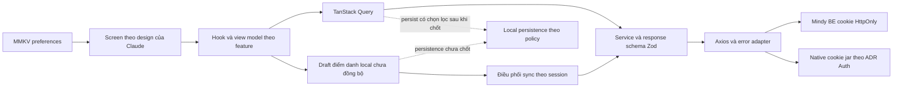
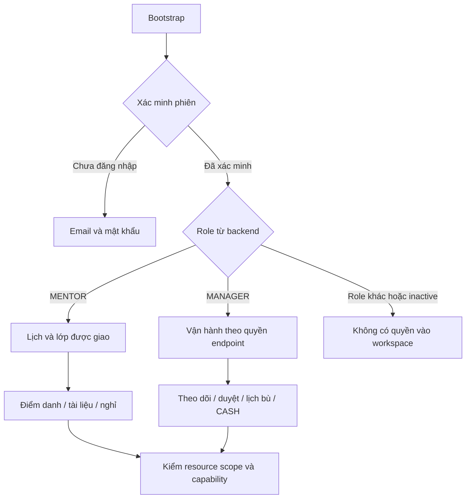

# Kiến trúc Mindy Mobile

**Bản nháp 30/10/2026.** Tất cả kiến trúc đích là đề xuất chờ [ADR](adr/README.md); chưa đổi code, dependencies hoặc native config. [BR](business-rules.md) xác định hành vi, [nguồn](README.md#nguồn-và-thứ-tự-đối-chiếu) xác định căn cứ. Không dùng bản nháp để vượt cổng phê duyệt.

## Hiện trạng checkout

| Hạng mục           | Quan sát trực tiếp                                                                                                        | Khoảng cần xử lý sau duyệt                                                                   |
| ------------------ | ------------------------------------------------------------------------------------------------------------------------- | -------------------------------------------------------------------------------------------- |
| React Native/React | package.json: RN 0.80.1, React 19.1.0                                                                                     | Giữ nền hiện có; kiểm tương thích từng dependency khi triển khai, không tự nâng major        |
| TypeScript         | strict=true, noEmit=true; paths chỉ @/\*                                                                                  | Bổ sung alias đồng bộ và kiểm tra test có nằm trong typecheck                                |
| UI                 | @sohantalukder/rn-kit, cấu trúc src/shared; chưa có NativeWind trong package                                              | Chuyển sang hệ component theo ADR-003, không thay trước design/ADR                           |
| Server state/local | TanStack Query 5, MMKV 3, Zod 3 và Zustand đã khai báo                                                                    | Query factory, schema và cách persist chưa xây cho nghiệp vụ Mindy                           |
| Auth/HTTP          | withCredentials=true nhưng còn Bearer đọc từ localStore; base URL dummyjson, log headers/body, timeout production 60000ms | Không phải auth Mindy; thay có kiểm soát sau ADR Auth, loại bỏ log nhạy cảm và token storage |
| Env                | Babel inline-dotenv; chưa có react-native-config trong package                                                            | ADR-001 để chuyển cấu hình, không đoán API host                                              |
| Metro/Babel        | SVG transformer và Reanimated plugin có sẵn; chưa withNativeWind                                                          | Kết hợp transformer/NativeWind và giữ Reanimated plugin cuối theo version tương thích        |
| i18n               | Có en-EN/bn-BN và src/config/i18n.config.ts                                                                               | Migrate sang vi/en và entry src/translations/index.ts                                        |
| Type policy        | Source còn kiểu unknown tường minh trong HTTP, logger, tiện ích và context declarations                                   | Không tuyên bố repo sạch; xử lý mã giữ lại ở P0 theo ADR-002                                 |
| Kiểm chứng         | Chưa chạy lint/tsc/Jest cho app trong lượt lập tài liệu                                                                   | Không ghi kết quả pass của backend/boilerplate làm nghiệm thu mobile                         |
| Git                | git status tại workspace trả “not a git repository”                                                                       | Chưa có commit/PR để trích; không git init tự động                                           |

## Ranh giới và luồng dữ liệu đề xuất



Dữ liệu server chỉ được đưa vào cache sau validate response. View model không đổi nghĩa null/UNMARKED/UNTRACKED, revision/version hoặc quyền. DTO tiếng Anh giữ đúng wire, nhãn UI qua i18n. Mock chỉ ở cổng service của bước UI, có chế độ/nhãn rõ; không fallback sang mock khi API thật lỗi.

Service tương tác endpoint hiện hữu; có hai namespace manager và management với quyền/DTO khác nhau. Không gom các endpoint chỉ dựa trên URL giống nhau hoặc suy rằng ADMIN gọi được mọi route Manager.

## Cấu trúc đích đề xuất

```text
src/
  components/ui/             # React Native Reusables và wrapper theo design
  config/
    app.ts                   # metadata, route, theme, flags, timeout/retries
    env.ts                   # react-native-config, validate cấu hình
    queryClient.ts
  navigation/                # root gate và từng role
  services/
    http/                    # axios, refresh orchestration, AppError
    storage/                 # preferences và persistence theo policy
  utils/                     # cn(), tiền, calendar date, instant
  translations/
    index.ts
    vi.ts
    en.ts
  modules/
    auth/
    teaching/                # lịch, lớp, context, assignment
    attendance/              # roster, draft, queue, correction
    materials/               # authoring, review, upload
    leave/                   # preview, plan, approval
    operations/              # reschedule, replacement, CASH
    assignments/             # P1
    reports/                 # P1
    communication/           # P1
```

Mỗi feature có screens/components/hooks/services/schemas/types/index.ts. Import qua public index của feature khác hoặc shared services; không để shared phụ thuộc feature. Component UI không gọi HTTP trực tiếp. Hook query là nơi điều phối cache; service không điều hướng. Zustand hiện hữu chưa mặc định được dùng lưu server state hay auth token; state nhỏ có thể dùng context/hook, lựa chọn cụ thể ghi ở ADR-001.

Alias Babel module-resolver root ['./src']: @ → src, @components → src/components, @modules → src/modules, @services → src/services, @utils → src/utils. tsconfig paths và Jest moduleNameMapper phải khớp; kiểm cả .ts/.tsx/.js/.json. SVG declarations dùng kiểu cụ thể; không giữ declaration boilerplate trái type policy.

## Navigation theo vai trò



Không có màn chọn vai trò/chi nhánh. Settings là UI chung; tab/stack, layout và token do Claude thiết kế. Khôi phục/deep link kiểm phiên và resource scope trước tải dữ liệu; không mở màn đặc quyền bằng role đã cache. Chưa có push/deep link provider P0.

## Auth cookie: bằng chứng và phần chưa quyết định

Đây là khảo sát source, **không phải ADR Auth và chưa phê duyệt implementation**. Lần khởi tạo không tạo ADR Auth; phải nhập nguồn legacy cố định rồi mới đề xuất chi tiết theo yêu cầu gốc.

| Căn cứ source SRC-AUTH/SRC-ORIGIN                                                                       | Kết luận giới hạn                                                                                       |
| ------------------------------------------------------------------------------------------------------- | ------------------------------------------------------------------------------------------------------- |
| POST /api/v1/auth/login → user, accessTokenExpiresAt và Set-Cookie                                      | Không lấy access token từ body để lưu MMKV                                                              |
| Access cookie path /; refresh cookie path /api/v1/auth/refresh; HttpOnly, SameSite=Lax, Secure theo env | Native jar phải xử lý đúng host/path, lưu/gửi và xóa cả hai cookie                                      |
| POST /api/v1/auth/refresh đọc refresh cookie, luân chuyển; lỗi invalid refresh xóa auth cookie          | Cần điều phối một refresh khi nhiều request 401 và chống vòng lặp                                       |
| GET /api/v1/auth/me kiểm active; logout/logout-all dùng AccessTokenGuard, response 204                  | Cần kiểm chứng trường hợp access hết hạn trước logout và revoke phía server                             |
| Guard material/note/meeting kiểm Origin cho method ghi                                                  | Chưa có căn cứ yêu cầu X-CSRF-Token toàn bộ auth; không bịa header; cần origin allowlist phù hợp native |
| .env đang có COOKIE_SECURE=true; người dùng cung cấp HTTP localhost:3003                                | Chưa đủ điều kiện kết luận cookie hoạt động trên Android                                                |

ADR Auth sau này phải nêu endpoint/header làm căn cứ, jar/library và version tương thích, refresh single-flight, retry an toàn, logout/clearCookie đúng scope, secure storage có/không và kiểm chứng thiết bị. Cookie/credentials không được log. Browser cookie hoặc Postman chạy được không chứng minh native chạy được.

Q-ENV-01 giữ phần API P0 chờ: URL 3003 do người dùng cung cấp; PORT=3000 trong file env không chứng minh runtime port vì có thể mapping. Chưa tự sửa backend, thêm Origin giả hoặc nới HTTP toàn app. Nếu dùng debug HTTP phải có quyết định được duyệt và vẫn giữ release không cleartext; nếu dùng HTTPS phải có host/cert/cookie kiểm chứng được. Env config có fallback cho APP_ENV/DEBUG_MODE; API_URL chưa hợp lệ thì fail cấu hình rõ ràng, không fallback production sang dummy API. Cách fallback development cuối cùng chờ cấu hình được chốt.

## Offline và local storage

BR-OFF-01/BR-OFF-02 và ADR-006 **Proposed**; chính sách persist BR-DATA-02 đang chờ người dùng.

MVP được đề xuất chỉ offline thao tác đánh dấu trên roster đã tải sau start online. Start, sync roster, finalize, gửi/duyệt tài liệu, duyệt nghỉ và xác nhận CASH cần online. Ghi chú offline chưa được yêu cầu; không tự mở rộng queue sang note.

Queue logic đề xuất:

1. Mỗi tài khoản/session có thứ tự thao tác; không gửi song song các ghi dùng chung session.version.
2. Tách draft chưa gửi khỏi operation đã gửi: operation chứa ý định, version, payload và key cố định. Tùy chọn gộp draft trước lần gửi đầu phải được chốt trong ADR-006.
3. Retry khi chưa biết kết quả giữ body/key; không thay expectedVersion dưới cùng key. Thành công dùng version server rồi refetch roster/context.
4. 409 → dừng queue session → tải mới → đối chiếu/xác nhận; hành động mới có key/version mới. Không tự merge hoặc last-write-wins.
5. 401 → xác minh phiên; 403/hết hạn/trạng thái đổi → không báo đã sync, giữ hoặc hủy draft theo policy được chốt. Không gửi lại dưới tài khoản khác.
6. Chỉ cho finalize khi đã giải quyết thao tác pending/in-flight/conflict; tải lại totals trước xác nhận.

HTTP Cache-Control private,no-store là căn cứ cần xem xét chính sách lưu nhạy cảm. Không coi header này tự động là quyết định sản phẩm về MMKV; đồng thời không tự persist toàn Query cache. Preferences vi/en/theme có thể dùng MMKV theo ADR-004; roster, notes, contact, signed URL và payment data cần phân loại riêng. Encryption/key management, retention, logout purge, app termination recovery đều chưa chốt. Nếu chưa được duyệt, tính năng offline chưa được coi là hoàn thành.

## Error handling và tính đồng thời

Đề xuất AppError dạng discriminated union: network/timeout/unauthenticated/forbidden/not-found/validation/conflict/server/configuration. Giữ code, statusCode, requestId và field errors đã chuẩn hóa; không đưa thông báo server chưa xử lý thẳng ra UI.

SRC-ERROR có envelope statusCode/code/message/requestId, nhưng details thực có nhiều hình dạng; validation message có thể là danh sách. Vì vậy không giả định details luôn Record<string,string[]> chỉ từ Swagger. Response schema cần bao phủ payload đã đối chiếu; chưa đủ bằng chứng thì ghi khoảng trống, không ép kiểu hoặc bỏ validate.

Axios interceptor thu hẹp lỗi, chuẩn hóa AxiosError<ApiErrorResponse> thành AppError. catch(error) không annotate, thu hẹp instanceof/type guard; không viết any/unknown, alias hay ép kiểu vòng để lách. Đầu vào JSON là không đáng tin về runtime dù generic TypeScript cụ thể; Zod bắt buộc validate trước dùng.

Chỉ retry tự động lỗi tạm thời và thao tác an toàn theo contract. retries=3 là giới hạn cấu hình, không lặp mọi POST, 422 hoặc conflict. CASH dựa idempotence nghiệp vụ không được tự gán version/key như attendance. Refresh không replay mutation khi chưa rõ kết quả và contract.

## Server state và cache

Query key factory theo module + accountId/role + resourceId + filters/page. Xóa bộ nhớ cache khi đổi tài khoản/quyền. Scope SESSION không reuse roster CLASS từ tài khoản trước.

| Nhóm mutation                            | Dữ liệu cần cập nhật/refetch sau thành công                                                  |
| ---------------------------------------- | -------------------------------------------------------------------------------------------- |
| Start/mark/bulk/sync/finalize/correction | Session context, roster và totals; lịch/lớp, report liên quan                                |
| Note                                     | Query note/version riêng; không tự tăng session version                                      |
| Material                                 | Revision detail, review queue, danh sách mọi CourseUnit/class dùng chung theo contract       |
| Leave approve/reschedule/replacement     | Leave detail/queue, lịch Mentor/Manager, session source/replacement, candidates và conflicts |
| Placement                                | Conflict queue, placement, guest roster/session capacity và report gốc                       |
| CASH                                     | Order, payment, class roster/enrollment status; không tự admit mọi buổi quá khứ              |

Optimistic update chỉ là đề xuất ở draft UI, không khẳng định server đã chấp nhận. TTL/staleTime/gcTime và persist chưa chốt; mỗi contract UI phải ghi chính xác key/invalidation trước tích hợp.

## i18n, theme và cấu hình

vi mặc định, en cùng key, i18next/react-i18next escapeValue=false. Không dùng locale tiếng Anh/Bengali hiện hữu làm default Mindy. Formatter VND nguyên, score integer ×100 nội bộ, instant UTC và calendar date riêng; adapter điểm parse decimal string chính xác, không nhân floating point rồi làm tròn tùy ý. Dữ liệu backend nullable không được thay bằng số 0.

NativeWind dùng CSS variables, dark mode, React Native Reusables ở src/components/ui, cn() ở @utils. Chọn defaultTheme sau Q-THEME-01 và design Claude. Metro phải giữ SVG transformer và tích hợp withNativeWind theo version; không copy snippet thay toàn bộ config gây mất cấu hình hiện hữu.

appConfig gồm metadata, initialRouteName, defaultTheme, feature flags, api.timeout=10000, api.retries=3. P1 flags mặc định tắt là đề xuất cần duyệt; không thêm biometric auth chỉ vì ví dụ boilerplate có. Android release cleartextTrafficPermitted=false, domain includeSubdomains=true sau khi xác nhận API domain.

## Testing strategy và nghiệm thu

TDD theo phase và test case Claude, không viết test placeholder để tăng số lượng.

- UI: Jest + RNTL hành vi/quyền/trạng thái, accessibility và vi/en; cùng mock service boundary cho toàn phase.
- Service/schema/query hooks: mock HTTP, sai shape/null, mapping, mã lỗi, cache invalidation và account isolation.
- Đồng thời: version/revision conflict, receipt replay cùng key, payload đổi bị từ chối; phân biệt note version/session version.
- Thời gian: trước/đúng/sau nửa đêm hạn sửa; ngày nghỉ/calendar date; timezone thiết bị khác nghiệp vụ.
- Offline: draft sau start, mất response sau commit, nối lại, 409, hết phiên/hạn, hai thiết bị, app kill nếu persistence được duyệt.
- Android thực: cookie login/relaunch/refresh/logout, Origin route ghi, upload/READY/signed URL, mất mạng/đồng bộ và thay assignment; chưa có bằng chứng trong lượt này.
- iOS: kiểm tương thích từ đầu; nghiệm thu cookie/file/permission riêng tại mốc được chốt.

Cổng cleanup: ESLint 0 error/0 warning, tsc --noEmit gồm source/test/config, Jest toàn bộ; rà AST/type policy mã do mobile quản lý. Quét chữ đơn thuần không được coi comment tiếng Anh chứa “any” là type violation; không quét node_modules/lockfile/generated như mã tự viết. Không sửa generated để vượt quy tắc. Kết quả phải ghi command, ngày, môi trường và giới hạn vào phase. Không chạy lại suite không liên quan chỉ để tuyên bố chất lượng tài liệu.
