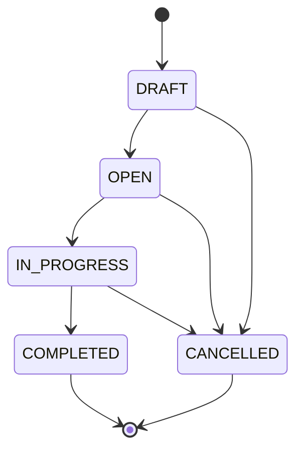
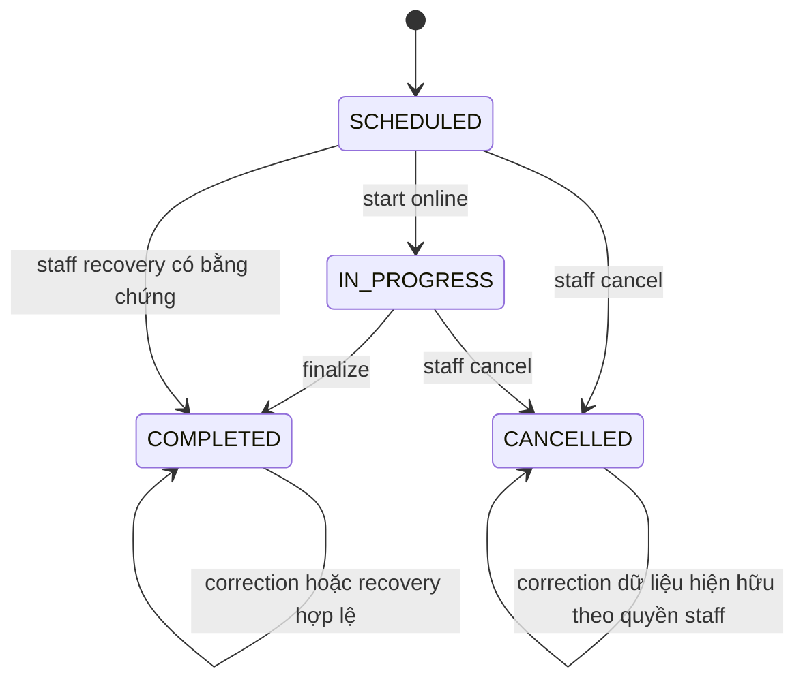
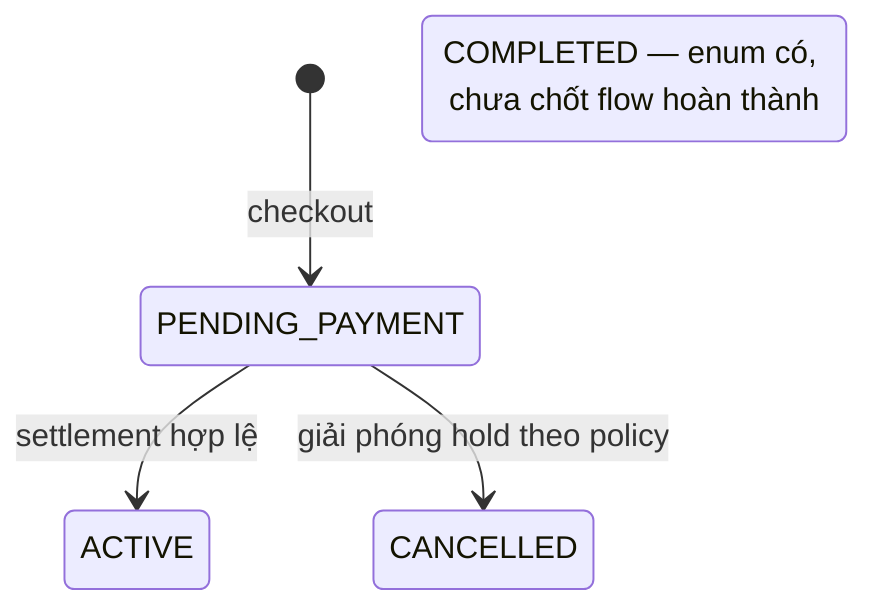
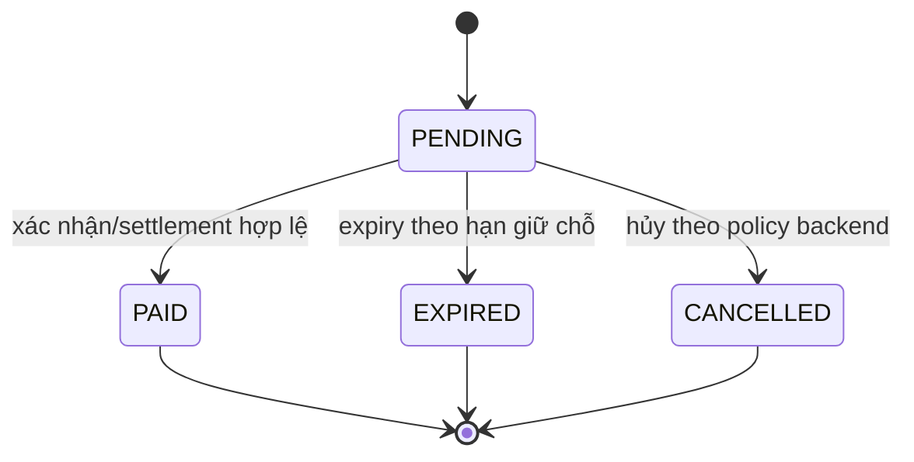
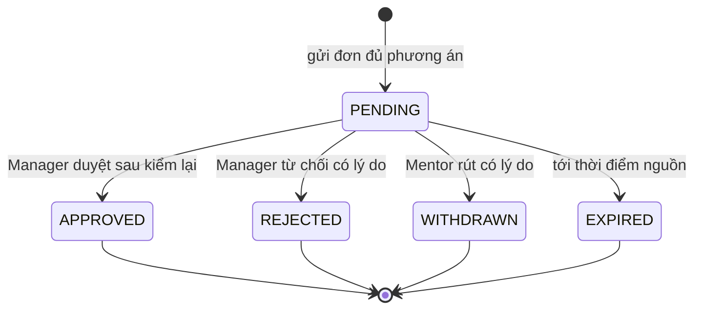
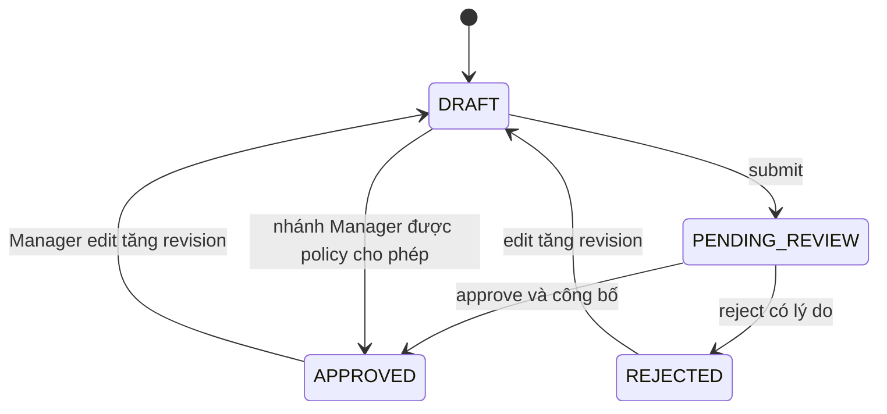

# Quy tắc nghiệp vụ Mindy Mobile

**Bản nháp 30/10/2026 — chưa phê duyệt.** Đây là file quy tắc nghiệp vụ duy nhất. Nguồn SRC-\* được định nghĩa và liên kết tại [mục nguồn](README.md#nguồn-và-thứ-tự-đối-chiếu). “Có căn cứ” xác nhận bằng chứng source/trao đổi, không xác nhận đã deploy hay đã nghiệm thu.

## Glossary

| Thuật ngữ                          | Nghĩa và ranh giới                                                                  |
| ---------------------------------- | ----------------------------------------------------------------------------------- |
| Course / CourseUnit                | Chương trình đào tạo / chương của chương trình                                      |
| Class / ClassUnit                  | Lần tổ chức khóa học / chương được tạo cho lớp từ CourseUnit                        |
| ClassSession                       | Buổi học có lịch dự kiến, trạng thái, version và snapshot người dạy                 |
| Primary mentor / Substitute mentor | Mentor chính của lớp / người được giao dạy thay theo buổi                           |
| Effective mentor                   | Người có quyền dạy ở thời điểm/trạng thái của buổi; sau start dùng teachingMentorId |
| Enrollment                         | Ghi danh quyết định quyền học; không đồng nhất Order hoặc PaymentTransaction        |
| Order / OrderDetail                | Đơn mua / từng lớp trong đơn; chưa có căn cứ coi là hóa đơn thuế                    |
| Invoice                            | Thuật ngữ trong yêu cầu gốc; chưa có thực thể riêng được xác nhận, xem Q-PAY-01     |
| Hold                               | Giữ chỗ sau checkout có hạn; thêm giỏ chưa giữ chỗ                                  |
| Material / Revision                | Tài liệu thuộc CourseUnit / phiên bản nội dung; phê duyệt gắn đúng revision         |
| Roster snapshot                    | Danh sách điểm danh được chụp khi start, có regular và guest                        |
| Attendance candidate               | Preview trước start, chưa phải record điểm danh                                     |
| UNMARKED / PRESENT / ABSENT        | Chưa đánh dấu / có mặt / vắng mặt tại buổi thực học                                 |
| Physical / Credited attendance     | Kết quả buổi thực học / kết quả tính cho nghĩa vụ học gốc                           |
| Replacement session                | Buổi thay thế buổi bị hủy cho cả lớp                                                |
| MakeupPlacement                    | Xếp một học viên vào một buổi lớp khác; không tạo enrollment đầy đủ                 |
| Leave request                      | Đơn nghỉ dạy có khoảng nghỉ và phương án bù, được duyệt                             |
| Correction / Recovery              | Sửa record hiện hữu / khôi phục record thiếu bằng bằng chứng                        |
| Teaching note                      | Ghi chú nội bộ của buổi; có version riêng, học viên không đọc                       |
| expectedVersion / expectedRevision | Điều kiện chống ghi đè trên dữ liệu cũ; không tự thay thế bằng phiên bản vừa đọc    |
| Idempotency-Key                    | Khóa của một thao tác logic; retry giữ nguyên key và payload theo từng API          |
| Draft offline                      | Thay đổi local chưa được backend chấp nhận; không phải điểm danh đã đồng bộ         |

## Phạm vi và quyền

P0 bao gồm hai vai trò MENTOR/MANAGER. P1 và sau MVP theo [kế hoạch](implementation-plan.md). Không có app học viên/phụ huynh/Admin, đăng ký tài khoản, tạo khóa học/lớp hay quản trị danh mục trên mobile MVP.

| Năng lực                                     | Mentor chính                                               | Mentor thay                                                | Manager                                                             |
| -------------------------------------------- | ---------------------------------------------------------- | ---------------------------------------------------------- | ------------------------------------------------------------------- |
| Xem lớp                                      | Lớp được phân công, scope CLASS                            | Class shell và buổi/chương được giao, scope SESSION        | Theo route Manager/management hiện có                               |
| Xem roster toàn lớp và trạng thái thanh toán | Theo route/phạm vi lớp, chỉ đọc                            | Không được mặc định cấp                                    | Theo route được cấp                                                 |
| Xem roster buổi được giao                    | Khi là effective mentor                                    | Đúng buổi được giao                                        | Theo route vận hành                                                 |
| Start/mark/sync/finalize                     | Effective mentor, điều kiện buổi/hạn sửa                   | Như effective mentor, không lan sang buổi khác             | Theo route staff, lý do bắt buộc khi ghi                            |
| Correction/recovery và audit điểm danh       | Không vượt cửa sổ/quyền Mentor                             | Không vượt cửa sổ/quyền Mentor                             | Có lý do và bằng chứng theo loại thao tác                           |
| Tạo/sửa/gửi tài liệu                         | Draft của mình, lớp/chương đúng scope, trước lần duyệt đầu | Chỉ đọc tài liệu công bố theo scope; không mặc định author | API cho phép quản lý; phạm vi UI MVP xem Q-MAT-01                   |
| Duyệt/từ chối/công bố/thu hồi tài liệu       | Không                                                      | Không                                                      | Có; tự duyệt tài liệu Manager tạo bằng thao tác tường minh có audit |
| Tạo/xem/rút đơn nghỉ của mình                | Theo buổi effective mentor                                 | Theo assignment và policy backend                          | Không tạo đơn giả vai Mentor                                        |
| Duyệt nghỉ, lịch bù, phân công               | Không                                                      | Không                                                      | Có theo route và kiểm tra xung đột                                  |
| Xác nhận CASH                                | Không                                                      | Không                                                      | Đúng toàn bộ đơn, không cần assignment lớp                          |
| Quiz P1                                      | Theo scope backend                                         | Theo scope backend                                         | Không tự thêm quyền chấm/publish                                    |
| Chọn vai trò / chi nhánh                     | Không                                                      | Không                                                      | Không                                                               |

Nguồn: SRC-USER, SRC-WORKSPACE, SRC-ATT, SRC-MAT, SRC-LEAVE, SRC-OPS, SRC-CASH. UI dùng capabilities/permissions backend khi có; điều kiện ẩn/khóa UI không thay kiểm quyền server.

## Quy tắc theo domain

### Phạm vi, xác thực và dữ liệu

| Mã          | Quy tắc                                                                                                                                | Trạng thái                               | Nguồn                   |
| ----------- | -------------------------------------------------------------------------------------------------------------------------------------- | ---------------------------------------- | ----------------------- |
| BR-SCOPE-01 | P0 theo luồng đã nêu; P1 quiz/báo cáo/chat/push; ZIP và chứng chỉ ngoài MVP                                                            | Có căn cứ                                | SRC-USER                |
| BR-AUTH-01  | Một tài khoản có một role; chỉ MENTOR/MANAGER vào workspace mobile. Không có role selector; role khác không được vào workspace         | Có căn cứ                                | SRC-USER, SRC-AUTH      |
| BR-AUTH-02  | P0 email/mật khẩu cho tài khoản đã cấp; Google để sau. Không đưa đăng ký Student vào app này                                           | Có căn cứ — người dùng trả lời trực tiếp | SRC-USER                |
| BR-AUTH-03  | Access/refresh token ở cookie HttpOnly; refresh luân chuyển token. GET me kiểm tài khoản hoạt động; logout hiện tại/all theo endpoint  | Có căn cứ; cách dùng native chờ ADR Auth | SRC-AUTH                |
| BR-AUTH-04  | Mất assignment, hết phiên, tài khoản bị khóa hoặc role không phù hợp phải ngăn thao tác; không coi cache là bằng chứng quyền hiện hành | Có căn cứ                                | SRC-AUTH, SRC-WORKSPACE |
| BR-SCOPE-02 | Chưa có phân quyền chi nhánh; dùng scope backend, không thêm chọn chi nhánh hoặc suy ra dữ liệu theo chi nhánh                         | Có căn cứ                                | SRC-USER                |
| BR-SCOPE-03 | ADMIN không mặc định có quyền mọi route MANAGER; không cho role ADMIN dùng workspace Manager chỉ vì tên dự án                          | Có căn cứ                                | SRC-AUTH, SRC-CASH      |
| BR-DATA-01  | Không lưu token ở MMKV hoặc tự thay cookie bằng Bearer; cơ chế cookie jar/secure storage phải qua ADR Auth và test native              | Đề xuất — cần xác nhận ADR               | SRC-USER, SRC-AUTH      |
| BR-DATA-02  | Lưu roster/cache/draft trên thiết bị, mã hóa, TTL, giữ/xóa khi logout chưa chốt; không bật persist dữ liệu nhạy cảm trước quyết định   | Chờ xác nhận                             | SRC-USER, SRC-ATT       |

### Khóa học, lớp, lịch và người dạy

| Mã          | Quy tắc                                                                                                                                                                | Trạng thái                                        | Nguồn                          |
| ----------- | ---------------------------------------------------------------------------------------------------------------------------------------------------------------------- | ------------------------------------------------- | ------------------------------ |
| BR-CLASS-01 | ClassUnit tạo theo CourseUnit khi tạo lớp; không suy rằng sửa CourseUnit tự đồng bộ mọi lớp cũ                                                                         | Có căn cứ                                         | SRC-OVERVIEW                   |
| BR-CLASS-02 | Class DRAFT → OPEN → IN_PROGRESS → COMPLETED; DRAFT/OPEN/IN_PROGRESS có thể CANCELLED; hai trạng thái kết thúc không mở lại qua update thường                          | Có căn cứ                                         | SRC-CLASS                      |
| BR-CLASS-03 | Backend chỉ có ONLINE/OFFLINE. HYBRID trong yêu cầu ban đầu chưa được hỗ trợ; không tạo enum mobile mới                                                                | Có căn cứ về backend; phạm vi HYBRID chờ xác nhận | SRC-CLASS                      |
| BR-CLASS-04 | Mua khi Course active, Class OPEN, chưa qua endDate ngày nghiệp vụ, còn capacity và không có đăng ký hiệu lực trùng; không chỉ xét trước khai giảng                    | Có căn cứ                                         | SRC-OVERVIEW, SRC-CLASS        |
| BR-CLASS-05 | Sau DRAFT các trường startDate/endDate/maxStudents/deliveryMode đóng với update thường; lịch bù gia hạn theo flow riêng                                                | Có căn cứ                                         | SRC-OVERVIEW                   |
| BR-CLASS-06 | Hủy lớp hủy buổi SCHEDULED/IN_PROGRESS liên quan; không tự hoàn tiền                                                                                                   | Có căn cứ                                         | SRC-OVERVIEW                   |
| BR-TEACH-01 | Buổi SCHEDULED dùng override nếu có, nếu không dùng mentor lớp; sau start giữ snapshot teachingMentorId, không ghi đè lịch sử khi đổi mentor                           | Có căn cứ                                         | SRC-WORKSPACE, SRC-OVERVIEW    |
| BR-TEACH-02 | Mentor thay chỉ scope SESSION; không mở roster toàn lớp, dữ liệu tiền hoặc draft người khác. Legacy thiếu người dạy không tự suy ra                                    | Có căn cứ                                         | SRC-WORKSPACE                  |
| BR-TEACH-03 | Phân công/lịch phải kiểm trùng và nghỉ đã duyệt; preview/candidates không bảo đảm mutation sẽ thành công                                                               | Có căn cứ                                         | SRC-OPS, SRC-LEAVE             |
| BR-TIME-01  | Instant trao đổi theo ISO-8601 có timezone, chuẩn hóa UTC; hiển thị Asia/Ho_Chi_Minh. Ngày lớp/ngày nghỉ là calendar date YYYY-MM-DD, không ép thành instant           | Có căn cứ                                         | SRC-USER, SRC-CLASS, SRC-LEAVE |
| BR-TIME-02  | Không xếp học qua đêm theo ngày nghiệp vụ; điểm kết thúc đúng nửa đêm được xử lý theo boundary backend, không tự tính lệch ngày                                        | Có căn cứ                                         | SRC-CLASS                      |
| BR-TEACH-04 | Sửa meeting URL theo effective mentor, đúng version và trạng thái SCHEDULED/IN_PROGRESS; null trả về link lớp, chuỗi rỗng sai. Chưa quyết định đưa thao tác này vào P0 | Có căn cứ API; UI chờ xác nhận                    | SRC-OVERVIEW, SRC-OPS          |

### Điểm danh và ghi chú

| Mã         | Quy tắc                                                                                                                                                                    | Trạng thái                                      | Nguồn                   |
| ---------- | -------------------------------------------------------------------------------------------------------------------------------------------------------------------------- | ----------------------------------------------- | ----------------------- |
| BR-ATT-01  | Candidates trước start chỉ preview. Start online chụp roster/người dạy/thời gian thực và chuyển IN_PROGRESS                                                                | Có căn cứ                                       | SRC-ATT                 |
| BR-ATT-02  | Mentor start trong ngày dạy theo timezone nghiệp vụ; qua startsAt không tự start; class phải OPEN/IN_PROGRESS                                                              | Có căn cứ                                       | SRC-ATT                 |
| BR-ATT-03  | Record trong roster có UNMARKED/PRESENT/ABSENT; thiếu record không tự là ABSENT. Regular và guest được nhận diện bằng ID khác nhau                                         | Có căn cứ                                       | SRC-ATT                 |
| BR-ATT-04  | Sync roster chỉ thêm học viên đủ điều kiện theo backend, không lấy enrollment chờ thanh toán làm hợp lệ; không dựng roster từ preview                                      | Có căn cứ                                       | SRC-ATT                 |
| BR-ATT-05  | Finalize online chuyển COMPLETED và UNMARKED còn lại thành ABSENT; phải cho người dùng thấy tác động trước xác nhận                                                        | Có căn cứ về server; xác nhận UI là đề xuất     | SRC-ATT                 |
| BR-ATT-06  | Hạn Mentor là 00:00 sau ngày kế tiếp ngày học, điều kiện now < editableUntil. Học 23/10 hạn 00:00 25/10, không phải 48 giờ từ start                                        | Có căn cứ                                       | SRC-CLASS, SRC-ATT      |
| BR-ATT-07  | Mentor được sửa COMPLETED trong hạn/phạm vi, không cần duyệt từng lần; ngoài quyền chuyển Manager, không tự kéo dài hạn                                                    | Có căn cứ                                       | SRC-ATT, SRC-USER       |
| BR-ATT-08  | Mọi ghi điểm danh theo API yêu cầu version và UUID v4 Idempotency-Key. Retry cùng ý định giữ nguyên body/key; version mới là hành động mới sau đối chiếu                   | Có căn cứ                                       | SRC-ATT                 |
| BR-ATT-09  | Bulk checked=true là PRESENT, false là ABSENT cho toàn snapshot mọi trang, cả guest; không tương đương reset UNMARKED hay chọn trang hiện tại                              | Có căn cứ                                       | SRC-ATT                 |
| BR-ATT-10  | Manager ghi phải có lý do; correction sửa dữ liệu hiện hữu. Recovery insert-only cần bằng chứng lịch sử, người dạy/thời gian/quan hệ thanh toán hợp lệ, không dựng quá khứ | Có căn cứ                                       | SRC-CORRECTION, SRC-ATT |
| BR-ATT-11  | 409 version conflict tải dữ liệu mới và yêu cầu đối chiếu; không tự last-write-wins. 409 trạng thái/hết hạn giữ thay đổi chưa được chấp nhận là chưa đồng bộ               | Có căn cứ về conflict; hành vi draft là đề xuất | SRC-ATT, SRC-USER       |
| BR-OFF-01  | Đề xuất cho Mentor đánh dấu/sửa draft offline sau start online và tải roster thành công; start/sync/finalize vẫn online                                                    | Đề xuất — cần xác nhận                          | SRC-USER                |
| BR-OFF-02  | Chưa chốt persist; queue không tự rebase version/payload đã gửi. Backend kiểm quyền/trạng thái/hạn lúc nhận; draft local không bảo đảm đồng bộ được                        | Đề xuất — cần xác nhận                          | SRC-USER, SRC-ATT       |
| BR-NOTE-01 | Teaching note là nội bộ, effective mentor ghi IN_PROGRESS/COMPLETED trong hạn; nội dung tối đa 10000, nextSteps 5000 ký tự                                                 | Có căn cứ                                       | SRC-NOTE                |
| BR-NOTE-02 | Note có version riêng, chưa có note dùng version 0; mutation có key; correction staff phải có lý do. Không dùng session.version thay note.version                          | Có căn cứ                                       | SRC-NOTE                |

### Tài liệu và file

| Mã         | Quy tắc                                                                                                                                                  | Trạng thái                                                    | Nguồn             |
| ---------- | -------------------------------------------------------------------------------------------------------------------------------------------------------- | ------------------------------------------------------------- | ----------------- |
| BR-MAT-01  | Material thuộc CourseUnit; có thể ảnh hưởng nhiều lớp. Không coi file đính kèm một lớp là bản độc lập nếu cùng material                                  | Có căn cứ                                                     | SRC-MAT           |
| BR-MAT-02  | Mentor chính tạo/sửa draft của mình đúng lớp/chương trước firstApprovedAt; lần duyệt đầu xong không tự sửa như draft ban đầu                             | Có căn cứ                                                     | SRC-MAT           |
| BR-MAT-03  | SUBMIT từ DRAFT sang PENDING_REVIEW; Manager APPROVE/REJECT, từ chối cần lý do; gửi lại bản REJECTED cần EDIT về DRAFT trước                             | Có căn cứ                                                     | SRC-MAT           |
| BR-MAT-04  | APPROVE đồng thời đặt publishedAt; Manager có PUBLISH/UNPUBLISH riêng và có nhánh tự duyệt draft của mình theo policy, lưu audit                         | Có căn cứ                                                     | SRC-MAT           |
| BR-MAT-05  | EDIT tăng revision, về DRAFT, bỏ duyệt/công bố hiệu lực; không giữ phê duyệt bản cũ. expectedRevision chống cập nhật cũ                                  | Có căn cứ                                                     | SRC-MAT           |
| BR-MAT-06  | Bỏ khóa/mở/hẹn giờ ClassUnit từ 22/10; không tạo UI gọi release route đã bỏ. Material vẫn kiểm revision, công bố, availableAt, file READY, lớp và quyền  | Có căn cứ                                                     | SRC-MAT           |
| BR-FILE-01 | Upload intent → upload storage → complete → kiểm file → READY/FAILED; upload thành công chưa đủ để submit tài liệu có file                               | Có căn cứ                                                     | SRC-FILE, SRC-MAT |
| BR-FILE-02 | File private, signed URL có hạn, luôn qua kiểm quyền. Không persist signed URL như link vĩnh viễn hoặc gửi cookie BE sang storage                        | Có căn cứ cơ chế URL; cách ly credential là đề xuất kiến trúc | SRC-FILE          |
| BR-FILE-03 | Allowlist backend gồm PDF/ảnh/Office/audio/video/source text; thông thường 25 MiB, MP4 200 MiB. Không tự cho ZIP/external video URL vì yêu cầu LMS chung | Có căn cứ                                                     | SRC-FILE, SRC-MAT |

### Nghỉ dạy, lịch bù và vận hành

| Mã           | Quy tắc                                                                                                                                                            | Trạng thái                                         | Nguồn                        |
| ------------ | ------------------------------------------------------------------------------------------------------------------------------------------------------------------ | -------------------------------------------------- | ---------------------------- |
| BR-LEAVE-01  | Mentor preview buổi ảnh hưởng và lập đủ mapping bù rồi tạo PENDING; nguồn buổi/assignment được backend kiểm lại                                                    | Có căn cứ                                          | SRC-LEAVE                    |
| BR-LEAVE-02  | Source yêu cầu gửi trước 00:00 ngày ngay trước ngày buổi đầu tiên. Ví dụ buổi 23/10 phải gửi trước 00:00 22/10; không diễn giải thành 48 giờ                       | Có căn cứ implementation; cần xác nhận nghiệp vụ   | SRC-LEAVE                    |
| BR-LEAVE-03  | Nghỉ theo MORNING 00–12, AFTERNOON 12–18, EVENING 18–24, FULL_DAY; khoảng tối đa 93 ngày, tối đa 500 buổi nguồn                                                    | Có căn cứ implementation; cần xác nhận cách gọi ca | SRC-LEAVE                    |
| BR-LEAVE-04  | Manager approve/reject, Mentor withdraw khi còn hợp lệ; hết thời điểm nguồn có thể EXPIRED. Duyệt kiểm request/source version, xung đột, khả dụng và nghỉ đã duyệt | Có căn cứ                                          | SRC-LEAVE                    |
| BR-LEAVE-05  | Duyệt nghỉ hủy source, tạo replacement, ghi nghỉ/audit, gia hạn lớp nếu cần trong transaction; có xung đột học viên phải acknowledgment tường minh                 | Có căn cứ                                          | SRC-LEAVE                    |
| BR-OPS-01    | Manager reschedule/cancel/assign substitute theo route và lý do/version/key tương ứng; không tự thêm vòng duyệt chung                                              | Có căn cứ                                          | SRC-OPS, SRC-USER            |
| BR-MAKEUP-01 | Replacement là chuỗi tuyến tính từ buổi hủy mới nhất; không tạo nhánh từ tổ tiên cũ hoặc copy điểm danh/thời gian thực sang buổi mới                               | Có căn cứ                                          | SRC-OVERVIEW, SRC-OPS        |
| BR-MAKEUP-02 | Placement khác lớp phải cùng CourseUnit, còn chỗ, không trùng; xác nhận nội dung/lý do/version/key theo API; chỉ cấp quyền buổi nhận                               | Có căn cứ                                          | SRC-OPS, SRC-OVERVIEW        |
| BR-MAKEUP-03 | Guest được điểm danh tại buổi nhận, credit hợp lệ tính một lần về nghĩa vụ gốc; buổi nhận hủy cần xếp lại, không tự tính vắng                                      | Có căn cứ                                          | SRC-CORRECTION, SRC-OVERVIEW |

### Ghi danh, đơn và thanh toán

| Mã        | Quy tắc                                                                                                                                                          | Trạng thái   | Nguồn                  |
| --------- | ---------------------------------------------------------------------------------------------------------------------------------------------------------------- | ------------ | ---------------------- |
| BR-ENR-01 | Checkout tạo Order PENDING, OrderDetail snapshot giá và Enrollment PENDING_PAYMENT giữ chỗ trong transaction; một mục sai rollback toàn giỏ                      | Có căn cứ    | SRC-OVERVIEW           |
| BR-ENR-02 | Thanh toán hợp lệ kích hoạt hold hiện hữu sang ACTIVE; thêm giỏ hoặc redirect thành công không cấp quyền học                                                     | Có căn cứ    | SRC-CASH, SRC-OVERVIEW |
| BR-PAY-01 | CASH chia theo mentor snapshot, mặc định hold 48 giờ; bất kỳ Manager active hợp lệ có thể xác nhận, không cần phụ trách lớp                                      | Có căn cứ    | SRC-CASH, SRC-CONFIG   |
| BR-PAY-02 | CASH nhận đúng toàn bộ totalAmount số nguyên VND; không thu một phần/trả góp. Sai tiền, hết hạn, đóng đơn/lớp hủy hoặc hold không hợp lệ phải từ chối            | Có căn cứ    | SRC-CASH               |
| BR-PAY-03 | Xác nhận CASH hợp lệ cập nhật payment SUCCEEDED, order PAID, enrollment ACTIVE cùng transaction; retry đơn PAID hợp lệ không sinh thêm giao dịch                 | Có căn cứ    | SRC-CASH               |
| BR-PAY-04 | API CASH không nhận expectedVersion/Idempotency-Key như điểm danh; không tự yêu cầu header không có trong contract. Retry phải dựa vào trạng thái thực tế server | Có căn cứ    | SRC-CASH               |
| BR-PAY-05 | Mobile MVP chỉ xem đơn/thanh toán và xác nhận CASH; tạo enrollment/order/invoice hoặc đối soát payOS Admin chưa được đưa vào scope                               | Có căn cứ    | SRC-USER, SRC-MANAGER  |
| BR-PAY-06 | Chưa có state machine Invoice riêng; tạm mô tả Order bên dưới và chờ Q-PAY-01 chốt thuật ngữ                                                                     | Chờ xác nhận | SRC-CASH, SRC-USER     |

### LMS P1 và báo cáo

| Mã           | Quy tắc                                                                                                                                          | Trạng thái                      | Nguồn                        |
| ------------ | ------------------------------------------------------------------------------------------------------------------------------------------------ | ------------------------------- | ---------------------------- |
| BR-QUIZ-01   | Quiz thuộc session; 1–200 câu ABCD một đáp án, publish đóng băng nội dung/cấu hình; theo scope Mentor chính/thay                                 | Có căn cứ                       | SRC-OVERVIEW, SRC-QUIZ       |
| BR-QUIZ-02   | Một lượt chính thức; resume không reset giờ; giới hạn sớm hơn của timer/dueAt; timeout chấm đáp án đã lưu, không tự chấm local                   | Có căn cứ                       | SRC-QUIZ, SRC-OVERVIEW       |
| BR-QUIZ-03   | API điểm dạng decimal string; mobile đề xuất chuyển chính xác thành số nguyên ×100 ở adapter, không sửa wire DTO thành integer                   | Có căn cứ wire; adapter chờ ADR | SRC-QUIZ                     |
| BR-QUIZ-04   | ZIP publish/nộp/chấm và assignmentSummary chưa hoàn thiện; không dùng mock rồi ghi nhận tích hợp xong                                            | Có căn cứ                       | SRC-OVERVIEW                 |
| BR-REPORT-01 | Tỷ lệ chuyên cần = PRESENT/(PRESENT+ABSENT) ×100 theo credit đã chốt; mẫu số 0 là null; unmarked/excluded/makeupPending báo riêng                | Có căn cứ                       | SRC-CORRECTION               |
| BR-REPORT-02 | Physical khác credited, không đếm đôi replacement/placement. Thiếu stored progress là UNTRACKED, không tự biến thành 0% hoặc điều kiện chứng chỉ | Có căn cứ                       | SRC-OVERVIEW, SRC-CORRECTION |
| BR-REPORT-03 | Chưa chốt KPI báo cáo mở rộng, SLA duyệt và chat/push mobile; không mặc định push là kênh bảo đảm thông báo nghiệp vụ P0                         | Chờ xác nhận                    | SRC-USER, SRC-P1             |

## State machine

Sơ đồ mô tả contract/domain hiện có, không phải danh sách thao tác mobile đều được quyền thực hiện. Guard chi tiết theo rule và API.

### Class

### Session

Replacement tạo **session mới** SCHEDULED, giữ liên kết source CANCELLED; không chuyển source về SCHEDULED. Recovery không mặc định cho phép mọi buổi/lớp; xem BR-ATT-10.

### Enrollment

Không suy ra ACTIVE → COMPLETED từ enum. Các action hủy/kết thúc enrollment ngoài giữ chỗ cần xác minh trước khi đưa lên mobile; hiện không có slice mutation enrollment.

### Invoice / Order

Chưa xác nhận Invoice riêng. Sơ đồ dưới là **Order**; không tự gắn nghĩa hóa đơn thuế.

### Request — Mentor leave

### Material

publishedAt là chiều trạng thái riêng: UNPUBLISH không đổi APPROVED thành REJECTED. Soft delete không xóa lịch sử.

## Tham số cấu hình

Giá trị backend là **default từ source**, không khẳng định môi trường chạy đang dùng giá trị đó.

| Tham số                                     | Giá trị/default                                                                           | Nguồn / trạng thái                                                                     |
| ------------------------------------------- | ----------------------------------------------------------------------------------------- | -------------------------------------------------------------------------------------- |
| APP_TIME_ZONE                               | Asia/Ho_Chi_Minh                                                                          | SRC-CONFIG; phải đối chiếu runtime                                                     |
| Access TTL                                  | 900 giây                                                                                  | SRC-CONFIG                                                                             |
| Refresh TTL                                 | 2592000 giây (30 ngày)                                                                    | SRC-CONFIG                                                                             |
| Cookie                                      | HttpOnly, SameSite=Lax; secure theo env; access path /, refresh path /api/v1/auth/refresh | SRC-AUTH                                                                               |
| CASH hold                                   | 172800 giây                                                                               | SRC-CONFIG                                                                             |
| PAYOS hold                                  | 900 giây                                                                                  | SRC-CONFIG; mobile không checkout P0                                                   |
| Pagination                                  | page=1, pageSize=20, tối đa 100                                                           | common/dtos/page-options.dto.ts trong BE                                               |
| Attendance batch                            | regular ≤100 và guest ≤100 theo DTO; bulk toàn roster                                     | SRC-ATT                                                                                |
| Attendance reason                           | 1–1000 ký tự khi có; bắt buộc staff                                                       | SRC-ATT                                                                                |
| Recovery evidenceNote                       | 1–2000; records 1–1000, body route 256 KiB                                                | SRC-CORRECTION, SRC-CONFIG                                                             |
| Note                                        | content ≤10000, nextSteps ≤5000; staff reason 1–2000                                      | SRC-NOTE                                                                               |
| Leave range/source                          | ≤93 ngày, ≤500 buổi nguồn                                                                 | SRC-LEAVE                                                                              |
| File thường / MP4                           | 25 MiB / 200 MiB                                                                          | SRC-FILE                                                                               |
| Signed PUT / GET TTL                        | default 600 / 60 giây                                                                     | SRC-CONFIG                                                                             |
| Upload intent TTL                           | default 1800 giây                                                                         | SRC-CONFIG                                                                             |
| API timeout / retries                       | 10000 ms / 3                                                                              | Yêu cầu gốc; retry mutation phải theo contract, ADR-004                                |
| Ngôn ngữ/theme                              | vi mặc định, en; dark mode; defaultTheme chưa chốt                                        | Yêu cầu gốc, ADR-003                                                                   |
| Cache TTL/queue retention/draft persistence | Chưa chốt, không tự đặt                                                                   | Q-DATA-01, ADR-004/ADR-006                                                             |
| Local backend                               | http://localhost:3003                                                                     | Người dùng cung cấp; host origin, chưa chốt API_URL/prefix hoặc đường truy cập Android |
| HTTPS/Origin môi trường tích hợp            | Chưa chốt                                                                                 | Q-ENV-01; không dùng cấu hình mẫu làm runtime truth                                    |

## Use case

Luồng ngoại lệ phải được thể hiện trong design và test trước implement. Các màn hình dùng lại nằm ở [kế hoạch slice](implementation-plan.md).

| Mã       | Mục tiêu / rule                                                             | Luồng chính                                                                     | Ngoại lệ bắt buộc                                                                         |
| -------- | --------------------------------------------------------------------------- | ------------------------------------------------------------------------------- | ----------------------------------------------------------------------------------------- |
| UC-M-01  | Đăng nhập/khôi phục phiên; BR-AUTH-01, BR-AUTH-02, BR-AUTH-03               | Nhập email/mật khẩu → cookie → me → workspace Mentor                            | Sai mật khẩu, offline, hết refresh, khóa tài khoản, role sai                              |
| UC-M-02  | Xem lịch/lớp; BR-TEACH-01, BR-TEACH-02                                      | Tải lịch theo khoảng → chọn lớp/buổi trong scope → đọc context                  | Không assignment, thay assignment khi mở màn, thiếu snapshot legacy                       |
| UC-M-03  | Xem học viên; BR-TEACH-02                                                   | Mentor chính đọc roster lớp; người dạy thay xem roster buổi                     | Forbidden khi truy cập toàn lớp; payment pending khác đủ điều kiện                        |
| UC-M-04  | Bắt đầu và điểm danh; BR-ATT-01, BR-ATT-02, BR-ATT-03, BR-ATT-08, BR-ATT-09 | Preview → start online → roster → đánh dấu → nhận version mới                   | Sai ngày, conflict, roster rỗng, guest, retry mất response, offline                       |
| UC-M-05  | Chốt/sửa buổi; BR-ATT-05, BR-ATT-06, BR-ATT-07                              | Đồng bộ thay đổi → xem UNMARKED → xác nhận finalize → sửa trong hạn nếu cần     | Draft chưa sync, tới hạn giữa thao tác, buổi hủy, mutation bị từ chối                     |
| UC-M-06  | Draft offline; BR-OFF-01, BR-OFF-02, BR-DATA-02                             | Sau start/tải roster → đánh dấu local → online → kiểm lại và gửi                | Persistence chưa chốt, 409, 401, hết hạn, đổi assignment, crash sau gửi                   |
| UC-M-07  | Ghi chú; BR-NOTE-01, BR-NOTE-02                                             | Đọc note/version → sửa nội dung/nextSteps → lưu có key                          | Note conflict khác session conflict, hết hạn, mất quyền; offline chưa được cam kết        |
| UC-M-08  | Gửi tài liệu; BR-MAT-01, BR-MAT-02, BR-MAT-03, BR-FILE-01                   | Chọn chương → tạo/upload/đợi READY → draft → submit → đọc kết quả               | File FAILED/URL hết hạn, revision cũ, đã duyệt lần đầu, bị từ chối cần EDIT trước gửi lại |
| UC-M-09  | Xin nghỉ; BR-LEAVE-01, BR-LEAVE-02, BR-LEAVE-04                             | Chọn khoảng/ca → preview → mapping bù → gửi → theo dõi                          | Không có buổi, thiếu notice, lịch đổi, mapping thiếu, hết hạn đơn                         |
| UC-M-10  | Rút đơn; BR-LEAVE-04                                                        | Mở đơn còn phù hợp → lý do → withdraw/version/key → trạng thái mới              | Đã duyệt/từ chối/hết hạn, version cũ                                                      |
| UC-M-11  | Quiz P1; BR-QUIZ-01, BR-QUIZ-02, BR-QUIZ-03, BR-QUIZ-04                     | Tạo draft theo buổi → câu hỏi → publish/archive theo quyền                      | ZIP chưa hỗ trợ, published bị khóa, mất assignment; chưa hứa dashboard điểm               |
| UC-M-12  | Báo cáo P1; BR-REPORT-01, BR-REPORT-02                                      | Đọc chuyên cần/progress theo scope → xem các trạng thái tách biệt               | Mẫu số 0, missing progress, makeup pending, quyền SESSION                                 |
| UC-MG-01 | Đăng nhập Manager; BR-AUTH-01, BR-AUTH-03                                   | Cookie/me → workspace Manager                                                   | Role không phù hợp, account inactive, refresh hết hạn                                     |
| UC-MG-02 | Theo dõi lớp/buổi; BR-SCOPE-02, BR-CLASS-02                                 | Danh sách → lớp → lịch/roster/context trong API được cấp                        | Không có dữ liệu, lớp hủy, nguồn Manager và management khác DTO                           |
| UC-MG-03 | Correction/recovery; BR-ATT-10                                              | Đọc dữ liệu/bằng chứng → chọn đúng loại → lý do → gửi → xem audit               | Thiếu evidence, thiếu snapshot, vượt giới hạn, conflict, không được dựng lịch sử          |
| UC-MG-04 | Duyệt tài liệu; BR-MAT-03, BR-MAT-04, BR-MAT-05                             | Queue → preview đúng revision → approve hoặc reject có lý do → refetch          | Revision đổi, file không READY, đã quyết định; approve đã đồng thời công bố               |
| UC-MG-05 | Duyệt nghỉ; BR-LEAVE-04, BR-LEAVE-05                                        | Đọc đơn/source/conflict → lý do/acknowledgment → approve/reject → lịch cập nhật | Source đổi, slot hết khả dụng, request expired, chưa acknowledgment                       |
| UC-MG-06 | Xếp học bù khác lớp; BR-MAKEUP-02, BR-MAKEUP-03                             | Backlog → candidates → xác nhận nội dung/lý do → placement → roster guest       | Hết chỗ, xung đột mới, target hủy, cần xếp lại, không có candidate                        |
| UC-MG-07 | Lịch bù/dời buổi; BR-OPS-01, BR-MAKEUP-01                                   | Đọc version → preview/chọn phương án → lý do → mutation → lịch mới              | Không còn SCHEDULED, source không phải leaf, conflict, class period                       |
| UC-MG-08 | Phân công dạy thay; BR-TEACH-01, BR-TEACH-03, BR-OPS-01                     | Đọc candidates/version → chọn mentor → lý do/key → cập nhật                     | Mentor inactive, lịch/nghỉ đổi, snapshot lịch sử không được ghi đè                        |
| UC-MG-09 | Xác nhận CASH; BR-PAY-01, BR-PAY-02, BR-PAY-03, BR-PAY-04                   | Đọc đơn → kiểm người mua/lớp/tổng/hạn → xác nhận đủ tiền → refetch PAID         | Sai tiền, hết hạn, hold sai, lớp hủy, mất response hoặc Manager khác đã thu               |
| UC-MG-10 | Báo cáo mở rộng P1; BR-REPORT-01, BR-REPORT-02, BR-REPORT-03                | Chốt KPI → đọc endpoint đủ scope → hiển thị mẫu số/nguồn/thời gian              | KPI thiếu API, không tính từ một trang rồi coi là toàn bộ                                 |

Chat/push chưa có UC chi tiết: Q-P1-01 phải được chốt trước phase tương ứng; phase hiện chỉ là dự kiến, không phát sinh mã UC chưa định nghĩa.

## Chỉ số báo cáo

| Chỉ số                              | Cách hiểu                                                                     | Phạm vi                                          |
| ----------------------------------- | ----------------------------------------------------------------------------- | ------------------------------------------------ |
| Present/absent/unmarked toàn roster | Lấy totals server; không cộng một trang thành tổng                            | P0 tại màn điểm danh                             |
| Buổi chưa start/chưa chốt/quá hạn   | Dựa trạng thái/permission/asOf thực; không tự coi SCHEDULED là quên điểm danh | P0 Manager; bộ lọc/dashboard chờ Q-ATT-01        |
| Attendance rate                     | Theo BR-REPORT-01, null khác 0%; makeupPending/excluded hiển thị riêng        | P1 mở rộng; dữ liệu P0 được dùng nếu contract có |
| Stored progress                     | UNTRACKED khác 0%; không tự suy từ attendance                                 | P1                                               |
| Pending review/leave                | Queue theo status, tổng server khi có; không tự cam kết SLA                   | P0                                               |
| CASH đã thu                         | Chỉ giao dịch/order thành công từ BE, không từ số lần nhấn nút                | P0 chi tiết; tổng hợp doanh thu chờ KPI P1       |

## Khoảng thiếu, mâu thuẫn và câu hỏi mở

Các lựa chọn đã trả lời trong chat được ghi là căn cứ; danh sách này chỉ giữ phần chưa chốt. Không hỏi lại role/branch/Google P0 đã rõ.

| ID          | Domain và quyết định cần người dùng                                                                                                                                                                                                 | Ảnh hưởng / trước khi nào                                      | ADR liên quan              |
| ----------- | ----------------------------------------------------------------------------------------------------------------------------------------------------------------------------------------------------------------------------------- | -------------------------------------------------------------- | -------------------------- |
| Q-ENV-01    | Local URL 3003 khác PORT=3000 trong file .env đọc được; có proxy/mapping hay runtime override không? Dùng HTTPS/tunnel hay cho ngoại lệ HTTP **debug**? Giá trị Origin nào được chủ backend cho phép?                               | P0 API, Android thực; không thay env/server tự động            | ADR-001; ADR Auth chưa tạo |
| Q-DATA-01   | Cho phép persist roster/draft tối thiểu không, mã hóa/retention bao lâu, giữ/xóa khi logout/đổi tài khoản thế nào? Người dùng hiện trả lời “chưa chốt”                                                                              | P2 offline và query persistence dữ liệu nhạy cảm; không tự bật | ADR-004, ADR-006           |
| Q-OFF-01    | Xác nhận phạm vi draft offline sau start và tải roster; chọn số trang đã tải hay phải tải đủ snapshot trước offline; giải quyết thao tác liên tiếp dùng chung session version thế nào?                                              | P2 trước thiết kế/implement offline                            | ADR-006                    |
| Q-PLAT-01   | Android nghiệm thu MVP, iOS mốc sau là đề xuất trong câu trả lời; xác nhận mốc và thiết bị/OS tối thiểu để lập bằng chứng                                                                                                           | Trước nghiệm thu P0/P2/P3                                      | ADR-001, ADR-009           |
| Q-CLASS-01  | Đồng ý giới hạn MVP ONLINE/OFFLINE theo backend và hoãn HYBRID?                                                                                                                                                                     | P1 trước UI hiển thị mode                                      | ADR-005                    |
| Q-CLASS-02  | Mobile P0 có cần sửa meeting URL theo buổi không? Có cần đổi mentor chính của lớp, hay chỉ dạy thay từng buổi?                                                                                                                      | P1/P5, tránh tự mở rộng scope                                  | ADR-005                    |
| Q-ATT-01    | Có endpoint GET /management/class-sessions/incomplete. Manager P0 chỉ cần danh sách này hay thêm dashboard/KPI ngoài DTO? Chốt bộ lọc trong design, không tự tạo endpoint tổng hợp                                                  | P2 slice Manager queue                                         | ADR-004                    |
| Q-MAT-01    | P0 Mentor cần những loại tài liệu nào (file, video, bài HTML)? Manager chỉ duyệt/từ chối hay cần tạo/sửa/công bố/thu hồi ngay? Backend có quyền nhưng chưa đồng nghĩa mobile phải có đủ UI                                          | P3 trước Claude design/editor contract                         | ADR-003, ADR-005           |
| Q-LEAVE-01  | Xác nhận notice theo mốc lịch trong BR-LEAVE-02, ca nghỉ và quy tắc bù hiện có; tình huống nghỉ khẩn/có 0 buổi ảnh hưởng xử lý bằng flow Manager nào?                                                                               | P4 trước implement đơn nghỉ                                    | ADR-008                    |
| Q-MAKEUP-01 | Xếp bù khác lớp và hủy/xếp lại placement đều bắt buộc P0, hay chỉ replacement cả lớp? “Xử lý lịch bù” chưa phân biệt hai nghĩa                                                                                                      | P4/P5; slice placement chỉ là đề xuất                          | ADR-005                    |
| Q-PAY-01    | Dùng thuật ngữ “đơn thanh toán tiền mặt” thay Invoice trong MVP? Có yêu cầu biên nhận/xuất hóa đơn riêng không?                                                                                                                     | P5 trước UI/contract; chưa có Invoice riêng                    | ADR-008                    |
| Q-P1-01     | Quiz/báo cáo/chat/push: phạm vi mobile, KPI, audience và hành vi notification nào? Controller chat/notifications/push hiện chỉ cho MENTOR/STUDENT, không có MANAGER; Manager muốn dùng cần quyết định riêng và khoảng trống backend | P6–P8; cần discovery và bổ sung UC trước design                | ADR-004, ADR-005           |
| Q-DESIGN-01 | Claude sẽ cung cấp design theo các slice dự kiến; cần xác nhận phân rã UI có phù hợp trước khi coi danh sách màn là baseline                                                                                                        | Mọi phase; không bắt đầu UI trước đủ design                    | ADR-009                    |
| Q-THEME-01  | defaultTheme light/dark/system và token theme do Claude thiết kế; chưa tự chốt giá trị mặc định                                                                                                                                     | P0                                                             | ADR-003                    |

Đối với luật đã duyệt: mọi sửa đổi phải có ADR Accepted và ghi ngày, BR, cũ → mới, lý do, ADR, phase/slice vào [changelog](progress/business-rules-changelog.md) và phase đang chạy. Bổ sung draft phải ghi nguồn/trạng thái, không tự gắn nhãn “đã duyệt”.
