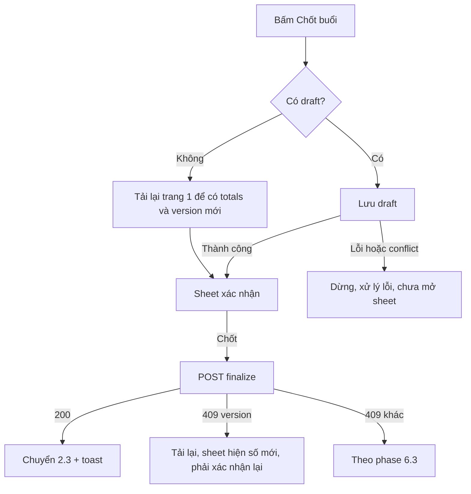

# P2-S1 — attendance-editor · Bắt đầu buổi, điểm danh, đồng bộ và chốt

Ngày: 01/11/2026. Người thiết kế: Claude. Design cấp phase: [../design.md](../design.md).
BR/UC: BR-ATT-01–09, BR-ATT-11, BR-OFF-01/02; UC-M-04, UC-M-05, UC-M-06. Endpoint tham chiếu: `GET .../attendance-candidates`, `GET .../attendance`, `POST .../start`, `PUT .../attendance`, `PUT .../attendance/bulk`, `POST .../attendance/sync-roster`, `POST .../finalize`, `GET .../context`.

## 1. Mục tiêu

Người dạy của buổi thấy danh sách tạm tính, bắt đầu buổi online để chốt danh sách, đánh dấu từng người hoặc cả lớp, đồng bộ học viên vừa đủ điều kiện, chốt buổi và sửa trong hạn. Màn đổi theo `status` và `permissions`, không tách route.

## 2. Bố cục

### 2.1 Trước khi bắt đầu (SCHEDULED)

```
┌──────────────────────────────┐
│▓ ←  Điểm danh                ▓│
│▓    IELTS Foundation K12     ▓│
├──────────────────────────────┤
│ ┌──────────────────────────┐ │
│ │ [Theo lịch] Buổi 8: Line… │ │
│ │ T2, 02/11/2026 · 18:30–20:00│
│ └──────────────────────────┘ │
│ ⓘ Danh sách tạm tính. Danh   │
│   sách chính thức được chốt  │
│   khi bắt đầu buổi.          │
│ HỌC VIÊN DỰ KIẾN · 18        │
│ ┌──────────────────────────┐ │
│ │ (NB) Ngô Bảo Ngọc         │ │
│ │ (CK) Châu Minh Khoa [Học bù]│
│ └──────────────────────────┘ │
├──────────────────────────────┤
│ (      ▶ Bắt đầu buổi      ) │  dính đáy, chỉ khi canStart
└──────────────────────────────┘
```

Hàng chỉ đọc, không có nút đánh dấu. Qua `startsAt` không tự start và không đổi nhãn.

### 2.2 Đang diễn ra (IN_PROGRESS)

```
┌──────────────────────────────┐
│▓ ←  Điểm danh                ▓│
│▓    IELTS Foundation K12     ▓│
├──────────────────────────────┤
│ ┌──────────────────────────┐ │
│ │ [Đang diễn ra] Buổi 8     │ │
│ │ Bắt đầu thực tế 18:32     │ │
│ │ ┌─────┐┌─────┐┌─────┐     │ │
│ │ │ 10  ││  2  ││  6  │     │ │  TotalsStrip, số server
│ │ │Có mặt││Vắng ││Chưa…│     │ │
│ │ └─────┘└─────┘└─────┘     │ │
│ │ Tổng 18 học viên          │ │
│ └──────────────────────────┘ │
│ [✓✓ Tất cả có mặt] [Tất cả vắng]│
│ ⟳ Đồng bộ danh sách          │
│ ⓘ 2 học viên đang chờ thanh  │  pendingPaymentCount > 0
│   toán nên chưa vào danh sách│
│ HỌC VIÊN · 18                │
│ ┌──────────────────────────┐ │
│ │▌(NB) Ngô Bảo Ngọc         │ │  viền trái: có draft
│ │▌ Chưa lưu  [✓Có mặt][Vắng]│ │
│ │ (TH) Trần Hà              │ │
│ │  Vào lúc 18:35 [✓Có mặt][Vắng]│
│ │ (CK) Châu Khoa [Học bù]   │ │
│ │       [Có mặt][Vắng]      │ │  chưa chọn = chưa điểm danh
│ └──────────────────────────┘ │
│        Xem thêm học viên     │  khi còn trang
├──────────────────────────────┤
│ 3 thay đổi chưa lưu  ( Lưu ) │  chỉ khi có draft
│ (        Chốt buổi         ) │  canFinalize
└──────────────────────────────┘
```

- **Đánh dấu:** chạm "Có mặt" hoặc "Vắng". **Chạm lại nút đang chọn thì về Chưa điểm danh**, chỉ khi IN_PROGRESS (không có cách khác để về UNMARKED, và bulk không làm việc này).
- `TotalsStrip` chỉ đổi sau khi server nhận. Số trên đó là thực tế đã lưu, không phải dự kiến.
- Tải thêm bằng nút "Xem thêm học viên", không tự tải khi cuộn: tránh nhảy hàng khi đang chạm đánh dấu.
- Ghi chú: S1 không có ô ghi chú. Sau khi chốt, toast có hành động "Ghi chú buổi học" mở S2.

### 2.3 Đã chốt (COMPLETED)

| Điều kiện | Khác với 2.2 |
| --- | --- |
| `canEditAttendance` true | Dải info "Buổi đã chốt. Bạn vẫn sửa được đến {editableUntil}." Có `MarkToggle`, không về được Chưa điểm danh. Có bulk, không có đồng bộ và chốt. Có Lưu |
| `canEditAttendance` false | Dải neutral (`lock_clock`) "Đã hết hạn sửa. Liên hệ Quản lý nếu cần điều chỉnh." Chip chỉ đọc thay `MarkToggle`, không bulk, không `SaveBar` |

Chữ hạn dùng đúng giá trị server, ví dụ học 23/10 hiện "00:00 25/10/2026".

### 2.4 Bất thường

| Tình huống | Hiển thị |
| --- | --- |
| IN_PROGRESS, `canEditAttendance` false (qua hạn) | Chip chỉ đọc; dải warning "Đã quá hạn điểm danh. Liên hệ Quản lý để chốt buổi." Không có "Chốt buổi" |
| CANCELLED đã start | Chip "Đã hủy", chỉ đọc. Mentor không có quyền ghi |
| CANCELLED chưa start | Thông báo "Buổi đã hủy nên không có điểm danh." Không gọi candidates |
| Snapshot rỗng (`eligible` = 0) | Empty "Chưa có học viên trong danh sách." + đồng bộ nếu có quyền; ẩn bulk. Vẫn chốt được, sheet nói rõ 0 học viên |

## 3. Bắt đầu buổi

Nút hiển thị theo `permissions.canStart`, không suy từ giờ.

**Khi `canStart` false và SCHEDULED**, so ngày của `asOf` với ngày của `startsAt` theo giờ Việt Nam để chọn chữ giải thích. Đây chỉ là chữ:

| So sánh | Chữ |
| --- | --- |
| Trước ngày học | "Buổi này chỉ bắt đầu được trong ngày {dd/MM/yyyy}." |
| Đúng ngày, không có quyền | "Chưa thể bắt đầu buổi này." |
| Sau ngày học | "Đã qua ngày học nên không bắt đầu được nữa. Liên hệ Quản lý." |

**Xác nhận:** `ConfirmationDialog` icon `play_arrow`, tiêu đề "Bắt đầu buổi học?", thân: "Danh sách học viên sẽ được chốt ngay bây giờ. Giờ bắt đầu thực tế là thời điểm bạn xác nhận. Thao tác này không hoàn tác được." Nút "Bắt đầu" / "Để sau".

Body chỉ có `expectedVersion`. Mentor không gửi `actualStartedAt` hay `reason`.

| Kết quả | Hành vi |
| --- | --- |
| 200 | Chuyển 2.2, tải trang 1 của snapshot. Bỏ candidates khỏi màn. Toast "Đã bắt đầu buổi học" |
| 200, `eligible` 0 | Như snapshot rỗng ở 2.4 |
| Chưa rõ | `IntentBanner`, giữ màn preview. Gửi lại cùng intent. Server trả kết quả cũ nếu đã ghi |
| 409 version | Tải lại. Nếu đã IN_PROGRESS: chuyển 2.2 và báo "Buổi đã được bắt đầu". Còn SCHEDULED: xác nhận lại với version mới |
| 409 `ATTENDANCE_START_DAY_CLOSED` | Dialog "Đã qua ngày học…"; tải lại |
| 409 `SESSION_STATE_CONFLICT` | Tải lại, hiện theo trạng thái mới |
| 409 `CLASS_MENTOR_SCHEDULE_CONFLICT` | Dialog theo phase mục 12 |

## 4. Đánh dấu cả lớp

Hai nút secondary cao 36: "Tất cả có mặt" (`done_all`), "Tất cả vắng". Không có "bỏ đánh dấu tất cả" vì bulk không hỗ trợ (BR-ATT-09).

`ConfirmationDialog`, thân phải nêu rõ phạm vi và **dùng `totals.eligible` của server**, không đếm hàng đang thấy:

> Đánh dấu **cả {eligible} học viên** là Có mặt, gồm mọi trang và học viên học bù. Những người đã đánh dấu Vắng cũng sẽ đổi.

Bản "Vắng" đổi chữ tương ứng và thêm "Giờ vào lớp đã ghi sẽ bị xóa." Có draft: thêm câu "{n} thay đổi chưa lưu sẽ bị bỏ." Nút "Đánh dấu cả lớp" / "Hủy".

Thành công: xóa toàn bộ draft, cập nhật theo `totals`, tải lại trang đã mở. Toast "Đã đánh dấu {changed} học viên", với `changed` = `changedEnrollmentIds` + `changedMakeupPlacementIds`. Số 0: "Không có thay đổi." Mọi hàng đã mở hiển thị đúng sau tải lại, kể cả hàng ở trang chưa mở khi người dùng tải sau.

## 5. Đồng bộ danh sách

Nút text `sync` "Đồng bộ danh sách", chỉ khi `canSyncRoster`. Không cần dialog: thao tác chỉ thêm, không đổi kết quả có sẵn.

| Kết quả | Hành vi |
| --- | --- |
| Có thêm | Toast "Đã thêm {n} học viên vào danh sách"; tải lại; **giữ draft** |
| Không thêm | Toast "Danh sách đã khớp"; version không đổi |
| Lỗi | Theo phase mục 6.3 |

Dòng `pendingPaymentCount` > 0: "{n} học viên đang chờ thanh toán nên chưa vào danh sách." Chỉ là thông tin. Không có nút thu tiền (P5) và không thêm họ vào hàng.

## 6. Mất mạng

Start, đồng bộ, chốt, bulk và Lưu luôn cần mạng. Khi offline các nút này khóa và không có "Thử lại". Dải cảnh báo `cloud_off`: "Bạn đang offline. Dữ liệu có thể đã cũ."

Đã chốt theo Q-OFF-01 và Q-DATA-01 ngày 01/11/2026:

- **Điều kiện đánh dấu:** buổi đã start online, trang đó đã tải, và lần tải gần nhất có `canEditAttendance` true. Buổi SCHEDULED không đánh dấu được khi offline.
- **Phạm vi:** `MarkToggle` chạm được trên hàng đã tải. Hàng chưa tải vẫn không có, nút "Xem thêm học viên" khóa. Bulk khóa, vì cần phạm vi server.
- **Cảnh báo:** thêm dòng "Thay đổi chỉ được giữ trên máy này đến khi bạn lưu, và sẽ mất nếu đóng ứng dụng." Khi có draft, thêm "{n} thay đổi chưa lưu. Có mạng lại thì bấm Lưu."
- **Có mạng lại:** **không tự gửi.** Tải lại các trang đã mở, draft vẫn nằm đè lên dữ liệu mới, rồi người dùng tự bấm Lưu. Khác biệt với server đi qua `ConflictPanel` như thường.
- **Lưu trữ:** chỉ trong bộ nhớ, không ghi xuống thiết bị. Tắt app thì mất draft và không có màn phục hồi. Đăng xuất hoặc đổi tài khoản cũng xóa draft.

Không hứa đồng bộ thành công: backend vẫn kiểm quyền, trạng thái và hạn lúc nhận (BR-OFF-02).

## 7. Chốt buổi

Nút "Chốt buổi" (`task_alt`), chỉ khi `canFinalize`. Luôn cần mạng.



**Sheet:** tiêu đề "Chốt buổi học", dòng phụ tên buổi. Hai ô Có mặt, Vắng và một ô Chưa điểm danh theo `totals` vừa nhận.

| `totals.unmarked` | Nội dung |
| --- | --- |
| > 0 | `Alert` warning: "**{unmarked} học viên chưa điểm danh sẽ được tính là Vắng.**" |
| 0 | Không có cảnh báo |

Dòng cuối: "Sau khi chốt, buổi học chuyển sang Đã hoàn tất. Bạn vẫn sửa được điểm danh đến {editableUntil}." Nút primary "Chốt buổi", nút text "Quay lại".

Body chỉ có `expectedVersion`. Mentor không gửi `actualEndedAt`, nên server dùng thời điểm thật. Sau 409 version, sheet hiện dòng "Số liệu vừa thay đổi. Xem lại trước khi chốt." và số mới; xác nhận cũ không còn hiệu lực. Không tự chốt theo giờ kết thúc.

Thành công: toast "Đã chốt buổi học" kèm hành động "Ghi chú buổi học".

## 8. Trạng thái

| # | Trạng thái | Hiển thị |
| --- | --- | --- |
| AE-A | Đang tải | Skeleton thẻ đầu, `TotalsStrip` và các hàng, đúng kích thước; không có bulk và `SaveBar` |
| AE-B | SCHEDULED, `canStart` | 2.1 |
| AE-C | SCHEDULED, không `canStart` | 2.1, không có nút, chữ mục 3 |
| AE-D | Candidates: rỗng / 422 / lỗi mạng | "Chưa có học viên dự kiến." / tải lại context, nếu vẫn SCHEDULED hiện "Chưa có danh sách học viên cho buổi này." / lỗi trong nhóm + "Thử lại" |
| AE-E | IN_PROGRESS, có quyền | 2.2 |
| AE-F | IN_PROGRESS, snapshot rỗng | 2.4 |
| AE-G | Có draft | `SaveBar`; viền và chữ "Chưa lưu" |
| AE-H | Đang gửi | Nút spinner, khóa toggle và action |
| AE-I | Intent chưa rõ | `IntentBanner`; khóa hàng và action |
| AE-J | Version conflict | `ConflictPanel` |
| AE-K | 409 trạng thái / hết hạn | Phase mục 6.3, không nói "đã đồng bộ" |
| AE-L | COMPLETED còn hạn / hết hạn | 2.3 |
| AE-M | Qua hạn khi IN_PROGRESS, CANCELLED | 2.4 |
| AE-N | Tải thêm: đang tải / lỗi | Giữ hàng; skeleton footer / chữ lỗi + "Thử lại" đúng trang |
| AE-O | Làm mới lỗi | Giữ dữ liệu cùng query; `Alert` warning |
| AE-P | Tải lần đầu lỗi | `StatusBlock` + "Thử lại" |
| AE-Q | Offline | Mục 6 |
| AE-R | 401 / 403 / 404 | Về Login / xóa dữ liệu và draft, "Bạn không còn được giao buổi này" / "Không tìm thấy buổi học" |

Mất assignment giữa chừng: 403 ở lần gọi kế tiếp xóa cả draft. Chữ đó phải đủ để Mentor hiểu vì sao thay đổi biến mất: thân `StatusBlock` thêm "Những thay đổi chưa lưu không còn được giữ."

## 9. Nội dung chữ

| Key gợi ý | vi | en |
| --- | --- | --- |
| `attendance.editor.title` | Điểm danh | Attendance |
| `attendance.editor.provisional` | Danh sách tạm tính. Danh sách chính thức được chốt khi bắt đầu buổi. | Provisional list. The official list is set when the session starts. |
| `attendance.editor.expected` | HỌC VIÊN DỰ KIẾN · {{count}} | EXPECTED STUDENTS · {{count}} |
| `attendance.editor.students` | HỌC VIÊN · {{count}} | STUDENTS · {{count}} |
| `attendance.editor.start` | Bắt đầu buổi | Start session |
| `attendance.editor.startTitle` | Bắt đầu buổi học? | Start this session? |
| `attendance.editor.startBody` | Danh sách học viên sẽ được chốt ngay bây giờ. Giờ bắt đầu thực tế là thời điểm bạn xác nhận. Thao tác này không hoàn tác được. | The student list is set now, and the actual start time is when you confirm. This can't be undone. |
| `attendance.editor.startConfirm` / `.later` | Bắt đầu / Để sau | Start / Not now |
| `attendance.editor.started` | Đã bắt đầu buổi học | Session started |
| `attendance.editor.startBefore` | Buổi này chỉ bắt đầu được trong ngày {{date}}. | This session can only start on {{date}}. |
| `attendance.editor.startBlocked` | Chưa thể bắt đầu buổi này. | This session can't be started yet. |
| `attendance.editor.startAfter` | Đã qua ngày học nên không bắt đầu được nữa. Liên hệ Quản lý. | The session day has passed, so it can't be started. Contact a manager. |
| `attendance.editor.alreadyStarted` | Buổi đã được bắt đầu | This session has already started |
| `attendance.editor.present` / `.absent` / `.unmarked` | Có mặt / Vắng / Chưa điểm danh | Present / Absent / Not marked |
| `attendance.editor.totalLine` | Tổng {{count}} học viên | {{count}} students in total |
| `attendance.editor.checkedIn` | Vào lúc {{time}} | Checked in at {{time}} |
| `attendance.editor.allPresent` / `.allAbsent` | Tất cả có mặt / Tất cả vắng | All present / All absent |
| `attendance.editor.bulkTitle` | Đánh dấu cả lớp? | Mark the whole class? |
| `attendance.editor.bulkPresent` | Đánh dấu cả {{count}} học viên là Có mặt, gồm mọi trang và học viên học bù. Những người đã đánh dấu Vắng cũng sẽ đổi. | Mark all {{count}} students Present, including every page and make-up students. Anyone marked Absent will change too. |
| `attendance.editor.bulkAbsent` | Đánh dấu cả {{count}} học viên là Vắng, gồm mọi trang và học viên học bù. Những người đã đánh dấu Có mặt cũng sẽ đổi. Giờ vào lớp đã ghi sẽ bị xóa. | Mark all {{count}} students Absent, including every page and make-up students. Anyone marked Present will change too, and check-in times will be cleared. |
| `attendance.editor.bulkDraft` | {{count}} thay đổi chưa lưu sẽ bị bỏ. | {{count}} unsaved changes will be discarded. |
| `attendance.editor.bulkConfirm` | Đánh dấu cả lớp | Mark whole class |
| `attendance.editor.bulkDone` / `.bulkNoChange` | Đã đánh dấu {{count}} học viên / Không có thay đổi. | Marked {{count}} students / No changes. |
| `attendance.editor.sync` | Đồng bộ danh sách | Sync list |
| `attendance.editor.syncAdded` / `.syncSame` | Đã thêm {{count}} học viên vào danh sách / Danh sách đã khớp | Added {{count}} students to the list / The list is up to date |
| `attendance.editor.pending` | {{count}} học viên đang chờ thanh toán nên chưa vào danh sách. | {{count}} students are awaiting payment and aren't on the list yet. |
| `attendance.editor.save` / `.saved` | Lưu / Đã lưu điểm danh | Save / Attendance saved |
| `attendance.editor.more` | Xem thêm học viên | More students |
| `attendance.editor.empty` | Chưa có học viên trong danh sách. | There are no students on the list. |
| `attendance.editor.previewEmpty` | Chưa có học viên dự kiến. | No expected students yet. |
| `attendance.editor.noPreview` | Chưa có danh sách học viên cho buổi này. | No student list for this session yet. |
| `attendance.editor.finalize` | Chốt buổi | Finalize |
| `attendance.editor.finalizeTitle` | Chốt buổi học | Finalize session |
| `attendance.editor.finalizeImpact` | {{count}} học viên chưa điểm danh sẽ được tính là Vắng. | {{count}} unmarked students will be counted as Absent. |
| `attendance.editor.finalizeFoot` | Sau khi chốt, buổi học chuyển sang Đã hoàn tất. Bạn vẫn sửa được điểm danh đến {{deadline}}. | After finalizing, the session is marked Completed. You can still edit attendance until {{deadline}}. |
| `attendance.editor.finalizeChanged` | Số liệu vừa thay đổi. Xem lại trước khi chốt. | The numbers just changed. Review them before finalizing. |
| `attendance.editor.finalized` | Đã chốt buổi học | Session finalized |
| `attendance.editor.editUntil` | Buổi đã chốt. Bạn vẫn sửa được đến {{deadline}}. | Session finalized. You can edit until {{deadline}}. |
| `attendance.editor.expired` | Đã hết hạn sửa. Liên hệ Quản lý nếu cần điều chỉnh. | The editing period has ended. Contact a manager if changes are needed. |
| `attendance.editor.overdue` | Đã quá hạn điểm danh. Liên hệ Quản lý để chốt buổi. | The attendance period has ended. Contact a manager to finalize. |
| `attendance.editor.expiredDraft` | Đã hết hạn sửa. Những thay đổi này chưa được lưu. | The editing period has ended. These changes weren't saved. |
| `attendance.editor.cancelled` | Buổi đã hủy nên không có điểm danh. | This session was cancelled, so there's no attendance. |
| `attendance.editor.offline` | Bạn đang offline. Dữ liệu có thể đã cũ. | You're offline. Data may be out of date. |
| `attendance.editor.offlineDraft` | {{count}} thay đổi chưa lưu. Có mạng lại thì bấm Lưu. | {{count}} unsaved changes. Tap Save when you're back online. |
| `attendance.editor.offlineMark` | Thay đổi chỉ được giữ trên máy này đến khi bạn lưu, và sẽ mất nếu đóng ứng dụng. | Changes stay on this device until you save, and are lost if you close the app. |
| `attendance.editor.deniedExtra` | Những thay đổi chưa lưu không còn được giữ. | Unsaved changes are no longer kept. |

## 10. Accessibility

- `MarkToggle`: nhóm đọc "Ngô Bảo Ngọc, trạng thái Chưa điểm danh"; từng nút có role `radio`, `selected`. Khi IN_PROGRESS, nút đang chọn có hint "Chạm lại để bỏ đánh dấu".
- Hàng có draft đọc thêm "chưa lưu".
- `TotalsStrip` đọc thành một cụm "10 có mặt, 2 vắng, 6 chưa điểm danh, tổng 18".
- Sau khi tải thêm, focus giữ nguyên, không nhảy về đầu.

## 11. testID

`attendance-screen`, `attendance-back`, `attendance-session-card`, `attendance-provisional`, `attendance-candidate-<enrollmentId>-<entryType>`, `attendance-start`, `attendance-start-confirm`, `attendance-start-hint`, `attendance-totals`, `attendance-total-present`, `attendance-total-absent`, `attendance-total-unmarked`, `attendance-total-eligible`, `attendance-pending-count`, `attendance-bulk-present`, `attendance-bulk-absent`, `attendance-bulk-dialog`, `attendance-bulk-confirm`, `attendance-sync`, `attendance-row-<attendanceId>`, `attendance-mark-<attendanceId>-present`, `attendance-mark-<attendanceId>-absent`, `attendance-row-<attendanceId>-unsaved`, `attendance-save`, `attendance-unsaved-count`, `attendance-batch-limit`, `attendance-more`, `attendance-intent-banner`, `attendance-resend`, `attendance-conflict`, `attendance-conflict-<attendanceId>-latest`, `attendance-conflict-<attendanceId>-keep`, `attendance-conflict-latest-all`, `attendance-finalize`, `attendance-finalize-sheet`, `attendance-finalize-impact`, `attendance-finalize-confirm`, `attendance-finalize-changed`, `attendance-edit-until`, `attendance-expired`, `attendance-overdue`, `attendance-empty`, `attendance-offline`, `attendance-denied`, `attendance-not-found`, `attendance-error`, `attendance-retry`, `attendance-refresh-alert`.

## 12. Test case

| ID | Tiền điều kiện / mock | Thao tác | Kết quả mong đợi |
| --- | --- | --- | --- |
| TC-P2-S1-01 | SCHEDULED, `canStart` | Mở | Gọi context, `attendance`, candidates; hàng chỉ đọc; có `attendance-provisional`, `attendance-start` |
| TC-P2-S1-02 | SCHEDULED, candidates 18, snapshot totals 0 | Xem | Hiện 18 dự kiến; không có `attendance-totals` và không có số 0 |
| TC-P2-S1-03 | SCHEDULED, `asOf` trước ngày học, `canStart` false | Xem | Chữ "chỉ bắt đầu được trong ngày…"; không có nút |
| TC-P2-S1-04 | SCHEDULED, `asOf` sau ngày học | Xem | Chữ "Đã qua ngày học…"; trạng thái vẫn "Theo lịch"; không suy thành vắng |
| TC-P2-S1-05 | Máy khác múi giờ, buổi 23:30 giờ VN | Xem | Ngày và giờ theo giờ VN |
| TC-P2-S1-06 | `canStart` | Bắt đầu, xác nhận | Body đúng `expectedVersion`; có UUID v4; không có `actualStartedAt`; chuyển sang snapshot |
| TC-P2-S1-07 | | Double tap "Bắt đầu" | Đúng 1 request |
| TC-P2-S1-08 | Mất response sau khi gửi start | Bấm "Gửi lại" | Cùng key, body, version; thành công một lần |
| TC-P2-S1-09 | Start 409 version, buổi đã IN_PROGRESS | | Chuyển snapshot, báo "Buổi đã được bắt đầu" |
| TC-P2-S1-10 | Start 409 `ATTENDANCE_START_DAY_CLOSED` | | Thông báo đúng; tải lại; không hiện như version conflict |
| TC-P2-S1-11 | Candidates khác snapshot sau start | Xem sau start | Hiện theo snapshot; không còn hàng từ candidates |
| TC-P2-S1-12 | Start trả `eligible` 0 | | `attendance-empty`; có đồng bộ; không có bulk |
| TC-P2-S1-13 | IN_PROGRESS, regular + guest | Xem | Guest có chip "Học bù"; khóa theo `attendanceId` không trùng khi cùng `enrollmentId` |
| TC-P2-S1-14 | Hàng UNMARKED | Xem | Không nút nào được chọn; không hiển thị như Vắng |
| TC-P2-S1-15 | | Chạm Có mặt ở 3 hàng | `attendance-unsaved-count` = 3; `TotalsStrip` **không đổi**; chưa có request |
| TC-P2-S1-16 | | Chạm Có mặt rồi chạm lại | Về Chưa điểm danh (không còn draft nếu base là UNMARKED) |
| TC-P2-S1-17 | Hàng base PRESENT | Chạm lại Có mặt, lưu | Gửi `UNMARKED` |
| TC-P2-S1-18 | Có draft regular và guest | Lưu | Regular trong `records`, guest trong `guestRecords` theo `makeupPlacementId`; `TotalsStrip` theo response; hết "Chưa lưu" |
| TC-P2-S1-19 | Có 101 thay đổi regular | Chạm hàng thứ 101 | Không nhận; có `attendance-batch-limit` |
| TC-P2-S1-20 | Hai lần lưu nối tiếp | | Lần 2 dùng version response lần 1, key mới |
| TC-P2-S1-21 | Lưu xong mà response version không tăng | | Dùng đúng version response; không tự cộng |
| TC-P2-S1-22 | Mất response sau khi gửi lưu | Xem | `attendance-intent-banner`; hàng khóa; bulk, đồng bộ, chốt khóa |
| TC-P2-S1-23 | Tiếp -22 | Gửi lại | Cùng key, body, version |
| TC-P2-S1-24 | Lưu 409 `SESSION_VERSION_CONFLICT`; server đổi hàng A; hàng B không | Xem | Panel chỉ hỏi A; B vẫn là draft; không tự gửi |
| TC-P2-S1-25 | Tiếp -24 | Giữ của tôi, Lưu | Key mới, version mới; A gửi đúng giá trị của tôi |
| TC-P2-S1-26 | Tiếp -24 | Dùng bản mới | A rời draft |
| TC-P2-S1-27 | Panel mở | Tìm "Giữ tất cả" | Không có |
| TC-P2-S1-28 | Lưu 409 `ATTENDANCE_EDIT_WINDOW_EXPIRED` | | Chuyển chỉ đọc; hàng vẫn "Chưa lưu"; dòng `expiredDraft`; không có toast đã lưu |
| TC-P2-S1-29 | Lưu 409 `SESSION_STATE_CONFLICT` | | Thông báo trạng thái; không hiện `ConflictPanel` |
| TC-P2-S1-30 | Lưu 422 not eligible | | Tải lại; bỏ hàng; báo số hàng bị bỏ |
| TC-P2-S1-31 | Lưu 500 có requestId | | Giữ draft; có mã hỗ trợ; thử lại dùng cùng intent |
| TC-P2-S1-32 | Lưu 403 | | Xóa dữ liệu và draft; `attendance-denied` kèm câu `deniedExtra` |
| TC-P2-S1-33 | Roster 2 trang, `eligible` 150, chỉ mở trang 1 | Tất cả có mặt | Dialog ghi 150; body `checked: true`; không gửi danh sách id |
| TC-P2-S1-34 | Tiếp -33 | Mở trang 2 | Hàng trang 2 là Có mặt theo server |
| TC-P2-S1-35 | | Tất cả vắng | Dialog có câu xóa giờ vào lớp; body `checked: false`; không mô tả là bỏ đánh dấu |
| TC-P2-S1-36 | Có 2 draft | Bulk, xác nhận | Dialog nêu 2 thay đổi bị bỏ; thành công thì hết draft |
| TC-P2-S1-37 | Bulk không đổi gì | | Toast "Không có thay đổi." |
| TC-P2-S1-38 | `canSyncRoster`, có draft | Đồng bộ, thêm 2 | Toast 2; draft giữ nguyên |
| TC-P2-S1-39 | Đồng bộ thêm 0 | | "Danh sách đã khớp" |
| TC-P2-S1-40 | `pendingPaymentCount` 2 | Xem | Có dòng; không có hàng cho 2 người đó; không có nút thu tiền |
| TC-P2-S1-41 | Có 3 draft | Chốt | Lưu trước; lưu xong mới mở sheet, số theo response |
| TC-P2-S1-42 | Tiếp -41, lưu 409 | | Dừng; không mở sheet; `ConflictPanel` |
| TC-P2-S1-43 | `unmarked` 6 | Mở sheet | `attendance-finalize-impact` có 6 |
| TC-P2-S1-44 | `unmarked` 0 | Mở sheet | Không có cảnh báo |
| TC-P2-S1-45 | Sheet mở, chốt 409 version, `unmarked` mới 8 | | Sheet hiện 8 và `finalize-changed`; phải bấm xác nhận lại |
| TC-P2-S1-46 | | Chốt thành công | Không gửi `actualEndedAt`; chuyển COMPLETED; hàng đã UNMARKED hiện Vắng sau tải lại; toast có hành động ghi chú |
| TC-P2-S1-47 | Double tap xác nhận chốt | | Đúng 1 request |
| TC-P2-S1-48 | COMPLETED, `canEditAttendance` true | Xem, chạm lại nút đang chọn | Có hạn đúng giá trị server; không về Chưa điểm danh; không có đồng bộ, chốt |
| TC-P2-S1-49 | COMPLETED, `editableUntil` 00:00 25/10, học 23/10 | Xem | Hiện "00:00 25/10/2026" |
| TC-P2-S1-50 | COMPLETED, `canEditAttendance` false | Xem | Chip chỉ đọc; `attendance-expired`; không có "chỉ quản lý" sai quyền trong hạn |
| TC-P2-S1-51 | IN_PROGRESS, `canEditAttendance` false | Xem | `attendance-overdue`; không có chốt |
| TC-P2-S1-52 | CANCELLED chưa start | Mở | Không gọi candidates; thông báo |
| TC-P2-S1-53 | Có draft | Back toolbar, Android Back | `leave-dialog`; Ở lại giữ draft; Bỏ thay đổi thì rời màn |
| TC-P2-S1-54 | Có draft, foreground refetch đổi dữ liệu | | Draft còn; có dòng `newerExists` |
| TC-P2-S1-55 | Tải thêm lỗi trang 2 | Thử lại | Gọi lại trang 2; hàng trang 1 và draft giữ nguyên |
| TC-P2-S1-56 | Làm mới 500, có dữ liệu | | Giữ dữ liệu; có alert và mã hỗ trợ |
| TC-P2-S1-57 | Offline, chưa có dữ liệu | Mở | `offlineEmpty`; không có "Thử lại"; không có số 0 |
| TC-P2-S1-58 | Offline, trang 1 đã tải, `canEditAttendance` true | Chạm toggle | Draft ghi nhận; có `offlineMark`; Lưu, bulk, đồng bộ, chốt, "Xem thêm học viên" khóa; không có "Thử lại" |
| TC-P2-S1-59 | Tiếp -58 | Có mạng lại | Tải lại trang đã mở; draft còn; **không có request ghi** đến khi bấm Lưu |
| TC-P2-S1-60 | Có draft, đăng xuất | Đăng nhập tài khoản khác | Không còn draft, không còn dữ liệu cũ |
| TC-P2-S1-61 | App bị tắt khi có draft, mở lại | | Không có draft; không có màn phục hồi; không có dữ liệu ghi xuống thiết bị |
| TC-P2-S1-62 | Mentor thay, SESSION | Dùng đủ luồng | 0 lần gọi `GET /mentor/classes/:id/students` |
| TC-P2-S1-64 | Offline, SCHEDULED có dữ liệu | Xem | Không có toggle; "Bắt đầu buổi" khóa |
| TC-P2-S1-65 | Offline, đánh dấu; có mạng lại khi đã hết hạn | Bấm Lưu | 409 hết hạn; hàng vẫn "Chưa lưu"; không báo đã đồng bộ |
| TC-P2-S1-66 | Offline, `canEditAttendance` false ở lần tải gần nhất | Xem | Chip chỉ đọc; không đánh dấu được |
| TC-P2-S1-63 | Màn 360, font 1.3, tên dài | Xem | `MarkToggle` xuống dòng; không đè tên, vùng chạm ≥ 44 |

Ứng viên Maestro E2E: TC-P2-S1-01, -06, -13, -18, -25, -33, -34, -38, -43, -46, -48, -50, -53, -58, -59, -62.
