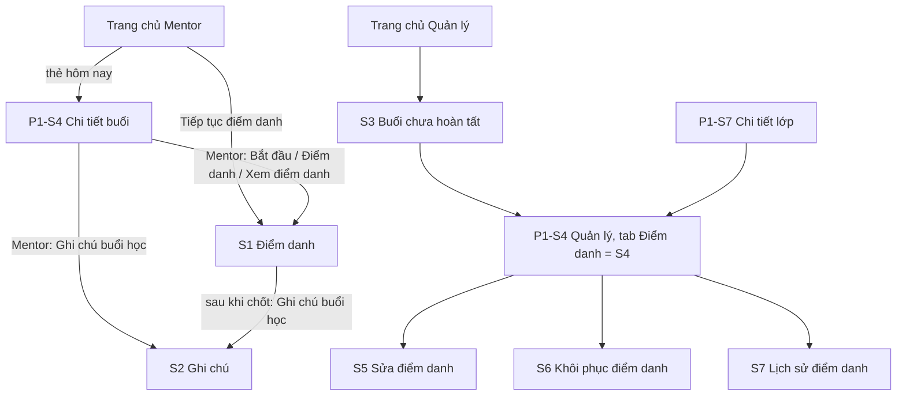

# P2 — Mentor điểm danh/ghi chú → Manager theo dõi và correction · Design cấp phase

Ngày: 01/11/2026 (Asia/Bangkok). Người thiết kế: Claude. Trạng thái: **design hoàn tất, chờ người dùng duyệt cùng UI toàn phase** (ADR-009). Design không thay cổng duyệt kế hoạch tổng (ADR-017). Các câu hỏi design ở mục 2 đã được người dùng chốt ngày 01/11/2026.

File này chứa phần dùng chung: quyết định cần duyệt, điều hướng, thay đổi trên màn P1, mô hình ghi, thành phần, nhãn, hành vi dữ liệu và khoảng lệch backend. Màn hình, trạng thái, chữ và test case nằm ở từng slice:

| Slice | Design | Route | Vai trò |
| --- | --- | --- | --- |
| P2-S1 — attendance-editor | [attendance-editor/design.md](attendance-editor/design.md) | `AttendanceEditor` | MENTOR |
| P2-S2 — teaching-note-editor | [teaching-note-editor/design.md](teaching-note-editor/design.md) | `TeachingNoteEditor` | MENTOR |
| P2-S3 — incomplete-sessions | [incomplete-sessions/design.md](incomplete-sessions/design.md) | `IncompleteSessions` | MANAGER |
| P2-S4 — manager-attendance | [manager-attendance/design.md](manager-attendance/design.md) | Tab trong `SessionContext` | MANAGER |
| P2-S5 — attendance-correction | [attendance-correction/design.md](attendance-correction/design.md) | `AttendanceCorrection` | MANAGER |
| P2-S6 — attendance-recovery | [attendance-recovery/design.md](attendance-recovery/design.md) | `AttendanceRecovery` | MANAGER |
| P2-S7 — attendance-audits | [attendance-audits/design.md](attendance-audits/design.md) | `AttendanceAudits` | MANAGER |

Căn cứ:

- [Kế hoạch tổng P2](../../implement/phase-002-attendance-and-notes/phase-002-attendance-and-notes.md), BR-ATT-01–11, BR-NOTE-01/02, BR-OFF-01/02, BR-DATA-02, BR-REPORT-01; UC-M-04–07, UC-MG-02/03; ADR-006/008/012/023/025.
- Mẫu `Mentor Mobile UI.html` [M] và `Manager Mobile UI.html` [H], giải nén và đọc ngày 01/11/2026. [M] có sheet điểm danh, đồng bộ sĩ số và chốt buổi; [H] có trang "Buổi học chưa hoàn tất", tab Điểm danh, tab Ghi chú và nhóm Thao tác. Không có mẫu cho correction form, recovery form và audit: ba màn này ghép từ token và thành phần có sẵn, cần xem kỹ khi duyệt UI.
- Source `../Mindy-BE/src/modules/attendance`, `teaching-operations`, `classes`, `payments` đọc ngày 01/11/2026. Đây là căn cứ trường dữ liệu cho design, chưa phải contract; Codex đối chiếu lại ở API-00.
- Design [teaching-workspace](../teaching-workspace/design.md) và source hiện tại của `SessionContextScreen`, `WorkspaceScreen`.

## 1. Khác với mẫu có chủ đích

| Mẫu nói | Design | Lý do |
| --- | --- | --- |
| [M] "Mặc định là vắng · chạm để đánh dấu có mặt" | Mặc định "Chưa điểm danh", có hai nút Có mặt / Vắng | UNMARKED khác ABSENT (BR-ATT-03) |
| [M] "Sau khi chốt… chỉ quản lý có thể sửa" | "Bạn vẫn sửa được đến {hạn}" | Mentor được sửa trong hạn (BR-ATT-06/07) |
| [M] sheet đồng bộ liệt kê trước học viên "Thêm mới" | Chỉ báo số đã thêm sau khi đồng bộ | Không có API xem trước; không dựng từ candidates (BR-ATT-04) |
| [H] "Vắng có phép" | Bỏ | Backend chỉ có UNMARKED/PRESENT/ABSENT |
| [H] "Thiếu điểm danh 3 học viên" trên thẻ buổi | Bỏ | DTO incomplete không có số này; không gọi API từng hàng (ADR-025 mục 5) |
| [H] tab Ghi chú cho Quản lý | Bỏ | Ngoài phạm vi 7 slice (kế hoạch mục 1) |
| [H] Đổi lịch, dạy thay, tạo buổi bù, hủy buổi | Bỏ | Thuộc P4/P5 (ADR-025 mục 12) |
| [M] [H] có ô tìm và lọc trạng thái trong danh sách học viên | Bỏ | Backend không có query. Lọc trên trang đã tải sẽ cho kết quả sai với lớp nhiều trang |

## 2. Quyết định đã chốt

Người dùng duyệt cả năm đề xuất dưới đây ngày 01/11/2026 qua phản hồi "được duyệt, viết vào design đi". Design chỉ còn một nhánh theo các quyết định này.

| ID | Câu hỏi | Quyết định | Ảnh hưởng |
| --- | --- | --- | --- |
| Q-OFF-01 | Có cho đánh dấu khi mất mạng không, trong phạm vi nào? | Cho đánh dấu trên các hàng **đã tải**, chỉ giữ trong bộ nhớ, người dùng tự bấm Lưu khi có mạng, không tự gửi | S1 mục 6 |
| Q-DATA-01 | Có lưu draft/roster xuống thiết bị không? | Không lưu ở P2. App bị tắt thì mất draft, và màn có nói rõ điều đó | S1, S2 |
| Q-ATT-01 | Quản lý chỉ cần danh sách hay thêm KPI? Bộ lọc nào? | Chỉ danh sách; lọc `issue` và `classId`; chưa làm `from/to` vì repo chưa có date picker và danh sách đã xếp buổi cũ nhất lên đầu | S3 |
| Q-P2-01 | Quản lý có được chốt buổi thay Mentor không? | **Có.** Backend cho phép (`canFinalize`). Nhờ vậy buổi STARTED_NOT_FINALIZED trong S3 có cách xử lý trên mobile. Kế hoạch mục 8 chưa liệt kê `POST /finalize` cho Quản lý, cần bổ sung | S4, S5 mục 7, kế hoạch mục 8 |
| Q-P2-02 | Trang chủ Quản lý có gọi API để thẻ phản ánh việc thật không? | **Có**, một request `pageSize=1` (mục 4.3). P1 mục 3.5 đã yêu cầu đổi thẻ khi có S3 | Trang chủ |

Q-PLAT-01 (mốc Android/iOS) không thuộc design và vẫn còn mở; câu hỏi này ảnh hưởng nghiệm thu, không ảnh hưởng UI.

## 3. Điều hướng

| Route | Vai trò | Params | Ghi chú |
| --- | --- | --- | --- |
| `AttendanceEditor` | MENTOR | `sessionId`, `classTitle?` | S1 |
| `TeachingNoteEditor` | MENTOR | `sessionId`, `classTitle?` | S2 |
| `IncompleteSessions` | MANAGER | — | S3 |
| `SessionContext` (có sẵn) | MENTOR, MANAGER | thêm `initialTab?: 'overview' \| 'attendance'` | S4 là tab của route này. Chỉ Quản lý dùng `initialTab` |
| `AttendanceCorrection` | MANAGER | `sessionId`, `classTitle?` | S5 |
| `AttendanceRecovery` | MANAGER | `sessionId`, `classTitle?` | S6 |
| `AttendanceAudits` | MANAGER | `sessionId`, `classTitle?`, `enrollmentId?`, `makeupPlacementId?`, `studentName?` | S7 |

- Mở màn, Back và đổi tab hiển thị trực tiếp, không slide/fade/gesture (ADR-023, ADR-025 mục 1). **Câu "trang con push từ phải" ở P1 mục 4 không còn áp dụng.**
- Mỗi role chỉ đăng ký route của mình. Params chỉ để định danh và hiển thị, không phải căn cứ quyền; `permissions` luôn đọc từ response hiện tại. `version`, `permissions`, `status` không truyền qua params.
- Màn đích tự kiểm tra lại quyền khi mở. Mở trực tiếp màn S5/S6/S7 trái quyền (mở từ màn đã cũ, thông báo sau này) thì hiện `StatusBlock` không quyền theo P1 mục 9.3, không gọi mutation.
- Rời màn có thay đổi chưa lưu (toolbar và Android Back): dialog chung ở mục 6.5. Khi có mutation đang chạy, Back bị chặn như cơ chế auth busy hiện có.

## 4. Thay đổi trên màn P1

Chỉ đổi đúng các chỗ dưới đây. Design P1 giữ nguyên hiệu lực ở phần còn lại; Codex cập nhật test P1 bị thay thế theo bảng 4.4.

### 4.1 Chi tiết buổi của Mentor

Màn hiện có ba ô Học viên / Có mặt / Vắng đang để "—" và nút `session-attend` chỉ hiện toast. P2 thay bằng dữ liệu thật:

- Khi mở tab Tổng quan và buổi khác CANCELLED: gọi `GET /class-sessions/:id/attendance?page=1&pageSize=1` để lấy `session.permissions` và `totals`. Đây là request quyền cần thiết, vì context và candidates không trả `permissions` (G-P2-01). Không tải thêm hàng ở tab Tổng quan.
- Đang tải: skeleton ở ô số và ở vị trí nút, không nhảy bố cục. Lỗi: ô số giữ "—", nút hành động ẩn, thêm dòng 12 "Chưa tải được dữ liệu điểm danh." kèm "Thử lại" (offline: chỉ dòng cảnh báo, không có "Thử lại"). Phần còn lại của màn vẫn dùng được.

| `status` | Ba ô số | Nút chính | Nút phụ |
| --- | --- | --- | --- |
| SCHEDULED | Học viên: `—` đến khi tab Học viên đã tải; Có mặt, Vắng: `—`. **Không hiện 0**: buổi chưa start thì totals 0 không phải số thật | `canStart`: "Bắt đầu buổi" (`play_arrow`) mở S1. Không có: giữ dòng `session-starts-note` | Không có |
| IN_PROGRESS | `eligible`, `present`, `absent` | `canEditAttendance`: "Điểm danh" (`fact_check`) mở S1. Không có: "Xem điểm danh" | "Vào phòng" như hiện có; "Ghi chú buổi học" (`edit_note`) mở S2 |
| COMPLETED | `eligible`, `present`, `absent` | "Sửa điểm danh" nếu `canEditAttendance`, ngược lại "Xem điểm danh" | "Ghi chú buổi học" |
| CANCELLED | Như hiện có | Không có | Không có |

Bố cục hai nút giữ `flex-1 min-w-[140px]`, tự xuống hàng khi đủ ba nút. Ô "Chưa điểm danh" không thêm vào hàng ba ô; S1 mới hiện đủ.

testID thêm: `session-start`, `session-attend` (giữ), `session-attend-view`, `session-note`, `session-totals-error`, `session-totals-retry`.

### 4.2 Trang chủ Mentor

Thẻ hôm nay T-C, chỉ khi buổi đang hiện là IN_PROGRESS: thêm nút secondary cao 44 "Tiếp tục điểm danh" (`fact_check`) mở S1, testID `workspace-today-attend`, đặt trên nút Meet. Không gọi thêm API; S1 tự kiểm quyền khi mở. Đây là chỗ P1 mục 3.4 đã để dành ("Tiếp tục buổi dạy thuộc P2-S1"). Chữ đổi thành "Tiếp tục điểm danh" cho khớp đích đến.

### 4.3 Trang chủ Quản lý

Thêm tile thứ hai vào "Điều phối giảng dạy": "Buổi chưa hoàn tất" / "Incomplete sessions", icon `pending_actions`, testID `workspace-open-incomplete`. Thứ tự theo [H]: Lớp học trước.

Thẻ tĩnh ở P1 mục 3.5 thành thẻ có dữ liệu, testID giữ `workspace-today-card`. Gọi `GET /management/class-sessions/incomplete?page=1&pageSize=1` khi mở và khi quay về màn, chỉ đọc `total`. Đây là tổng server của đúng endpoint S3, không phải KPI mới.

| Trạng thái | Hiển thị |
| --- | --- |
| Đang tải | Skeleton hai dòng căn giữa |
| `total` = 0 | "Bạn được nghỉ ngơi" + "Không có buổi học nào cần xử lý" |
| `total` > 0 | Số `total` 26/700 `--mdy-link` + "buổi học cần xử lý" 13, cả thẻ bấm được mở S3, có `chevron_right`, testID `workspace-incomplete-summary` |
| Lỗi, chưa có dữ liệu | "Chưa tải được việc cần xử lý." + "Thử lại". **Không hiện "Bạn được nghỉ ngơi"** |
| Offline, chưa có dữ liệu | Chỉ dòng "Bạn đang offline." không có "Thử lại" |
| Lỗi hoặc offline, đã có dữ liệu | Giữ số, thêm dòng 12 "Chưa cập nhật được." |
| 403 | Xóa số; dòng "Chưa xem được việc cần xử lý." |

### 4.4 Test P1 bị thay thế

| Test | Thay bằng |
| --- | --- |
| H-B (Quản lý: đúng 1 tile) | Đúng 2 tile |
| H-R (Quản lý không có request) | TC-P2-HOME-01 đến 04 ở mục 13 |
| TC-P1-S4-13 (không hiện trạng thái điểm danh) | Chỉ còn đúng với tab Học viên của Mentor; tab Điểm danh theo S4 |
| TC-P1-S4-26, -33, -34, -37 (tab Quản lý) | TC-P2-S4 |
| TC-P1-S4-28 (Mentor không có nút điểm danh, ghi chú) | Mục 4.1 |
| H-O (không có nút "Tiếp tục buổi dạy") | Chỉ buổi SCHEDULED không có nút; IN_PROGRESS theo mục 4.2 |

## 5. Hai đường đọc học viên

| `session.status` | Nguồn | Ý nghĩa | Được dùng ở |
| --- | --- | --- | --- |
| SCHEDULED | `attendance-candidates` | Xem trước, chưa phải record. Luôn kèm dòng "Danh sách tạm tính" | S1, S4 |
| IN_PROGRESS, COMPLETED, CANCELLED đã start | `attendance` | Snapshot đã chụp | S1, S4, S5, S7 |

- **Không bao giờ** dựng snapshot từ candidates hoặc roster lớp (BR-ATT-04). Riêng S6 đọc roster lớp của Quản lý vì recovery cần thông tin thanh toán, và kết quả chỉ là lựa chọn để gửi, không hiển thị như điểm danh.
- Candidates trả 422 khi buổi đã rời SCHEDULED hoặc lớp không còn OPEN/IN_PROGRESS: tải lại context trước khi kết luận, vì có thể buổi vừa được start ở thiết bị khác.
- `GET attendance` xếp theo `enrollmentId`, không theo tên (G-P2-02). Giữ nguyên thứ tự server, không sắp lại trong từng trang vì hàng sẽ nhảy khi tải thêm.
- Khóa hàng: `attendanceId`. Định danh gửi lên: REGULAR dùng `enrollmentId` trong `records`; MAKEUP dùng `makeupPlacementId` trong `guestRecords`. Cùng `enrollmentId` có thể xuất hiện ở cả hai loại nên không dùng làm khóa hàng.
- `pageSize`: S1, S5 dùng 100 vì người dùng cần thấy cả lớp để đánh dấu. S4 dùng 20 vì chỉ đọc. Vẫn phân trang đầy đủ theo `total`.

## 6. Mô hình ghi dùng chung

Áp dụng cho S1, S5 và mutation của S6, S2 (S2 có version riêng).

### 6.1 Draft và intent

Hai khái niệm tách hẳn (ADR-006):

| Khái niệm | Nội dung | Được sửa? |
| --- | --- | --- |
| **Draft** | Lớp phủ trong bộ nhớ trên snapshot server, mỗi hàng ghi trạng thái muốn đổi và trạng thái server tại lúc đổi (`baseStatus`) | Có. Đổi về đúng `baseStatus` thì hàng rời draft |
| **Intent** | Một request đã tạo: body + `expectedVersion` + UUID v4 `Idempotency-Key` | **Không.** Retry giữ nguyên cả ba |

**Vì sao lưu theo lô, không lưu từng chạm.** Mỗi thay đổi tăng `session.version` dùng chung, nên lưu từng chạm phải xếp hàng từng request, sinh nhiều audit, và gặp conflict ở giữa chừng. Lưu theo lô cho một version, một audit batch, conflict xử lý một lần, và đánh dấu offline dùng chung đúng draft này. Đổi lại người dùng có thể quên lưu, nên có thanh lưu dính đáy, dialog khi rời màn và chốt buổi tự lưu trước.

- Một lô tối đa 100 `records` và 100 `guestRecords`. Đạt giới hạn thì không nhận thêm thay đổi cho loại đó, hiện dòng "Lưu các thay đổi này trước khi đánh dấu tiếp." Không tự chia lô, để mỗi lần lưu luôn là một giao dịch.
- Các mutation của một buổi chạy tuần tự: khi còn intent chưa rõ kết quả, các nút Lưu, Đánh dấu tất cả, Đồng bộ, Chốt và Bắt đầu đều bị khóa.
- Sau khi thành công: dùng `session.version`, `session.permissions`, `totals` từ response; bỏ khỏi draft các hàng đã gửi; tải lại các trang đã mở. Draft còn lại nằm đè lên dữ liệu mới, không bị ghi đè.
- Version trong response là nguồn duy nhất. Mentor chỉ đánh dấu lại đúng giá trị cũ thì version không đổi; client không tự cộng.

### 6.2 Ba kết quả của một intent

| Kết quả | Dấu hiệu | Hành vi |
| --- | --- | --- |
| Được chấp nhận | 200 | Mục 6.1 |
| Bị từ chối | Có response lỗi | Không gửi lại tự động; xử lý theo mã ở mục 6.3. Hàng chưa được chấp nhận vẫn hiện "Chưa lưu" |
| **Chưa rõ** | Timeout, mất mạng sau khi gửi | Giữ nguyên intent, các hàng liên quan bị khóa, dải cảnh báo "Chưa rõ thay đổi đã được lưu chưa." kèm "Gửi lại" (cùng key, body, version). Offline: chỉ cảnh báo, chưa có nút; có mạng lại thì nút hiện. Server trả lại kết quả cũ nếu đã ghi, nên gửi lại là an toàn |

Giữ intent chỉ trong bộ nhớ (Q-DATA-01). Dải cảnh báo chưa rõ ghi thêm "Đóng ứng dụng lúc này có thể làm mất thay đổi chưa lưu."

### 6.3 Mã lỗi mutation

Nhãn đối chiếu lại ở API-00. Không hiện message tiếng Anh của backend. Có `requestId` thì thêm "Mã hỗ trợ: {requestId}".

| HTTP / mã | Nghĩa | Hành vi chung |
| --- | --- | --- |
| 409 `SESSION_VERSION_CONFLICT` | Có thay đổi khác đã ghi trước | `ConflictPanel` (mục 6.4). Tải lại, không tự gửi lại |
| 409 `SESSION_STATE_CONFLICT` | Buổi đã đổi trạng thái | Tải lại; dải danger "Trạng thái buổi học đã thay đổi." Giữ draft và ghi rõ chưa đồng bộ. **Không gộp vào version conflict** |
| 409 `ATTENDANCE_EDIT_WINDOW_EXPIRED` | Hết hạn Mentor sửa | Chuyển chế độ chỉ đọc; draft giữ hiển thị "Chưa lưu" và dòng "Đã hết hạn sửa. Những thay đổi này chưa được lưu." (BR-ATT-11) |
| 409 `ATTENDANCE_START_DAY_CLOSED` | Không còn trong ngày học | S1 mục 3 |
| 409 `CLASS_MENTOR_SCHEDULE_CONFLICT` | Trùng lịch người dạy khi start | Dialog báo lỗi, buổi vẫn SCHEDULED |
| 422 `ATTENDANCE_ENROLLMENT_NOT_ELIGIBLE`, 409 `MAKEUP_ATTENDANCE_NOT_ELIGIBLE` | Hàng không còn trong snapshot | Tải lại, bỏ hàng đó khỏi draft, báo số hàng bị bỏ |
| 409 `IDEMPOTENCY_KEY_REUSED` | Lỗi phía client | Lỗi chung + mã hỗ trợ; bỏ intent; giữ draft. Không tự thử key mới |
| 403 `SESSION_ASSIGNMENT_REQUIRED`, `MENTOR_SCOPE_REQUIRED` | Mất quyền | Xóa dữ liệu **và draft**, `StatusBlock` không quyền. Không giữ dữ liệu trên màn (BR-AUTH-04) |
| 401 | Hết phiên | Về Login theo P0; xóa draft |
| 404 | Không còn buổi | Xóa dữ liệu, `StatusBlock` không tìm thấy |
| 422 khác, 5xx | Dữ liệu hoặc server lỗi | Dải danger, giữ draft, cho thử lại với **cùng intent** nếu 5xx |

### 6.4 `ConflictPanel`

Hiện trên đầu danh sách, không phải dialog, để người dùng cuộn so với các hàng.

1. Tải lại các trang đã mở. Với mỗi hàng trong draft, so `baseStatus` với trạng thái server mới.
2. Không đổi ở server: vẫn là draft, không hỏi lại.
3. Đổi ở server: hàng hiện hai giá trị "Bản mới: Vắng · Của bạn: Có mặt" và hai nút "Dùng bản mới" / "Giữ của tôi".
4. Nút "Lưu" khóa đến khi mọi hàng trong panel đã chọn. "Giữ của tôi" đặt `baseStatus` mới. Lần lưu sau là **intent mới**: key mới, version mới.
5. Không có hàng nào khác biệt: panel chỉ báo "Điểm danh vừa được cập nhật ở nơi khác. Xem lại rồi bấm Lưu." Vẫn cần người dùng bấm lại, không tự gửi.

Có thêm "Dùng bản mới cho tất cả" khi từ 2 hàng trở lên. Không có nút "Giữ tất cả": đó chính là last-write-wins (BR-ATT-11).

### 6.5 Dialog rời màn

`ConfirmationDialog` icon `warning`. Tiêu đề "Thoát mà chưa lưu?"; thân "{n} thay đổi chưa lưu sẽ bị bỏ."; hai nút "Ở lại" (primary) và "Bỏ thay đổi" (danger). testID `leave-dialog`, `leave-stay`, `leave-discard`. Có intent chưa rõ: nút danger đổi thành "Vẫn thoát" và thân nói rõ "Chưa rõ thay đổi đã được lưu chưa."

### 6.6 Làm mới và draft

Refetch khi focus lại/foreground vẫn chạy, nhưng chỉ cập nhật lớp server; **không xóa hay ghi đè draft và nội dung đang gõ**. Nếu lớp server đổi trạng thái của hàng đang trong draft thì chưa báo gì; khi Lưu server sẽ trả conflict, vì version đã đổi. Phát hiện `version` mới khác version đang giữ khi có draft: hiện dòng 12 "Có cập nhật mới từ nơi khác. Bạn sẽ được đối chiếu khi lưu."

## 7. Token

Không thêm token màu. Dùng lại bộ chip P1 mục 5.

| Vai trò | Token |
| --- | --- |
| Có mặt | `--mdy-success-fg` / `--mdy-success-bg` |
| Vắng | `--mdy-danger-fg` / `--mdy-danger-bg` |
| Chưa điểm danh | neutral |
| Hàng có draft | Viền trái 3 `--mdy-warning-fg` + chữ "Chưa lưu" |

Trạng thái không truyền đạt chỉ bằng màu: luôn có chữ hoặc icon.

## 8. Thành phần

Tái sử dụng `TeachingPage`, `QueryBlock`, `Group`, `Footer`, `SkeletonList`, `Filters`, `StatusChip`, `Card`, `Chip`, `Button`, `Alert`, `Sheet`, `ConfirmationDialog`, `TextField`, `Toast`. Thành phần mới nằm trong `src/modules/attendance/components/`:

| Thành phần | Mô tả | Dùng ở |
| --- | --- | --- |
| `TotalsStrip` | Ba ô cùng kiểu `session-stat`: Có mặt, Vắng, Chưa điểm danh; số 18/700, chú thích 11. Dòng dưới "Tổng {eligible} học viên". Luôn từ `totals` server, không cộng draft. Không có dữ liệu: "—", không hiện 0 | S1, S4, S5 |
| `AttendanceRow` | Hàng cao tối thiểu 64: avatar 36, tên 14/500 (`displayName` null → "Chưa có tên"), chip "Học bù" khi MAKEUP, dòng phụ 12 ("Vào lúc {HH:mm}" khi có `checkedInAt`; "Chưa lưu" khi có draft). Bên phải là `MarkToggle` hoặc chip chỉ đọc | S1, S4, S5 |
| `MarkToggle` | Hai nút pill liền nhau "Có mặt" (`check`), "Vắng" (`close`), mỗi nút cao 36, rộng tối thiểu 64, vùng chạm 44. Chọn: nền `*-bg`, chữ `*-fg`, viền 1px. Chưa chọn: nền trong, viền `--mdy-border`. Màn 360 hoặc font scale ≥ 1.3: rớt xuống dòng dưới tên, chiếm đủ ngang. Vai trò `radiogroup` | S1, S5 |
| `SaveBar` | Thanh dính đáy, trên safe area, tránh bàn phím: trái "{n} thay đổi chưa lưu", phải nút chính. Không có thay đổi thì ẩn hoặc chỉ giữ nút chốt | S1, S5 |
| `ConflictPanel` | Mục 6.4 | S1, S5 |
| `IntentBanner` | Dải "chưa rõ" mục 6.2 | S1, S2, S5, S6 |
| `MultilineField` | Mở rộng `TextField`: nhiều dòng, cao tối thiểu 120, đếm ký tự 12 ở dưới phải dạng `{n}/{max}`, chuyển danger khi vượt | S2, S5, S6 |
| `ReasonField` | `MultilineField` nhãn "Lý do" giới hạn 1000. Server trim trước khi kiểm, nên chỉ có khoảng trắng là trống | S5, S6 |
| `TimeField` | Nhập `HH:mm` bằng bàn phím số, tự chèn dấu `:`, hiểu theo giờ Việt Nam. Repo chưa có date picker và design không yêu cầu cài | S5, S6 |
| `AuditRow` | S7 mục 2 | S7 |

**Sheet và dialog:** dùng `ConfirmationDialog` cho xác nhận ngắn, `Sheet` cho nội dung có danh sách hoặc ô nhập. Cả hai `busy` khi đang gửi, không đóng được.

**Icon cần thêm vào `src/components/ui/symbols.json`**, Material Symbols Rounded weight 300: `edit_note`, `history`, `check`, `sync`, `restore`, `pending_actions`, `task_alt`, `play_arrow`, `done_all`, `lock_clock`, `filter_list`. `fact_check`, `close`, `warning`, `info`, `lock_person`, `cloud_off` đã có.

## 9. Nhãn

Nhãn lấy từ giá trị server. Giá trị lạ: schema coi là phản hồi sai định dạng, không có nhãn dự phòng.

| Loại | Giá trị | vi | en | Tone |
| --- | --- | --- | --- | --- |
| Điểm danh | PRESENT | Có mặt | Present | success |
| Điểm danh | ABSENT | Vắng | Absent | danger |
| Điểm danh | UNMARKED | Chưa điểm danh | Not marked | neutral |
| Vào học | MAKEUP | Học bù | Make-up | info |
| Vấn đề | OVERDUE_NOT_STARTED | Chưa bắt đầu | Not started | warning |
| Vấn đề | STARTED_NOT_FINALIZED | Chưa chốt | Not finalized | danger |
| Lịch sử | ADMIT | Thêm vào danh sách | Added to list | neutral |
| Lịch sử | MARK | Điểm danh | Marked | brand |
| Lịch sử | FINALIZE | Chốt buổi | Finalized | neutral |
| Lịch sử | CORRECT | Sửa | Corrected | warning |
| Lịch sử | RECOVER | Khôi phục | Recovered | info |
| Cơ sở vào học | PAID_BEFORE_START | Thanh toán trước giờ học | Paid before start | dòng chữ |
| Cơ sở vào học | CASH_LATE_ADMISSION | Tiền mặt, vào muộn | Late cash admission | dòng chữ |

Nhãn buổi, người dạy null: theo P1 mục 8. **Thời gian:** instant hiển thị theo `Asia/Ho_Chi_Minh` (ADR-008). `editableUntil` hiển thị đúng instant server: "00:00 25/10/2026", không đổi thành "hết ngày 24/10" và không tự cộng từ giờ học. Kiểm hạn để đổi giao diện dùng `asOf` của response, không dùng đồng hồ máy; server vẫn là bên quyết định cuối.

## 10. Hành vi dữ liệu

Áp dụng P1 mục 9 và ADR-025, cộng các điểm riêng dưới đây. Ma trận lỗi tải theo [P1 mục 9.3](../teaching-workspace/design.md).

### 10.1 Tải

| Màn | Lúc mở gọi gì | Không gọi |
| --- | --- | --- |
| S1 | Context + `attendance` trang 1 (`pageSize` 100). Thêm candidates chỉ khi SCHEDULED | Roster lớp; candidates khi đã start |
| S2 | Context + `teaching-notes` | Attendance |
| S3 | `incomplete` trang 1; tra tên lớp (S3 mục 3) | Context từng hàng, attendance từng hàng |
| S4 | Context + `attendance?pageSize=1` ở Tổng quan; tab Điểm danh mở mới tải danh sách | Note, audit |
| S5 | `attendance` trang 1 | Candidates, roster lớp |
| S6 | Context + `attendance?pageSize=1`; roster lớp chỉ khi mở sheet chọn học viên | Audit |
| S7 | Audit trang 1; `attendance` để tra tên (S7 mục 3) | Context từng người |

Query key gồm tài khoản, role, sessionId, `pageSize`, filter và page. Đổi session, filter hoặc tài khoản không hiện dữ liệu cũ dưới nhãn mới. Mutation invalidate đúng phần liên quan:

| Sau khi | Invalidate |
| --- | --- |
| Start | Attendance, context của buổi; lịch hôm nay và danh sách buổi của lớp |
| Lưu, đánh dấu tất cả, đồng bộ | Attendance, context của buổi |
| Chốt, correction, recovery | Attendance, context, `incomplete` (cả số trên Trang chủ), audit của buổi, danh sách buổi của lớp |
| Lưu ghi chú | Note của buổi. Không đụng attendance |

Không refetch mọi lớp, mọi ngày.

### 10.2 Offline

Nhận biết bằng NetInfo có sẵn. Dữ liệu chỉ ở bộ nhớ. Offline không có "Thử lại" trong phần đang offline; phục hồi bằng có mạng lại, focus hoặc kéo làm mới.

| Màn | Đã có dữ liệu cùng query | Chưa có dữ liệu | Mutation |
| --- | --- | --- | --- |
| S1 | Hiện, kèm cảnh báo | "Chưa có dữ liệu. Kết nối mạng để tải." Không hiện 0 hay rỗng | Start, Lưu, bulk, đồng bộ, chốt khóa. Đánh dấu được trên hàng đã tải, chỉ trong bộ nhớ (S1 mục 6) |
| S2 | Hiện; đang gõ thì vẫn gõ được, chỉ khóa Lưu | Như S1 | Khóa Lưu; không xếp hàng (kế hoạch mục 5.8) |
| S3, S4, S7 | Hiện, kèm cảnh báo | Như S1 | S4: các action khóa, có dòng "Cần kết nối mạng" |
| S5, S6 | Form giữ nguyên trong bộ nhớ | Như S1 | Khóa gửi |

### 10.3 Bảo mật

Roster, note, lý do, bằng chứng không ghi vào log, không lưu thiết bị, không đưa vào params. Đăng xuất hoặc đổi tài khoản xóa cache và draft trước khi điều hướng. `Idempotency-Key` không hiển thị.

## 11. Khoảng lệch với backend

Đọc từ source ngày 01/11/2026. Mọi mục đều đã có cách xử lý không cần đổi backend. Không tự sửa backend; G-P2-02, -03, -05 nên được chủ backend xem xét.

| ID | Phát hiện | Cách design xử lý |
| --- | --- | --- |
| G-P2-01 | `permissions` chỉ có trong `GET attendance` và response ghi. Context và candidates không có | Gọi `attendance?pageSize=1` khi cần quyền, kể cả với buổi SCHEDULED |
| G-P2-02 | `GET attendance` xếp theo `enrollmentId`; candidates xếp theo tên. Tên trong danh sách điểm danh vì thế không theo A–Z và không có query tìm | Giữ thứ tự server, không có ô tìm. Thiếu hỗ trợ tìm học viên trong lớp đông. Nếu backend xếp theo tên thì UI không cần đổi |
| G-P2-03 | `IncompleteSessionDto.session` có `classId`, không có tên lớp, trong khi [H] lấy tên lớp làm tiêu đề thẻ | S3 mục 3: tra bằng danh sách lớp; không tra được thì ẩn dòng. Nên thêm `class { code, name }` vào DTO |
| G-P2-04 | Teaching note không trả `permissions`. Mentor chính đọc được note của buổi có người dạy thay, nhưng chỉ người dạy mới ghi được | S2 suy gợi ý từ context (`effectiveMentor`, `status`, `editableUntil`, `asOf`) để đổi giao diện; server quyết định khi lưu |
| G-P2-05 | Audit không có tên học viên, chỉ có `enrollmentId` và `attendanceId` | S7 tra từ `attendance` một lần. Nên thêm `student` vào `AttendanceAuditDto` |
| G-P2-06 | `canRecover` true với mọi buổi SCHEDULED của lớp không DRAFT, **kể cả buổi tương lai**, và server không so giờ thực tế với lịch | S4 chỉ hiện action khi thêm điều kiện `endsAt <= asOf`. S6 mục 3 cảnh báo khi giờ nhập lệch ngày lịch |
| G-P2-07 | Staff finalize không gửi `actualEndedAt` thì server lấy **thời điểm bấm** làm giờ kết thúc thực tế. Với buổi quá hạn đó là dữ liệu sai | S5 mục 7 bắt buộc nhập giờ, không điền sẵn |
| G-P2-08 | Recovery chỉ nhận `enrollmentId` regular. Guest không khôi phục được qua route này; người dạy cũng không có trường nhập | S6 nêu rõ giới hạn. Người dạy có thể vẫn "Chưa có dữ liệu người dạy" sau recovery; đó là đúng, không dựng lịch sử |
| G-P2-09 | Staff có thêm `POST /start` kèm `actualStartedAt` và `POST sync-roster` với buổi COMPLETED | Không dùng ở P2. Buổi quá hạn chưa start đi qua recovery; sync muộn thuộc luồng tiền mặt P5. Ghi lại để khỏi tưởng sót |
| G-P2-10 | Route teaching-notes có `RequestOriginGuard`, route attendance không. Client mobile chưa thấy gửi `Origin` trong các service đã đọc | Codex kiểm ở API-00 trước khi kết luận S2 gọi được |
| G-P2-11 | Repo chưa có thư viện sinh UUID v4 trong `package.json` | Codex chọn cách sinh ở bước implement; đây là điều kiện bắt buộc của mọi mutation. Không dùng `Math.random` |
| G-P2-12 | `TeachingNoteDto.updatedBy` chỉ là id | S2 chỉ hiện thời gian cập nhật, không hiện tên người sửa |

## 12. i18n, testID, accessibility

Namespace gợi ý `attendance.*`; Codex được đổi tên key nếu giữ nguyên chữ. Không hiển thị message tiếng Anh từ backend. testID theo mẫu `<slice>-<phần tử>`: `attendance-` (S1), `note-` (S2), `incomplete-` (S3), `manager-att-` (S4), `correction-` (S5), `recovery-` (S6), `audit-` (S7).

Chung cho mọi slice:

- Mở Sheet/dialog: focus vào tiêu đề; đóng: trả focus về nút gốc.
- Lỗi form: focus ô lỗi đầu tiên và trình đọc màn hình đọc lỗi.
- Bàn phím không che ô đang nhập và `SaveBar`.
- Không giới hạn phóng chữ nội dung; ở 1.3 không có nút nào đè nhau.
- Mutation thành công đọc lại kết quả bằng live region của `Toast`.

Chữ dùng chung:

| Key gợi ý | vi | en |
| --- | --- | --- |
| `attendance.unsavedCount` | {{count}} thay đổi chưa lưu | {{count}} unsaved changes |
| `attendance.unsavedRow` | Chưa lưu | Not saved |
| `attendance.batchLimit` | Lưu các thay đổi này trước khi đánh dấu tiếp. | Save these changes before marking more. |
| `attendance.unknownResult` | Chưa rõ thay đổi đã được lưu chưa. | We're not sure your changes were saved. |
| `attendance.resend` | Gửi lại | Send again |
| `attendance.memoryOnly` | Đóng ứng dụng lúc này có thể làm mất thay đổi chưa lưu. | Closing the app now may lose unsaved changes. |
| `attendance.conflictTitle` | Điểm danh vừa được cập nhật ở nơi khác | Attendance was just updated elsewhere |
| `attendance.conflictBody` | Chọn giá trị cho từng học viên rồi lưu lại. | Choose a value for each student, then save again. |
| `attendance.conflictNoDiff` | Xem lại rồi bấm Lưu. | Review, then tap Save. |
| `attendance.conflictRow` | Bản mới: {{server}} · Của bạn: {{mine}} | Latest: {{server}} · Yours: {{mine}} |
| `attendance.useLatest` / `.keepMine` | Dùng bản mới / Giữ của tôi | Use latest / Keep mine |
| `attendance.useLatestAll` | Dùng bản mới cho tất cả | Use latest for all |
| `attendance.newerExists` | Có cập nhật mới từ nơi khác. Bạn sẽ được đối chiếu khi lưu. | There's a newer update. You'll review it when you save. |
| `attendance.stateChanged` | Trạng thái buổi học đã thay đổi. | The session status has changed. |
| `attendance.rowsDropped` | {{count}} học viên không còn trong danh sách nên đã được bỏ khỏi thay đổi. | {{count}} students are no longer on the list and were removed from your changes. |
| `attendance.mentorConflict` | Bạn đang trùng lịch với một buổi khác nên chưa bắt đầu được. | This overlaps another of your sessions, so it can't start yet. |
| `attendance.support` | Mã hỗ trợ: {{id}} | Support code: {{id}} |
| `attendance.leaveTitle` / `.leaveBody` | Thoát mà chưa lưu? / {{count}} thay đổi chưa lưu sẽ bị bỏ. | Leave without saving? / {{count}} unsaved changes will be lost. |
| `attendance.leaveStay` / `.leaveDiscard` / `.leaveAnyway` | Ở lại / Bỏ thay đổi / Vẫn thoát | Stay / Discard / Leave anyway |
| `attendance.offlineEmpty` | Chưa có dữ liệu. Kết nối mạng để tải. | No data yet. Connect to load it. |
| `attendance.needOnline` | Cần kết nối mạng | Connection required |
| `attendance.tile` | Buổi chưa hoàn tất | Incomplete sessions |
| `attendance.home.pendingLabel` | buổi học cần xử lý | sessions need attention |
| `attendance.home.none` | Không có buổi học nào cần xử lý | No sessions need attention |
| `attendance.home.failed` | Chưa tải được việc cần xử lý. | Couldn't load what needs attention. |
| `attendance.home.denied` | Chưa xem được việc cần xử lý. | This isn't available for your account. |
| `attendance.home.continue` | Tiếp tục điểm danh | Continue attendance |
| `attendance.context.start` / `.attend` / `.view` / `.edit` / `.note` | Bắt đầu buổi / Điểm danh / Xem điểm danh / Sửa điểm danh / Ghi chú buổi học | Start session / Take attendance / View attendance / Edit attendance / Session notes |
| `attendance.context.totalsFailed` | Chưa tải được dữ liệu điểm danh. | Couldn't load attendance data. |

## 13. Test case cấp phase và dữ liệu E2E

| ID | Tiền điều kiện | Thao tác | Kết quả mong đợi |
| --- | --- | --- | --- |
| TC-P2-HOME-01 | Quản lý, `total` = 3 | Mở Trang chủ | Thẻ "3 buổi học cần xử lý"; bấm mở S3; đúng 1 request `pageSize=1` |
| TC-P2-HOME-02 | Quản lý, `total` = 0 | Mở | "Bạn được nghỉ ngơi" + "Không có buổi học nào cần xử lý" |
| TC-P2-HOME-03 | Quản lý, 500 lần đầu | Mở | Có lỗi và "Thử lại"; **không** có "Bạn được nghỉ ngơi"; tile vẫn bấm được |
| TC-P2-HOME-04 | Quản lý, offline, chưa có dữ liệu | Mở | Chỉ cảnh báo, không có "Thử lại", không có số 0 |
| TC-P2-HOME-05 | Quản lý | Xem nhóm tile | Đúng 2 tile: Lớp học, Buổi chưa hoàn tất; bấm mở đúng màn, Back về một Trang chủ |
| TC-P2-HOME-06 | Mentor, buổi hôm nay IN_PROGRESS | Bấm `workspace-today-attend` | Mở S1 đúng buổi; không mở S4; nút Meet hoạt động riêng |
| TC-P2-HOME-07 | Mentor, buổi SCHEDULED hoặc COMPLETED | Xem thẻ | Không có `workspace-today-attend` |
| TC-P2-CTX-01 | Mentor, SCHEDULED, `canStart` true, totals toàn 0 | Mở chi tiết | Ô Có mặt, Vắng là "—", không phải 0; có `session-start` |
| TC-P2-CTX-02 | Mentor, SCHEDULED, `canStart` false | Mở | Không có `session-start`; có `session-starts-note` |
| TC-P2-CTX-03 | Mentor, IN_PROGRESS, `eligible` 18, `present` 10, `absent` 2 | Mở | Ô 18/10/2 lấy từ `totals`; không đếm từ trang đã tải |
| TC-P2-CTX-04 | Mentor, IN_PROGRESS, `canEditAttendance` false | Mở | Nút "Xem điểm danh", không có "Điểm danh" |
| TC-P2-CTX-05 | Mentor, COMPLETED, `canEditAttendance` true | Mở | "Sửa điểm danh", "Ghi chú buổi học" |
| TC-P2-CTX-06 | Attendance 500, context đã có | Mở | Ô "—", có `session-totals-retry`; thông tin buổi giữ nguyên |
| TC-P2-CTX-07 | Mở tab Tổng quan | Xem request | `attendance` đúng `pageSize=1`; chưa gọi `teaching-notes` |
| TC-P2-NAV-01 | Mở từng màn P2, Back toolbar và Android Back | | Không animation chuyển màn, về đúng màn trước (kiểm native) |
| TC-P2-NAV-02 | Đăng nhập Mentor | Điều hướng tới route Quản lý | Route không tồn tại trong stack Mentor |
| TC-P2-I18N-01 | vi/en × sáng/tối × màn 360 × font 1.3 | Xem 7 slice | Không cắt chữ, không đè nút, tương phản đạt bảng P1 |

**Dữ liệu E2E** (Codex chuẩn bị theo kế hoạch mục 10):

- Mentor A: buổi hôm nay SCHEDULED (preview và start), buổi IN_PROGRESS có regular + guest, buổi COMPLETED còn hạn, buổi COMPLETED hết hạn.
- Mentor B: dạy thay một buổi hôm nay. Khả năng thu hồi assignment trong lúc chạy flow.
- Một buổi có hơn 100 record để kiểm nhiều trang và bulk toàn snapshot.
- Một ghi danh tiền mặt được kích hoạt sau start để kiểm đồng bộ.
- Backlog: một OVERDUE_NOT_STARTED, một STARTED_NOT_FINALIZED chưa hết hạn, một đã hết hạn.
- Một buổi có điều kiện recovery hợp lệ với thanh toán thật có trước giờ học. **Không tạo thanh toán giả**; thiếu thì báo blocked.
- Hai phiên song song cùng buổi để tạo version conflict.
