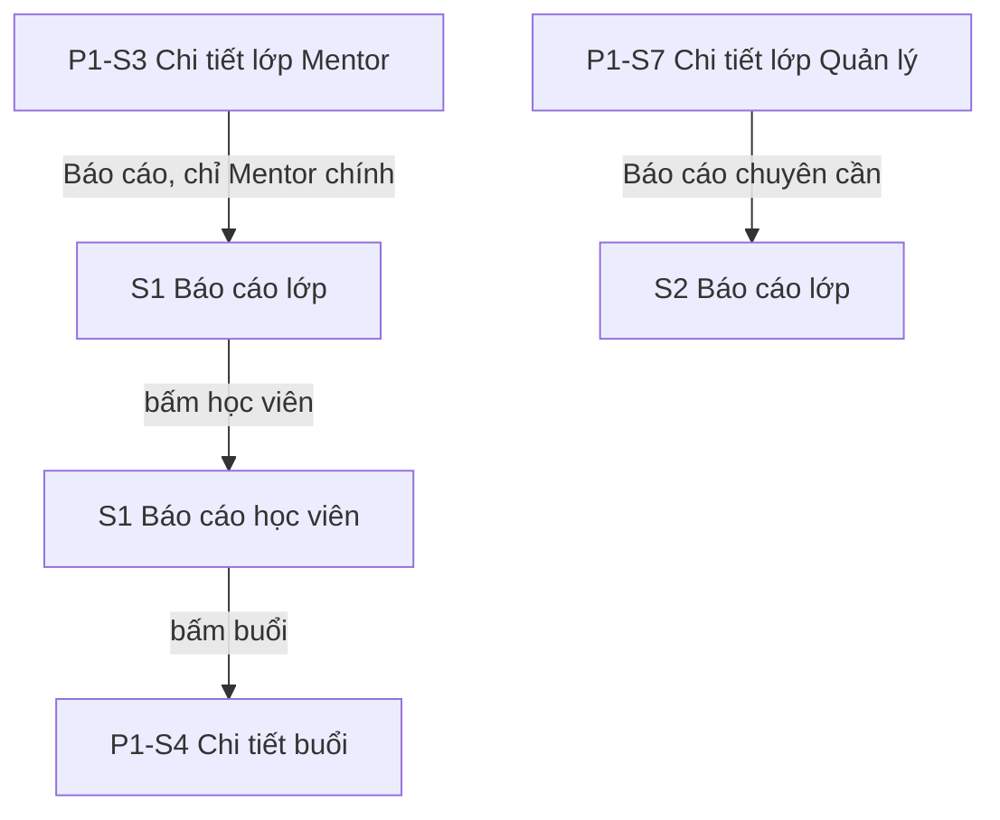

# P7 — Mentor/Manager đọc chuyên cần và progress đúng nghĩa · Design cấp phase

Ngày: 02/11/2026 (Asia/Bangkok). Người thiết kế: Claude. Trạng thái: **design hoàn tất, chờ người dùng chốt các đề xuất ở mục 2 và duyệt cùng UI toàn phase** (ADR-009). Design không thay cổng duyệt kế hoạch tổng (ADR-016, ADR-017): chưa có kế hoạch `phase-007-attendance-progress-reports.md`. Q-P1-01 và BR-REPORT-03 ghi KPI chưa chốt; mục 2 là phần trả lời đề xuất cho P7, chưa được chốt.

File này chứa phần dùng chung: quyết định cần duyệt, ý nghĩa số liệu, điều hướng, thay đổi trên màn cũ, thành phần, nhãn, hành vi dữ liệu và khoảng lệch backend. Màn hình, trạng thái, chữ và test case nằm ở từng slice:

| Slice | Design | Route | Vai trò |
| --- | --- | --- | --- |
| P7-S1 — mentor-attendance-report | [mentor-attendance-report/design.md](mentor-attendance-report/design.md) | `MentorAttendanceReport`, `MentorStudentReport` | MENTOR chính |
| P7-S2 — manager-attendance-report | [manager-attendance-report/design.md](manager-attendance-report/design.md) | `ManagerAttendanceReport` | MANAGER |

Căn cứ:

- [Kế hoạch P7](../../implementation-plan.md#p7-attendance-progress-reports), BR-REPORT-01–03, BR-TEACH-02, BR-AUTH-04; UC-M-12, UC-MG-10; ADR-004/005/008/009/023/025.
- Mẫu `Mentor Mobile UI.html` [M] và `Manager Mobile UI.html` [H], giải nén và đọc ngày 02/11/2026. [M] có "Chuyên cần TB", "Cần chú ý", thanh "Tiến độ". [H] có tiện ích "Báo cáo chuyên cần", các ô "Chuyên cần", "Dưới 80%". Các số này không có nguồn hợp lệ (mục 1).
- Source `../Mindy-BE/src/modules/attendance` (`attendance-credit.ts`, `attendance-projection.service.ts`, các controller báo cáo), `classes/services/mentor-progress.service.ts`, `enrollments/services/stored-progress.service.ts`, commit `2533b00`, đọc ngày 02/11/2026. Đây là căn cứ trường dữ liệu cho design, chưa phải contract; Codex đối chiếu lại ở API-00.
- Source mobile hiện tại của `MentorClassDetailScreen`, `ManagerClassDetailScreen`; design [teaching-workspace](../teaching-workspace/design.md), [attendance-and-notes](../attendance-and-notes/design.md).

## 1. Khác với mẫu có chủ đích

| Mẫu nói | Design | Lý do |
| --- | --- | --- |
| [M] [H] "Chuyên cần TB" của lớp | **Bỏ** | Không có endpoint tổng hợp. Tính từ các trang đã tải là sai, tiêu chí P7-S2 cấm. Trung bình theo học viên cũng khác tỷ lệ theo buổi |
| [H] "Dưới 80%", [M] "Cần chú ý" | **Bỏ** | Không có BR nào định nghĩa ngưỡng, không lọc được ở server (BR-REPORT-03) |
| [M] [H] Thanh tiến độ của lớp, "Unit 5/12" | **Bỏ** | Backend ghi rõ `completionPolicy: UNDEFINED`; "Stored decimal, not a measured learning rate". Suy từ số buổi là sai BR-REPORT-02 |
| [H] Tile "Báo cáo chuyên cần" ở Tất cả tiện ích | Mở từ Chi tiết lớp | Endpoint theo lớp; đi từ Trang chủ phải qua bước chọn lớp mà không có gì khác để xem |
| [M] Sắp xếp, lọc học viên theo mức chuyên cần | Thứ tự server theo tên | Server không có tham số; sắp xếp trên trang đã tải là sai |
| [H] Tô đỏ tỷ lệ thấp | Tỷ lệ một màu | Không có ngưỡng được chốt |

## 2. Đề xuất cần người dùng chốt

Design được viết theo cột "Đề xuất". Đổi đề xuất nào thì design của slice ở cột cuối phải cập nhật trước khi Codex làm UI.

| ID | Câu hỏi | Đề xuất | Vì sao | Ảnh hưởng |
| --- | --- | --- | --- | --- |
| Q-P7-01 | Manager có KPI thêm không? | **Không.** Chỉ hiện đúng các trường server trả cho từng học viên | BR-REPORT-03 chưa chốt. KPI mới cần contract và ADR riêng theo kế hoạch | S2 |
| Q-P7-02 | Manager có xem stored progress không? | **Không.** | Không có endpoint cho Manager (G-P7-04) | S2 |
| Q-P7-03 | Manager có bấm vào một học viên để xem chi tiết không? | **Không.** Hàng không bấm được | Không có endpoint lịch sử chuyên cần theo học viên cho Manager (G-P7-04) | S2 |
| Q-P7-04 | Mentor có màn chi tiết từng học viên không? | **Có**, gồm lịch sử điểm danh và tiến độ từng chương | Backend có sẵn. Mapping P7-S1 chưa ghi `/attendance` và `/progress`, Codex cần bổ sung. Đây là chỗ duy nhất phân biệt được physical và credited (BR-REPORT-02) | S1 |
| Q-P7-05 | Có lối vào ở Trang chủ không? | **Không.** Vào từ Chi tiết lớp | Mọi endpoint theo lớp | Mục 4 |
| Q-P7-06 | Mặc định xem khoảng nào? | **Toàn bộ, không gửi `from`/`to`**; có bộ lọc khoảng ngày tùy chọn | Backend không tự giới hạn; tỷ lệ cả lớp học là con số mọi người mong đợi | S1, S2 |

## 3. Ý nghĩa số liệu

Mục này là phần quan trọng nhất của phase. Mọi slice phải theo đúng.

### 3.1 Bộ đếm chuyên cần

| Trường | Nghĩa từ source | Nhãn | Ghi chú |
| --- | --- | --- | --- |
| `rate` | `present / (present + absent) × 100`, server làm tròn 2 chữ số. Mẫu số 0 thì `null` | Tỷ lệ | **`null` khác `0`.** Hiện "—", không bao giờ hiện "0%" cho `null` |
| `finalizedEligibleCount` | `present + absent` | Mẫu số | Hiện cùng tỷ lệ: "5/6 buổi đã chốt" |
| `present` | Credit Có mặt, gồm cả học bù được tính (`MAKEUP_CREDITED`) | Có mặt | Không phải số buổi học viên ngồi tại lớp |
| `absent` | Credit Vắng | Vắng | |
| `makeupPending` | Đang chờ học bù hoặc còn xung đột | Chờ học bù | **Không nằm trong mẫu số** |
| `unmarked` | Chỉ buổi đang IN_PROGRESS chưa điểm danh | Chưa điểm danh | Không nằm trong mẫu số |
| `excluded` | Mọi buổi còn lại: **gồm cả buổi chưa diễn ra**, buổi đã hủy, chờ thanh toán, dữ liệu cũ, trước khi ghi danh | Không tính | Con số này thường lớn khi lớp mới học. Phải có chữ giải thích, không trình bày như một vấn đề |

**Client không tính gì.** Không cộng `present + absent`, không chia lại, không làm tròn lại. Không cộng các hàng thành số của lớp.

### 3.2 Physical và credited

Chỉ lịch sử từng học viên có đủ dữ liệu để phân biệt (BR-REPORT-02):

| Trường | Nghĩa |
| --- | --- |
| `attendanceStatus` | Physical: bản ghi tại đúng buổi đó. Có thể `null` |
| `creditedAttendanceStatus` | Credited: kết quả được tính vào tỷ lệ. Có thể `null` |
| `attendanceApplicability` | Vì sao buổi được hoặc không được tính |
| `creditSessionId` | Buổi mang credit; khác `sessionId` nghĩa là credit đến từ buổi học bù |

Ví dụ: học viên vắng buổi gốc rồi học bù có mặt: buổi gốc hiện "Điểm danh: Vắng", "Tính chuyên cần: Có mặt (học bù)". Hai giá trị khác nhau và không đếm đôi (BR-MAKEUP-03).

### 3.3 Stored progress

Đây là **dữ liệu đã lưu**, không phải kết quả học. `completionPolicy` luôn là `UNDEFINED`.

| Trường | Hiển thị | Cấm |
| --- | --- | --- |
| `untrackedUnitCount`, `trackingStatus: UNTRACKED` | "Chưa theo dõi" | Không hiện 0% (BR-REPORT-02) |
| `invalidStoredUnitCount`, `dataQuality: INVALID_PERCENT` | "Dữ liệu không hợp lệ", tone warning | Không hiện số; `progressPercent` là `null` |
| `progressPercent` | Hiện đúng chuỗi server, chỉ đổi dấu thập phân: `"40.50"` → "40,50%" | Không làm tròn, không tô tiến độ tổng |
| `status` | Nhãn mục 7 | Không suy từ phần trăm |
| STORED nhưng `dataQuality: UNTRACKED` | Hiện nhãn `status`, phần trăm là "Chưa có %" | Xảy ra khi có bản ghi mà `progress_percent` null |

Không hiện thanh tiến độ, không có "x% hoàn thành khóa", không nói đủ điều kiện chứng chỉ. `assignmentSummary` luôn `NOT_IMPLEMENTED`: không có dòng nào về quiz trong báo cáo.

### 3.4 Quyền

| Dữ liệu | Mentor chính | Mentor dạy thay | Manager |
| --- | --- | --- | --- |
| Chuyên cần theo lớp | Có | **Không**, 403 `MENTOR_SCOPE_REQUIRED` | Có, mọi lớp |
| Lịch sử, tổng theo học viên | Có | Không | Không có endpoint |
| Stored progress | Có | Không | Không có endpoint |

Mobile dùng `capabilities.readClassReports` để hiện lối vào. Server là bên quyết định.

## 4. Điều hướng

| Route | Vai trò | Params | Ghi chú |
| --- | --- | --- | --- |
| `MentorAttendanceReport` | MENTOR | `classId`, `classTitle?` | |
| `MentorStudentReport` | MENTOR | `classId`, `studentId`, `studentName?`, `from?`, `to?` | Mở với cùng khoảng ngày của màn trước |
| `ManagerAttendanceReport` | MANAGER | `classId`, `classTitle?` | |

- Mở màn, Back và đổi tab hiển thị trực tiếp, không animation/gesture (ADR-023, ADR-025 mục 1).
- Mỗi role chỉ đăng ký route của mình. Params chỉ định danh và hiển thị; không truyền số liệu qua params.

Code mới đặt tại `src/modules/reports/`, namespace i18n `reports`. Toàn phase chỉ đọc, không có mutation.

## 5. Thay đổi trên màn cũ

Chỉ đổi đúng các chỗ dưới đây. Không gọi thêm API ở các màn này.

| Màn | Thay đổi | Điều kiện | testID |
| --- | --- | --- | --- |
| Chi tiết lớp Mentor | `Button` text "Báo cáo", icon `monitoring`, dưới nút "Quiz" của P6 hoặc "Tài liệu" nếu P6 chưa có | `capabilities.readClassReports` = true và `status` khác DRAFT. **Ẩn hẳn với Mentor dạy thay** | `class-detail-report-button` |
| Chi tiết lớp Quản lý, tab Tổng quan | Thêm một hàng bấm được "Báo cáo chuyên cần", icon `monitoring`, `chevron_right`, trong thẻ thông tin, sau hàng "Giáo trình" | `status` khác DRAFT | `manager-detail-report` |

Bổ sung vào model `TeachingClass` trường `readClassReports` từ `capabilities`, cùng cách với `readClassRoster`.

Không thêm tab thứ tư ở Chi tiết lớp Quản lý: 4 nhãn trên màn 360 ở font 1.3 sẽ bị cắt, và báo cáo không cần có mặt mỗi lần xem lớp.

## 6. Thành phần

Tái sử dụng `Page`, `QueryBlock`, `More`, `Filters`, `Card`, `Chip`, `StatusChip`, `Button`, `Alert`, `Sheet`, `Avatar`, `Calendar`. Thành phần mới trong `src/modules/reports/components/`:

| Thành phần | Mô tả | Dùng ở |
| --- | --- | --- |
| `AttendanceSummaryRow` | `Card` padding 14: `Avatar`, tên 15/600, `RateText` bên phải, dòng mẫu số, dòng Có mặt và Vắng, hàng chip phụ. Không blur trên thẻ lặp (ADR-025 mục 11) | S1, S2 |
| `RateText` | Tỷ lệ 17/700 màu chữ thường, tabular figures. `null` hiện "—". Không đổi màu theo giá trị | S1, S2 |
| `CountChips` | `makeupPending`, `unmarked` dạng chip khi > 0. `excluded` dạng chữ 12 khi > 0. **Không có chip với giá trị 0** | S1, S2 |
| `MeaningSheet` | Nút `info` "Cách tính" mở `Sheet` giải thích, nội dung mục 8 | S1, S2 |
| `RangeFilter` | Chip "Toàn bộ thời gian" hoặc "dd/MM/yyyy – dd/MM/yyyy" kèm `close`, mở `Sheet` hai ô ngày | S1, S2 |
| `AsOfLine` | "Số liệu lúc {HH:mm dd/MM/yyyy}" 12 từ `asOf` của response | S1, S2 |
| `ProgressRow`, `UnitProgressRow` | Mục 3.3. Không có thanh tiến độ | S1 |
| `HistoryRow` | Mục 3.2 | S1 |

**Icon cần thêm vào `symbols.json`**, Material Symbols Rounded weight 300, nếu chưa có khi làm: `monitoring`, `date_range`. `info`, `close`, `chevron_right`, `warning` đã có.

Không thêm token màu.

## 7. Nhãn và định dạng

Nhãn lấy từ giá trị server. Giá trị lạ: schema coi là phản hồi sai định dạng, không có nhãn dự phòng.

| Loại | Giá trị | vi | en | Tone |
| --- | --- | --- | --- | --- |
| Physical | PRESENT | Có mặt | Present | success |
| Physical | ABSENT | Vắng | Absent | danger |
| Physical | UNMARKED | Chưa điểm danh | Not marked | warning |
| Physical | `null` | Chưa có bản ghi | No record | neutral |
| Applicability | ELIGIBLE | Được tính | Counted | dòng chữ |
| Applicability | NOT_STARTED | Chưa diễn ra | Not started | neutral |
| Applicability | NOT_ELIGIBLE | Không tính | Not counted | neutral |
| Applicability | PAYMENT_PENDING | Chờ thanh toán | Payment pending | warning |
| Applicability | LEGACY_NO_DATA | Không có dữ liệu cũ | No legacy data | neutral |
| Applicability | MAKEUP_PENDING | Chờ học bù | Make-up pending | warning |
| Applicability | MAKEUP_CREDITED | Đã tính học bù | Make-up counted | success |
| Progress | NOT_STARTED | Chưa bắt đầu | Not started | neutral |
| Progress | IN_PROGRESS | Đang học | In progress | info |
| Progress | COMPLETED | Đã hoàn thành | Completed | success |

`displayName` null → "Chưa có tên". Trạng thái buổi theo P1 mục 8.

**Tỷ lệ:** `rate` là number, tối đa 2 chữ số thập phân. Hiện theo locale, không làm tròn thêm: `83.33` → "83,33%" (vi), "83.33%" (en); `100` → "100%"; `0` → "0%"; `null` → "—".

**Thời gian:** instant hiển thị theo `Asia/Ho_Chi_Minh` (ADR-008). Dùng `asOf` và `timeZone` của response.

**Khoảng ngày:** chọn ngày theo giờ Việt Nam. `from` là 00:00 `+07:00` của ngày đầu; `to` là 00:00 `+07:00` của **ngày sau ngày cuối**. Khoảng tối đa 93 ngày. Kiểm ở client: "Khoảng ngày tối đa 93 ngày." Ngày đầu sau ngày cuối: "Ngày đầu phải trước ngày cuối." Server trả 422 thì hiện cùng chữ; 422 này **không có mã riêng** (G-P7-05). Buổi được tính nếu giao với khoảng đó.

## 8. Chữ "Cách tính"

Dùng chung cho S1, S2, trong `MeaningSheet`:

| Mục | vi | en |
| --- | --- | --- |
| Tỷ lệ | Tỷ lệ = Có mặt ÷ (Có mặt + Vắng). Chỉ tính các buổi đã chốt. Chưa có buổi đã chốt thì hiện "—", không phải 0%. | Rate = Present ÷ (Present + Absent). Only finalized sessions count. With none finalized it shows "—", not 0%. |
| Chờ học bù | Buổi đang chờ học bù, chưa tính vào tỷ lệ. | Sessions waiting for a make-up, not yet in the rate. |
| Chưa điểm danh | Buổi đang diễn ra mà học viên chưa được điểm danh. | Sessions in progress where the student isn't marked yet. |
| Không tính | Buổi chưa diễn ra, đã hủy, chờ thanh toán, trước khi ghi danh hoặc không có dữ liệu. | Sessions not yet held, cancelled, awaiting payment, before enrollment, or with no data. |
| Học bù | Học bù được tính một lần cho buổi gốc, không đếm đôi. | A make-up counts once toward the original session. |
| Nguồn | Số liệu do hệ thống tính, không phải ứng dụng. | Figures are calculated by the system, not the app. |

## 9. Hành vi dữ liệu

Áp dụng P1 mục 9 và ADR-025, cộng các điểm riêng dưới đây.

### 9.1 Tải

| Màn | Lúc mở gọi gì | Không gọi |
| --- | --- | --- |
| S1 lớp, tab Chuyên cần | `GET /mentor/classes/:classId/attendance-summary` trang 1 | Trang sau, tiến độ |
| S1 lớp, tab Tiến độ | `GET /mentor/classes/:classId/progress` trang 1, **khi mở tab** | |
| S1 học viên | `GET .../students/:studentId/attendance-summary` và `/attendance` trang 1 | Tiến độ |
| S1 học viên, tab Tiến độ | `GET .../students/:studentId/progress` trang 1, bảng tra `GET .../units?pageSize=100` song song, không chặn | |
| S2 | `GET /management/classes/:classId/attendance-summary` trang 1 | Roster, sessions |

`pageSize` 20, nút "Xem thêm". **Không tự tải hết các trang.** Giữ thứ tự server: theo tên. Query key gồm tài khoản, role, classId, studentId, `from`, `to`, page. Đổi khoảng không hiện dữ liệu cũ dưới nhãn mới. Khử trùng theo `enrollmentId` khi ghép trang.

Không có mutation nên không có invalidate riêng. Làm mới khi focus lại và kéo làm mới, theo cơ chế đã có. Chỉnh điểm danh ở P2 sẽ thấy ở lần tải sau; `AsOfLine` cho biết số liệu lúc nào.

### 9.2 Offline

Dữ liệu chỉ ở bộ nhớ. Tên học viên và số liệu không lưu thiết bị (BR-DATA-02).

| Đã có dữ liệu cùng query | Chưa có dữ liệu |
| --- | --- |
| Hiện, kèm "Dữ liệu có thể đã cũ." và `AsOfLine`. Không "Thử lại" | "Chưa có dữ liệu. Kết nối mạng để tải." Không hiện rỗng và **không hiện 0** |

### 9.3 Lỗi

| HTTP / mã | Hành vi |
| --- | --- |
| 403 `MENTOR_SCOPE_REQUIRED`, 403 khác | Xóa dữ liệu; `StatusBlock` không quyền (BR-AUTH-04). Không giữ danh sách cũ |
| 404 `CLASS_STUDENT_NOT_FOUND` | Xóa dữ liệu; `StatusBlock` không tìm thấy, "Quay lại" |
| 404 lớp | Như trên |
| 422 khoảng ngày | Mục 7; giữ dữ liệu cũ của khoảng trước khi sheet còn mở |
| 401 | Về Login theo P0 |
| 5xx, timeout | Theo P1 mục 9.3. Lần đầu: `StatusBlock` + "Thử lại", **không hiện 0**. Làm mới: giữ dữ liệu, `Alert`. Tải thêm: giữ hàng, thử lại đúng trang |

Repo không có component tên `StatusBlock`: từ đó chỉ khối trạng thái toàn màn theo P1 mục 9.3, dựng bằng `QueryBlock` hoặc `FocusPanel` hiện có.

## 10. Khoảng lệch với backend

Đọc từ source ngày 02/11/2026. Mọi mục đều đã có cách xử lý không cần đổi backend. Không tự sửa backend; G-P7-01, -02, -03 nên được chủ backend xem xét.

| ID | Phát hiện | Cách design xử lý |
| --- | --- | --- |
| G-P7-01 | `classSummary` và progress đếm **mọi** enrollment của lớp, gồm cả CANCELLED và PENDING_PAYMENT. Hàng không có `status` của enrollment. Học viên hủy rồi ghi danh lại có hai hàng, hàng cũ có thể toàn số 0 | Số đầu danh sách ghi "{total} lượt ghi danh", không gọi là "học viên" hay "sĩ số". Hàng `rate` null hiện đúng theo mục 3. Không ghép roster để lọc vì không ghép được qua trang. Nên thêm `enrollmentStatus` vào hàng |
| G-P7-02 | Không có endpoint tổng hợp cấp lớp | Không có số của lớp. Mục 1 |
| G-P7-03 | `excluded` gộp nhiều nghĩa, gồm buổi chưa diễn ra | Nhãn "Không tính" kèm giải thích; không tone cảnh báo. Lịch sử từng buổi mới phân biệt được |
| G-P7-04 | Manager không có route lịch sử theo học viên hay progress. `GET /manager/classes/:classId/students/:studentId` chỉ có liên hệ. Route `/management/...` nhận cả ADMIN | Q-P7-02, Q-P7-03: hàng không bấm được; không dùng route khác để lấp |
| G-P7-05 | Khoảng ngày sai trả `UnprocessableEntityException`, không có mã lỗi riêng | Client kiểm trước; 422 ở các route này coi là lỗi khoảng ngày |
| G-P7-06 | Tổng theo học viên có `aggregationScope: STUDENT_CLASS_HISTORY`: gộp mọi enrollment của học viên trong lớp, nên có thể khác hàng của một enrollment | Màn học viên có dòng giải thích. Không so sánh hay đối chiếu hai số |
| G-P7-07 | `MentorClassAttendanceSummaryPageDto` có `readonly`; DTO của Manager không có | S1 hiện `Alert` theo `readonly`. S2 không có, cũng không cần vì màn chỉ đọc |
| G-P7-08 | Progress `readonly` luôn `true`, `policyVersion` luôn `null` | Không hiển thị hai trường này |
| G-P7-09 | Lịch sử trả cả buổi không phải leaf của chuỗi thay thế, applicability là `NOT_ELIGIBLE` | Hiện đúng theo server. Không ẩn, không ghép với buổi thay thế |

## 11. i18n, testID, accessibility

Namespace gợi ý `reports.*`; Codex được đổi tên key nếu giữ nguyên chữ. testID theo mẫu `<slice>-<phần tử>`: `mentor-report-` (S1 lớp), `student-report-` (S1 học viên), `manager-report-` (S2).

Chung cho mọi slice:

- Mở Sheet: focus vào tiêu đề; đóng: trả focus về nút gốc.
- Không giới hạn phóng chữ; ở 1.3 không có phần nào đè nhau, chip xuống dòng được.
- `null` đọc là "chưa có dữ liệu", không đọc "gạch ngang". Tỷ lệ đọc "83 phẩy 33 phần trăm".
- Trạng thái không truyền đạt chỉ bằng màu.

Chữ dùng chung:

| Key gợi ý | vi | en |
| --- | --- | --- |
| `reports.mentorLink` | Báo cáo | Reports |
| `reports.managerLink` | Báo cáo chuyên cần | Attendance report |
| `reports.enrollments` | {{count}} lượt ghi danh | {{count}} enrollments |
| `reports.denominator` | {{present}}/{{total}} buổi đã chốt | {{present}}/{{total}} finalized sessions |
| `reports.noFinalized` | Chưa có buổi đã chốt | No finalized sessions |
| `reports.present` | Có mặt {{count}} | Present {{count}} |
| `reports.absent` | Vắng {{count}} | Absent {{count}} |
| `reports.makeupPending` | Chờ học bù {{count}} | Make-up pending {{count}} |
| `reports.unmarked` | Chưa điểm danh {{count}} | Not marked {{count}} |
| `reports.excluded` | Không tính {{count}} | Not counted {{count}} |
| `reports.asOf` | Số liệu lúc {{time}} | As of {{time}} |
| `reports.meaning` | Cách tính | How it's calculated |
| `reports.allTime` | Toàn bộ thời gian | All time |
| `reports.pickRange` | Chọn khoảng ngày | Choose a date range |
| `reports.from` / `.to` | Từ ngày / Đến ngày | From / To |
| `reports.apply` | Áp dụng | Apply |
| `reports.rangeMax` | Khoảng ngày tối đa 93 ngày. | The range can be up to 93 days. |
| `reports.rangeOrder` | Ngày đầu phải trước ngày cuối. | The start date must be before the end date. |
| `reports.noName` | Chưa có tên | No name |
| `reports.empty` | Lớp chưa có lượt ghi danh nào. | This class has no enrollments yet. |
| `reports.stale` | Dữ liệu có thể đã cũ. | Data may be out of date. |
| `reports.offlineEmpty` | Chưa có dữ liệu. Kết nối mạng để tải. | No data yet. Connect to load it. |
| `reports.refreshFailed` | Chưa cập nhật được. | Couldn't refresh. |
| `reports.more` | Xem thêm | Show more |
| `reports.status.*` | Bảng mục 7 | Bảng mục 7 |

## 12. Test case cấp phase và dữ liệu E2E

| ID | Tiền điều kiện | Thao tác | Kết quả mong đợi |
| --- | --- | --- | --- |
| TC-P7-CTX-01 | Mentor chính | Mở chi tiết lớp | Có `class-detail-report-button`; không có request báo cáo trước khi bấm |
| TC-P7-CTX-02 | Mentor dạy thay, `readClassReports` false | Mở chi tiết lớp | Không có nút, kể cả dạng khóa |
| TC-P7-CTX-03 | Quản lý | Mở tab Tổng quan | Có `manager-detail-report`; không có request báo cáo trước khi bấm; số tab không đổi |
| TC-P7-NAV-01 | Mở từng màn P7, Back toolbar và Android Back | | Không animation chuyển màn, về đúng màn trước (kiểm native) |
| TC-P7-NAV-02 | Đăng nhập Mentor / Quản lý | Điều hướng tới route của role kia | Route không tồn tại trong stack |
| TC-P7-SEM-01 | `rate` null, `finalizedEligibleCount` 0 | Xem | "—", `noFinalized`; **không có "0%" ở đâu cả** |
| TC-P7-SEM-02 | `rate` 0, `absent` 3 | Xem | "0%", "0/3 buổi đã chốt"; khác trường hợp null |
| TC-P7-SEM-03 | `rate` 83.33, vi / en | Xem | "83,33%" / "83.33%"; không làm tròn |
| TC-P7-SEM-04 | Mọi số đếm phụ 0 | Xem | Không có chip nào |
| TC-P7-SEM-05 | `excluded` 8, `makeupPending` 1, `unmarked` 2 | Xem | Hiện đúng, tách riêng; `excluded` không có tone cảnh báo |
| TC-P7-SEM-06 | Client tính lại | So sánh | Tìm trong code: không có phép tính tỷ lệ, không cộng hàng |
| TC-P7-SEM-07 | Bấm `info` | | `MeaningSheet` đúng chữ mục 8 |
| TC-P7-SEM-08 | Toàn bộ màn | Tìm | Không có "Chuyên cần TB", "Dưới 80%", "Cần chú ý", thanh tiến độ |
| TC-P7-RNG-01 | Mở lần đầu | Xem request | Không có `from`, `to` |
| TC-P7-RNG-02 | Chọn 01/10–31/10/2026 | Áp dụng | `from=2026-10-01T00:00:00+07:00`, `to=2026-11-01T00:00:00+07:00`; page 1; không hiện số cũ trong lúc tải |
| TC-P7-RNG-03 | Chọn 94 ngày | Áp dụng | `rangeMax`; không có request |
| TC-P7-RNG-04 | Chọn đúng 93 ngày | Áp dụng | Hợp lệ |
| TC-P7-RNG-05 | Ngày đầu sau ngày cuối | Áp dụng | `rangeOrder`; không có request |
| TC-P7-RNG-06 | Bấm `close` trên chip | | Về Toàn bộ thời gian; request không có `from`, `to` |
| TC-P7-I18N-01 | vi/en × sáng/tối × màn 360 × font 1.3 | Xem 2 slice | Không cắt chữ, chip xuống dòng được, tương phản đạt bảng P1 |

**Dữ liệu E2E** (Codex chuẩn bị theo kế hoạch phase):

- Mentor A chính của một lớp IN_PROGRESS; Mentor B dạy thay một buổi của lớp đó; lớp COMPLETED. Tài khoản Manager.
- Học viên đủ trường hợp: chưa có buổi đã chốt (`rate` null); toàn vắng (`rate` 0); có `makeupPending`; có học bù được tính (physical Vắng, credited Có mặt); có buổi IN_PROGRESS chưa điểm danh; hủy rồi ghi danh lại (hai hàng); enrollment PENDING_PAYMENT.
- Stored progress: chương STORED hợp lệ, chương UNTRACKED; **chương có phần trăm không hợp lệ chỉ tạo được bằng fixture riêng**, thiếu thì ghi blocked, không âm thầm bỏ qua.
- Hơn 20 enrollment để kiểm phân trang. Buổi nằm trong và ngoài một khoảng ngày để kiểm bộ lọc.
- Dùng cùng dữ liệu P2 đã chốt; **không tạo số liệu giả qua mock trong E2E**.
