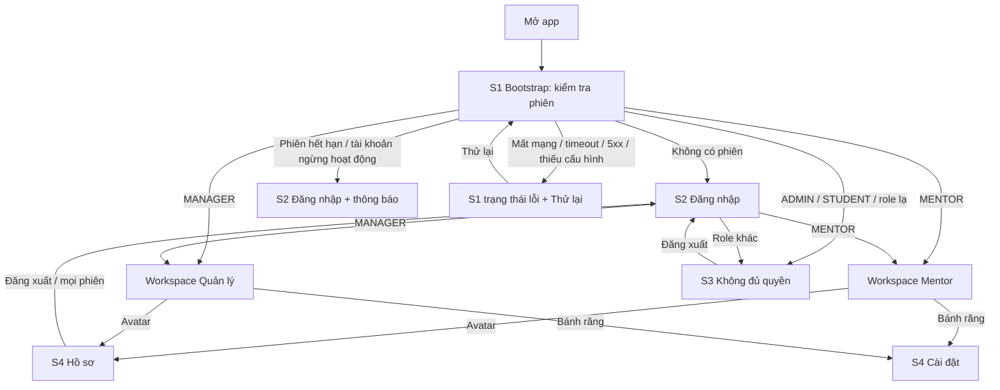

# P0 — Nền tảng → đăng nhập → đúng workspace · Design cấp phase

Ngày: 30/10/2026 (Asia/Bangkok). Người thiết kế: Claude. Trạng thái: **design hoàn tất, chờ người dùng duyệt cùng UI toàn phase** (ADR-009).

File này chứa phần dùng chung của cả phase: luồng điều hướng, quyết định token/theme, thành phần và khung workspace P0. Màn hình, trạng thái, nội dung chữ và test case của từng slice nằm ở:

| Slice | Design |
| --- | --- |
| P0-S1 — bootstrap | [bootstrap/design.md](bootstrap/design.md) |
| P0-S2 — login | [login/design.md](login/design.md) |
| P0-S3 — access-denied | [access-denied/design.md](access-denied/design.md) |
| P0-S4 — settings | [settings/design.md](settings/design.md) |

Căn cứ: mẫu `docs/design/Login.html` [L], `Mentor Mobile UI.html` [M], `Thiết kế Home UI.html` [H]; token tại [global.css.md](../global.css.md); BR-AUTH-01–04, BR-SCOPE-03, BR-DATA-01/02; source auth backend (`../Mindy-BE/src/modules/auth`) đọc ngày 30/10/2026.

## 1. Ranh giới slice (trả lời Q-DESIGN-01 cho P0)

Giữ nguyên 4 slice như kế hoạch, không thêm màn. Các trạng thái loading/offline/hết phiên/lỗi là trạng thái của màn tương ứng, không phải màn mới. Bổ sung một **khung workspace P0** (mục 6): không phải slice riêng, chỉ là đích điều hướng tối thiểu để kiểm chứng "đúng workspace" và mở Hồ sơ/Cài đặt; P1 thay phần thân bằng Trang chủ.

## 2. Luồng điều hướng



Quy tắc điều hướng chung:

- Mọi chuyển giữa Bootstrap, Login, Denied và Workspace là **thay toàn bộ stack** (reset), không push. Nút back/cử chỉ back Android ở các màn này thoát app, không quay lại màn trước. Mục tiêu: không vòng lặp, không quay lại workspace sau đăng xuất.
- Hồ sơ và Cài đặt là trang con push từ workspace (trượt ngang từ phải, `--mdy-dur-slide` 0.32s, `--mdy-ease-standard`), back quay về workspace.
- Role chỉ lấy từ response `login`/`me` của lần kiểm tra hiện tại. **Không** mở workspace bằng role/user đã lưu trên thiết bị (BR-AUTH-04).
- Chuyển cảnh Bootstrap → Login: không hiệu ứng trượt; phần header giống hệt nhau nên chỉ thẻ đăng nhập fade-in (`--mdy-dur-base` 0.25s). Bootstrap → Workspace: fade 0.25s.

## 3. Theme (trả lời Q-THEME-01)

- **defaultTheme = `system`** (theo cài đặt máy; người dùng xác nhận ngày 30/10/2026). Người dùng chọn được Sáng / Tối / Hệ thống tại S4; lựa chọn lưu cục bộ (preference, không nhạy cảm) và giữ qua đăng xuất.
- Ngôn ngữ mặc định `vi`; `en` đủ cùng key. Không tự theo ngôn ngữ máy ở P0.
- Bảng sáng = token trong [global.css.md](../global.css.md). Bảng tối dưới đây là token mới do design bổ sung; tên token giữ nguyên, chỉ đổi giá trị theo `dark`.

### 3.1 Bảng token sáng/tối dùng trong P0

| Token | Sáng | Tối | Vai trò |
| --- | --- | --- | --- |
| `--mdy-bg` | #f6f5f2 | #101615 | nền màn |
| `--mdy-brand-tint-4` (quầng teal) | #d7e9e5 | #16302f | quầng sáng nền |
| `--mdy-warm-glow` | #f2e4d0 | #2a2219 | quầng ấm nền |
| `--mdy-surface` | #ffffff | #1a2121 | input, thẻ trắng, nút secondary |
| `--mdy-surface-muted` | #efede8 | #242b2a | pressed trung tính, chip neutral |
| `--mdy-surface-muted-2` | #f1efeb | #212827 | pressed nút secondary |
| `--mdy-bg-sheet` | #fbfaf8 | #161d1c | nền bottom sheet |
| `--mdy-border` | #e3e0da | #2f3836 | viền input/nút secondary |
| `--mdy-divider` | #ebe9e4 | #273030 | đường chia hàng |
| `--mdy-handle` | #cfccc5 | #3d4644 | tay kéo sheet |
| `--mdy-ink` | #1c1b19 | #ecebe7 | chữ chính |
| `--mdy-text-secondary` | #6b6862 | #a8a69f | chữ phụ, icon input |
| `--mdy-text-tertiary` | #8a867e | #8f8c85 | nhãn nhóm |
| `--mdy-text-placeholder` | #a19d95 | #77746e | placeholder |
| `--mdy-brand-800` (primary) | #1f4f55 | #2b767c | nút chính, radio chọn |
| `--mdy-brand-900` (pressed) | #123236 | #22636a | nút chính khi nhấn |
| `--mdy-brand-700` (loading) | #2b6a71 | #3a8a90 | nút chính khi loading |
| `--mdy-brand-disabled` | #c9d6d4 | #2a3838 | nền nút chính disabled (chữ tối: #7d8b8a) |
| `--mdy-link` | #1f5f66 | #7cc4bf | nút text, link |
| `--mdy-brand-tint-1` | #eef4f3 | #18302f | hàng đang chọn |
| `--mdy-brand-tint-2` | #e4efed | #1d3836 | nền icon tròn teal, pressed nút text |
| `--mdy-brand-tint-3` | #d9e6e4 | #234342 | nền avatar (chữ: sáng #1f4f55 / tối #9fd3c9) |
| `--mdy-danger-fg` | #9a2f12 | #f0a089 | chữ lỗi |
| `--mdy-danger-bg` | #f8e1da | #4a2419 | icon tròn lỗi |
| `--mdy-danger-bg-soft` | #fbeee9 | #3a1f18 | hộp lỗi |
| `--mdy-danger-border` | #e8c9bf | #7a3a2a | viền input lỗi |
| nền nút danger | #9a2f12 | #b0472e | nút "Đăng xuất mọi phiên" (chữ #fff) |
| `--mdy-warning-fg` | #8a4b06 | #f2c27a | chữ cảnh báo |
| `--mdy-warning-bg-soft` | #fdf5e8 | #33270f | hộp cảnh báo |
| `--mdy-warning-border` | #f0dcb8 | #5a4520 | viền hộp cảnh báo |
| `--mdy-info-fg` / `--mdy-info-bg` | #274a8a / #e1e8f6 | #a9c1f0 / #1d2a44 | hộp thông tin |
| nền toast (`--mdy-ink` ở sáng) | #1c1b19 | #2c3433 | toast (chữ sáng #fff / tối #ecebe7) |
| `--mdy-scrim-sheet` | rgba(20,24,24,.4) | rgba(0,0,0,.55) | scrim sau sheet |
| `--mdy-gradient-header` | #123236 → #1f4f55 → #2b6a71 | #0b2123 → #143a3e → #1d5156 | header |
| `--mdy-gradient-glass` | rgba(255,255,255,.9) → .68 | rgba(30,38,37,.92) → rgba(30,38,37,.78) | thẻ kính |
| viền thẻ kính | rgba(255,255,255,.95) | rgba(255,255,255,.08) | |
| bóng thẻ kính | `--mdy-shadow-glass` | 0 8px 24px rgba(0,0,0,.35), không inset | |

Không đổi giữa hai theme: `--mdy-on-brand` #fff, `--mdy-on-brand-muted` #c7dcd9, `--mdy-toast-icon` #9fd3c9, nút kính trên header, ảnh linh vật.

Độ tương phản đã kiểm (WCAG): chữ chính 15.8:1 (sáng) / 15.3:1 (tối); chữ phụ trên surface 5.6 / 6.7; nút chính 9.1 / 5.3; link 7.3 / 8.2; lỗi trong hộp lỗi 6.6 / 7.3; nút danger tối 5.6. `--mdy-text-tertiary` sáng chỉ đạt 3.3:1 nên **P0 không dùng tertiary cho câu chữ cần đọc**: footer và phụ đề hàng dùng `--mdy-text-secondary`; tertiary chỉ cho nhãn nhóm viết hoa (≥12px, semibold) và chevron.

### 3.2 Xử lý xung đột token liên quan P0 ([global.css.md](../global.css.md) mục 6)

| # | Quyết định cho P0 |
| --- | --- |
| #1 nền màn | Giữ 2 biến thể có chủ đích: `--mdy-bg-screen-login` cho Bootstrap/Login/Denied; `--mdy-bg-screen-app` cho workspace, Hồ sơ và Cài đặt. |
| #2 accent trên nền tối | Dùng #9fd3c9 (toast, chữ avatar tối, chip brand tối). #9fe3d6 chỉ dùng cho chấm lịch tuần [M] (P1). |
| #3 bo góc chip | Chip luôn dạng pill: `--mdy-radius-pill`. |
| #5 cỡ nút | Nút toàn chiều rộng trong form/sheet: 52px, pressed đổi nền sang `--mdy-brand-900`. Nút trong thẻ: 44px, pressed `scale(.98)`. 48px không dùng ở P0. |
| #6 hai teal | `--mdy-brand-800` cho nền nút/icon/radio; `--mdy-link` cho nút text. |

## 4. Typography, icon, ảnh

- Font: **Be Vietnam Pro** 400/500/600/700, nhúng vào app (không tải từ Google Fonts lúc chạy). Cho phép phóng chữ theo cài đặt máy; tối đa `maxFontSizeMultiplier = 1.3` cho tiêu đề header và nút để không vỡ layout; nội dung thường không giới hạn.
- Icon: **Material Symbols Rounded**, weight 300 mặc định, `FILL 1` cho trạng thái bật. Glyph dùng ở P0: `mail`, `lock`, `visibility`, `visibility_off`, `error`, `info`, `warning`, `check_circle`, `cloud_off`, `dns`, `settings_alert`, `lock_person`, `logout`, `devices`, `arrow_back`, `settings`, `call`, `school`, `dashboard`, `contrast`, `light_mode`, `dark_mode`, `radio_button_checked`, `radio_button_unchecked`, `refresh`, `help`. Nếu bộ icon trong app thiếu glyph nào, báo lại để design thay, không tự đổi hình.
- Ảnh linh vật: [assets/mascot-login.png](assets/mascot-login.png) (trích nguyên từ mẫu [L], 557×700, nền trong suốt). Ảnh trang trí, `accessible=false`.
- Wordmark "Mindy": chữ Be Vietnam Pro 30px/700, letter-spacing −0.01em, không dùng `src/assets/images/logo.png` cũ của boilerplate.

## 5. Thành phần dùng ở P0

Đặt tại `src/components/ui` (ADR-003). Kích thước/màu theo [global.css.md](../global.css.md) mục 4, giá trị tối theo bảng 3.1.

| Thành phần | Biến thể dùng ở P0 | Ghi chú hành vi |
| --- | --- | --- |
| `Screen` | `login`, `app` | nền quầng sáng tương ứng; tôn trọng safe area trên/dưới |
| `BrandHeader` | `auth` (padding 56/24/96, wordmark + tagline + linh vật), `workspace` (avatar + tên + phụ đề + nút cài đặt), `subpage` (nút back trong suốt + tiêu đề 18px + phụ đề 13px; không bo đáy, xem S4 mục 3) | `auth`/`workspace` bo đáy 28px; gradient header; status bar chữ sáng |
| `GlassCard` | mặc định, `pressable` | radius 20, padding theo slice |
| `Button` | `primary`, `secondary`, `danger`, `text`; cỡ `lg` 52 và `sm` 44 | trạng thái pressed / loading (spinner 18px + đổi nhãn) / disabled; khi loading chặn bấm lặp |
| `TextField` | `email`, `password` (có nút hiện/ẩn) | label trên ô; lỗi dưới ô 12px; viền lỗi `--mdy-danger-border` |
| `InlineAlert` | `error`, `warning`, `info` | icon 18px + chữ 13px, radius 12, padding 10/12; `accessibilityRole="alert"` (error) để screen reader đọc ngay |
| `StatusBlock` | — | icon tròn 56px + tiêu đề 17/600 + mô tả 14 + vùng nút; dùng cho lỗi bootstrap và Denied |
| `Toast` | `success`, `info` | dưới đáy cách 24px, tự ẩn 2.2s, không nhận chạm; đọc qua `announceForAccessibility` |
| `BottomSheet` | `confirm`, `info` | scrim + sheet `--mdy-bg-sheet`, tay kéo, chạm scrim/back để đóng (trừ khi đang loading) |
| `Avatar` | 52px (header), 84px (Hồ sơ); chữ cái | 2 chữ cái đầu của họ và tên cuối từ `displayName` (ví dụ "Trần Thị Linh" → "TL"); 1 từ → 1 chữ |
| `ListRow` | `action` (icon tròn 40 + nhãn + phụ đề), `option` (ô mã tròn 40 + nhãn + phụ đề + radio), `info` (icon tròn 40 + nhãn + giá trị, không bấm được) | hàng cao tối thiểu 56px; pressed nền `--mdy-surface-muted` |
| `ThemeCard` | `light`, `dark`, `system` | hình xem trước + nhãn; xem S4 mục 4.2 |
| `Chip` | `brand`, `neutral` | cao 22, pill, 11px/600 |

Kích thước chạm tối thiểu 44×44 cho mọi phần tử bấm; nút text 32px phải mở rộng vùng chạm (hitSlop) đủ 44.

## 6. Khung workspace P0 (đích của S1/S2, cửa vào S4)

P0 chưa có Trang chủ (P1 thiết kế riêng). Khung tối thiểu cho cả hai role:

```
┌──────────────────────────────┐
│▓▓ header gradient (workspace)▓│
│ (TL)  Trần Thị Linh      (⚙) │  ← Avatar → Hồ sơ; bánh răng → Cài đặt
│       Mentor · linh.tran@…   │
│▓▓▓▓▓▓▓▓▓▓▓▓▓▓▓▓▓▓▓▓▓▓▓▓▓▓▓▓▓▓│
│  ┌────────────────────────┐  │
│  │ (icon tròn teal)        │  │  GlassCard, overlap −50px
│  │ Không gian Mentor       │  │
│  │ Lịch dạy và lớp học sẽ  │  │
│  │ hiển thị tại đây.       │  │
│  └────────────────────────┘  │
└──────────────────────────────┘
```

- Header: bố cục như [M]/[H] (padding 20/16/120, avatar 52px, tên 17/600, phụ đề "{vai trò} · {email}" 13 `--mdy-on-brand-muted` cắt 1 dòng, nút kính `settings` 44px bên phải). Không có chip vai trò trên header. Không có nút chuông ở P0.
- Avatar và bánh răng là nút: `accessibilityLabel` = "Hồ sơ" / "Profile" và "Cài đặt" / "Settings".
- Thẻ thân: icon `school` (Mentor) hoặc `dashboard` (Quản lý) trong ô tròn 56px `--mdy-brand-tint-2`; tiêu đề "Không gian Mentor" / "Không gian Quản lý"; mô tả "Lịch dạy và lớp học sẽ hiển thị tại đây." / "Các việc cần theo dõi sẽ hiển thị tại đây.".
- testID gốc: `workspace-mentor-root`, `workspace-manager-root`; avatar `workspace-account-button`; bánh răng `workspace-settings-button`.

## 7. Nội dung chữ, i18n và testID

- Mỗi slice có bảng chữ vi/en và key gợi ý theo namespace `auth.*`, `settings.*`, `workspace.*`, `common.*`. Codex được đổi tên key nếu giữ nguyên chữ.
- Không hiển thị message tiếng Anh thô từ backend. Mã lỗi map theo ADR-007; với lỗi 5xx có `requestId`, hiện dòng "Mã hỗ trợ: {requestId}" 12px `--mdy-text-secondary`, cho phép chọn/copy chữ.
- testID theo mẫu `<slice>-<phần tử>`, liệt kê trong từng slice; dùng cho Jest/RNTL và Maestro.

## 8. Lỗi dùng chung (ADR-007)

| Loại lỗi | vi | en |
| --- | --- | --- |
| Mất mạng | Không có kết nối mạng. Kiểm tra kết nối rồi thử lại. | No internet connection. Check your connection and try again. |
| Timeout | Máy chủ phản hồi quá lâu. Vui lòng thử lại. | The server took too long to respond. Please try again. |
| 5xx | Hệ thống đang gặp sự cố. Vui lòng thử lại sau. | Something went wrong on our side. Please try again later. |
| Phản hồi sai định dạng | Không đọc được phản hồi từ máy chủ. Vui lòng thử lại sau. | We couldn't read the server response. Please try again later. |
| Thiếu cấu hình (chỉ development) | Ứng dụng chưa được cấu hình địa chỉ máy chủ. | The app has no server address configured. |

## 9. Ngoài phạm vi P0 và phụ thuộc

- Không có: đăng nhập Google, đăng ký, "Ghi nhớ đăng nhập", đặt lại mật khẩu trong app, chọn role/chi nhánh, chuông thông báo. Nút Google, đường kẻ "hoặc" và ô "Ghi nhớ đăng nhập" của mẫu [L] được **bỏ** (BR-AUTH-02; ghi nhớ phiên do cookie/ADR Auth quyết định, không phải lựa chọn người dùng).
- Phụ thuộc chưa giải quyết, không chặn UI mock: ADR Auth (cookie jar, refresh, logout khi mất mạng), Q-ENV-01, Q-PLAT-01, Q-DATA-01 (draft khi đăng xuất — P0 chưa có draft).
- Khi P1 có Trang chủ, khung workspace mục 6 được thay; avatar → Hồ sơ và bánh răng → Cài đặt giữ nguyên.
