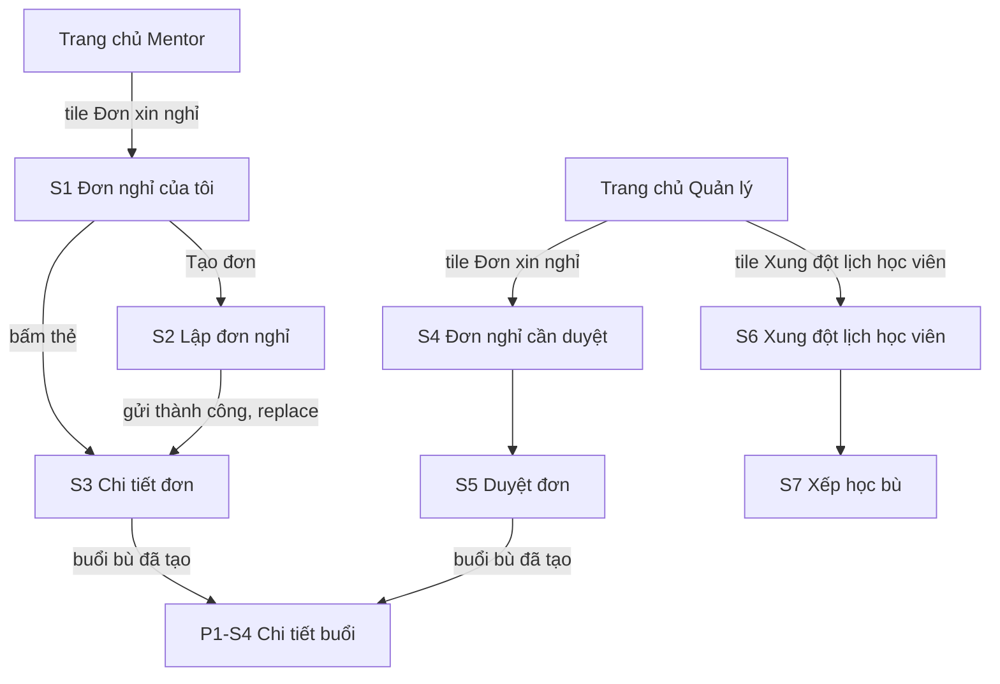
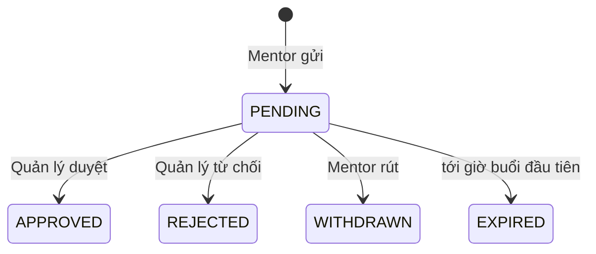

# P4 — Mentor xin nghỉ → Manager duyệt → lịch bù cập nhật · Design cấp phase

Ngày: 02/11/2026 (Asia/Bangkok). Người thiết kế: Claude. Trạng thái: **design hoàn tất, các quyết định ở mục 2 chờ người dùng duyệt; UI duyệt cùng toàn phase** (ADR-009). Design không thay cổng duyệt kế hoạch tổng (ADR-017).

File này chứa phần dùng chung: quyết định cần duyệt, điều hướng, thay đổi trên màn cũ, mô hình ghi, thành phần, nhãn, hành vi dữ liệu và khoảng lệch backend. Màn hình, trạng thái, chữ và test case nằm ở từng slice:

| Slice | Design | Route | Vai trò |
| --- | --- | --- | --- |
| P4-S1 — mentor-leave-list | [mentor-leave-list/design.md](mentor-leave-list/design.md) | `MentorLeaveList` | MENTOR |
| P4-S2 — leave-plan-editor | [leave-plan-editor/design.md](leave-plan-editor/design.md) | `LeavePlanEditor` | MENTOR |
| P4-S3 — mentor-leave-detail | [mentor-leave-detail/design.md](mentor-leave-detail/design.md) | `MentorLeaveDetail` | MENTOR |
| P4-S4 — leave-review-queue | [leave-review-queue/design.md](leave-review-queue/design.md) | `LeaveReviewQueue` | MANAGER |
| P4-S5 — leave-review-detail | [leave-review-detail/design.md](leave-review-detail/design.md) | `LeaveReviewDetail` | MANAGER |
| P4-S6 — makeup-conflicts (đề xuất) | [makeup-conflicts/design.md](makeup-conflicts/design.md) | `MakeupConflicts` | MANAGER |
| P4-S7 — makeup-placement-editor (đề xuất) | [makeup-placement-editor/design.md](makeup-placement-editor/design.md) | `MakeupPlacement` | MANAGER |

Căn cứ:

- [Baseline P4](../../implementation-plan.md#p4-leave-and-makeup), BR-LEAVE-01–05, BR-MAKEUP-01–03, BR-TEACH-03, BR-TIME-01; UC-M-09/10, UC-MG-05/06; ADR-004/005/007/008/009/012/023/025. P4 chưa có kế hoạch tổng; khi lập kế hoạch thì đối chiếu lại design này.
- Mẫu `Manager Mobile UI.html` [H], giải nén và đọc ngày 02/11/2026: có danh sách đơn nghỉ, chi tiết đơn, sheet từ chối và tile "Xung đột lịch học viên", "Bố trí học bù". Hai tile này chưa có màn trong mẫu, chỉ hiện toast. `Mentor Mobile UI.html` [M] **không có màn xin nghỉ nào**. Vì vậy S1, S2, S3, S6, S7 ghép từ token và thành phần có sẵn, cần xem kỹ khi duyệt UI.
- Source `../Mindy-BE/src/modules/teaching-operations` (leave), `attendance` (makeup), `schedule-reservations`, `manager-operations` đọc ngày 02/11/2026, kèm `test/integration/phase44-mentor-leave.spec.ts` và `docs/api_flow/PHASE_4_4_flow-api-breakdown.md` mục 6–10, 19. Đây là căn cứ trường dữ liệu cho design, chưa phải contract; Codex đối chiếu lại ở API-00. Không có backend nào được gọi trong lượt design.
- Design [teaching-workspace](../teaching-workspace/design.md), [attendance-and-notes](../attendance-and-notes/design.md) và source hiện tại của `WorkspaceScreen`, `HomeTile`, `SessionEditScreen`.

## 1. Khác với mẫu có chủ đích

| Mẫu nói | Design | Lý do |
| --- | --- | --- |
| [H] Mỗi buổi trong đơn có "Chưa có mentor dạy thay" và nút "Phân công" | Bỏ. Mỗi buổi hiện lịch gốc → lịch bù Mentor đã chọn | Backend duyệt đơn bằng cách hủy buổi gốc và tạo buổi bù do **chính Mentor đó** dạy (BR-LEAVE-05). Dạy thay là luồng khác, thuộc P5-S1 |
| [H] Chỉ từ chối mới cần lý do | Duyệt cũng bắt buộc lý do | `ApproveLeaveInput` kế thừa `reason` 1–1000; lý do này ghi vào audit hủy buổi |
| [H] "{n} học viên trùng lịch cần học bù", bấm mở Xung đột và vẫn duyệt được | Còn trùng thì **không duyệt được**; chỉ từ chối | Từ 23/10/2026 backend từ chối `LEAVE_STUDENT_CONFLICT`, cờ acknowledgment không bỏ qua được (mục 2, Q-P4-01) |
| [H] Sheet từ chối có chip lý do gợi ý | Chỉ một ô `ReasonField` | Cùng cách nhập lý do với P2; chip gợi ý chưa có nguồn nghiệp vụ |
| [H] Thẻ "Ưu tiên · buổi học tối mai", "còn 2 buổi cần phân công" | Bỏ. Thẻ đơn hiện "Hạn xử lý {expiresAt}" | Backend không tính mức ưu tiên; ưu tiên suy từ client sẽ sai. Trang chủ giữ thẻ của P2 |
| [H] Trạng thái chỉ có Chờ duyệt, Đã duyệt, Đã từ chối | Thêm Đã rút, Hết hạn | Có trong `LEAVE_STATUSES` (BR-LEAVE-04) |
| [H] Thông báo "… gửi đơn xin nghỉ" | Bỏ | Không hứa push ở P0 (tiêu chí P4-S4); P8 |

## 2. Quyết định cần người dùng duyệt

Mỗi dòng là đề xuất của design; UI và test case đã viết theo cột "Đề xuất". Từ chối đề xuất nào thì chỉ phần ở cột "Ảnh hưởng" phải đổi.

| ID | Câu hỏi | Đề xuất | Ảnh hưởng |
| --- | --- | --- | --- |
| Q-LEAVE-01a | Notice theo mốc lịch có đúng nghiệp vụ không? | **Giữ theo backend:** gửi trước 00:00 của ngày ngay trước ngày buổi đầu tiên. Buổi 23/10 phải gửi trước 00:00 22/10. Không diễn giải thành 48 giờ. Client không tự tính, chỉ đọc `noticeEligible`, `noticeDeadline` | S2 mục 4 |
| Q-LEAVE-01b | Tên và khung giờ ca | **Sáng 00:00–12:00, Chiều 12:00–18:00, Tối 18:00–24:00, Cả ngày**, luôn hiện khung giờ cạnh tên để không hiểu nhầm "Sáng" là từ 07:00 | S2 mục 3, nhãn mục 9 |
| Q-LEAVE-01c | Nghỉ gấp (quá notice) hoặc khoảng nghỉ có 0 buổi? | **Không tạo đơn trên app.** Backend không cho. Quá notice: màn báo rõ hạn và nhắc liên hệ Quản lý; Quản lý xử lý bằng dạy thay, dời hoặc hủy buổi ở P5. 0 buổi: báo không cần tạo đơn | S2 mục 4 |
| Q-MAKEUP-01 | S6, S7 có thuộc P0 không? | **Có, giữ cả hai.** Lý do: buổi bù có thể phát sinh trùng lịch sau khi học viên đăng ký thêm lớp, và placement chưa xử lý (ASSIGNED, NEEDS_REASSIGNMENT) chặn hoàn thành lớp gốc (`CLASS_HAS_UNRESOLVED_MAKEUPS`), kể cả với placement tạo từ web. Hai slice tách biệt: bỏ chúng chỉ mất một tile và hai route, S1–S5 không đổi | S6, S7, mục 4.2 |
| Q-P4-01 | BR-LEAVE-05 và tiêu chí P4-S5 yêu cầu "acknowledgment tường minh", nhưng backend từ 23/10/2026 **không còn cho duyệt khi trùng lịch học viên**. Theo ai? | **Theo backend:** không có ô xác nhận; còn trùng thì khóa nút Duyệt, Quản lý từ chối để Mentor gửi đơn mới. Luôn gửi `acknowledgeStudentConflicts: false` vì trường vẫn bắt buộc. BR-LEAVE-05 cần ADR và changelog để cập nhật, design không tự đổi BR | S5 mục 4, 6 |
| Q-P4-02 | Dữ liệu đang nhập có lưu xuống thiết bị không? | **Không.** Q-DATA-01 chỉ chốt cho P2 nên P4 cần quyết định riêng; đề xuất giống P2: chỉ trong bộ nhớ, tắt app thì mất, màn có nói rõ | S2 mục 7, S5, S7 |
| Q-P4-03 | Trang chủ Quản lý có hiện số đơn chờ duyệt không? | **Có**, một request `pageSize=1` với `status=PENDING`, chỉ đọc `total`. P0 không có push, đơn lại tự hết hạn khi tới giờ buổi đầu tiên nên Quản lý cần tín hiệu. Lỗi tải thì tile không có số và không báo lỗi | Mục 4.2 |
| Q-P4-04 | Backend trả giờ bù mỗi 15 phút, ca Sáng tính từ 00:00, tức có cả 00:15. Có lọc không? | **Không lọc ở client**, vì khung giờ dạy hợp lệ là luật nghiệp vụ chưa có nguồn. Sheet tự cuộn tới giờ gần giờ gốc nhất để giảm chọn nhầm. Nếu trung tâm có khung giờ, nên đặt ở backend | S2 mục 5, G-P4-06 |

Q-PLAT-01 không thuộc design và vẫn còn mở.

## 3. Điều hướng

| Route | Vai trò | Params | Ghi chú |
| --- | --- | --- | --- |
| `MentorLeaveList` | MENTOR | — | S1 |
| `LeavePlanEditor` | MENTOR | — | S2. Không nhận dữ liệu từ params |
| `MentorLeaveDetail` | MENTOR | `requestId` | S3 |
| `LeaveReviewQueue` | MANAGER | — | S4 |
| `LeaveReviewDetail` | MANAGER | `requestId` | S5 |
| `MakeupConflicts` | MANAGER | — | S6 |
| `MakeupPlacement` | MANAGER | `conflictId`, `classId` | S7. `classId` chỉ để thu hẹp truy vấn (G-P4-13) |

- Mở màn, Back và đổi tab hiển thị trực tiếp, không slide/fade/gesture (ADR-023, ADR-025 mục 1).
- Mỗi role chỉ đăng ký route của mình. Params chỉ để định danh; `version`, `status`, `sourceVersions` không qua params.
- S2 gửi thành công dùng `replace` sang S3, để Back từ S3 về S1 chứ không về form đã gửi.
- Mở S3 bằng id của Mentor khác: server trả 404, hiện không tìm thấy, không phân biệt với id sai (BR-AUTH-04).
- Rời màn có dữ liệu chưa gửi (toolbar và Android Back): dialog chung ở [P2 mục 6.5](../attendance-and-notes/design.md), đổi thân thông báo theo từng slice. Có mutation đang chạy thì Back bị chặn.

## 4. Thay đổi trên màn cũ

Chỉ đổi đúng các chỗ dưới đây. Design P1, P2 giữ nguyên hiệu lực ở phần còn lại.

### 4.1 Trang chủ Mentor

Thêm tile thứ ba `HomeTile compact` sau "Lịch dạy": "Đơn xin nghỉ" / "Leave requests", icon `event_note`, testID `workspace-open-leave`. Không gọi API ở Trang chủ. Ở màn 360 ba tile phải nằm đủ trên một hàng; không vừa thì Codex cho xuống hàng, không thu nhỏ vùng chạm dưới 44.

### 4.2 Trang chủ Quản lý

`WorkspaceScreen` hiện có ba tile: Lớp học, Quản lý điểm danh, Chốt buổi thay Mentor. Thêm hai tile, nối sau cùng:

| Tile | Icon | testID | Mở |
| --- | --- | --- | --- |
| Đơn xin nghỉ / Leave requests | `event_note` | `workspace-open-leave-review` | S4 |
| Xung đột lịch học viên / Student conflicts | `event_busy` | `workspace-open-makeup-conflicts` | S6 |

Theo Q-P4-03, thêm prop `badge?: number` cho `HomeTile`. Khi mở Trang chủ và khi quay về, gọi `GET /management/mentor-leave-requests?status=PENDING&page=1&pageSize=1`, chỉ đọc `total`:

| Kết quả | Hiển thị |
| --- | --- |
| Đang tải, lỗi, offline, 403 | Tile không có số, không skeleton, không báo lỗi. Trang chủ không phải nơi xử lý việc này |
| `total` = 0 | Không có số. **Không hiện "0"** |
| 1–99 | Huy hiệu tròn góc trên phải icon, nền `dangerButton`, chữ cùng màu với chữ của nút danger hiện có, 11/700 |
| > 99 | "99+" |

`accessibilityLabel` đổi thành "Đơn xin nghỉ, {n} đơn chờ duyệt". S6 không có số vì Q-P4-03 chỉ duyệt cho đơn nghỉ; thêm một request nữa ở Trang chủ không có lý do tương đương (xung đột không tự hết hạn).

### 4.3 Chi tiết buổi

Không đổi route và không thêm nút. Buổi bù đã có chip "Buổi bù" (`makeupForSessionId`). Buổi gốc sau duyệt là CANCELLED, hiển thị theo P1. Các nút đổi lịch, dạy thay, tạo buổi bù thủ công thuộc P5.

### 4.4 Test bị thay thế

| Test | Thay bằng |
| --- | --- |
| TC-P2-HOME-05, H-B (số tile Quản lý) | Năm tile, TC-P4-HOME-03 |
| Test đếm tile Mentor đúng 2 của P1 nếu có | Ba tile, TC-P4-HOME-01 |

## 5. Hai khái niệm "học bù" không được trộn

Đây là chỗ dễ sai nhất của phase. UI dùng hai từ khác nhau và không dùng lẫn.

| | **Buổi bù** (replacement) | **Xếp học bù** (placement) |
| --- | --- | --- |
| Là gì | Một buổi **mới của cả lớp**, thay buổi đã hủy | **Một học viên** đi học ké một buổi của **lớp khác** |
| Tạo khi | Quản lý duyệt đơn nghỉ (S5). Cũng có ở P5-S3 | Quản lý xếp từ backlog xung đột (S7) |
| Dữ liệu | `class_sessions`, `makeupForSessionId`, chuỗi tuyến tính (BR-MAKEUP-01) | `makeup_placements`, học viên là guest ở buổi nhận (BR-MAKEUP-02) |
| Chọn gì | Giờ mới, do Mentor đề xuất | Buổi có sẵn cùng Course Unit, còn chỗ |

Nguồn của xung đột: khi một buổi bù của lớp trùng lịch với lớp khác của học viên. Backend ghi conflict khi tạo hoặc đổi lịch buổi bù và khi học viên đăng ký thêm lớp. Do duyệt đơn đã chặn trùng lịch nên phần lớn xung đột phát sinh **sau** khi duyệt.

**Không kết luận vắng:** trùng lịch, chưa xếp hay cần xếp lại đều không phải ABSENT (BR-MAKEUP-03). Không có chữ "vắng" nào trên S6, S7.

### 5.1 Vòng đời đơn nghỉ

- `PENDING` **không đổi lịch và không giữ chỗ**. Giờ bù đã chọn có thể bị người khác chiếm trước khi duyệt; khi đó duyệt trả lỗi, không phải lỗi app.
- `status` luôn đọc từ server. Server tự đổi PENDING quá `expiresAt` thành EXPIRED ở mọi response đọc. Client không tự suy và không có nút cho EXPIRED.
- Đã APPROVED thì không rút được. Không có sửa đơn: muốn đổi thì rút rồi tạo đơn mới.

## 6. Mô hình ghi dùng chung

Áp dụng mô hình intent [P2 mục 6.1, 6.2](../attendance-and-notes/design.md): một lần bấm tạo một intent bất biến gồm body + `expectedVersion` + UUID v4 `Idempotency-Key`. P4 không có draft theo hàng và không có `ConflictPanel`, vì mỗi mutation là một quyết định duy nhất. Sau conflict: tải lại và người dùng bấm lại, tạo intent mới.

| Mutation | Version | Body |
| --- | --- | --- |
| Tạo đơn (S2) | `sourceVersions` từ preview | `fromDate`, `toDate`, `period`, `reason`, `sourceVersions`, `sessionMappings` |
| Rút đơn (S3) | `expectedVersion` của đơn | `expectedVersion`, `reason` |
| Duyệt (S5) | `expectedVersion` của đơn | `expectedVersion`, `reason`, `acknowledgeStudentConflicts: false` |
| Từ chối (S5) | `expectedVersion` của đơn | `expectedVersion`, `reason` |
| Xếp học bù (S7) | `expectedVersion` của conflict, `expectedTargetVersion` của buổi nhận | `targetSessionId`, `expectedVersion`, `expectedTargetVersion`, `contentMatchConfirmed: true`, `reason` |
| Hủy xếp (S7) | `expectedVersion` của placement | `expectedVersion`, `reason` |

- `reason` server trim trước khi kiểm: 1–1000 ký tự sau trim. Không gửi `dayMappings` (dạng cũ, G-P4-06).
- Kết quả "chưa rõ" (timeout, mất mạng sau khi gửi): `IntentBanner` của P2, khóa form, "Gửi lại" cùng key/body/version. Offline chỉ cảnh báo, chưa có nút. **Đặc biệt quan trọng với Duyệt:** gửi lại an toàn vì server trả lại kết quả cũ, không hủy buổi hai lần.
- Lý do đã gõ không mất khi đóng sheet, gặp lỗi hay conflict; thành công mới xóa.

### 6.1 Mã lỗi

Nhãn đối chiếu lại ở API-00. Không hiện message tiếng Anh của backend. Có `requestId` thì thêm "Mã hỗ trợ: {requestId}". Hành vi riêng ở từng slice.

| HTTP / mã | Nghĩa | Hành vi chung |
| --- | --- | --- |
| 409 `LEAVE_VERSION_CONFLICT`, `MAKEUP_VERSION_CONFLICT` | Có thay đổi khác đã ghi trước | Tải lại. Giữ lý do. Báo "Dữ liệu vừa thay đổi. Xem lại rồi thực hiện lại." Không tự gửi lại |
| 409 `LEAVE_STATE_CONFLICT`, `MAKEUP_STATE_CONFLICT` | Đã rời trạng thái có thể xử lý | Tải lại, hiện trạng thái mới, gỡ nút. **Không gộp vào version conflict** |
| 409 `LEAVE_REQUEST_EXPIRED` | Đơn vừa hết hạn | Tải lại, hiện Hết hạn, gỡ nút |
| 409 `LEAVE_REQUEST_STALE` | Buổi trong đơn đã đổi | S2 mục 6; S5 mục 6 |
| 409 `LEAVE_TARGET_CONFLICT`, `LEAVE_STUDENT_CONFLICT` | Giờ bù không còn hợp lệ | S2 mục 6; S5 mục 6. **Không báo thành công** |
| 409 `LEAVE_STUDENT_CONFLICT_ACK_REQUIRED` | Backend hiện không còn đi tới nhánh này (G-P4-01) | Xử lý như `LEAVE_STUDENT_CONFLICT`. Không tự bật cờ rồi gửi lại |
| 409 `SESSION_HAS_MAKEUP_PLACEMENTS` | Buổi đang có học viên xếp học bù | S2 mục 6; S5 mục 6 |
| 409 `LEAVE_MENTOR_INACTIVE` | Mentor không còn hoạt động | S5 mục 6 |
| 409 `IDEMPOTENCY_KEY_REUSED` | Lỗi phía client | Lỗi chung + mã hỗ trợ; bỏ intent; giữ form |
| 403 `LEAVE_FORBIDDEN`, `SESSION_ASSIGNMENT_REQUIRED`, guard role | Mất quyền | Xóa dữ liệu, `StatusBlock` không quyền |
| 401 | Hết phiên | Về Login theo P0; xóa dữ liệu đang nhập |
| 404 `LEAVE_NOT_FOUND`, `LEAVE_SOURCE_NOT_FOUND`, `MAKEUP_NOT_FOUND` | Không còn hoặc không phải của mình | Xóa dữ liệu, `StatusBlock` không tìm thấy |
| 422 `LEAVE_KEY_INVALID`, 422 khác, 5xx | Lỗi client hoặc server | Dải danger, giữ form; 5xx cho thử lại **cùng intent** |

## 7. Token

Không thêm token màu. Dùng lại bộ chip P1 mục 5. Trạng thái không truyền đạt chỉ bằng màu: luôn có chữ hoặc icon.

## 8. Thành phần

Tái sử dụng `Page`/`TeachingPage`, `QueryBlock`, `More`, `Footer`, `SkeletonList`, `Filters`, `Card`, `Chip`, `Button`, `Alert`, `Sheet`, `ConfirmationDialog`, `TextField`, `Toast`, `IntentBanner`, `MutationError` và `Calendar` của `react-native-calendars` đặt trong `Sheet` như `SessionEditScreen`. `ReasonField` trong design này là ô nhiều dòng nhãn "Lý do", tối đa 1000, có bộ đếm, chỉ khoảng trắng tính là trống; source hiện có `Field` trong `attendance/components/shared.tsx`, Codex dùng lại, không viết thêm bản thứ hai. Không cài dependency. Các thành phần P2 đang nằm trong `src/modules/attendance/components/`; Codex quyết định chuyển lên chỗ dùng chung hay export qua public API, không import sâu giữa module. Thành phần mới nằm trong `src/modules/leave/components/`:

| Thành phần | Mô tả | Dùng ở |
| --- | --- | --- |
| `LeaveRequestCard` | `Card` pressable, padding 14, gap 8. Dòng 1: khoảng ngày + ca 15/600, `LeaveStatusChip` bên phải. Dòng 2: lý do 13 secondary, tối đa 2 dòng. Dòng 3: "{n} buổi · Gửi {submittedAt}" 12. PENDING thêm "Hạn xử lý {expiresAt}" 12 kèm `schedule` | S1, S4 |
| `LeaveStatusChip` | Mục 9 | S1, S3, S4, S5 |
| `LeaveSessionRow` | Hàng buổi: ô ngày rộng 44 như P2-S3, dòng tên lớp 14/500 (không tra được thì ẩn), dòng giờ 13. Biến thể lịch bù: "Lịch gốc {…}" và "Lịch bù {…}" có icon `event_repeat` | S2, S3, S5 |
| `LeaveReviewBlock` | Khối kết quả xử lý, nội dung theo `status` (mục 9.1) | S3, S5 |
| `PeriodSelector` | Bốn lựa chọn dạng `radiogroup`, mỗi lựa chọn hai dòng: tên ca 14 và khung giờ 11. Hai cột, mỗi ô cao tối thiểu 56 | S2 |
| `DateField` | Ô bấm mở `Sheet` chứa `Calendar` một ngày, `firstDay` thứ Hai. Giá trị là `YYYY-MM-DD`, hiển thị `T6, 06/11/2026`. Không ép qua UTC (ADR-008) | S2 |
| `SlotGrid` | Lưới chip giờ `HH:mm–HH:mm`, 2 cột, chip cao 44, cuộn trong sheet | S2 |
| `ConflictCard` | S6 mục 2 | S6, S7 |
| `CandidateCard` | S7 mục 3 | S7 |

**Icon cần thêm vào `src/components/ui/symbols.json`**, Material Symbols Rounded weight 300: `event_note`, `add`. `event_busy`, `event_repeat`, `schedule`, `task_alt`, `person`, `warning`, `info`, `lock_person`, `cloud_off`, `filter_list`, `close`, `check` đã có.

## 9. Nhãn

Nhãn lấy từ giá trị server. Giá trị lạ: schema coi là phản hồi sai định dạng, không có nhãn dự phòng.

| Loại | Giá trị | vi | en | Tone |
| --- | --- | --- | --- | --- |
| Đơn | PENDING | Chờ duyệt | Pending | warning |
| Đơn | APPROVED | Đã duyệt | Approved | success |
| Đơn | REJECTED | Đã từ chối | Rejected | danger |
| Đơn | WITHDRAWN | Đã rút | Withdrawn | neutral |
| Đơn | EXPIRED | Hết hạn | Expired | neutral |
| Ca | MORNING | Sáng · 00:00–12:00 | Morning · 00:00–12:00 | |
| Ca | AFTERNOON | Chiều · 12:00–18:00 | Afternoon · 12:00–18:00 | |
| Ca | EVENING | Tối · 18:00–24:00 | Evening · 18:00–24:00 | |
| Ca | FULL_DAY | Cả ngày | Full day | |
| Xung đột (suy ra) | NEEDS_PLACEMENT | Chưa xếp | Not placed | warning |
| Xung đột (suy ra) | NEEDS_REASSIGNMENT | Cần xếp lại | Needs re-placement | danger |
| Xung đột | MAKEUP_ASSIGNED | Đã xếp | Placed | info |
| Xung đột | RESOLVED | Đã xong | Done | success |

**Thời gian:** instant hiển thị theo `Asia/Ho_Chi_Minh`; `fromDate`, `toDate` là ngày lịch, không qua UTC (ADR-008). Khoảng một ngày hiện "T6, 06/11/2026", nhiều ngày hiện "06/11 – 08/11/2026". Kiểm thời gian để đổi giao diện dùng `asOf` của response, không dùng đồng hồ máy. Ngoại lệ duy nhất: ngày nhỏ nhất của `DateField` tính theo ngày hiện tại ở UTC+7 vì chưa có response nào; server vẫn quyết định.

### 9.1 `LeaveReviewBlock`

`review` ghi người thực hiện lệnh cuối, không nhất thiết là Quản lý (G-P4-09), nên nội dung đi theo `status`:

| `status` | Tiêu đề | Nội dung | Ghi chú |
| --- | --- | --- | --- |
| PENDING | Không hiện | | |
| APPROVED | Đã duyệt {reviewedAt} | "Lý do của Quản lý" + `review.reason` | Không có tên người duyệt: chỉ có `reviewerId` |
| REJECTED | Đã từ chối {reviewedAt} | "Lý do của Quản lý" + `review.reason` | Như trên |
| WITHDRAWN | Đã rút {reviewedAt} | "Lý do rút" + `review.reason` | |
| EXPIRED | Đã hết hạn {expiresAt} | "Đơn chưa được xử lý trước giờ buổi đầu tiên nên không còn hiệu lực. Lịch dạy không thay đổi." | **Không hiện `review.reason`**: backend ghi chữ tiếng Anh "Source start reached", và `review` có thể null nếu chưa ai thao tác |

## 10. Hành vi dữ liệu

Áp dụng P1 mục 9 và ADR-025, cộng các điểm riêng dưới đây.

### 10.1 Tải

| Màn | Lựa chọn ban đầu | Lúc mở gọi gì | Không gọi |
| --- | --- | --- | --- |
| S1 | Tất cả trạng thái | `GET /mentor/leave-requests` trang 1, `pageSize` 20 | Detail từng đơn |
| S2 | Chưa chọn ngày; ca Cả ngày | **Không gọi gì** đến khi bấm "Xem buổi bị ảnh hưởng" | Slots trước khi chọn đủ ngày và ca |
| S3 | Trang 1 | `GET /mentor/leave-requests/:id` `pageSize` 20; tên lớp từ bảng tra | Context từng buổi |
| S4 | PENDING | Danh sách trang 1; bảng tra Mentor, không chặn danh sách | Detail từng đơn; đếm từng trạng thái |
| S5 | Trang 1 | Detail `pageSize` 20; `GET /manager/mentors/:id`; bảng tra lớp | Thông tin từng học viên |
| S6 | Cần xử lý | Conflict trang 1; bảng tra lớp | Context từng buổi |
| S7 | | Tìm conflict theo `classId`; candidates chỉ khi conflict OPEN và chưa có placement | Candidates khi còn placement |

**Bảng tra lớp:** Mentor `GET /mentor/classes`, Quản lý `GET /manager/classes`, cùng `status=IN_PROGRESS` và `status=OPEN`, `pageSize` 100, tải đủ theo `total`, không chặn nội dung, dùng chung trong phiên. Không tra được: **ẩn dòng tên lớp, không hiện id**. Lớp đã kết thúc không có trong bảng nên đơn cũ có thể thiếu tên lớp; chấp nhận được vì không phải dữ liệu để ra quyết định trên đơn còn mở.

**Query key** gồm tài khoản, role, resource, filter, `pageSize`, page. Đổi filter xóa danh sách cũ ngay, hiện skeleton; response cũ về sau bị bỏ qua.

**Sau mutation**, invalidate đúng phần liên quan, không refetch mọi lớp, mọi ngày:

| Sau khi | Invalidate |
| --- | --- |
| Tạo đơn | Danh sách đơn của Mentor |
| Rút đơn | Danh sách và detail đơn; số trên tile Quản lý khi Quản lý mở lại |
| Duyệt | Danh sách, detail, số trên tile; danh sách buổi và chi tiết của các lớp trong `classExtensions`; context buổi gốc; `incomplete`; `student-schedule-conflicts` |
| Từ chối | Danh sách, detail, số trên tile |
| Xếp, hủy xếp | `student-schedule-conflicts`; candidates; roster và context của buổi nhận |

Thiết bị của Mentor không nhận tín hiệu. Lịch Mentor cập nhật nhờ refetch khi focus/foreground đã có; không hứa push (tiêu chí P4-S4).

### 10.2 Offline

Nhận biết bằng NetInfo có sẵn. Dữ liệu chỉ ở bộ nhớ (Q-P4-02). Offline không có "Thử lại" trong phần đang offline; phục hồi bằng có mạng lại, focus hoặc kéo làm mới.

| Màn | Đã có dữ liệu cùng query | Chưa có dữ liệu | Mutation |
| --- | --- | --- | --- |
| S1, S4, S6 | Hiện, kèm cảnh báo "Dữ liệu có thể đã cũ." | `offlineEmpty`, không hiện rỗng | Không có |
| S2 | Form giữ trong bộ nhớ | Form vẫn nhập được | Khóa Xem buổi, chọn giờ, Gửi |
| S3, S5 | Hiện, kèm cảnh báo | `offlineEmpty` | Khóa, dòng "Cần kết nối mạng". Không xếp hàng gửi sau |
| S7 | Hiện, sheet giữ nội dung | `offlineEmpty` | Khóa |

Duyệt, từ chối, rút đơn, xếp học bù đều có tác động lịch nên **chỉ online**. Có mạng lại không tự gửi.

### 10.3 Bảo mật

Lý do nghỉ, lý do duyệt, tên học viên không ghi vào log, không lưu thiết bị, không đưa vào params. Đăng xuất hoặc đổi tài khoản xóa cache và form trước khi điều hướng. `Idempotency-Key` không hiển thị. Lý do nghỉ có thể chứa thông tin sức khỏe, gia đình: chỉ hiện trong màn của đơn, không đưa vào toast hay tiêu đề thông báo.

## 11. Khoảng lệch với backend

Đọc từ source ngày 02/11/2026. Mọi mục đều đã có cách xử lý không cần đổi backend. Không tự sửa backend; **G-P4-03, -12, -13 nên được chủ backend xem xét trước API**, vì chúng làm trải nghiệm kém đi rõ rệt.

| ID | Phát hiện | Cách design xử lý |
| --- | --- | --- |
| G-P4-01 | `LeavePlanningService.validate` ném `LEAVE_STUDENT_CONFLICT` khi có trùng, nên nhánh `LEAVE_STUDENT_CONFLICT_ACK_REQUIRED` trong `approve` không còn tới được. Test `phase44-mentor-leave.spec.ts` và tài liệu backend mục 19 xác nhận đây là chủ ý từ 23/10/2026. `acknowledgeStudentConflicts` vẫn bắt buộc trong body. BR-LEAVE-05 và tiêu chí P4-S5 chưa cập nhật | Q-P4-01; S5 mục 4 |
| G-P4-02 | Preview xếp `affectedSessions` theo `s.id`, không theo thời gian | S2 sắp theo `startsAt` tăng dần trên client. Preview không phân trang nên sắp được toàn bộ |
| G-P4-03 | `LeaveRequestDto` chỉ có `mentorId`; `LeaveItemDto` chỉ có `classId`, không tên lớp, không tiêu đề buổi. `LeaveStudentConflictDto` chỉ có id, không tên học viên | Tra Mentor và lớp (mục 10.1). Hàng buổi trong S3, S5 không có tiêu đề buổi. S5 chỉ hiện số trùng theo buổi, không có tên học viên. Nên thêm `mentor { displayName }`, `class { name }`, `sessionTitle` vào DTO |
| G-P4-04 | List trả `items: []` và `studentConflictCount: null` | Thẻ dùng `itemCount`; không hiện xung đột ở S1, S4 kể cả khi [H] có |
| G-P4-05 | `makeup-slots` không biết khoảng nghỉ và các lịch bù khác của cùng đơn; create mới kiểm | S2 mục 5 lọc thêm trên client; server vẫn quyết định |
| G-P4-06 | `dayMappings` là dạng cũ, chỉ FULL_DAY. `targetPeriod` của slots nhận FULL_DAY theo DTO nhưng tài liệu ghi ba ca. Slots bước 15 phút từ đầu ca, gồm giờ khuya | Luôn gửi `sessionMappings`. `SlotGrid` chỉ cho chọn ba ca. Q-P4-04 |
| G-P4-07 | Buổi đang có placement làm slots trả rỗng, không phân biệt với "hết giờ trống" | S2: slots rỗng báo chung "chọn ngày hoặc ca khác"; nguyên nhân thật hiện khi gửi (`SESSION_HAS_MAKEUP_PLACEMENTS`) |
| G-P4-08 | Giới hạn nghiệp vụ 500 buổi nhưng body JSON tối đa 64 KiB (`configure-app.ts`), mỗi buổi tốn khoảng 230 byte, tức khoảng 270 buổi | S2 tính kích thước body UTF-8 trước khi gửi; vượt thì yêu cầu chia khoảng nghỉ. Ngoài ra không có chọn hàng loạt: mỗi buổi chọn riêng |
| G-P4-09 | `review` ở WITHDRAWN là chính Mentor, ở EXPIRED là người bấm lệnh gặp hết hạn, với lý do tiếng Anh | `LeaveReviewBlock` mục 9.1 |
| G-P4-10 | `classExtensions` liệt kê mọi lớp bị ảnh hưởng, không chỉ lớp thật sự kéo dài | Chữ trung tính "Ngày kết thúc dự kiến của lớp"; không nói "được gia hạn" |
| G-P4-11 | Danh sách đơn chỉ xếp `submittedAt` giảm dần, không sắp theo `expiresAt`. Đơn sắp hết hạn có thể nằm ở trang sau | S4 hiện "Hạn xử lý" trên từng thẻ, không sắp lại trong trang vì sẽ sai khi nhiều trang. Nên thêm sort phía server |
| G-P4-12 | Conflict DTO không có `placementStatus` và **không có buổi nhận**. Quản lý không có route nào đọc placement. Trên app không biết học viên đã được xếp vào buổi nào sau khi tải lại | Suy trạng thái (S6 mục 3). Buổi nhận chỉ hiện ngay sau khi xếp, từ response; về sau hiện "Chưa xem được buổi đã xếp trên ứng dụng." Nên thêm `placement { status, targetSession }` vào conflict DTO |
| G-P4-13 | Không có `GET` một conflict theo id | S7 tìm trong danh sách lọc `classId`, đi từng trang tới khi thấy (S7 mục 2) |
| G-P4-14 | Conflict `NEEDS_REASSIGNMENT` có status OPEN nên candidates vẫn trả kết quả, nhưng tạo placement sẽ lỗi `MAKEUP_ALREADY_ASSIGNED` do ràng buộc unique | S7 buộc hủy xếp cũ trước, chưa tải candidates |
| G-P4-15 | Cancel placement chỉ chặn CANCELLED, tức API cho hủy cả placement COMPLETED và thu hồi credit | S6: RESOLVED chỉ đọc, không có nút hủy. Hủy sau khi đã học là việc của màn khác nếu có yêu cầu (BR-MAKEUP-03) |
| G-P4-16 | Detail dùng chung `page` cho `items` và `studentConflicts` | S5: "Xem thêm" gộp cả hai, tổng lấy `studentConflictCount` |
| G-P4-17 | Candidates không có tên lớp | Tra bảng lớp. Thẻ vẫn đủ nghĩa nhờ tiêu đề buổi và giờ |
| G-P4-18 | Tài liệu backend mục 8 ghi candidates chưa kiểm approved leave, source hiện đã kiểm (`approvedLeaveOverlap`). Mục 19 cũng cũ hơn source ở vài chỗ | Tin source; API-00 đối chiếu |

Route leave và makeup không có `RequestOriginGuard` (khác teaching-notes, G-P2-10), nên không cần header `Origin`. Codex kiểm lại ở API-00.

## 12. i18n, testID, accessibility

Namespace gợi ý `leave.*`; Codex được đổi tên key nếu giữ nguyên chữ. testID theo mẫu `<slice>-<phần tử>`: `leave-list-` (S1), `leave-plan-` (S2), `leave-detail-` (S3), `leave-queue-` (S4), `leave-review-` (S5), `makeup-conflicts-` (S6), `makeup-placement-` (S7).

Chung cho mọi slice (như P2 mục 12): mở Sheet/dialog focus tiêu đề, đóng trả focus về nút gốc; lỗi form focus ô lỗi đầu tiên; bàn phím không che ô đang nhập; không giới hạn phóng chữ nội dung, ở 1.3 không có nút nào đè nhau; mutation thành công đọc lại qua live region của `Toast`.

| Key gợi ý | vi | en |
| --- | --- | --- |
| `leave.tile` | Đơn xin nghỉ | Leave requests |
| `leave.tilePending` | Đơn xin nghỉ, {{count}} đơn chờ duyệt | Leave requests, {{count}} pending |
| `leave.conflictsTile` | Xung đột lịch học viên | Student conflicts |
| `leave.sessionCount` | {{count}} buổi | {{count}} sessions |
| `leave.sentAt` | Gửi {{time}} | Sent {{time}} |
| `leave.dueAt` | Hạn xử lý {{time}} | Handle by {{time}} |
| `leave.sourceTime` | Lịch gốc | Original |
| `leave.targetTime` | Lịch bù | Make-up |
| `leave.classEnd` | Ngày kết thúc dự kiến của lớp: {{date}} | Expected class end date: {{date}} |
| `leave.stale` | Dữ liệu có thể đã cũ. | Data may be out of date. |
| `leave.changed` | Dữ liệu vừa thay đổi. Xem lại rồi thực hiện lại. | This just changed. Review and try again. |
| `leave.needOnline` | Cần kết nối mạng | Connection required |
| `leave.offlineEmpty` | Chưa có dữ liệu. Kết nối mạng để tải. | No data yet. Connect to load it. |
| `leave.reviewManagerReason` | Lý do của Quản lý | Manager's reason |
| `leave.reviewWithdrawReason` | Lý do rút | Reason for withdrawal |
| `leave.reviewExpired` | Đơn chưa được xử lý trước giờ buổi đầu tiên nên không còn hiệu lực. Lịch dạy không thay đổi. | This request wasn't handled before the first session, so it no longer applies. The schedule hasn't changed. |
| `leave.reason` | Lý do | Reason |
| `leave.reasonRequired` | Nhập lý do. | Enter a reason. |
| `leave.support` | Mã hỗ trợ: {{id}} | Support code: {{id}} |

## 13. Test case cấp phase và dữ liệu E2E

| ID | Tiền điều kiện | Thao tác | Kết quả mong đợi |
| --- | --- | --- | --- |
| TC-P4-HOME-01 | Mentor | Xem Trang chủ | Ba tile: Lớp phụ trách, Lịch dạy, Đơn xin nghỉ; bấm mở S1; không có request đơn nghỉ khi chưa bấm |
| TC-P4-HOME-02 | Mentor, màn 360, font 1.3 | Xem | Ba tile không đè nhau, vùng chạm ≥ 44 |
| TC-P4-HOME-03 | Quản lý | Xem Trang chủ | Năm tile; hai tile mới mở đúng S4, S6 |
| TC-P4-HOME-04 | Quản lý, `total` = 3 | Mở | Tile có số 3; đúng một request `status=PENDING&pageSize=1`; nhãn đọc "3 đơn chờ duyệt" |
| TC-P4-HOME-05 | Quản lý, `total` = 0 | Mở | Không có số, không có "0" |
| TC-P4-HOME-06 | Quản lý, `total` = 120 | Mở | "99+" |
| TC-P4-HOME-07 | Quản lý, 500 hoặc offline | Mở | Tile không có số, không có lỗi; tile vẫn bấm được; thẻ P2 không bị ảnh hưởng |
| TC-P4-HOME-08 | Quản lý duyệt xong một đơn | Back về Trang chủ | Số giảm theo refetch |
| TC-P4-NAV-01 | Mở từng màn P4, Back toolbar và Android Back | | Không animation chuyển màn, về đúng màn trước (kiểm native) |
| TC-P4-NAV-02 | Đăng nhập Mentor | Điều hướng tới route Quản lý | Route không tồn tại trong stack Mentor, và ngược lại |
| TC-P4-NAV-03 | S2 gửi thành công | Back từ S3 | Về S1, không về form |
| TC-P4-I18N-01 | vi/en × sáng/tối × màn 360 × font 1.3 | Xem 7 slice | Không cắt chữ, không đè nút, tương phản đạt bảng P1 |
| TC-P4-TIME-01 | Máy đặt múi giờ khác UTC+7 | Xem ngày, giờ ở S1–S7 | Luôn theo giờ Việt Nam; `fromDate`, `toDate` không lệch ngày |
| TC-P4-LOGOUT-01 | Đang nhập dở S2 hoặc sheet S5 | Đăng xuất, đăng nhập tài khoản khác | Không còn dữ liệu của tài khoản trước |

**Dữ liệu E2E** (Codex chuẩn bị theo [quy ước](../../implement/e2e-maestro.md), ADR-026). Duyệt đơn hủy buổi thật nên dataset phải tạo mới mỗi lần chạy, không dùng lại lớp demo:

- Mentor A: một lớp OPEN có buổi SCHEDULED ở ngày ≥ hôm nay + 3 (đủ notice) và một buổi ở ngày hôm nay + 1 (quá notice). Một buổi SUBSTITUTE (bị ảnh hưởng theo effective mentor).
- Một khoảng ngày không có buổi nào cho nhánh 0 buổi. Một đơn ở mỗi trạng thái PENDING, APPROVED, REJECTED, WITHDRAWN; hơn 20 đơn để phân trang.
- Đơn PENDING với buổi nguồn đổi version sau khi tạo, để có `sourcesCurrent: false`.
- Đơn PENDING có `studentConflictCount` > 0: học viên đăng ký thêm lớp trùng giờ bù sau khi đơn được tạo.
- Xung đột OPEN chưa placement có candidate còn chỗ; xung đột không có candidate; xung đột MAKEUP_ASSIGNED; xung đột NEEDS_REASSIGNMENT (hủy buổi nhận); xung đột RESOLVED.
- Hai phiên song song cùng đơn để tạo version conflict.
- **EXPIRED và hết hạn giữa chừng không tạo được bằng E2E** nếu không chỉnh đồng hồ server: buổi đủ notice cách ít nhất hơn một ngày. Kiểm ở UI test bằng mock và ghi rõ giới hạn; có thể kiểm thêm khi có dữ liệu thật đã hết hạn, nhưng không chỉnh giờ server hoặc tự sửa DB chỉ để test pass.
