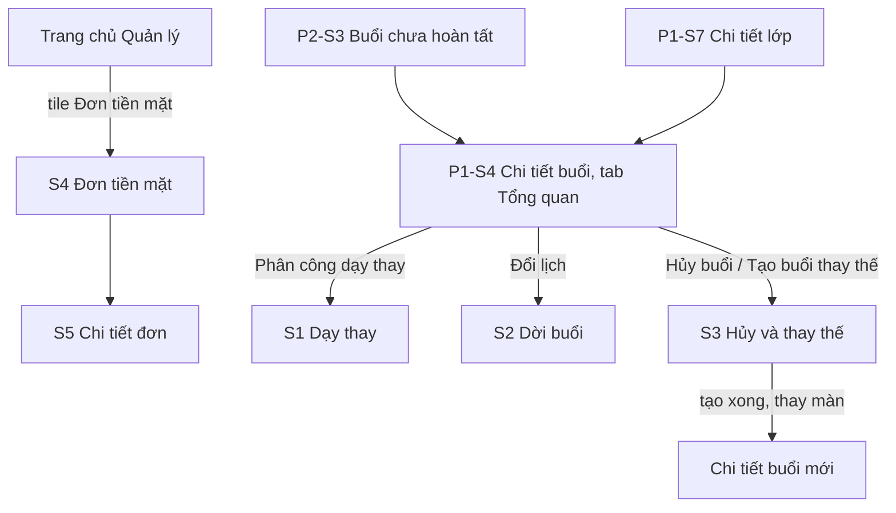

# P5 — Manager phân công/xử lý lịch → xác nhận CASH · Design cấp phase

Ngày: 02/11/2026 (Asia/Bangkok). Người thiết kế: Claude. Trạng thái: **design hoàn tất, chờ người dùng chốt các đề xuất ở mục 2 và duyệt cùng UI toàn phase** (ADR-009). Design không thay cổng duyệt kế hoạch tổng (ADR-017).

File này chứa phần dùng chung: quyết định cần duyệt, điều hướng, thay đổi trên màn hiện có, mô hình ghi, thành phần, nhãn, hành vi dữ liệu và khoảng lệch backend. Màn hình, trạng thái, chữ và test case nằm ở từng slice:

| Slice | Design | Route | Vai trò |
| --- | --- | --- | --- |
| P5-S1 — substitute-assignment | [substitute-assignment/design.md](substitute-assignment/design.md) | `SubstituteAssignment` | MANAGER |
| P5-S2 — reschedule-session | [reschedule-session/design.md](reschedule-session/design.md) | `RescheduleSession` | MANAGER |
| P5-S3 — replacement-session | [replacement-session/design.md](replacement-session/design.md) | `ReplacementSession` | MANAGER |
| P5-S4 — cash-orders | [cash-orders/design.md](cash-orders/design.md) | `CashOrders` | MANAGER |
| P5-S5 — cash-order-detail | [cash-order-detail/design.md](cash-order-detail/design.md) | `CashOrderDetail` | MANAGER |

Căn cứ:

- [Kế hoạch P5](../../implementation-plan.md#p5-manager-operations-cash), BR-TEACH-01/03, BR-OPS-01, BR-TIME-01, BR-MAKEUP-01, BR-PAY-01–06; UC-MG-07/08/09; ADR-004/005/007/008/009/023/025.
- Mẫu `Manager Mobile UI.html` [H], giải nén và đọc ngày 02/11/2026. [H] có danh sách đơn tiền mặt, sheet xác nhận tiền mặt, sheet "Phân công dạy thay" và các mục "Đổi lịch buổi học", "Tạo buổi bù", "Hủy buổi học". **Không có form dời buổi, form hủy và form tạo buổi bù**: ba form này ghép từ token và thành phần có sẵn, cần xem kỹ khi duyệt UI.
- Source `../Mindy-BE/src/modules/classes`, `payments`, `commerce`, `manager-operations` đọc ngày 02/11/2026. Đây là căn cứ trường dữ liệu cho design, chưa phải contract; Codex đối chiếu lại ở API-00.
- Design [attendance-and-notes](../attendance-and-notes/design.md), [hồ sơ tiện ích P2](../../implement/phase-002-attendance-and-notes/ui-utilities-update.md) và source hiện tại của `SessionContextScreen`, `WorkspaceScreen`, `SessionEditScreen`.

## 1. Khác với mẫu có chủ đích

| Mẫu nói | Design | Lý do |
| --- | --- | --- |
| [H] Chọn lớp trước, mỗi lớp có số đơn chờ | Mở thẳng danh sách đơn chờ xác nhận; lọc lớp là tùy chọn | Số đơn từng lớp phải gọi API từng hàng (ADR-025 mục 5). Lọc lớp và tìm mã đơn cho cùng kết quả mà không thêm bước. Q-P5-05 |
| [H] Thẻ đơn có tên khóa học | Thẻ có tên học viên, không có tên lớp; lớp hiện ở S5 | `ManagerOrderSummaryDto` không có `details` (G-P5-04) |
| [H] Nút xác nhận ngay trên thẻ đơn | Chỉ xác nhận ở S5 | Phải đối chiếu người, lớp, tổng, hạn bằng dữ liệu vừa tải (UC-MG-09) |
| [H] Ô tích "Tôi đã nhận đủ" | Nhập số tiền thực nhận, không điền sẵn | Q-P5-02 |
| [H] Tab "Tiền mặt (3)" và tab "Giao dịch" gồm chuyển khoản, VNPay | Bộ lọc trạng thái, không có số đếm; không có tab Giao dịch | Số trạng thái chưa tải không được hiện (ADR-025 mục 4). P5 chỉ làm CASH (BR-PAY-05) |
| [H] Mã đơn `DH-10482` | Dùng `orderCode` thật, dạng `MD7K3QX9PA2B4C` | Backend sinh mã này |
| [H] "Tạo buổi bù" có ở mọi buổi | Chỉ hiện với buổi đã hủy | Replacement đi từ buổi hủy mới nhất (BR-MAKEUP-01) |
| [H] Sheet chọn mentor có dòng phụ mô tả từng người | Chỉ có tên và chip "Đang dạy" | Candidates đã loại người bận, nghỉ và không trả lý do |
| [H] Sheet thao tác khi bấm buổi trong danh sách | Nhóm "Điều phối buổi học" trong tab Tổng quan của chi tiết buổi | Thao tác cần version và trạng thái mới nhất; S3 P2 đã mở chi tiết buổi trực tiếp |

## 2. Đề xuất cần người dùng chốt

Design được viết theo cột "Đề xuất". Đổi đề xuất nào thì design của slice ở cột cuối phải cập nhật trước khi Codex làm UI. Q-PAY-01 và Q-CLASS-02 là cổng đã ghi trong kế hoạch; năm câu còn lại phát sinh khi đọc source.

| ID | Câu hỏi | Đề xuất | Vì sao | Ảnh hưởng |
| --- | --- | --- | --- | --- |
| Q-CLASS-02 | Có đổi mentor chính hay sửa link học không? | **Không.** Chỉ dạy thay theo từng buổi; không sửa `meetingUrl` | Kế hoạch ghi đổi mentor chính chưa mặc định P0; đổi mentor chính tác động hàng loạt buổi | S1 |
| Q-PAY-01 | Gọi "đơn tiền mặt" thay Invoice? Có biên nhận riêng không? | **Gọi "đơn tiền mặt"; không có biên nhận hay hóa đơn** ở MVP | Backend chỉ có Order, không có Invoice (BR-PAY-06) | S4, S5 |
| Q-P5-01 | Có đổi người dạy khi buổi đang diễn ra không? | **Không.** Chỉ đổi với buổi SCHEDULED | Backend cho phép và sẽ ghi đè `teachingMentorId` của buổi IN_PROGRESS, trái BR-TEACH-01 và tiêu chí "bảo toàn teachingMentorId" (G-P5-02) | S1 |
| Q-P5-02 | Xác nhận tiền bằng ô tích hay nhập số tiền? | **Nhập số tiền, không điền sẵn.** Lệch tổng thì không gửi được | Ô tích khiến client luôn gửi đúng `totalAmount`, phép kiểm số tiền của server mất ý nghĩa. Nhập tay buộc người thu đếm lại. Đổi lại mất thêm vài giây mỗi đơn | S5 |
| Q-P5-03 | S4 đọc từ đâu? | **`GET /manager/orders?paymentType=CASH`**, thay `GET /manager/cash-orders` trong mapping | Route này có tên học viên và lọc server theo trạng thái, lớp, mã đơn. `cash-orders` không có tên học viên và không lọc được (G-P5-03) | S4 |
| Q-P5-04 | Dời buổi có sửa tên buổi không? | **Không.** S2 thay `SessionEdit` mock; bỏ ô tên buổi | `PATCH schedule` không nhận `title`; Manager không có route đổi tên (G-P5-06) | S2 |
| Q-P5-05 | Có giữ bước chọn lớp trước như [H] không? | **Không**, xem mục 1 | Một bước chạm ít hơn và không tốn request đếm | S4 |

Q-PLAT-01 (mốc Android/iOS) không thuộc design và vẫn còn mở.

## 3. Điều hướng

| Route | Vai trò | Params | Ghi chú |
| --- | --- | --- | --- |
| `SubstituteAssignment` | MANAGER | `sessionId`, `classTitle?` | S1 |
| `RescheduleSession` | MANAGER | `sessionId`, `classTitle?` | S2. Thay route `SessionEdit` |
| `ReplacementSession` | MANAGER | `sessionId`, `classTitle?` | S3. Một route, nội dung theo `status` |
| `CashOrders` | MANAGER | — | S4 |
| `CashOrderDetail` | MANAGER | `orderId`, `orderCode?` | S5 |

- Mở màn, Back và đổi bộ lọc hiển thị trực tiếp, không slide/fade/gesture (ADR-023, ADR-025 mục 1).
- Chỉ stack Manager đăng ký các route này. Params chỉ để định danh và hiển thị; `version`, `status`, số tiền không truyền qua params. Màn đích luôn đọc lại từ server.
- Rời màn có dữ liệu đã nhập: dialog "Thoát mà chưa lưu?" của P2 mục 6.5, không tính số thay đổi. Khi có mutation đang chạy, Back bị chặn như cơ chế hiện có.

Code mới đặt tại `src/modules/operations/`, namespace i18n `operations`. Tái dùng `src/modules/attendance` qua export, không chép code.

## 4. Thay đổi trên màn hiện có

Chỉ đổi đúng các chỗ dưới đây.

### 4.1 Chi tiết buổi của Quản lý, tab Tổng quan

Thêm nhóm "Điều phối buổi học" (`session-ops-group`) ngay dưới thẻ "Thông tin buổi". Dạng `Card` chứa hàng `Row`: icon, nhãn, `chevron_right`. Nhãn "Hủy buổi" dùng màu danger. Không gọi thêm API; nhóm chỉ dùng `session` trong context.

Backend không trả capability cho các thao tác này (G-P5-01), nên bảng dưới chỉ quyết định hiển thị lối vào. Server vẫn quyết định khi ghi và màn đích kiểm tra lại.

| `status` | Điều kiện thêm | Các hàng |
| --- | --- | --- |
| SCHEDULED | `startsAt > asOf` | "Đổi lịch" (`edit_calendar`) → S2; "Phân công dạy thay" (`swap_horiz`), hoặc "Đổi người dạy thay" khi `assignmentType` = SUBSTITUTE → S1; "Hủy buổi" (`event_busy`) → S3 |
| SCHEDULED | `startsAt <= asOf` | "Hủy buổi" → S3 |
| IN_PROGRESS | — | "Hủy buổi" → S3 |
| COMPLETED | — | Ẩn cả nhóm |
| CANCELLED | — | "Tạo buổi thay thế" (`event_repeat`) → S3 |

Đang tải context: chưa hiện nhóm. Offline: các hàng vẫn hiện nhưng khóa, có dòng 12 "Cần kết nối mạng".

**Bỏ nút `manager-session-edit`** ở `ManagerAttendancePanel` và route `SessionEdit`. `canEditSession` chỉ là trường của mock, không có ở backend; tiện ích này được thay bằng S2.

Thêm hàng chỉ đọc vào thẻ thông tin khi `makeupForSessionId` khác null: "Thay cho buổi đã hủy", bấm mở `SessionContext` của buổi đó, testID `session-makeup-source`. Đây là lối đi duy nhất theo chiều ngược của chuỗi replacement (G-P5-08).

### 4.2 Trang chủ Quản lý

Thêm tile thứ tư vào "Điều phối giảng dạy": "Đơn tiền mặt" / "Cash orders", icon `payments`, testID `workspace-open-cash-orders`, đặt sau các tile hiện có. Không gọi API, không có số đếm. Thẻ "buổi học cần xử lý" giữ nguyên.

### 4.3 Test hiện có bị thay thế

| Test | Thay bằng |
| --- | --- |
| Test `manager-session-edit`, `session-edit-*` trong `__tests__/attendance-ui.test.tsx` | TC-P5-S2 |
| Kiểm số tile Trang chủ Quản lý của P2 | Có thêm tile thứ tư, TC-P5-HOME-01 |
| Test P1/P2 khẳng định tab Tổng quan của Quản lý không có thao tác, nếu còn | TC-P5-OPS-01 đến 06 |

## 5. Mô hình ghi của S1, S2, S3

Dùng lại **intent** của P2 mục 6.2: mỗi lần gửi là một request gồm body, `expectedVersion` và `Idempotency-Key` UUID v4 (`newIntentKey`). Retry giữ nguyên cả ba. Ba route đều cần `reason` 1–1000 ký tự sau trim. Không có draft theo hàng như điểm danh, chỉ có form trong bộ nhớ.

- **Version:** S1 lấy `sessionVersion` từ candidates; S2, S3 lấy `session.version` từ context. Sau khi thành công dùng version trong response. Version này dùng chung với điểm danh, nên điểm danh hay dạy thay ở nơi khác cũng làm lệch version.
- **Ba kết quả:** được chấp nhận; bị từ chối (xử lý theo bảng 5.1, không tự gửi lại); chưa rõ (khóa form, `IntentBanner`, "Gửi lại" cùng key, body, version). Server trả lại kết quả cũ nếu đã ghi nên gửi lại an toàn.
- **Trước khi xác nhận** đều có `ConfirmationDialog` nêu rõ trước/sau. Dialog `busy` khi đang gửi.
- Mutation thành công: toast, invalidate theo mục 8.1, về màn trước (S3 có ngoại lệ, xem slice).

### 5.1 Mã lỗi mutation

Nhãn đối chiếu lại ở API-00. Không hiện message tiếng Anh của backend. Có `requestId` thì thêm "Mã hỗ trợ: {requestId}". Form giữ nguyên dữ liệu đã nhập trừ khi bảng ghi khác.

| HTTP / mã | Nghĩa | Hành vi |
| --- | --- | --- |
| 409 `SESSION_VERSION_CONFLICT` | Buổi vừa có thay đổi khác | Đóng dialog, tải lại context. Alert "Buổi học vừa được cập nhật. Xem lại rồi xác nhận." Không tự gửi. Lần sau là intent mới: key mới, version mới |
| 409 `SESSION_STATE_CONFLICT` | Buổi đã đổi trạng thái | Tải lại; khóa form; "Trạng thái buổi học đã thay đổi." **Không gộp vào version conflict** |
| 409 `CLASS_NOT_EDITABLE` | Lớp đã kết thúc hoặc đã hủy | Khóa form; "Lớp đã kết thúc hoặc đã hủy nên không đổi được buổi này." |
| 409 `CLASS_MENTOR_SCHEDULE_CONFLICT` | Người dạy trùng lịch hoặc đang nghỉ | Alert theo từng slice. Giữ form; intent mới khi đổi giá trị |
| 409 `CLASS_SESSION_OVERLAP` | Trùng buổi khác của lớp | "Giờ này trùng một buổi khác của lớp." |
| 409 `SESSION_HAS_MAKEUP_PLACEMENTS` | Buổi đang có học viên xếp học bù | "Buổi này đang có học viên được xếp học bù. Hãy xử lý học bù trước." Có lối đi tới P4-S6 khi P4 đã có |
| 409 `MAKEUP_ALREADY_EXISTS` | Đã có replacement | S3 mục 4 |
| 422 `SESSION_START_NOT_FUTURE` | Giờ mới đã qua | Lỗi ở ô giờ: "Giờ bắt đầu phải ở tương lai." |
| 422 `CLASS_SESSION_OUTSIDE_CLASS_PERIOD` | Ngoài thời gian lớp | Lỗi ở ô ngày: "Ngày này nằm ngoài thời gian của lớp." |
| 422 `CLASS_SESSION_TIME_RANGE_INVALID`, `CLASS_SESSION_OVERNIGHT_NOT_ALLOWED` | Khoảng giờ sai | Lỗi ở ô giờ: "Giờ kết thúc phải sau giờ bắt đầu và trong cùng ngày." |
| 422 `MAKEUP_DURATION_MISMATCH` | Sai thời lượng | Không xảy ra do client tính giờ kết thúc. Nếu có: lỗi chung kèm mã hỗ trợ |
| 422 `CLASS_MENTOR_NOT_ELIGIBLE` | Mentor không còn hoạt động | Tải lại candidates, bỏ lựa chọn, "Mentor này không còn nhận lớp." |
| 409 `IDEMPOTENCY_KEY_REUSED` | Lỗi phía client | Lỗi chung + mã hỗ trợ; bỏ intent; giữ form. Không tự thử key mới |
| 403 `SESSION_ASSIGNMENT_REQUIRED` | Mất quyền | Xóa dữ liệu và form, `StatusBlock` không quyền |
| 401 | Hết phiên | Về Login theo P0; xóa form |
| 404 | Không còn buổi | Xóa dữ liệu, `StatusBlock` không tìm thấy |
| 422 khác | Dữ liệu sai | Dải danger, giữ form |
| 5xx, timeout, mất mạng sau khi gửi | Chưa rõ | `IntentBanner` |

CASH có mô hình riêng, không dùng mục này: xem [S5 mục 4](cash-order-detail/design.md).

## 6. Thành phần

Tái sử dụng `Page`, `QueryBlock`, `More`, `Field`, `IntentBanner`, `Filters`, `StatusChip`, `Card`, `Chip`, `Button`, `Alert`, `Sheet`, `Row`, `Avatar`, `ConfirmationDialog`, `Toast` và `parseVietnamTime`, `isoDate`, `isoTime`, `newIntentKey`. `MutationError` của P2 không nhận các mã ở mục 5.1, nên làm bảng nhãn riêng trong module mới, không thêm nhánh vào file attendance. Repo không có component tên `StatusBlock`: trong design này, từ đó chỉ khối trạng thái toàn màn theo P1 mục 9.3, dựng bằng `QueryBlock` hoặc `FocusPanel` hiện có.

Thành phần mới trong `src/modules/operations/components/`:

| Thành phần | Mô tả | Dùng ở |
| --- | --- | --- |
| `SessionSummary` | Thẻ tóm tắt buổi: tiêu đề 15/600, ngày giờ 13, chip trạng thái, dòng người dạy. Dùng `date-tile` như chi tiết buổi. `effectiveMentor` null thì ẩn dòng người dạy | S1, S2, S3 |
| `ReasonField` | `Field` nhãn "Lý do", bắt buộc, tối đa 1000. Chỉ khoảng trắng tính là trống | S1, S2, S3 |
| `ScheduleFields` | Ô ngày mở `Sheet` chứa `Calendar` như `SessionEdit` hiện tại, kèm hai ô `HH:mm`. Nhận `minDate`, `maxDate`, cờ khóa giờ kết thúc. Tách từ `SessionEditScreen` | S2, S3 |
| `MoneyText` | Hiện VND số nguyên dạng `6.500.000 ₫`, tabular figures. Nhận số an toàn, không làm tròn. Giá trị không hợp lệ hiện "—" | S4, S5 |
| `MoneyField` | Bàn phím số, tự chèn dấu chấm khi gõ; bỏ ký tự khác số kể cả khi dán; giữ giá trị là số nguyên | S5 |
| `OrderStatusChip` | Theo bảng nhãn mục 7 | S4, S5 |

**Icon cần thêm vào `symbols.json`**, Material Symbols Rounded weight 300: `edit_calendar`, `payments`, `person_remove`, `receipt_long`. `swap_horiz`, `event_busy`, `event_repeat`, `calendar_month`, `schedule`, `search`, `school`, `check_circle`, `warning`, `info`, `history` đã có.

Không thêm token màu. Số tiền lớn ở S5 dùng 26/700 `--mdy-link` như số trên thẻ Trang chủ.

## 7. Nhãn

Nhãn lấy từ giá trị server. Giá trị lạ: schema coi là phản hồi sai định dạng, không có nhãn dự phòng.

| Loại | Giá trị | vi | en | Tone |
| --- | --- | --- | --- | --- |
| Đơn | PENDING | Chờ xác nhận | Awaiting confirmation | warning |
| Đơn | PAID | Đã thu tiền | Paid | success |
| Đơn | EXPIRED | Hết hạn | Expired | neutral |
| Đơn | CANCELLED | Đã hủy | Cancelled | neutral |
| Đơn, suy ra | PENDING và đã quá `expiresAt` | Quá hạn giữ chỗ | Hold expired | danger |
| Người thu | MANAGER | `{displayName}` | `{displayName}` | dòng chữ |
| Người thu | LEGACY_MENTOR | `{displayName}` · Mentor, dữ liệu cũ | `{displayName}` · Mentor, legacy | dòng chữ |
| Phân công | SUBSTITUTE | Dạy thay | Substitute | info, có sẵn |

`displayName` null → "Chưa có tên". Trạng thái buổi theo P1 mục 8.

**Thời gian:** instant hiển thị theo `Asia/Ho_Chi_Minh` (ADR-008). Dữ liệu buổi học có `asOf` nên dùng `asOf` để kiểm "tương lai", không dùng đồng hồ máy. Dữ liệu đơn không có `asOf` (G-P5-05): dùng header `Date` của chính response đó, thiếu header mới dùng đồng hồ máy. Dù theo nguồn nào, server vẫn quyết định cuối khi ghi.

**Tiền:** VND số nguyên (ADR-008). Client không cộng, chia hay làm tròn tiền. `totalAmount` và `details[].totalAmount` hiển thị đúng server trả.

## 8. Hành vi dữ liệu

Áp dụng P1 mục 9 và ADR-025, cộng các điểm riêng dưới đây.

### 8.1 Tải và invalidate

| Màn | Lựa chọn ban đầu | Lúc mở gọi gì | Không gọi |
| --- | --- | --- | --- |
| S1 | Không chọn sẵn ai | Context + candidates trang 1, `pageSize` 20 | Lịch từng mentor |
| S2 | Giờ hiện tại của buổi | Context + `GET /manager/classes/:classId` | Candidates, attendance |
| S3 | Theo `status` | Context + lớp; thêm một request `pageSize=1` lấy số học viên khi hủy | Danh sách buổi của lớp |
| S4 | `status=PENDING`, không lọc lớp | `GET /manager/orders?paymentType=CASH&status=PENDING&page=1&pageSize=20` | Chi tiết từng đơn, danh sách lớp, trạng thái khác |
| S5 | — | `GET /manager/orders/:orderId` | Enrollment, lớp |

Query key gồm tài khoản, role, id, filter và page. Đổi filter không hiện dữ liệu cũ dưới nhãn mới.

| Sau khi | Invalidate |
| --- | --- |
| Dạy thay, dời buổi | Context của buổi, chi tiết lớp, `incomplete`, candidates |
| Hủy buổi | Như trên, thêm attendance của buổi |
| Tạo replacement | Context của buổi cũ và buổi mới, chi tiết lớp, `incomplete` |
| Xác nhận CASH | Chi tiết đơn, mọi trang `CashOrders`, roster lớp của các `classId` trong đơn |

**Lịch của Mentor** không thể invalidate từ máy Quản lý. Mentor thấy thay đổi khi màn focus lại, foreground hoặc kéo làm mới, theo cơ chế refetch đã có. "Refetch lịch hai vai trò" được kiểm trong E2E bằng cách đăng nhập Mentor sau khi Quản lý ghi.

### 8.2 Offline

Nhận biết bằng NetInfo có sẵn. Dữ liệu chỉ ở bộ nhớ, không lưu thiết bị. Offline không có "Thử lại"; phục hồi bằng có mạng lại, focus hoặc kéo làm mới. **Mọi mutation trong phase chỉ online, không xếp hàng.**

| Màn | Đã có dữ liệu cùng query | Chưa có dữ liệu | Mutation |
| --- | --- | --- | --- |
| S1, S2, S3 | Hiện, kèm cảnh báo; form vẫn sửa được trong bộ nhớ | "Chưa có dữ liệu. Kết nối mạng để tải." | Khóa, có dòng "Cần kết nối mạng" |
| S4 | Hiện, kèm cảnh báo | Như trên | Không có |
| S5 | Hiện, kèm "Thông tin có thể đã cũ." | Như trên | Khóa |

### 8.3 Bảo mật

Tên học viên, số tiền, lý do không ghi vào log, không lưu thiết bị, không đưa vào params ngoài `orderCode`. Đăng xuất hoặc đổi tài khoản xóa cache và form trước khi điều hướng. Không hiển thị `referenceCode`, `mentorId` của đơn và `Idempotency-Key`.

## 9. Khoảng lệch với backend

Đọc từ source ngày 02/11/2026. Mọi mục đều đã có cách xử lý không cần đổi backend. Không tự sửa backend; G-P5-02, -04, -05, -07, -08 nên được chủ backend xem xét.

| ID | Phát hiện | Cách design xử lý |
| --- | --- | --- |
| G-P5-01 | Context, candidates và route vận hành không trả capability cho Quản lý. `permissions` của attendance không có các thao tác này | Hiện lối vào theo `status` và `asOf` (mục 4.1), server quyết định khi ghi. Không giả `canEditSession` |
| G-P5-02 | `PATCH .../mentor` nhận cả buổi IN_PROGRESS và ghi đè `teachingMentorId`, trái BR-TEACH-01 | Q-P5-01: UI chỉ mở cho SCHEDULED |
| G-P5-03 | `GET /manager/cash-orders` dùng `OrderDto`: có `details`, không có tên học viên và không có filter | Q-P5-03: dùng `GET /manager/orders` |
| G-P5-04 | `ManagerOrderSummaryDto` có `student`, `payment`, không có `details`. Thẻ danh sách không có tên lớp | Thẻ không hiện lớp; S5 hiện đủ. Không gọi chi tiết từng hàng. Nên thêm tóm tắt lớp vào DTO |
| G-P5-05 | DTO đơn không có `asOf`. Đơn PENDING vẫn ở PENDING sau `expiresAt` cho đến khi job chạy | Mục 7: dùng header `Date`; hiện "Quá hạn giữ chỗ". Codex xác nhận header đi tới client ở API-00. Nên thêm `asOf` |
| G-P5-06 | `PATCH schedule` không nhận `title`. Đổi tên buổi chỉ có ở route Admin | Q-P5-04: bỏ sửa tên, bỏ `SessionEdit`. Không gọi route Admin bằng Manager |
| G-P5-07 | Candidates chỉ kiểm được khoảng giờ của buổi đang SCHEDULED/IN_PROGRESS. Không có API tìm mentor rảnh cho **giờ mới**, nên không biết trước ai rảnh khi dời hoặc tạo replacement | S2 giữ người dạy hiện tại; S3 dùng mentor chính và không gửi `mentorId`. Trùng lịch thì báo lỗi, người dùng đổi giờ. Sau khi có buổi mới mới phân công dạy thay qua S1 |
| G-P5-08 | Buổi đã hủy không có trường trỏ tới replacement. Muốn biết cần quét mọi trang buổi của lớp | S3 không quét trước. Server trả `MAKEUP_ALREADY_EXISTS` thì mới báo và dẫn tới lịch lớp |
| G-P5-09 | `PATCH schedule` chỉ kiểm giờ mới ở tương lai, không kiểm giờ cũ. Buổi quá hạn chưa start vẫn dời được | Theo tiêu chí kế hoạch "SCHEDULED tương lai": UI không mở S2 cho buổi quá hạn. Buổi quá hạn đi qua Khôi phục P2 hoặc Hủy |
| G-P5-10 | Dời buổi tự ghi xung đột lịch học viên, không có API xem trước và response không báo số xung đột | Dialog nói chung về khả năng này, không nêu số. Xem xung đột ở P4-S6 |
| G-P5-11 | `CASH_ORDER_CLOSED` gộp ba nghĩa: hết hạn, đơn đóng, có lớp đã hủy. DTO đơn không có trạng thái lớp và trạng thái hold | S5 tải lại rồi hiện theo `status`; còn PENDING thì dùng câu chung, không đoán nguyên nhân |
| G-P5-12 | Confirm trả 200 cả khi đơn **đã do Manager khác thu**, response không có người thu | S5 luôn đọc lại chi tiết sau 200 và so `confirmedBy.id` với tài khoản hiện tại |
| G-P5-13 | Không có luồng hoàn tiền khi đã nhận tiền nhưng đơn bị đóng | Ngoài phạm vi (BR-PAY-05). S5 chỉ nhắc báo người phụ trách |
| G-P5-14 | `P5-S3` phụ thuộc P4-S5 và thông báo học bù trỏ tới P4-S6. P4 chưa có design | S3 và S2 hiện thông báo không có lối đi khi P4 chưa có; không dựng màn thay thế |

## 10. i18n, testID, accessibility

Namespace `operations.*`; Codex được đổi tên key nếu giữ nguyên chữ. testID theo mẫu `<slice>-<phần tử>`: `substitute-` (S1), `reschedule-` (S2), `replacement-` (S3), `cash-list-` (S4), `cash-detail-` (S5).

Chung cho mọi slice:

- Mở Sheet/dialog: focus vào tiêu đề; đóng: trả focus về nút gốc.
- Lỗi form: focus ô lỗi đầu tiên và trình đọc màn hình đọc lỗi.
- Bàn phím không che ô đang nhập và nút gửi.
- Không giới hạn phóng chữ; ở 1.3 không có nút nào đè nhau.
- Số tiền đọc thành chữ đầy đủ đơn vị: "sáu triệu năm trăm nghìn đồng" hoặc giá trị số kèm "đồng", không đọc ký hiệu ₫.
- Trạng thái không truyền đạt chỉ bằng màu.

Chữ dùng chung:

| Key gợi ý | vi | en |
| --- | --- | --- |
| `operations.group` | Điều phối buổi học | Session operations |
| `operations.reschedule` | Đổi lịch | Reschedule |
| `operations.assign` / `.changeSubstitute` | Phân công dạy thay / Đổi người dạy thay | Assign substitute / Change substitute |
| `operations.cancel` | Hủy buổi | Cancel session |
| `operations.replace` | Tạo buổi thay thế | Create replacement |
| `operations.makeupSource` | Thay cho buổi đã hủy | Replaces a cancelled session |
| `operations.tile` | Đơn tiền mặt | Cash orders |
| `operations.reason` | Lý do | Reason |
| `operations.reasonRequired` | Nhập lý do. | Enter a reason. |
| `operations.needOnline` | Cần kết nối mạng | Connection required |
| `operations.versionConflict` | Buổi học vừa được cập nhật. Xem lại rồi xác nhận. | This session was just updated. Review, then confirm. |
| `operations.stateChanged` | Trạng thái buổi học đã thay đổi. | The session status has changed. |
| `operations.classClosed` | Lớp đã kết thúc hoặc đã hủy nên không đổi được buổi này. | The class has ended or was cancelled, so this session can't be changed. |
| `operations.overlap` | Giờ này trùng một buổi khác của lớp. | This time overlaps another session of the class. |
| `operations.placements` | Buổi này đang có học viên được xếp học bù. Hãy xử lý học bù trước. | Students have make-up placements for this session. Resolve them first. |
| `operations.startPast` | Giờ bắt đầu phải ở tương lai. | The start time must be in the future. |
| `operations.outsidePeriod` | Ngày này nằm ngoài thời gian của lớp. | This date is outside the class period. |
| `operations.timeRange` | Giờ kết thúc phải sau giờ bắt đầu và trong cùng ngày. | The end time must be after the start time, on the same day. |
| `operations.error` | Chưa thực hiện được. Thử lại sau. | That didn't work. Try again later. |
| `operations.support` | Mã hỗ trợ: {{id}} | Support code: {{id}} |
| `operations.offlineEmpty` | Chưa có dữ liệu. Kết nối mạng để tải. | No data yet. Connect to load it. |
| `operations.status.*` | Bảng mục 7 | Bảng mục 7 |

## 11. Test case cấp phase và dữ liệu E2E

| ID | Tiền điều kiện | Thao tác | Kết quả mong đợi |
| --- | --- | --- | --- |
| TC-P5-HOME-01 | Quản lý | Xem Trang chủ | Có `workspace-open-cash-orders`; bấm mở S4; Back về một Trang chủ; không có request đơn khi mới mở Trang chủ |
| TC-P5-HOME-02 | Mentor | Xem Trang chủ | Không có tile này; route không có trong stack Mentor |
| TC-P5-OPS-01 | SCHEDULED, `startsAt > asOf`, PRIMARY | Xem Tổng quan | Có Đổi lịch, Phân công dạy thay, Hủy buổi |
| TC-P5-OPS-02 | SCHEDULED tương lai, SUBSTITUTE | Xem | Nhãn "Đổi người dạy thay" |
| TC-P5-OPS-03 | SCHEDULED, `startsAt <= asOf` | Xem | Chỉ có Hủy buổi |
| TC-P5-OPS-04 | IN_PROGRESS | Xem | Chỉ có Hủy buổi |
| TC-P5-OPS-05 | COMPLETED | Xem | Không có `session-ops-group` |
| TC-P5-OPS-06 | CANCELLED | Xem | Chỉ có Tạo buổi thay thế |
| TC-P5-OPS-07 | Mentor mở chi tiết buổi | Xem | Không có `session-ops-group` |
| TC-P5-OPS-08 | Mở Tổng quan | Xem request | Không có request nào thêm cho nhóm này |
| TC-P5-OPS-09 | Đồng hồ máy lệch 2 ngày so với `asOf` | Xem | Bảng hiển thị theo `asOf` |
| TC-P5-OPS-10 | `makeupForSessionId` có giá trị | Bấm `session-makeup-source` | Mở đúng buổi đã hủy |
| TC-P5-OPS-11 | Offline | Xem | Các hàng khóa, có "Cần kết nối mạng" |
| TC-P5-OPS-12 | Tìm trong app | Xem | Không còn `manager-session-edit`; `canEditSession` không xuất hiện trong code |
| TC-P5-NAV-01 | Mở từng màn P5, Back toolbar và Android Back | | Không animation chuyển màn, về đúng màn trước (kiểm native) |
| TC-P5-I18N-01 | vi/en × sáng/tối × màn 360 × font 1.3 | Xem 5 slice | Không cắt chữ, không đè nút, số tiền không xuống dòng giữa chừng |

**Dữ liệu E2E** (Codex chuẩn bị):

- Lớp OPEN có buổi SCHEDULED tương lai, mentor chính, và ít nhất hai mentor rảnh, một mentor đang nghỉ trong khoảng giờ đó, một mentor trùng lịch.
- Buổi đã có dạy thay; buổi IN_PROGRESS có điểm danh; buổi COMPLETED; buổi có makeup placement.
- Chuỗi replacement: buổi hủy đã có replacement, replacement đó đã hủy (leaf).
- Lớp COMPLETED có buổi SCHEDULED còn sót, để kiểm `CLASS_NOT_EDITABLE`.
- Đơn CASH: PENDING còn hạn một lớp, PENDING nhiều lớp, PENDING đã quá hạn nhưng job chưa chạy, PAID bởi Manager A, PAID legacy mentor nếu có, EXPIRED, CANCELLED; hơn 20 đơn PENDING để kiểm phân trang.
- Hai tài khoản Manager để kiểm thu trùng. Một tài khoản Mentor của lớp để xác nhận lịch đã đổi.
- **Không tạo thanh toán giả**. Xác nhận CASH trong E2E chỉ chạy trên dữ liệu test; thiếu thì báo blocked.
