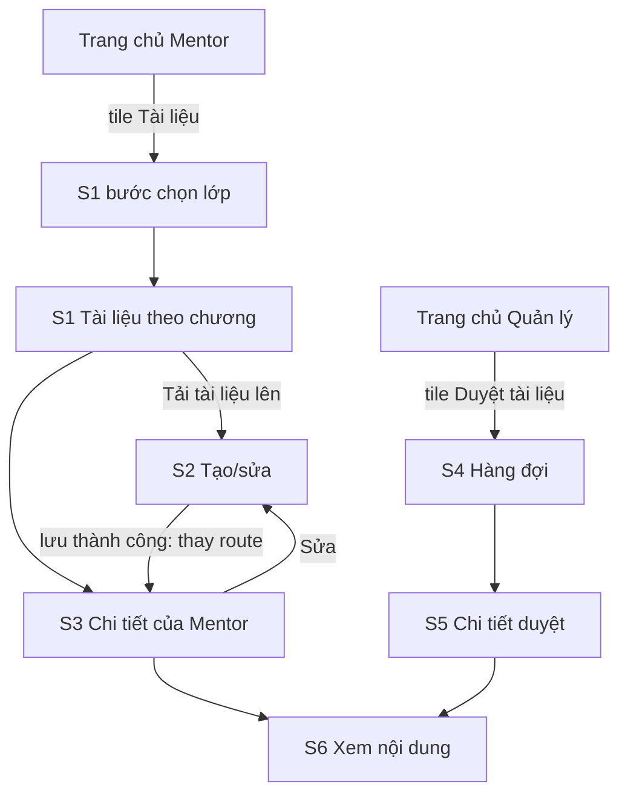
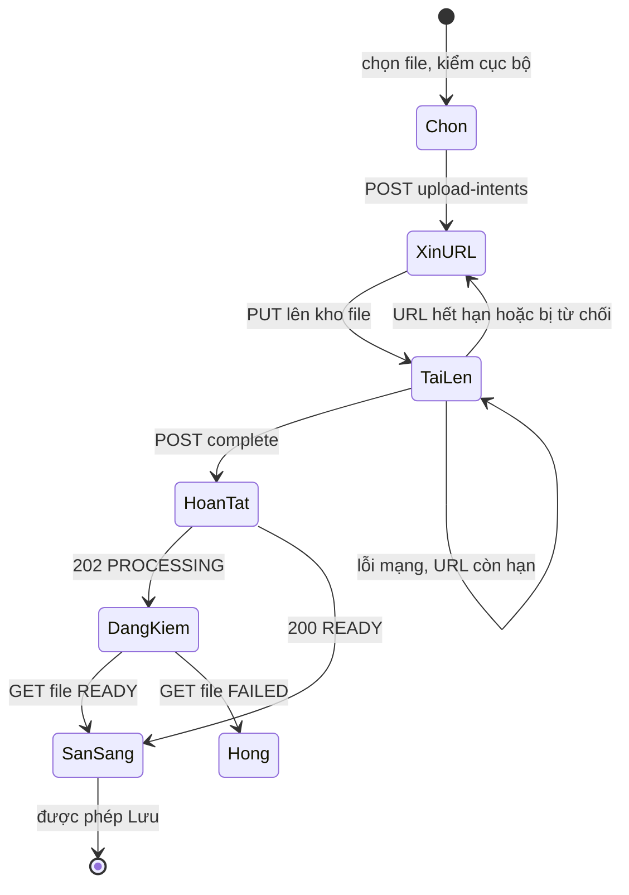

# P3 — Mentor tải tài liệu → Manager duyệt/công bố · Design cấp phase

Ngày: 02/11/2026 (Asia/Bangkok). Người thiết kế: Claude. Trạng thái: **design hoàn tất, chờ người dùng duyệt cùng UI toàn phase** (ADR-009). Design không thay cổng duyệt kế hoạch tổng (ADR-016, ADR-017): chưa có kế hoạch `phase-003-material-review.md`. Q-MAT-01 đã được người dùng chốt ngày 02/11/2026 (mục 2).

File này chứa phần dùng chung: quyết định đã chốt, điều hướng, thay đổi trên màn cũ, trạng thái tài liệu, mô hình ghi, upload, thành phần, nhãn, hành vi dữ liệu và khoảng lệch backend. Màn hình, trạng thái, chữ và test case nằm ở từng slice:

| Slice | Design | Route | Vai trò |
| --- | --- | --- | --- |
| P3-S1 — mentor-materials | [mentor-materials/design.md](mentor-materials/design.md) | `MentorMaterials` | MENTOR |
| P3-S2 — material-editor | [material-editor/design.md](material-editor/design.md) | `MaterialEditor` | MENTOR |
| P3-S3 — mentor-material-detail | [mentor-material-detail/design.md](mentor-material-detail/design.md) | `MentorMaterialDetail` | MENTOR |
| P3-S4 — material-review-queue | [material-review-queue/design.md](material-review-queue/design.md) | `MaterialReviewQueue` | MANAGER |
| P3-S5 — material-review-detail | [material-review-detail/design.md](material-review-detail/design.md) | `MaterialReviewDetail` | MANAGER |
| P3-S6 — material-preview | [material-preview/design.md](material-preview/design.md) | `MaterialPreview` | MENTOR, MANAGER |

Căn cứ:

- [Baseline P3](../../implementation-plan.md#p3-material-review), BR-MAT-01–06, BR-FILE-01–03, BR-AUTH-04, BR-DATA-02; UC-M-08, UC-MG-04; ADR-003/004/005/007/009/012/023/025/026.
- Mẫu `Mentor Mobile UI.html` [M] và `Manager Mobile UI.html` [H], giải nén và đọc ngày 02/11/2026. [M] có màn "Tài liệu" chọn lớp, "Tải file lên" với ba loại và danh sách có trạng thái. [H] có tab "Duyệt tài liệu" và sheet chi tiết. Không có mẫu cho form tạo/sửa, tiến trình upload và trình xem; ba phần này ghép từ token và thành phần có sẵn, cần xem kỹ khi duyệt UI.
- Source `../Mindy-BE/src/modules/materials`, `files`, `classes`, `manager-operations` và `docs/api_flow/PHASE_3_3_flow-api-breakdown.md`, đọc ngày 02/11/2026. Đây là căn cứ trường dữ liệu cho design, chưa phải contract; Codex đối chiếu lại ở API-00. Chưa xác minh deploy.
- Source mobile hiện tại của `MentorClassDetailScreen`, `WorkspaceScreen`, `src/modules/attendance/components/shared.tsx`; design [teaching-workspace](../teaching-workspace/design.md) và [attendance-and-notes](../attendance-and-notes/design.md).

## 1. Khác với mẫu có chủ đích

| Mẫu nói | Design | Lý do |
| --- | --- | --- |
| [H] Duyệt rồi mới "Xuất bản cho học viên" ở bước riêng | Một nút "Duyệt và công bố" | `APPROVE` đặt `publishedAt` luôn (BR-MAT-04). Trạng thái "đã duyệt, chưa công bố" chỉ xuất hiện sau khi gỡ công bố |
| [M] Tải file xong là có ngay bản nháp, chưa có tiêu đề | Chọn file → upload → đợi kiểm tra → nhập tiêu đề → Lưu nháp | Backend từ chối tạo draft nếu file chưa READY (G-P3-01); tiêu đề bắt buộc |
| [M] Nút "Gửi duyệt" trên từng hàng, "Gửi duyệt tất cả" | Gửi ở S3, có xác nhận. Không gửi hàng loạt | Sau khi gửi Mentor không sửa và không rút lại được; backend không có API gửi hàng loạt |
| [M] [H] Số đếm trên chip lọc ("Nháp (3)") | Chip không có số | Backend không có số theo trạng thái; không gọi API cho từng status chưa mở (ADR-025 mục 2, 4) |
| [H] Số đếm trên tile "Tài liệu cần duyệt" | Tile không có số | Không thêm request ở Trang chủ cho thông tin phụ (ADR-025 mục 5) |
| [H] Hàng hàng đợi có "khóa · chương · gửi hôm qua" | Lớp và người gửi từ bảng tra; không có chương; thời gian tuyệt đối | DTO chỉ có id và không có `asOf` (G-P3-03, G-P3-04) |
| [M] "Mở chương", nhãn khóa chương | Bỏ | BR-MAT-06, route release đã bỏ |
| [M] Tài liệu ở tab trong chi tiết buổi | Không có lối vào từ chi tiết buổi; mở từ trang chủ | Tránh tải kèm khi chỉ xem buổi (ADR-025 mục 2) |
| [M] "Chi tiết buổi: tài liệu do mentor chính quản lý" | Mentor dạy thay vẫn đọc được tài liệu đã công bố của chương được giao, không có nút tải lên | Backend cho phép đọc ở scope SESSION |

## 2. Quyết định đã chốt

Người dùng trả lời qua hộp câu hỏi ngày 02/11/2026. Design chỉ còn một nhánh theo các quyết định này. Chúng chốt Q-MAT-01 và mở rộng mapping P3-S3, P3-S5 hiện có (`docs/api-contract/README.md`), cần Codex đồng bộ.

| ID | Câu hỏi | Quyết định | Ảnh hưởng |
| --- | --- | --- | --- |
| Q-MAT-01a | Mentor tạo loại nội dung nào trên mobile? | **FILE và VIDEO.** Hình ảnh là một FILE. Không có editor ARTICLE; ARTICLE tạo từ web chỉ đọc | S2, S3 mục 3 |
| Q-MAT-01b | Manager làm được gì trên mobile? | **Duyệt, Từ chối, Gỡ công bố, Công bố lại.** Không Sửa, không Tạo, không Xóa | S5 |
| Q-P3-01 | Xem file thế nào? | **Ảnh, PDF, Video trong app.** Office, âm thanh, văn bản nguồn và file đính kèm mở bằng ứng dụng ngoài | S6; thêm dependency native (G-P3-09) |
| Q-P3-02 | Mentor có thêm phần nào? | **Chỉ thêm Xóa bản nháp.** Không làm file đính kèm, hẹn giờ `availableAt`, gắn `sessionId`, `sortOrder` | S2, S3 |

Các trường không làm vẫn được **giữ nguyên** khi sửa vì PATCH bỏ qua trường vắng mặt, và vẫn **hiển thị** nếu tài liệu đã có từ web. Q-ENV-01 (URL/Origin môi trường, nay gồm cả host storage) và Q-PLAT-01 vẫn mở; hai câu này ảnh hưởng tích hợp và nghiệm thu, không ảnh hưởng bố cục.

## 3. Điều hướng

| Route | Vai trò | Params | Ghi chú |
| --- | --- | --- | --- |
| `MentorMaterials` | MENTOR | `classId?`, `classTitle?`, `unitId?` | Không có `classId` thì hiện bước chọn lớp. `unitId` là ClassUnit |
| `MaterialEditor` | MENTOR | `classId`, `classUnitId`, `courseUnitId`, `unitTitle?`, `materialId?` | Có `materialId` là sửa |
| `MentorMaterialDetail` | MENTOR | `classId`, `materialId`, `classTitle?` | |
| `MaterialReviewQueue` | MANAGER | — | |
| `MaterialReviewDetail` | MANAGER | `materialId` | |
| `MaterialPreview` | MENTOR, MANAGER | `materialId`, `revision`, `classId?`, `fileId?`, `title` | Mentor bắt buộc có `classId`. Không có `fileId` là đọc bài ARTICLE |

- Mở màn, Back và đổi tab hiển thị trực tiếp, không animation/gesture (ADR-023, ADR-025 mục 1).
- Mỗi role chỉ đăng ký route của mình; `MaterialPreview` đăng ký ở cả hai và chọn đường API theo role đang đăng nhập, không theo params.
- Params chỉ định danh và hiển thị, không phải căn cứ quyền. `canEdit`, `reviewStatus` không truyền qua params. **Ngoại lệ có chủ đích:** `revision` ở S6 là phiên bản người dùng đang xem, dùng làm `expectedRevision`, để đảm bảo nội dung xem đúng bản sắp duyệt.
- Rời màn có thay đổi chưa lưu hoặc đang upload: dialog ở mục 6.5 của [design P2](../attendance-and-notes/design.md). Khi mutation đang chạy, Back bị chặn.

## 4. Thay đổi trên màn cũ

Chỉ đổi đúng các chỗ dưới đây.

### 4.1 Chi tiết lớp của Mentor

Không có nút mở tài liệu. Mentor mở tài liệu từ tile "Tài liệu" ở trang chủ rồi chọn lớp.

Bổ sung vào model `TeachingClass` trường `authorMaterials` từ `capabilities`. Bổ sung `courseUnitId` vào schema `unit`, vì S2 cần gửi trường này khi xin upload; schema hiện đang bỏ qua trường đó.

### 4.2 Chi tiết buổi của Mentor

Tab Tổng quan không có nút mở tài liệu. Mentor mở tài liệu từ trang chủ.

### 4.3 Trang chủ

| Vai trò | Tile vi / en | Icon | Đích | testID |
| --- | --- | --- | --- | --- |
| Mentor | Tài liệu / Materials | `folder_open` | S1 bước chọn lớp | `workspace-open-materials` |
| Quản lý | Duyệt tài liệu / Review materials | `rate_review` | S4 | `workspace-open-material-review` |

Mentor có ba tile, theo thứ tự Lớp phụ trách, Lịch dạy, Tài liệu. Không có số trên tile; Trang chủ không có thêm request.

### 4.4 Test cũ bị thay thế

| Test | Thay bằng |
| --- | --- |
| H-D của P1 (không có tile Tài liệu) | TC-P3-HOME-01 |
| TC-P1-S3-15 (không có nút tài liệu với `authorMaterials` true) | TC-P3-CTX-01 đến 03 |
| Test đếm tile Trang chủ Quản lý/Mentor | Tăng thêm một tile |

## 5. Trạng thái tài liệu

Trục `reviewStatus` và trục `publishedAt` là hai chiều riêng. Giao diện gộp thành một nhãn duy nhất:

| `reviewStatus` | `publishedAt` | Nhãn | Tone |
| --- | --- | --- | --- |
| DRAFT | — | Nháp | neutral |
| PENDING_REVIEW | — | Chờ duyệt | warning |
| REJECTED | — | Bị từ chối | danger |
| APPROVED | có | Đã công bố | success |
| APPROVED | null | Đã gỡ công bố | neutral |

**Chỉ Mentor nhìn thấy gì** (backend lọc trước khi phân trang): tài liệu đã duyệt và đang công bố, cộng với bản của chính mình trong đúng lớp **chưa từng được duyệt** (`firstApprovedAt` null). Scope SESSION chỉ thấy phần đã công bố. Hệ quả:

- Mentor không thấy bản nháp của người khác, kể cả cùng chương.
- Sau khi tài liệu của Mentor được duyệt rồi bị Manager gỡ công bố hoặc sửa, nó **biến mất** khỏi danh sách của chính Mentor (G-P3-06).

**Hành động được phép:**

| Trạng thái | Mentor (chủ bản, `canEdit`) | Manager |
| --- | --- | --- |
| DRAFT | Sửa, Xóa, Gửi duyệt | Chỉ đọc |
| PENDING_REVIEW | Chỉ đọc. Không rút lại được | Duyệt và công bố, Từ chối |
| REJECTED | Sửa, Xóa. **Không gửi lại trực tiếp**: phải sửa để về DRAFT trước (BR-MAT-03) | Chỉ đọc |
| APPROVED, đang công bố | Chỉ đọc | Gỡ công bố |
| APPROVED, đã gỡ | Không nhìn thấy | Công bố lại |

Nút hiển thị theo bảng này để định hướng; server là bên quyết định cuối. DTO chỉ có `canEdit`, không có quyền gửi hay duyệt (G-P3-05).

**Giá trị lạ:** `reviewStatus`, `contentType`, `kind` lạ là phản hồi sai định dạng theo schema, không có nhãn dự phòng.

## 6. Mô hình ghi

### 6.1 `expectedRevision`

Mutation tài liệu **không** dùng `Idempotency-Key` như P2. Thay vào đó mọi lệnh ghi đều gửi `expectedRevision`, lấy từ response gần nhất của đúng màn. `revision` trong response là nguồn duy nhất; client không tự cộng.

- PATCH thành công: `revision` tăng 1, trạng thái về DRAFT, xóa lý do từ chối và công bố (BR-MAT-05).
- SUBMIT, APPROVE, REJECT, PUBLISH, UNPUBLISH: `revision` giữ nguyên.
- Mỗi lần lưu tăng revision: nút Lưu khóa khi không có gì đổi, trừ bản REJECTED (S2 mục 4).
- Mọi mutation trên một tài liệu chạy tuần tự. Khi có lệnh chưa rõ kết quả, các nút ghi đều khóa.

Tất cả route `/mentor/...materials` và `/manager/materials...` cần header `Origin` cho request không phải GET (`RequestOriginGuard`), cấu hình như P2 (`API_ORIGIN`). Route `/files/*` không có guard này.

### 6.2 Lệnh chưa rõ kết quả

Timeout hoặc mất mạng sau khi gửi. Cách xử lý khác nhau vì độ an toàn khi gửi lại khác nhau:

| Lệnh | Gửi lại có an toàn? | Hành vi |
| --- | --- | --- |
| POST tạo | **Không**, có thể tạo hai bản (G-P3-02) | Không có nút gửi lại. Có nút "Kiểm tra", xem S2 mục 6 |
| PATCH | Không tự động; `expectedRevision` cũ sẽ bị 409 nếu đã ghi | Nút "Kiểm tra" đọc lại chi tiết, xem S2 mục 6 |
| SUBMIT | An toàn: cùng revision đang chờ duyệt thì không đổi gì | `IntentBanner` + "Gửi lại" cùng body |
| APPROVE, PUBLISH, UNPUBLISH | An toàn: giữ nguyên trạng thái | Như trên |
| REJECT | An toàn nếu giữ nguyên lý do; lý do khác sẽ 409 | Như trên, khóa ô lý do đến khi có kết quả |
| DELETE | An toàn: 204 lặp lại | Như trên |

Offline: chỉ hiện cảnh báo, chưa có nút; có mạng lại thì nút hiện. Không tự gửi khi có mạng lại (đúng tinh thần ADR-006, Q-OFF-01). Lệnh chưa rõ chỉ giữ trong bộ nhớ.

### 6.3 Mã lỗi

Nhãn đối chiếu lại ở API-00. Không hiện message tiếng Anh của backend. Có `requestId` thì thêm "Mã hỗ trợ: {requestId}".

| HTTP / mã | Nghĩa | Hành vi chung |
| --- | --- | --- |
| 409 `MATERIAL_REVIEW_CONFLICT` | Revision cũ hoặc trạng thái không cho phép. **Một mã cho cả hai** | Tải lại chi tiết rồi hiển thị theo trạng thái mới, dải "Tài liệu vừa thay đổi. Xem lại trước khi tiếp tục." Không tự gửi lại |
| 409 `FILE_NOT_READY` | Có file chưa READY hoặc đã mất | Dải danger "Tệp của tài liệu chưa sẵn sàng." Không có thử lại tự động |
| 409 `UPLOAD_EXPIRED`, `UPLOAD_FAILED`, `FILE_DELETED` | Trạng thái file không còn dùng được | S2 mục 5: chọn lại file |
| 413 `MATERIAL_CONTENT_TOO_LARGE` | Vượt giới hạn | Không xảy ra với FILE/VIDEO; lỗi chung |
| 422 `MATERIAL_CONTENT_INVALID`, `MATERIAL_SCOPE_MISMATCH` | Dữ liệu hoặc phạm vi sai | Dải danger, giữ form. `SCOPE_MISMATCH` ghi "Tệp không thuộc chương này." |
| 429 `FILE_UPLOAD_QUOTA_EXCEEDED` | Quá nhiều lượt upload đang mở | "Bạn có quá nhiều tệp đang tải. Đợi một lúc rồi thử lại." Không tự thử lại |
| 503 `FILE_STORAGE_DISABLED`, `FILE_STORAGE_UNAVAILABLE` | Kho file không dùng được | "Kho tệp đang không sẵn sàng." + "Thử lại" |
| 403 `ORIGIN_NOT_ALLOWED` | **Lỗi cấu hình, không phải mất quyền** | Lỗi chung + mã hỗ trợ. **Giữ dữ liệu**, không chuyển màn không quyền |
| 403 `MATERIAL_ACCESS_DENIED`, `FILE_OWNER_MISMATCH` | Mất quyền hoặc mất assignment | Xóa dữ liệu và form, `StatusBlock` không quyền (BR-AUTH-04). Không đổi id để gửi lại |
| 404 `MATERIAL_NOT_FOUND`, `FILE_NOT_FOUND` | Không còn hoặc không còn được xem | Xóa dữ liệu, `StatusBlock` không tìm thấy, "Quay lại" |
| 401 | Hết phiên | Về Login theo P0; xóa form |
| 422 khác, 5xx, timeout khi đọc | Lỗi chung | Theo [P1 mục 9.3](../teaching-workspace/design.md); giữ form |

## 7. Upload file

Chi tiết màn ở [S2](material-editor/design.md). Luồng bắt buộc theo BR-FILE-01:

**Tách credential khỏi storage (BR-FILE-02, tiêu chí P3-S6).** Request tới `uploadUrl` và URL đọc đã ký:

- Không đi qua client HTTP có `withCredentials`, không gắn `Origin`, không qua interceptor làm mới phiên.
- Chỉ gửi đúng `requiredHeaders` server trả.
- Cookie `access_token` có `path: '/'`, và cookie không tách theo cổng. Nếu API và storage chung hostname thì cookie có thể bị gắn tự động ở tầng native, kể cả ảnh và WebView (G-P3-10). Codex phải kiểm bằng log thật của storage, không suy từ cờ cấu hình.

**Không lưu:** URL đã ký, `fileId` đang upload và form chỉ nằm trong bộ nhớ. App bị tắt thì mất form; intent bỏ dở tự hết hạn ở server. Không có upload nền: rời app có thể làm upload lỗi, và màn nói rõ điều đó.

## 8. Token và nhãn

Không thêm token màu. Dùng lại bộ chip P1 mục 5.

| Loại | Giá trị | vi | en |
| --- | --- | --- | --- |
| Nội dung | FILE | Tài liệu | Document |
| Nội dung | VIDEO | Video | Video |
| Nội dung | ARTICLE | Bài viết | Article |
| Tệp | PDF, IMAGE, DOCUMENT, PRESENTATION, SPREADSHEET, AUDIO, VIDEO, SOURCE_CODE | PDF, Hình ảnh, Word, PowerPoint, Excel, Âm thanh, Video, Văn bản | PDF, Image, Word, PowerPoint, Excel, Audio, Video, Text |

**Dung lượng:** tính theo 1024, hiện "MB" 1 chữ số thập phân ("6,8 MB"), dưới 1 MB hiện "KB". Giới hạn hiện "25 MB", "200 MB".

**Thời gian:** instant hiển thị theo `Asia/Ho_Chi_Minh` (ADR-008), dạng tuyệt đối "HH:mm dd/MM/yyyy". Không có "hôm qua": response tài liệu không có `asOf` và không dùng đồng hồ máy.

## 9. Thành phần

Module mới `src/modules/materials/`. Tái sử dụng `Page`, `QueryBlock`, `More`, `Field`, `IntentBanner`, `MutationError`, `FocusPanel` (đang ở `attendance/components/shared.tsx`; Codex chuyển lên chỗ dùng chung khi cần, không sao chép), cùng `Filters`, `StatusChip`, `Card`, `Chip`, `Button`, `Alert`, `Sheet`, `ConfirmationDialog`, `Toast`. Thành phần mới:

| Thành phần | Mô tả | Dùng ở |
| --- | --- | --- |
| `FileBadge` | Ô 44×44, bo góc 12, nền `--mdy-surface-muted`, chữ đuôi file in hoa tối đa 4 ký tự 11/700 (PDF, DOCX, MP4). ARTICLE: icon `article`. Trang trí, ẩn khỏi trình đọc màn hình | S1, S3, S4, S5 |
| `MaterialRow` | `Card` pressable padding 14, gap 12: `FileBadge`, tiêu đề 15/600 tối đa 2 dòng, dòng phụ 13, chip trạng thái. Không blur trên thẻ lặp (ADR-025 mục 11) | S1, S4 |
| `UploadCard` | Tên file, dung lượng, trạng thái và thanh tiến trình theo S2 mục 3 | S2 |
| `MaterialSummary` | Khối đầu chi tiết: `FileBadge`, tiêu đề, chip, các dòng thông tin, mô tả | S3, S5 |
| `RevisionNotice` | Dải warning `MATERIAL_REVIEW_CONFLICT` ở mục 6.3 | S2, S3, S5, S6 |
| `AttachmentList` | Danh sách file đính kèm đã có từ web, chỉ đọc, bấm là mở ngoài | S3, S5 |

**Icon cần thêm vào `src/components/ui/symbols.json`**, Material Symbols Rounded weight 300: `folder_open`, `upload_file`, `rate_review`, `description`, `movie`, `image`, `send`, `public`, `public_off`, `attach_file`, `delete`, `edit`, `article`, `replay`. `visibility`, `open_in_new`, `filter_list`, `check`, `close`, `warning`, `info`, `task_alt`, `cloud_off`, `lock_person` đã có.

## 10. Hành vi dữ liệu

Áp dụng P1 mục 9, P2 mục 10 và ADR-025, cộng các điểm riêng dưới đây.

### 10.1 Tải

| Màn | Lúc mở gọi gì | Không gọi |
| --- | --- | --- |
| S1 bước lớp | `GET /mentor/classes` theo `status` đang chọn, mặc định IN_PROGRESS | Số tài liệu từng lớp |
| S1 | `GET /mentor/classes/:id`, `GET .../units` (pageSize 100), `GET .../units/:unitId/materials` trang 1 của **một** chương | Chương khác, từng status |
| S2 tạo | Không gọi gì đến khi chọn file | |
| S2 sửa | `GET .../materials/:id` | Danh sách |
| S3 | `GET .../materials/:id` | URL xem file |
| S4 | `GET /manager/materials?reviewStatus=PENDING_REVIEW` trang 1; bảng tra lớp và Mentor song song, không chặn | Chi tiết từng hàng, số từng status |
| S5 | `GET /manager/materials/:id`; `GET /manager/mentors/:createdBy` nếu chưa có trong bảng tra; `GET /manager/classes/:classId/units` khi có `createdInClassId` | URL xem file |
| S6 | Đúng một URL cho file đang xem, khi màn mở | File khác |

Query key gồm tài khoản, role, classId/materialId, chương, filter, `pageSize` và page. Đổi chương, filter hoặc tài khoản không hiện dữ liệu cũ dưới nhãn mới; response cũ bị bỏ qua. **URL đã ký không vào query cache lâu dài**: gcTime 0, không ghi log, không đưa vào params.

| Sau khi | Invalidate |
| --- | --- |
| Tạo, sửa, gửi, xóa (Mentor) | Danh sách của đúng chương đó, chi tiết tài liệu |
| Duyệt, từ chối, gỡ, công bố lại (Manager) | Hàng đợi mọi filter đã mở, chi tiết tài liệu |

Không refetch mọi chương hay mọi lớp. Mentor và Manager ở hai thiết bị thấy thay đổi khi focus lại hoặc kéo làm mới; P3 không có realtime và không có push (P8).

### 10.2 Offline

Dữ liệu chỉ ở bộ nhớ. Offline không có "Thử lại" trong phần đang offline; phục hồi bằng có mạng lại, focus hoặc kéo làm mới.

| Màn | Đã có dữ liệu cùng query | Chưa có dữ liệu | Mutation |
| --- | --- | --- | --- |
| S1, S4 | Hiện, cảnh báo "Dữ liệu có thể đã cũ." | "Chưa có dữ liệu. Kết nối mạng để tải." Không hiện rỗng | Nút tải lên khóa |
| S2 | Form giữ nguyên, gõ được | Như S1 ở chế độ sửa | Khóa chọn file, Lưu. Upload đang chạy bị lỗi và chờ có mạng để người dùng bấm thử lại |
| S3, S5 | Hiện, cảnh báo | Như S1 | Các nút khóa, dòng "Cần kết nối mạng" |
| S6 | Nội dung đã mở vẫn xem được đến khi rời màn | "Cần kết nối mạng để mở tệp." | Không áp dụng |

### 10.3 Bảo mật

Nội dung tài liệu, lý do từ chối, URL đã ký và URI file cục bộ không ghi log, không đưa vào params, không lưu thiết bị. Đăng xuất hoặc đổi tài khoản xóa cache và form trước khi điều hướng; upload đang chạy bị hủy. HTML của ARTICLE theo S6 mục 5.

## 11. Khoảng lệch với backend

Đọc từ source ngày 02/11/2026. Mọi mục đều đã có cách xử lý không cần đổi backend. Không tự sửa backend; G-P3-02, -03, -04, -06, -07 nên được chủ backend xem xét.

| ID | Phát hiện | Cách design xử lý |
| --- | --- | --- |
| G-P3-01 | Tạo draft đã kiểm file READY (`assertReadyReferences`), nên không có "nháp đang chờ file". Khác với [M] và kế hoạch ("không submit file chưa READY") | S2 chỉ mở Lưu khi READY. Tiêu chí thực tế chặt hơn tiêu chí baseline |
| G-P3-02 | POST tạo không có khóa chống trùng; tài liệu backend ghi "không tự retry khi mất response" | S2 mục 6: không gửi lại mù, đối chiếu theo `file.id` |
| G-P3-03 | `ManagerMaterialDto` chỉ có `createdBy`, `createdInClassId`, `courseUnitId` dạng id, không có tên | S4 tra lớp và Mentor bằng bảng tra; thiếu thì ẩn dòng, không hiện id. S5 tra thêm tên chương. Nên thêm `class`, `author`, `unit` vào DTO |
| G-P3-04 | Danh sách không theo chương xếp `createdAt` giảm dần, không có query sắp xếp, không có `submittedAt`, không có `asOf`. Việc cũ nhất nằm cuối hàng đợi; khác với P2-S3 | Giữ thứ tự server. Hiện `updatedAt` với nhãn "Cập nhật", không gọi là "gửi lúc". Không đếm tuổi |
| G-P3-05 | DTO không có `permissions`, chỉ `canEdit`. Với Manager, `canEdit` luôn true | Mentor: dùng `canEdit` + status. Manager: suy theo status, server quyết định |
| G-P3-06 | Tài liệu của Mentor sau khi được duyệt rồi bị gỡ hoặc sửa thì biến mất với chính Mentor; mở lại nhận 404 | S3 hiện không tìm thấy, có chữ giải thích trung tính. Không dựng trạng thái |
| G-P3-07 | Không có API đếm số lớp đang dùng tài liệu. Baseline yêu cầu "xem tác động tài liệu dùng chung" | S5 nêu tác động bằng câu chữ, **không có số lớp**. Không cộng từ danh sách lớp vì không biết lớp nào đang học chương đó |
| G-P3-08 | Danh sách chỉ trả `file` khi READY; chi tiết trả cả khi không READY, nhưng DTO file **không có `status`**. Preview trả 409 với Manager, 404 với Mentor nếu có file không READY | S1, S4: `file` null ở FILE/VIDEO hiện "Tệp không khả dụng". S5, S6 xử lý lỗi khi mở. Mentor có thể gặp 404 ở chi tiết bản của mình trong trường hợp này |
| G-P3-09 | Repo chưa có thư viện chọn file, upload streaming, xem PDF, phát video. Đọc 200 MB vào bộ nhớ JS để PUT là không dùng được | Mục 12. Thêm dependency native là hệ quả của Q-P3-01 và của yêu cầu upload |
| G-P3-10 | Cookie `access_token` `path: '/'`, không gắn theo cổng. Tầng native Android dùng chung cookie store giữa request và WebView; ảnh tải native cũng có thể đi qua đó. Chưa xác minh trên thiết bị | Mục 7. Môi trường tích hợp cần storage khác hostname API, hoặc Codex chứng minh bằng log rằng không có `Cookie` tới storage |
| G-P3-11 | URL đọc sống tối đa 60 giây (`FILE_GET_TTL_SECONDS` ≤ 60), URL PUT tối đa 600 giây, intent tối đa 3600 giây, giới hạn 20 intent mở. Đều là default từ source | S2, S6. Không gán cứng thời lượng; dùng thời điểm server trả và xử lý theo lỗi |
| G-P3-12 | Host của URL đã ký do server sinh. Android chặn cleartext, nên kho file HTTP ở local sẽ fail ở tầng mạng dù API chạy được | Gộp vào Q-ENV-01. Codex kiểm ở API-00 |
| G-P3-13 | `GET /files/:id` có `errorCode` nhưng chưa thấy danh sách giá trị công khai | S2 hiện thông báo chung cho mọi lỗi kiểm file, kèm mã hỗ trợ. Không dịch `errorCode` |

## 12. Dependency cần thêm

Codex chọn gói ở bước implement, phải kiểm tương thích React Native 0.80 và Android build, ghi lại trong hồ sơ phase. Yêu cầu chức năng:

| Khả năng | Yêu cầu | Lý do không dùng có sẵn |
| --- | --- | --- |
| Chọn file | Bộ chọn hệ thống, trả tên, kích thước, mime; truy cập được `content://` | Repo chưa có |
| PUT streaming | Đọc file từ đĩa theo luồng, không vào bộ nhớ JS; có sự kiện tiến trình; không gắn cookie; hủy được | axios/fetch đọc cả file, không cho MP4 200 MB |
| Xem PDF | Mở từ URL hoặc file tạm; xóa file tạm khi rời màn | WebView Android không hiện PDF |
| Phát video | Hỗ trợ Range, có điều khiển gốc, báo lỗi và đọc được vị trí hiện tại, đổi nguồn và tiếp tục | WebView không cho đổi URL hết hạn đáng tin cậy |

`react-native-webview` (đã có) dùng cho ARTICLE. Ảnh dùng `Image` với cấu hình không giữ lâu trên đĩa, vì URL có chữ ký và nội dung riêng tư.

Ở bước UI mock: bộ chọn file và trình xem là thật với file mẫu cục bộ; xin URL, PUT, complete, kiểm file là mock qua service boundary. Không có request tới storage thật cho đến khi UI toàn phase được duyệt.

## 13. i18n, testID, accessibility

Namespace gợi ý `materials.*`; Codex được đổi tên key nếu giữ nguyên chữ. testID theo mẫu `<slice>-<phần tử>`: `materials-` (S1), `editor-` (S2), `material-detail-` (S3), `review-queue-` (S4), `review-detail-` (S5), `preview-` (S6).

Chung cho mọi slice:

- Mở Sheet/dialog: focus vào tiêu đề; đóng: trả focus về nút gốc.
- Lỗi form: focus ô lỗi đầu tiên và trình đọc màn hình đọc lỗi. Bàn phím không che ô đang nhập và thanh hành động.
- Không giới hạn phóng chữ nội dung; ở 1.3 không có nút nào đè nhau. Trạng thái không truyền đạt chỉ bằng màu.
- Thành công đọc lại bằng live region của `Toast`. Tiến trình upload đọc theo mốc 25/50/75/100, không đọc mỗi phần trăm.

Chữ dùng chung:

| Key gợi ý | vi | en |
| --- | --- | --- |
| `materials.status.draft` | Nháp | Draft |
| `materials.status.pending` | Chờ duyệt | Pending review |
| `materials.status.rejected` | Bị từ chối | Rejected |
| `materials.status.published` | Đã công bố | Published |
| `materials.status.unpublished` | Đã gỡ công bố | Unpublished |
| `materials.fileMissing` | Tệp không khả dụng | File unavailable |
| `materials.revision` | Phiên bản {{revision}} | Version {{revision}} |
| `materials.updatedAt` | Cập nhật {{time}} | Updated {{time}} |
| `materials.conflict` | Tài liệu vừa thay đổi. Xem lại trước khi tiếp tục. | This material just changed. Review it before continuing. |
| `materials.fileNotReady` | Tệp của tài liệu chưa sẵn sàng. | The material's file isn't ready. |
| `materials.storageDown` | Kho tệp đang không sẵn sàng. | File storage isn't available right now. |
| `materials.quota` | Bạn có quá nhiều tệp đang tải. Đợi một lúc rồi thử lại. | You have too many uploads open. Wait a moment and try again. |
| `materials.scopeMismatch` | Tệp không thuộc chương này. | This file doesn't belong to this chapter. |
| `materials.unknownResult` | Chưa rõ thao tác đã thành công chưa. | We're not sure that went through. |
| `materials.resend` / `.check` | Gửi lại / Kiểm tra | Send again / Check |
| `materials.stale` | Dữ liệu có thể đã cũ. | Data may be out of date. |
| `materials.offlineEmpty` | Chưa có dữ liệu. Kết nối mạng để tải. | No data yet. Connect to load it. |
| `materials.needOnline` | Cần kết nối mạng | Connection required |
| `materials.support` | Mã hỗ trợ: {{id}} | Support code: {{id}} |
| `materials.tile` | Tài liệu | Materials |
| `materials.reviewTile` | Duyệt tài liệu | Review materials |
| `materials.classLink` | Tài liệu | Materials |
| `materials.sessionLink` | Tài liệu của chương | Chapter materials |

## 14. Test case cấp phase và dữ liệu E2E

| ID | Tiền điều kiện | Thao tác | Kết quả mong đợi |
| --- | --- | --- | --- |
| TC-P3-HOME-01 | Mentor | Xem Trang chủ | Ba tile; `workspace-open-materials` mở S1 bước chọn lớp; không có request tài liệu ở Trang chủ |
| TC-P3-HOME-02 | Quản lý | Xem Trang chủ | Có `workspace-open-material-review`, không có số; không có thêm request; mở S4 |
| TC-P3-CTX-01 | Mentor, lớp IN_PROGRESS, scope CLASS | Mở chi tiết lớp | Không có nút tài liệu; không có request tài liệu |
| TC-P3-CTX-02 | Mentor, scope SESSION | Mở chi tiết lớp | Vẫn có link; S1 không có nút tải lên |
| TC-P3-CTX-03 | Mentor, lớp CANCELLED | Mở chi tiết lớp | Không có link; không gọi `/units` |
| TC-P3-CTX-04 | Mentor, buổi có `unitId` | Bấm `session-materials` | Mở S1 chọn sẵn đúng chương |
| TC-P3-CTX-05 | Buổi CANCELLED | Mở chi tiết buổi | Không có `session-materials` |
| TC-P3-NAV-01 | Mở từng màn P3, Back toolbar và Android Back | | Không animation chuyển màn, về đúng màn trước (kiểm native) |
| TC-P3-NAV-02 | Đăng nhập Mentor | Điều hướng tới S4, S5 | Route không tồn tại trong stack Mentor |
| TC-P3-NAV-03 | Đăng nhập Quản lý | Điều hướng tới S1, S2, S3 | Route không tồn tại trong stack Quản lý |
| TC-P3-ERR-01 | Mutation trả 403 `ORIGIN_NOT_ALLOWED` | Bấm | Lỗi chung + mã hỗ trợ; **dữ liệu vẫn còn**, không có màn không quyền |
| TC-P3-ERR-02 | Mutation trả 403 `MATERIAL_ACCESS_DENIED` | Bấm | Xóa dữ liệu và form; màn không quyền |
| TC-P3-ERR-03 | Đăng xuất khi đang upload | | Upload bị hủy; đăng nhập tài khoản khác không thấy form, tiến trình hay danh sách cũ |
| TC-P3-SEC-01 | Upload và xem file | Kiểm log storage | Không có `Cookie`, không có `Origin`; URL không xuất hiện trong log ứng dụng |
| TC-P3-I18N-01 | vi/en × sáng/tối × màn 360 × font 1.3 | Xem 6 slice | Không cắt chữ, không đè nút, tương phản đạt bảng P1 |

**Dữ liệu E2E** (Codex chuẩn bị theo kế hoạch phase, command `npm run test:e2e:phase-3` theo ADR-026):

- Mentor A chính của một lớp IN_PROGRESS có ít nhất hai chương; một lớp COMPLETED. Mentor B dạy thay theo buổi trong lớp đó.
- Mentor A có đủ tài liệu: DRAFT, PENDING_REVIEW, REJECTED kèm lý do, APPROVED đang công bố. Một ARTICLE có ảnh inline tạo qua API. Một tài liệu có file đính kèm. Hơn 20 tài liệu trong một chương để kiểm phân trang.
- File mẫu đẩy vào thiết bị bằng `adb push`: PDF nhỏ, JPG, DOCX, MP4 trên 25 MB, một file ngoài allowlist, một PDF giả (đổi đuôi) để kiểm file bị FAILED. Bộ chọn file hệ thống có thể khó điều khiển bằng Maestro: nếu không ổn định, ghi blocked và kiểm nhánh đó riêng, không âm thầm bỏ qua.
- Kho file thật (MinIO) phải chạy; thiếu thì runner báo blocked, không dùng mock thay.
- Hai phiên Manager song song trên cùng tài liệu để tạo xung đột revision.
