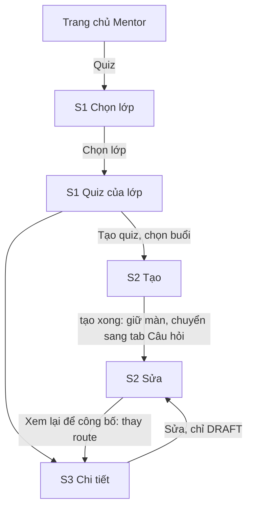
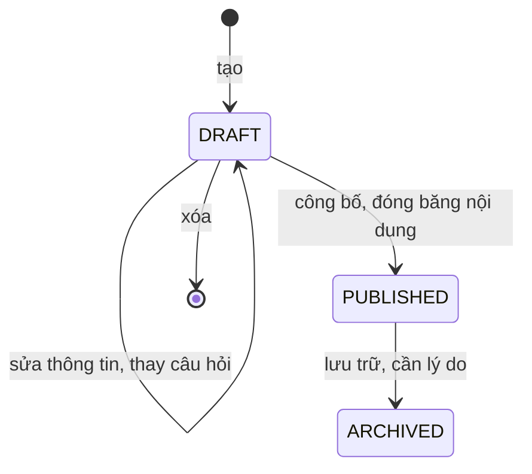

# P6 — Mentor tạo quiz → công bố → theo dõi trạng thái · Design cấp phase

Ngày: 02/11/2026 (Asia/Bangkok). Người thiết kế: Claude. Trạng thái: **design hoàn tất, chờ người dùng chốt các đề xuất ở mục 2 và duyệt cùng UI toàn phase** (ADR-009). Design không thay cổng duyệt kế hoạch tổng (ADR-016, ADR-017): chưa có kế hoạch `phase-006-mentor-quiz.md`. Q-P1-01 ghi "cần discovery trước design"; mục 2 là phần trả lời đề xuất cho P6, chưa được chốt.

File này chứa phần dùng chung: quyết định cần duyệt, điều hướng, thay đổi trên màn cũ, trạng thái, mô hình ghi, thành phần, nhãn, hành vi dữ liệu và khoảng lệch backend. Màn hình, trạng thái, chữ và test case nằm ở từng slice:

| Slice | Design | Route | Vai trò |
| --- | --- | --- | --- |
| P6-S1 — quiz-list | [quiz-list/design.md](quiz-list/design.md) | `MentorQuizzes` | MENTOR |
| P6-S2 — quiz-editor | [quiz-editor/design.md](quiz-editor/design.md) | `QuizEditor` | MENTOR |
| P6-S3 — quiz-detail | [quiz-detail/design.md](quiz-detail/design.md) | `QuizDetail` | MENTOR |

Căn cứ:

- [Kế hoạch P6](../../implementation-plan.md#p6-mentor-quiz), BR-QUIZ-01–04, BR-TEACH-02, BR-AUTH-04, BR-DATA-02; UC-M-11; ADR-004/005/007/008/009/023/025.
- Mẫu `Mentor Mobile UI.html` [M] và `Manager Mobile UI.html` [H], giải nén và đọc ngày 02/11/2026. **Cả hai không có màn quiz nào.** Toàn bộ phase ghép từ token và thành phần có sẵn, cần xem kỹ khi duyệt UI.
- Source `../Mindy-BE/src/modules/assignments`, commit `2533b00`, đọc ngày 02/11/2026. Đây là căn cứ trường dữ liệu cho design, chưa phải contract; Codex đối chiếu lại ở API-00. Chưa xác minh deploy.
- Source mobile hiện tại của `MentorClassDetailScreen`, `SessionContextScreen`, `src/modules/attendance/components/shared.tsx`; design [teaching-workspace](../teaching-workspace/design.md), [attendance-and-notes](../attendance-and-notes/design.md), [material-review](../material-review/design.md).

## 1. Phạm vi

| Có | Không có | Lý do |
| --- | --- | --- |
| Quiz ABCD một đáp án, tạo và sửa bản nháp, công bố, lưu trữ, xóa nháp | Bài ZIP | BR-QUIZ-04, publish trả `ZIP_PIPELINE_NOT_IMPLEMENTED` |
| Đọc nội dung và đáp án của quiz thuộc buổi được giao | Điểm, số lượt làm, tỷ lệ đúng, danh sách bài nộp | Backend không có endpoint Mentor nào cho kết quả (G-P6-02). Tiêu chí P6-S3 cấm tự dựng |
| Vai trò MENTOR | Manager | Controller chỉ `@Roles(MENTOR)`; service chặn role khác (Q-P6-01) |
| | Nhập câu hỏi từ file, ngân hàng câu hỏi, sao chép quiz | Backend không có API; ngoài UC-M-11 |

## 2. Đề xuất cần người dùng chốt

Design được viết theo cột "Đề xuất". Đổi đề xuất nào thì design của slice ở cột cuối phải cập nhật trước khi Codex làm UI.

| ID | Câu hỏi | Đề xuất | Vì sao | Ảnh hưởng |
| --- | --- | --- | --- | --- |
| Q-P6-01 | Manager có xem quiz trên mobile không? | **Không.** | Backend trả 403 với Manager. Muốn có cần sửa backend và ADR riêng | Cả phase |
| Q-P6-02 | Có để lối vào ở Trang chủ không? | **Không.** Vào từ Chi tiết lớp và Chi tiết buổi | Quiz thuộc buổi, phải chọn lớp và buổi mới làm được gì. Trang chủ Mentor đã có 4 tile | Mục 3, 4 |
| Q-P6-03 | Thang điểm mặc định? | **Điền sẵn 10**, sửa được khi tạo | Thang 10 quen thuộc ở Việt Nam. **Backend không cho đổi sau khi tạo** (G-P6-04), nên ô này được ghi rõ | S2 |
| Q-P6-04 | Có cho xóa bản nháp không? | **Có.** | Backend có `DELETE`, tuy chưa nằm trong mapping P6-S3. Không có xóa thì nháp sai thang điểm không bỏ được | S3 |
| Q-P6-05 | `purpose` gọi là gì? | **TEST = "Kiểm tra", HOMEWORK = "Bài về nhà"**, bắt buộc chọn, không điền sẵn | Backend chỉ lưu và lọc, không đổi hành vi. Không đổi được sau khi tạo | S1, S2, S3 |
| Q-P6-06 | Bản nháp của người khác? | **Hiển thị theo server**, không có lớp lọc ở client, và báo backend | DTO không có `createdBy`, nên client không phân biệt được (G-P6-03). Có thể trái BR-TEACH-02 | S1, S3 |

BR-QUIZ-03 (adapter ×100, "chờ ADR") **không cần chốt cho P6**: Mentor chỉ thấy `maxScore`, design giữ giá trị dạng chuỗi và không làm phép tính nào. Câu hỏi này quay lại khi có màn điểm.

## 3. Điều hướng

| Route | Vai trò | Params | Ghi chú |
| --- | --- | --- | --- |
| `MentorQuizzes` | MENTOR | Không có params, hoặc `classId`, `classTitle?`, `sessionId?`, `sessionTitle?` | Không có params là màn chọn lớp. Có `sessionId` là danh sách của buổi, hiện chưa có lối vào từ UI |
| `QuizEditor` | MENTOR | `classId`, `sessionId`, `sessionTitle?`, `assignmentId?` | Có `assignmentId` là sửa |
| `QuizDetail` | MENTOR | `classId`, `assignmentId`, `title?` | |

- Mở màn, Back và đổi tab hiển thị trực tiếp, không animation/gesture (ADR-023, ADR-025 mục 1).
- Chỉ stack Mentor đăng ký các route này. Params chỉ định danh và hiển thị; `revision`, `status`, câu hỏi, đáp án không truyền qua params.
- Rời màn có thay đổi chưa lưu: dialog "Thoát mà chưa lưu?" của P2 mục 6.5. Khi có mutation đang chạy, Back bị chặn.

Code mới đặt tại `src/modules/quiz/`, namespace i18n `quiz`.

## 4. Thay đổi trên màn cũ

Chỉ đổi đúng các chỗ dưới đây. Không gọi thêm API ở các màn này.

| Màn | Thay đổi | Điều kiện | testID |
| --- | --- | --- | --- |
| Chi tiết lớp Mentor | Không có lối vào quiz | | |
| Chi tiết buổi Mentor | Không có lối vào quiz | | |
| Chi tiết buổi Quản lý | Không đổi | | |
| Trang chủ Mentor | Tile "Quiz" trong nhóm tiện ích. Mở màn chọn lớp, rồi vào S1 của lớp đã chọn | Mọi Mentor | `workspace-open-quizzes` |
| Trang chủ Quản lý | Không đổi | | |

**Test hiện có bị ảnh hưởng:** test P1-S3 và P1-S4 kiểm số nút trên màn Mentor, nếu có, cập nhật theo TC-P6-CTX-01 đến 03.

## 5. Trạng thái quiz

| `status` | Nhãn vi / en | Tone | Mentor làm được |
| --- | --- | --- | --- |
| DRAFT | Nháp / Draft | neutral | Sửa, Công bố, Xóa |
| PUBLISHED | Đã công bố / Published | success | Lưu trữ, có lý do |
| ARCHIVED | Đã lưu trữ / Archived | neutral | Chỉ đọc. Không mở lại được |

**Khóa theo lớp và buổi:** lớp COMPLETED hoặc CANCELLED, hoặc buổi CANCELLED thì mọi lệnh ghi trả 409 `ASSIGNMENT_CLOSED`. Quiz vẫn đọc được. UI ẩn nút khi đã biết các trạng thái này; server là bên quyết định cuối.

DTO không có trường quyền (G-P6-01). Nút hiển thị theo bảng trên để định hướng.

**Giá trị lạ:** `status`, `purpose`, `type` lạ là phản hồi sai định dạng theo schema, không có nhãn dự phòng.

## 6. Mô hình ghi

### 6.1 `expectedRevision`

Mọi lệnh ghi trừ tạo đều gửi `expectedRevision`, lấy từ response gần nhất của đúng màn. Client không tự cộng. **Không có `Idempotency-Key`.** Mọi route cần header `Origin` cho request không phải GET (`RequestOriginGuard`), cấu hình như P2.

| Lệnh | Revision | Response có `questions`? |
| --- | --- | --- |
| POST tạo | 1 | Không |
| PATCH thông tin | +1 | **Không**: không được dùng response này ghi đè danh sách câu trong form |
| PUT câu hỏi | +1 | Có, kèm id mới |
| POST publish, archive | +1 | **Không**: phải GET lại mới có câu hỏi |
| DELETE | 204, không có body trả về | |

`DELETE` có **body** `{ expectedRevision }`. Codex kiểm client HTTP thật sự gửi body này ở API-00.

Mọi mutation trên một quiz chạy tuần tự. Khi có lệnh chưa rõ kết quả, các nút ghi đều khóa.

### 6.2 Lệnh chưa rõ kết quả

Timeout hoặc mất mạng sau khi gửi. Không có idempotency nên **không gửi lại mù**. Mọi nhánh đều bắt đầu bằng nút "Kiểm tra" trong `IntentBanner`, gọi GET rồi quyết định:

| Lệnh | Kết quả kiểm tra | Hành vi |
| --- | --- | --- |
| POST tạo | Trang 1 danh sách của buổi có DRAFT cùng tiêu đề | "Có vẻ quiz đã được tạo." + "Mở bản này" và "Tạo bản mới". Đối chiếu bằng tiêu đề vì DTO không có `createdAt` (G-P6-07) |
| POST tạo | Không có | "Gửi lại" cùng body |
| PATCH, PUT | `revision` chưa đổi | "Gửi lại" cùng body, cùng revision |
| PATCH, PUT | `revision` đã đổi, nội dung khớp bản đã gửi | Coi là thành công; toast |
| PATCH, PUT | `revision` đã đổi, nội dung khác | Xử lý như xung đột, mục 6.3 |
| Publish | `status` PUBLISHED | Thành công |
| Publish | DRAFT, `revision` chưa đổi | "Gửi lại" |
| Archive | `status` ARCHIVED | Thành công |
| Archive | PUBLISHED, `revision` chưa đổi | "Gửi lại", giữ nguyên lý do |
| DELETE | 404 | Thành công; về danh sách |
| DELETE | Còn DRAFT, `revision` chưa đổi | "Gửi lại" |

Offline: chỉ hiện cảnh báo, chưa có nút; có mạng lại thì nút hiện. Không tự gửi. Lệnh chưa rõ chỉ giữ trong bộ nhớ.

### 6.3 Mã lỗi

Nhãn đối chiếu lại ở API-00. Không hiện message tiếng Anh của backend. Có `requestId` thì thêm "Mã hỗ trợ: {requestId}".

| HTTP / mã | Nghĩa | Hành vi |
| --- | --- | --- |
| 409 `ASSIGNMENT_VERSION_CONFLICT` | Revision cũ | S2 mục 6: giữ bản đang soạn. S3: tải lại, "Quiz vừa thay đổi. Xem lại trước khi tiếp tục." Không tự gửi lại |
| 409 `ASSIGNMENT_CONTENT_FROZEN` | Đã công bố nên không sửa được | Tải lại; S2 thay route sang S3, "Quiz đã công bố nên không sửa được." |
| 409 `ASSIGNMENT_STATE_CONFLICT` | Lưu trữ khi không còn PUBLISHED | Tải lại; hiển thị theo trạng thái mới |
| 409 `ASSIGNMENT_CLOSED` | Lớp đã đóng hoặc buổi đã hủy | Khóa nút ghi; "Lớp đã kết thúc hoặc buổi đã hủy nên không sửa được quiz." Giữ dữ liệu đang xem |
| 409 `ZIP_PIPELINE_NOT_IMPLEMENTED` | Mở bài ZIP | Không xảy ra vì chỉ có QUIZ. Nếu có: lỗi chung + mã hỗ trợ |
| 422 `QUIZ_QUESTIONS_REQUIRED` | Công bố khi chưa có câu | S3: "Quiz cần ít nhất 1 câu hỏi." + "Soạn câu hỏi" |
| 422 `INVALID_ASSIGNMENT_DEADLINE` | Hạn nộp đã qua | S3: "Hạn nộp đã qua. Sửa hạn rồi công bố." + "Sửa hạn nộp" |
| 422 `INVALID_ASSIGNMENT_CONFIG` | Cấu hình sai | Lỗi ở ô nếu xác định được; nếu không, dải danger, giữ form |
| 422 `INVALID_QUIZ_QUESTIONS` | id câu cũ không còn hoặc sai cấu trúc | Lỗi chung + mã hỗ trợ; "Tải bản mới". Có thể xảy ra nếu id trong form đã cũ |
| 413 | Payload câu hỏi quá lớn | Dải danger "Nội dung quá dài để lưu một lần." Giữ form. Giới hạn body chưa xác minh, Codex kiểm ở API-00 |
| 403 `ORIGIN_NOT_ALLOWED` | **Lỗi cấu hình, không phải mất quyền** | Lỗi chung + mã hỗ trợ. **Giữ dữ liệu** |
| 403 `ASSIGNMENT_SCOPE_REQUIRED`, `MENTOR_SCOPE_REQUIRED` | Mất assignment | Xóa dữ liệu và form, `StatusBlock` không quyền (BR-AUTH-04) |
| 404 `ASSIGNMENT_NOT_FOUND` | Đã bị xóa | Xóa dữ liệu, `StatusBlock` không tìm thấy, "Quay lại" |
| 401 | Hết phiên | Về Login theo P0; xóa form |
| 5xx, timeout khi đọc | Lỗi chung | Theo [P1 mục 9.3](../teaching-workspace/design.md); giữ form |

Repo không có component tên `StatusBlock`: từ đó chỉ khối trạng thái toàn màn theo P1 mục 9.3, dựng bằng `QueryBlock` hoặc `FocusPanel` hiện có.

## 7. Thành phần

Tái sử dụng `Page`, `QueryBlock`, `More`, `Field`, `IntentBanner`, `FocusPanel`, `Filters`, `StatusChip`, `Card`, `Chip`, `Button`, `Alert`, `Sheet`, `Row`, `ConfirmationDialog`, `Toast`. Ô ngày giờ dùng `ScheduleFields` nếu P5 đã tách; nếu chưa thì tách từ `SessionEditScreen`, không chép. Thành phần mới trong `src/modules/quiz/components/`:

| Thành phần | Mô tả | Dùng ở |
| --- | --- | --- |
| `QuizRow` | `Card` pressable, padding 14, gap 8: tiêu đề 15/600 tối đa 2 dòng, chip trạng thái, chip mục đích, dòng buổi, dòng cấu hình. Không blur trên thẻ lặp (ADR-025 mục 11) | S1 |
| `QuizConfigLines` | Các dòng icon + chữ: thang điểm, hạn nộp, thời gian làm. Mỗi dòng theo mục 8 | S1, S3 |
| `QuestionRow` | Số thứ tự, nội dung tối đa 2 dòng, dòng "Đáp án đúng: B", nút `more_vert` | S2 |
| `QuestionForm` | Form một câu: nội dung và 4 ô A–D, mỗi ô kèm radio chọn đáp án đúng | S2 |
| `QuestionReadView` | Một câu ở dạng đọc, A–D. Đáp án đúng có `check_circle` và chữ "Đáp án đúng", không chỉ bằng màu | S3 |

**Icon cần thêm vào `src/components/ui/symbols.json`**, Material Symbols Rounded weight 300, nếu chưa có khi làm: `quiz`, `edit`, `delete`, `publish`, `inventory_2`, `timer`, `more_vert`, `arrow_upward`, `arrow_downward`. `add`, `check_circle`, `radio_button_unchecked`, `expand_more`, `visibility`, `visibility_off`, `info`, `warning` đã có.

Không thêm token màu.

## 8. Nhãn và định dạng

| Loại | Giá trị | vi | en |
| --- | --- | --- | --- |
| Mục đích | TEST | Kiểm tra | Test |
| Mục đích | HOMEWORK | Bài về nhà | Homework |

**Điểm:** `maxScore` là decimal string, giữ nguyên dạng chuỗi, không parse thành số. Chỉ để hiển thị: bỏ số 0 thừa sau dấu thập phân và đổi dấu theo locale. `"10.00"` → "10 điểm", `"7.50"` → "7,5 điểm" (vi), "7.5 points" (en). Không chia điểm theo câu ở bất kỳ đâu: server chấm và làm tròn (BR-QUIZ-02).

**Thời gian:** instant hiển thị theo `Asia/Ho_Chi_Minh` (ADR-008), dạng "HH:mm dd/MM/yyyy". Gửi lên server kèm offset `+07:00`; backend từ chối chuỗi không có offset.

**Đồng hồ:** DTO quiz không có `asOf` (G-P6-08). So hạn nộp bằng header `Date` của response gần nhất, thiếu mới dùng đồng hồ máy, như P5 mục 7. Chỉ để cảnh báo; server quyết định khi công bố.

| Dòng cấu hình | `null` | Có giá trị |
| --- | --- | --- |
| Hạn nộp | "Không có hạn nộp" | "Hạn {HH:mm dd/MM/yyyy}" |
| Thời gian làm | "Không giới hạn thời gian" | "{n} phút" |

## 9. Hành vi dữ liệu

Áp dụng P1 mục 9 và ADR-025, cộng các điểm riêng dưới đây.

### 9.1 Tải

| Màn | Lúc mở gọi gì | Không gọi |
| --- | --- | --- |
| S1 của lớp | `GET /mentor/classes/:classId/assignments?type=QUIZ` trang 1; `GET /mentor/classes/:classId`; bảng tra buổi `GET .../sessions?pageSize=100`, song song, không chặn | Chi tiết từng quiz để đếm câu |
| S1 của buổi | `GET /mentor/class-sessions/:sessionId/assignments?type=QUIZ` trang 1; `GET /mentor/classes/:classId`; context của buổi | Danh sách buổi |
| S2 tạo | `GET /mentor/classes/:classId` và context của buổi, chỉ để biết còn ghi được không | Danh sách quiz |
| S2 sửa | `GET /mentor/assignments/:id` | Danh sách |
| S3 | `GET /mentor/assignments/:id`; context của buổi; `GET /mentor/classes/:classId` | Kết quả, bài nộp |

**Luôn gửi `type=QUIZ`**: backend trả cả ZIP nếu bỏ filter, và không hiện chức năng ZIP là tiêu chí P6-S1. Hệ quả: nháp ZIP tạo từ web không hiện trên mobile.

`pageSize` mặc định 20, tối đa 100. Query key gồm tài khoản, role, classId/sessionId, filter, page. Đổi filter không hiện dữ liệu cũ dưới nhãn mới.

| Sau khi | Invalidate |
| --- | --- |
| Tạo, sửa, xóa, công bố, lưu trữ | Chi tiết quiz; danh sách của lớp và của buổi tương ứng ở mọi filter đã mở |

Hai Mentor ở hai thiết bị thấy thay đổi khi focus lại hoặc kéo làm mới; P6 không có realtime.

### 9.2 Offline

Dữ liệu và form chỉ ở bộ nhớ. Offline không có "Thử lại" trong phần đang offline; phục hồi bằng có mạng lại, focus hoặc kéo làm mới. **Mọi mutation chỉ online, không xếp hàng.**

| Màn | Đã có dữ liệu cùng query | Chưa có dữ liệu | Mutation |
| --- | --- | --- | --- |
| S1 | Hiện, cảnh báo "Dữ liệu có thể đã cũ." | "Chưa có dữ liệu. Kết nối mạng để tải." Không hiện rỗng | "Tạo quiz" khóa |
| S2 | Form giữ nguyên, gõ và soạn câu được | Như S1 ở chế độ sửa | Các nút Lưu khóa, dòng "Cần kết nối mạng" |
| S3 | Hiện, cảnh báo | Như S1 | Các nút khóa, dòng "Cần kết nối mạng" |

### 9.3 Bảo mật

**Đáp án đúng là dữ liệu nhạy cảm** (backend ghi "private quiz keys"). Câu hỏi và đáp án không ghi log, không vào params, không vào MMKV. Theo BR-DATA-02 và Q-DATA-01 chưa chốt: **form soạn câu chỉ nằm trong bộ nhớ; app bị tắt thì mất phần chưa lưu.** Thanh lưu ở S2 mục 4 giúp giảm rủi ro này, và S2 nói rõ điều đó với người dùng.

Đăng xuất hoặc đổi tài khoản xóa cache và form trước khi điều hướng.

S3 ẩn đáp án theo mặc định với quiz đã công bố, vì Mentor có thể mở màn này trước lớp ([S3 mục 2.2](quiz-detail/design.md)).

## 10. Khoảng lệch với backend

Đọc từ source ngày 02/11/2026. Mọi mục đều đã có cách xử lý không cần đổi backend. Không tự sửa backend; G-P6-01, -02, -03, -05, -07 nên được chủ backend xem xét.

| ID | Phát hiện | Cách design xử lý |
| --- | --- | --- |
| G-P6-01 | `AssignmentDto` không có `canEdit` hay `permissions`, không có trạng thái lớp và buổi | Suy nút từ `status` kèm context và chi tiết lớp; server quyết định khi ghi |
| G-P6-02 | Không có endpoint Mentor đọc bài nộp, điểm hay thống kê. `assignmentSummary` trả `NOT_IMPLEMENTED` | S3 có một dòng nói rõ. Không có số nào về bài làm |
| G-P6-03 | DTO không có `createdBy`. Service không kiểm người tạo: Mentor chính sửa được nháp của Mentor dạy thay và ngược lại trong buổi đó. Có thể trái BR-TEACH-02 "không mở draft người khác" | Q-P6-06. Không dựng lớp lọc client. Đề nghị backend trả `createdBy` |
| G-P6-04 | `UpdateAssignmentInput` không có `maxScore`, `purpose`, `type`, `maxAttempts`. Sai thang điểm phải xóa nháp tạo lại | S2 khóa hai ô này khi sửa, kèm chữ giải thích; khi tạo có dòng báo trước |
| G-P6-05 | Danh sách không trả `questions` hay số câu | `QuizRow` không có số câu. Không gọi chi tiết từng hàng (ADR-025 mục 5). Nên thêm `questionCount` vào DTO |
| G-P6-06 | PUT cần ít nhất 1 câu, nên không xóa hết câu của nháp đã lưu được | S2 khóa "Lưu câu hỏi" khi danh sách rỗng, kèm chữ giải thích |
| G-P6-07 | POST tạo không có khóa chống trùng; DTO không có `createdAt`, `updatedAt` | Mục 6.2 đối chiếu theo tiêu đề và để người dùng quyết định. Không hiện "cập nhật lúc" |
| G-P6-08 | DTO không có `asOf` | Mục 8 |
| G-P6-09 | Lý do lưu trữ chỉ ghi vào audit, DTO không trả; không có `archivedAt` | S3 không hiện lý do và thời điểm lưu trữ |
| G-P6-10 | PATCH cho phép `dueAt` đã qua; publish mới kiểm | S2 chỉ cảnh báo, S3 chặn theo lỗi server |
| G-P6-11 | Với quiz ARCHIVED, học viên bị 404 ở danh sách và chi tiết quiz, lượt IN_PROGRESS thành VOIDED. Bài đã nộp vẫn đọc được qua `/me/assignment-submissions/:id` (source ghi rõ "survives assignment archive") | Sheet lưu trữ tách rõ ba hệ quả, S3 mục 4. Không nói điểm bị mất |

## 11. i18n, testID, accessibility

Namespace gợi ý `quiz.*`; Codex được đổi tên key nếu giữ nguyên chữ. testID theo mẫu `<slice>-<phần tử>`: `quiz-list-` (S1), `quiz-editor-` (S2), `quiz-detail-` (S3).

Chung cho mọi slice:

- Mở Sheet/dialog: focus vào tiêu đề; đóng: trả focus về nút gốc.
- Lỗi form: focus ô lỗi đầu tiên và trình đọc màn hình đọc lỗi. Bàn phím không che ô đang nhập và thanh hành động.
- Không giới hạn phóng chữ nội dung; ở 1.3 không có nút nào đè nhau. Trạng thái và đáp án đúng không truyền đạt chỉ bằng màu.
- Thành công đọc lại bằng live region của `Toast`.

Chữ dùng chung:

| Key gợi ý | vi | en |
| --- | --- | --- |
| `quiz.status.draft` | Nháp | Draft |
| `quiz.status.published` | Đã công bố | Published |
| `quiz.status.archived` | Đã lưu trữ | Archived |
| `quiz.purpose.test` | Kiểm tra | Test |
| `quiz.purpose.homework` | Bài về nhà | Homework |
| `quiz.classLink` | Quiz | Quizzes |
| `quiz.sessionLink` | Quiz của buổi | Session quizzes |
| `quiz.points` | {{score}} điểm | {{score}} points |
| `quiz.due` | Hạn {{time}} | Due {{time}} |
| `quiz.noDue` | Không có hạn nộp | No due date |
| `quiz.minutes` | {{count}} phút | {{count}} min |
| `quiz.noLimit` | Không giới hạn thời gian | No time limit |
| `quiz.conflict` | Quiz vừa thay đổi. Xem lại trước khi tiếp tục. | This quiz just changed. Review it before continuing. |
| `quiz.frozen` | Quiz đã công bố nên không sửa được. | This quiz is published and can't be edited. |
| `quiz.closed` | Lớp đã kết thúc hoặc buổi đã hủy nên không sửa được quiz. | The class has ended or the session was cancelled, so this quiz can't be changed. |
| `quiz.needOnline` | Cần kết nối mạng | Connection required |
| `quiz.stale` | Dữ liệu có thể đã cũ. | Data may be out of date. |
| `quiz.offlineEmpty` | Chưa có dữ liệu. Kết nối mạng để tải. | No data yet. Connect to load it. |
| `quiz.unknownResult` | Chưa rõ thao tác đã thành công chưa. | We're not sure that went through. |
| `quiz.check` / `.resend` | Kiểm tra / Gửi lại | Check / Send again |
| `quiz.error` | Chưa thực hiện được. Thử lại sau. | That didn't work. Try again later. |
| `quiz.support` | Mã hỗ trợ: {{id}} | Support code: {{id}} |

## 12. Test case cấp phase và dữ liệu E2E

| ID | Tiền điều kiện | Thao tác | Kết quả mong đợi |
| --- | --- | --- | --- |
| TC-P6-CTX-01 | Mentor, lớp IN_PROGRESS | Mở chi tiết lớp và chi tiết buổi | Không có nút quiz; không có request quiz |
| TC-P6-CTX-02 | Mentor dạy thay, scope SESSION; lớp COMPLETED | Mở màn chọn lớp từ trang chủ | Vẫn chọn được lớp và đọc được quiz |
| TC-P6-CTX-03 | Mentor ở trang chủ | Bấm `workspace-open-quizzes`, chọn lớp | Mở S1 của đúng lớp |
| TC-P6-CTX-04 | Quản lý mở chi tiết buổi và chi tiết lớp | Xem | Không có lối vào quiz |
| TC-P6-NAV-01 | Mở từng màn P6, Back toolbar và Android Back | | Không animation chuyển màn, về đúng màn trước (kiểm native) |
| TC-P6-NAV-02 | Đăng nhập Quản lý | Điều hướng tới route P6 | Route không tồn tại trong stack |
| TC-P6-ERR-01 | Mutation trả 403 `ORIGIN_NOT_ALLOWED` | Bấm | Lỗi chung + mã hỗ trợ; **dữ liệu vẫn còn**, không có màn không quyền |
| TC-P6-ERR-02 | Mutation trả 403 `ASSIGNMENT_SCOPE_REQUIRED` | Bấm | Xóa dữ liệu và form; màn không quyền |
| TC-P6-SEC-01 | Soạn và lưu quiz | Kiểm log và MMKV | Không có nội dung câu hỏi hay đáp án |
| TC-P6-SEC-02 | Đang soạn dở | Đăng xuất, đăng nhập tài khoản khác | Không còn form hay danh sách cũ |
| TC-P6-I18N-01 | vi/en × sáng/tối × màn 360 × font 1.3 | Xem 3 slice | Không cắt chữ, không đè nút, tương phản đạt bảng P1 |

**Dữ liệu E2E** (Codex chuẩn bị theo kế hoạch phase):

- Mentor A chính của một lớp IN_PROGRESS; Mentor B dạy thay một buổi của lớp đó; một lớp COMPLETED và một buổi CANCELLED, mỗi nơi có sẵn một quiz.
- Đủ trạng thái: DRAFT chưa có câu, DRAFT có câu, DRAFT có hạn nộp đã qua, PUBLISHED, ARCHIVED; một bản ZIP nháp để kiểm không hiện. Hơn 20 quiz trong một lớp để kiểm phân trang.
- Một Student đang làm dở quiz PUBLISHED để kiểm lưu trữ làm hủy lượt, đọc lại qua API Student.
- Hai phiên cùng tài khoản Mentor A trên một quiz để tạo xung đột revision.
