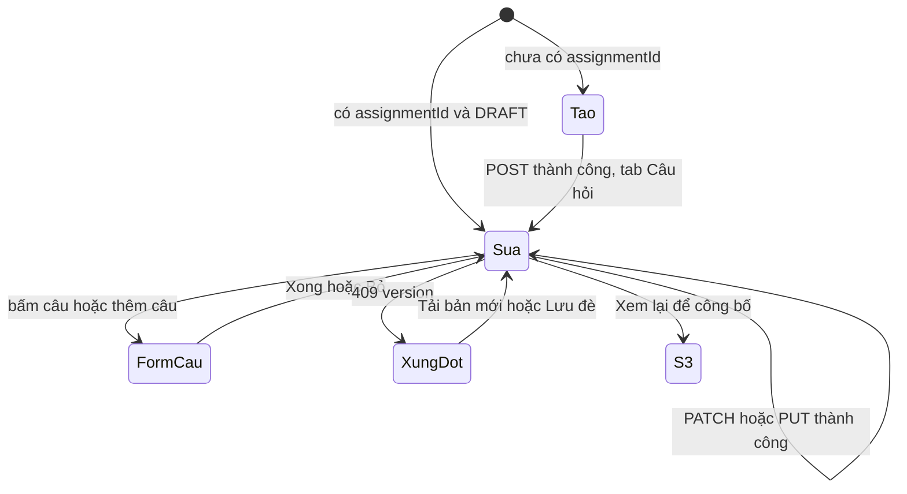

# P6-S2 — quiz-editor · Tạo và sửa bản nháp, soạn câu hỏi

Ngày: 02/11/2026. Người thiết kế: Claude. Design cấp phase: [../design.md](../design.md).
BR/UC: BR-QUIZ-01, BR-AUTH-04, BR-DATA-02; UC-M-11. Endpoint tham chiếu: `POST /mentor/class-sessions/:sessionId/assignments`; `GET`, `PATCH /mentor/assignments/:assignmentId`; `PUT /mentor/assignments/:assignmentId/questions`.

## 1. Mục tiêu

Mentor tạo bản nháp quiz cho một buổi, soạn câu hỏi ABCD một đáp án đúng, và lưu nhiều lần trước khi công bố. Công bố nằm ở S3, không nằm ở đây, để Mentor luôn xem lại nội dung đã lưu trên server trước khi đóng băng.

**Hai bước, không gộp:** tạo nháp trước rồi mới soạn câu. Backend tách hai request; gộp vào một nút sẽ tạo trường hợp "đã tạo nháp nhưng lưu câu lỗi" và dễ sinh bản trùng (G-P6-07).

## 2. Bố cục

### 2.1 Tạo mới

```
┌──────────────────────────────┐
│▓ ×  Tạo quiz                 ▓│
│▓    Buổi 8 · Line graphs     ▓│
├──────────────────────────────┤
│ Tiêu đề *                    │
│ [ Kiểm tra Unit 8          ] │
│ Mô tả                        │
│ [                          ] │
│ Mục đích *                   │
│ (○ Kiểm tra) (○ Bài về nhà)  │
│ Thang điểm *                 │
│ [ 10                       ] │
│ ⓘ Mục đích và thang điểm     │
│   không đổi được sau khi tạo.│
│ Hạn nộp                      │
│ [ Chưa đặt              📅 ] │
│ Thời gian làm (phút)         │
│ [ Không giới hạn           ] │
│ ⓘ Nếu đặt cả hai, lượt làm   │
│   kết thúc theo mốc đến trước│
├──────────────────────────────┤
│ [ Tạo nháp                 ] │
└──────────────────────────────┘
```

Tạo thành công: giữ màn, chuyển sang chế độ sửa ở tab **Câu hỏi**, toast "Đã tạo bản nháp." Back từ đây về màn trước của S2, không quay lại form tạo.

### 2.2 Sửa, tab Thông tin

```
┌──────────────────────────────┐
│▓ ←  Sửa quiz          [Nháp] ▓│
│▓    Buổi 8 · Line graphs     ▓│
│▓ [Thông tin] [Câu hỏi (12)]  ▓│
├──────────────────────────────┤
│ Tiêu đề *                    │
│ [ Kiểm tra Unit 8          ] │
│ Mô tả                        │
│ [                          ] │
│ Mục đích        Kiểm tra  🔒 │
│ Thang điểm       10 điểm  🔒 │
│ Hạn nộp                      │
│ [ 18:30 30/10/2026    ✕  📅 ]│
│ Thời gian làm (phút)         │
│ [ 30                    ✕  ] │
├──────────────────────────────┤
│ [ Lưu thông tin ]            │
│ ( Xem lại để công bố )       │
└──────────────────────────────┘
```

### 2.3 Sửa, tab Câu hỏi

```
┌──────────────────────────────┐
│▓ ←  Sửa quiz          [Nháp] ▓│
│▓ [Thông tin] [Câu hỏi (12)]  ▓│
├──────────────────────────────┤
│ ┌──────────────────────────┐ │
│ │ 1. Which line shows the ⋮│ │
│ │    highest growth in ... │ │
│ │    Đáp án đúng: B        │ │
│ ├──────────────────────────┤ │
│ │ 2. The chart suggests…  ⋮│ │
│ │    Đáp án đúng: D        │ │
│ └──────────────────────────┘ │
│ [ + Thêm câu hỏi ]           │
├──────────────────────────────┤
│ ● Có thay đổi chưa lưu       │
│ [ Lưu câu hỏi ]              │
│ ( Xem lại để công bố )       │
└──────────────────────────────┘
```

Số trên tab là số câu đang có trong form, không phải đã lưu. Đổi tab không mất dữ liệu.

- **Bấm hàng:** mở form câu (mục 2.4).
- **`more_vert`:** `Sheet` "Sửa", "Chuyển lên", "Chuyển xuống", "Xóa". Hàng đầu không có "Chuyển lên", hàng cuối không có "Chuyển xuống". Không có kéo thả: nút rõ ràng hơn với trình đọc màn hình và không vướng cuộn.
- **Xóa câu:** dialog "Xóa câu {n}?" Xóa khỏi form, chưa ghi lên server.
- **Danh sách trống:** "Chưa có câu hỏi nào." + "Thêm câu hỏi".
- **200 câu:** ẩn "Thêm câu hỏi", có dòng "Mỗi quiz có tối đa 200 câu."
- Hiện đủ danh sách, không phân trang: GET chi tiết trả toàn bộ. Dùng danh sách ảo hóa để 200 hàng vẫn mượt.
- **Xem lại để công bố:** thay route sang S3. Khóa khi có thay đổi chưa lưu, kèm dòng "Lưu trước khi xem lại."

### 2.4 Form một câu

Thân màn đổi sang form, **không phải route mới và không phải Sheet**: Sheet thấp không đủ chỗ cho 5 ô nhập khi bàn phím mở, còn route mới phải truyền đáp án qua params (phase mục 3 cấm). Header đổi theo, nút Back và Android Back về danh sách câu.

```
┌──────────────────────────────┐
│▓ ←  Câu 3 / 12               ▓│
├──────────────────────────────┤
│ Nội dung câu hỏi *           │
│ [                          ] │
│ [                          ] │
│ Các lựa chọn · Chọn đáp án   │
│ đúng bằng nút bên trái *     │
│ (○) A [                    ] │
│ (●) B [                    ] │ đáp án đúng: viền tone success, có chữ
│     ✓ Đáp án đúng            │
│ (○) C [                    ] │
│ (○) D [                    ] │
├──────────────────────────────┤
│ [ Xong ]  ( Thêm câu tiếp )  │
└──────────────────────────────┘
```

| Thành phần | Quy tắc |
| --- | --- |
| Đáp án đúng | **Không chọn sẵn.** Radio vùng chạm ≥ 44. Câu mới luôn bắt đầu chưa chọn |
| Xong | Kiểm hợp lệ, ghi vào form, về danh sách. Chưa gửi lên server |
| Thêm câu tiếp | Như Xong rồi mở form trống của câu kế. Câu thứ 200 thì ẩn |
| Back khi đã gõ | Dialog "Bỏ thay đổi của câu này?" + "Bỏ" / "Tiếp tục sửa" |

### 2.5 Nhắc lưu

Form chỉ ở bộ nhớ (phase mục 9.3), nên soạn nhiều câu là có rủi ro. Khi có câu chưa lưu, thanh dưới luôn hiện `quiz.editor.unsaved`. Từ câu chưa lưu thứ 10 trở đi, chữ đổi thành `quiz.editor.unsavedMany` kèm số câu, tone warning. Không tự lưu: mỗi lần lưu tăng `revision` và gửi lại toàn bộ danh sách.

## 3. Trường và kiểm tra

| Trường | Ràng buộc | Lỗi vi | Ghi chú |
| --- | --- | --- | --- |
| Tiêu đề | 1–250 ký tự sau trim | "Nhập tiêu đề." | |
| Mô tả | ≤ 20000; được trống | "Mô tả tối đa 20000 ký tự." | Nhiều dòng |
| Mục đích | Bắt buộc khi tạo | "Chọn mục đích." | Không chọn sẵn. Khi sửa: chỉ đọc |
| Thang điểm | Khớp `^(0|[1-9]\d{0,5})(\.\d{1,2})?$` và > 0 | "Nhập điểm lớn hơn 0, tối đa 2 chữ số thập phân." | Điền sẵn `10`. Bàn phím thập phân; **giữ dạng chuỗi**, chấp nhận dấu phẩy khi gõ rồi đổi thành dấu chấm khi gửi. Khi sửa: chỉ đọc |
| Hạn nộp | Tùy chọn | Mục 3.1 | Chọn ngày + giờ, gửi kèm `+07:00`. Nút `close` xóa |
| Thời gian làm | Tùy chọn, số nguyên 1–240 | "Nhập từ 1 đến 240 phút." | Nút `close` xóa |
| Nội dung câu | 1–5000 sau trim | "Nhập nội dung câu hỏi." | |
| Lựa chọn A–D | Mỗi ô 1–2000 sau trim | "Nhập lựa chọn {label}." | Luôn đủ 4 ô, thứ tự cố định |
| Đáp án đúng | Bắt buộc | "Chọn đáp án đúng." | |

So khớp `maxScore`: **không chuyển sang số dấu phẩy động** ngoài phép kiểm khác 0. Kiểm "> 0" bằng chuỗi: có ít nhất một chữ số khác 0.

### 3.1 Hạn nộp đã qua

Backend chỉ chặn lúc công bố (G-P6-10). Nên ở đây chỉ **cảnh báo**, không chặn lưu: "Hạn nộp đã qua. Cần sửa trước khi công bố." So theo phase mục 8.

### 3.2 Gửi lên server

| Lệnh | Body |
| --- | --- |
| Tạo | `purpose`, `type: "QUIZ"`, `title`, `description` nếu có, `maxScore`, `dueAt` và `timeLimitMinutes` nếu có. **Không gửi `maxAttempts`**: backend mặc định 1 và từ chối giá trị khác với QUIZ |
| Lưu thông tin | `expectedRevision` và **chỉ các trường đã đổi**. Xóa hạn hoặc thời gian là gửi `null`. Không có gì đổi thì nút khóa |
| Lưu câu hỏi | `expectedRevision`, toàn bộ `questions` theo thứ tự trong form. Câu đã có gửi kèm `id`; câu mới không có `id` |

Sau PATCH: chỉ cập nhật thông tin và `revision`, **giữ nguyên danh sách câu trong form** vì response không có `questions`. Sau PUT: thay danh sách bằng response, để có `id` mới. Hai tab lưu riêng; không có nút lưu tất cả, vì đó là hai request có thể thành công một nửa.

Lưu xong: toast, ở lại màn.

## 4. Trạng thái

| # | Trạng thái | Hiển thị |
| --- | --- | --- |
| E-A | Tạo mới | Mục 2.1. Không có tab |
| E-B | Sửa, đang tải | Skeleton đúng bố cục của tab Thông tin |
| E-C | Sửa, có dữ liệu | Mục 2.2, 2.3 |
| E-D | Đang gửi | Nút có spinner; form khóa; Back bị chặn |
| E-E | Lỗi ô | Lỗi dưới ô, focus ô đầu tiên; tab có lỗi có dấu `warning` |
| E-F | Xung đột revision | Mục 6 |
| E-G | Chưa rõ kết quả | Phase mục 6.2; form khóa, `IntentBanner` |
| E-H | Quiz không còn DRAFT khi mở | Thay route sang S3 ngay; không hiện form |
| E-I | `ASSIGNMENT_CONTENT_FROZEN` khi lưu | Thay route sang S3 với `quiz.frozen`. Phần chưa lưu bị bỏ, vì bản đã công bố là bản không đổi được; dialog báo trước khi rời |
| E-J | `ASSIGNMENT_CLOSED` | Form khóa, `quiz.closed`; Back không hỏi |
| E-K | Offline, có dữ liệu | Gõ và soạn được; các nút Lưu, Tạo nháp khóa, `quiz.needOnline` |
| E-L | Offline, chưa có dữ liệu (chế độ sửa) | `quiz.offlineEmpty` |
| E-M | Lỗi tải | `StatusBlock` + "Thử lại" |
| E-N | 403, 404, 401 | Phase mục 6.3; xóa form |
| E-O | Tạo thất bại không rõ | Phase mục 6.2 cho POST |
| E-P | Lưu câu khi danh sách rỗng | Nút khóa, dòng "Quiz cần ít nhất 1 câu để lưu." (G-P6-06) |

**Thoát khi chưa lưu:** dialog "Thoát mà chưa lưu?" của P2 mục 6.5, tính cả hai tab và form câu đang mở. Android Back ở form câu về danh sách câu trước, không thoát màn.

## 5. Luồng chính



## 6. Xung đột revision

Xảy ra khi có phiên khác vừa lưu, ví dụ Mentor chính và Mentor dạy thay cùng sửa. PUT **thay toàn bộ** câu hỏi, nên không thể gộp hai bản. Soạn nhiều câu rồi mất hết là lỗi nặng, nên design giữ bản đang soạn và cho người dùng chọn.

```
┌──────────────────────────────┐
│ ⚠ Quiz vừa được sửa ở nơi khác│
│ Bản của bạn chưa được lưu.    │
│ ( Tải bản mới ) ( Lưu đè )    │
└──────────────────────────────┘
```

| Lựa chọn | Hành vi |
| --- | --- |
| Tải bản mới | Dialog "Bỏ thay đổi của bạn?" rồi GET, thay form |
| Lưu đè | Dialog nêu rõ "Bản của người khác sẽ bị thay thế." rồi GET lấy `revision` mới, gửi lại body đang có với revision đó. **Không tự làm**; luôn là lần bấm rõ ràng |

Nếu GET cho thấy không còn DRAFT: theo E-I. `id` trong câu không còn tồn tại khi lưu đè: bỏ `id` của các câu đó trước khi gửi để tránh `INVALID_QUIZ_QUESTIONS`.

## 7. Nội dung chữ

| Key gợi ý | vi | en |
| --- | --- | --- |
| `quiz.editor.createTitle` | Tạo quiz | Create quiz |
| `quiz.editor.editTitle` | Sửa quiz | Edit quiz |
| `quiz.editor.tabInfo` | Thông tin | Details |
| `quiz.editor.tabQuestions` | Câu hỏi ({{count}}) | Questions ({{count}}) |
| `quiz.editor.fieldTitle` | Tiêu đề | Title |
| `quiz.editor.fieldDescription` | Mô tả | Description |
| `quiz.editor.fieldPurpose` | Mục đích | Purpose |
| `quiz.editor.fieldScore` | Thang điểm | Maximum score |
| `quiz.editor.fieldDue` | Hạn nộp | Due date |
| `quiz.editor.dueUnset` | Chưa đặt | Not set |
| `quiz.editor.fieldLimit` | Thời gian làm (phút) | Time limit (minutes) |
| `quiz.editor.limitUnset` | Không giới hạn | No limit |
| `quiz.editor.lockNote` | Mục đích và thang điểm không đổi được sau khi tạo. | Purpose and maximum score can't be changed after creation. |
| `quiz.editor.bothLimits` | Nếu đặt cả hai, lượt làm kết thúc theo mốc đến trước. | If you set both, the attempt ends at whichever comes first. |
| `quiz.editor.duePast` | Hạn nộp đã qua. Cần sửa trước khi công bố. | The due date has passed. Change it before publishing. |
| `quiz.editor.create` | Tạo nháp | Create draft |
| `quiz.editor.created` | Đã tạo bản nháp. | Draft created. |
| `quiz.editor.saveInfo` | Lưu thông tin | Save details |
| `quiz.editor.saveQuestions` | Lưu câu hỏi | Save questions |
| `quiz.editor.saved` | Đã lưu. | Saved. |
| `quiz.editor.review` | Xem lại để công bố | Review to publish |
| `quiz.editor.saveFirst` | Lưu trước khi xem lại. | Save before reviewing. |
| `quiz.editor.unsaved` | Có thay đổi chưa lưu | You have unsaved changes |
| `quiz.editor.unsavedMany` | {{count}} câu chưa lưu. Đóng ứng dụng sẽ mất phần này. | {{count}} questions aren't saved. Closing the app will lose them. |
| `quiz.editor.addQuestion` | Thêm câu hỏi | Add question |
| `quiz.editor.noQuestions` | Chưa có câu hỏi nào. | No questions yet. |
| `quiz.editor.maxQuestions` | Mỗi quiz có tối đa 200 câu. | A quiz can have up to 200 questions. |
| `quiz.editor.needOne` | Quiz cần ít nhất 1 câu để lưu. | A quiz needs at least 1 question to save. |
| `quiz.editor.questionHead` | Câu {{index}} / {{total}} | Question {{index}} of {{total}} |
| `quiz.editor.prompt` | Nội dung câu hỏi | Question |
| `quiz.editor.options` | Các lựa chọn · Chọn đáp án đúng bằng nút bên trái | Options · Use the left button to choose the correct one |
| `quiz.editor.correct` | Đáp án đúng | Correct answer |
| `quiz.editor.correctLine` | Đáp án đúng: {{label}} | Correct answer: {{label}} |
| `quiz.editor.done` | Xong | Done |
| `quiz.editor.next` | Thêm câu tiếp | Add another |
| `quiz.editor.moveUp` / `.moveDown` | Chuyển lên / Chuyển xuống | Move up / Move down |
| `quiz.editor.edit` / `.delete` | Sửa / Xóa | Edit / Delete |
| `quiz.editor.deleteConfirm` | Xóa câu {{index}}? | Delete question {{index}}? |
| `quiz.editor.discardQuestion` | Bỏ thay đổi của câu này? | Discard changes to this question? |
| `quiz.editor.conflictTitle` | Quiz vừa được sửa ở nơi khác | This quiz was just edited elsewhere |
| `quiz.editor.conflictBody` | Bản của bạn chưa được lưu. | Your version hasn't been saved. |
| `quiz.editor.loadLatest` | Tải bản mới | Load latest |
| `quiz.editor.overwrite` | Lưu đè | Overwrite |
| `quiz.editor.overwriteConfirm` | Bản của người khác sẽ bị thay thế. | The other version will be replaced. |
| `quiz.editor.discardMine` | Bỏ thay đổi của bạn? | Discard your changes? |
| `quiz.editor.maybeCreated` | Có vẻ quiz đã được tạo. | It looks like the quiz was created. |
| `quiz.editor.openIt` | Mở bản này | Open it |
| `quiz.editor.createAnother` | Tạo bản mới | Create new |

Lỗi ô ở mục 3 có bản en tương ứng do Codex dịch theo cùng nghĩa.

## 8. Accessibility

- Ô A–D có nhãn "Lựa chọn A". Radio đọc "Đặt A là đáp án đúng", trạng thái `selected`.
- Radio và ô nhập của cùng một lựa chọn là hai điểm focus riêng, theo thứ tự radio rồi ô.
- `more_vert` đọc "Thao tác cho câu {n}".
- Chuyển lên, xuống: đọc lại "Đã chuyển câu thành số {n}". Focus giữ trên hàng vừa chuyển.
- Bàn phím không che ô đang nhập và thanh hành động.

## 9. testID

`quiz-editor-screen`, `quiz-editor-back`, `quiz-editor-tab-info`, `quiz-editor-tab-questions`, `quiz-editor-title`, `quiz-editor-description`, `quiz-editor-purpose-test`, `quiz-editor-purpose-homework`, `quiz-editor-score`, `quiz-editor-due`, `quiz-editor-due-clear`, `quiz-editor-due-warning`, `quiz-editor-limit`, `quiz-editor-limit-clear`, `quiz-editor-create`, `quiz-editor-save-info`, `quiz-editor-save-questions`, `quiz-editor-review`, `quiz-editor-unsaved`, `quiz-editor-add-question`, `quiz-editor-question-<index>`, `quiz-editor-question-<index>-menu`, `quiz-editor-menu-edit`, `quiz-editor-menu-up`, `quiz-editor-menu-down`, `quiz-editor-menu-delete`, `quiz-editor-prompt`, `quiz-editor-option-a`, `-b`, `-c`, `-d`, `quiz-editor-correct-a`, `-b`, `-c`, `-d`, `quiz-editor-question-done`, `quiz-editor-question-next`, `quiz-editor-conflict`, `quiz-editor-load-latest`, `quiz-editor-overwrite`, `quiz-editor-offline`, `quiz-editor-error`, `quiz-editor-denied`, `quiz-editor-skeleton`.

## 10. Test case

| ID | Tiền điều kiện / mock | Thao tác | Kết quả mong đợi |
| --- | --- | --- | --- |
| TC-P6-S2-01 | Tạo mới | Mở | Thang điểm là `10`; mục đích chưa chọn; có `lockNote`; không có tab; không gọi danh sách quiz |
| TC-P6-S2-02 | Tiêu đề chỉ có khoảng trắng | Tạo nháp | Lỗi ở ô, focus ô; không có request |
| TC-P6-S2-03 | Chưa chọn mục đích | Tạo nháp | Lỗi; không có request |
| TC-P6-S2-04 | Thang điểm `0`, `0.00`, `1.234`, `1234567`, `abc` | Tạo nháp | Từng giá trị đều báo lỗi; không có request |
| TC-P6-S2-05 | Thang điểm `7,5`, `100`, `0.5` | Tạo nháp | Hợp lệ; body gửi chuỗi `"7.5"`, `"100"`, `"0.5"`; không qua số |
| TC-P6-S2-06 | Thời gian `0`, `241`, `1.5` | Tạo nháp | Báo lỗi |
| TC-P6-S2-07 | Hợp lệ | Tạo nháp | POST đúng `sessionId`, `type: "QUIZ"`; **không có `maxAttempts`**; `dueAt` có `+07:00`; không gửi trường trống |
| TC-P6-S2-08 | POST 201 | Xem | Toast; chế độ sửa, tab Câu hỏi; Back không về form tạo |
| TC-P6-S2-09 | Sửa, DRAFT | Mở | 1 GET; thông tin đúng; mục đích và thang điểm chỉ đọc; có đủ câu và đáp án |
| TC-P6-S2-10 | Sửa, PUBLISHED hoặc ARCHIVED | Mở | Thay route sang S3; không hiện form |
| TC-P6-S2-11 | Đổi chỉ tiêu đề | Lưu thông tin | PATCH chỉ có `title`, `expectedRevision` |
| TC-P6-S2-12 | Xóa hạn nộp | Lưu thông tin | Body có `dueAt: null` |
| TC-P6-S2-13 | Không đổi gì | Xem | "Lưu thông tin" khóa |
| TC-P6-S2-14 | Có câu chưa lưu, lưu thông tin | PATCH trả không có `questions` | Câu trong form còn nguyên; `revision` mới dùng cho lần PUT sau |
| TC-P6-S2-15 | PUT thành công | Xem | Danh sách thay theo response; lần PUT sau gửi đúng `id` |
| TC-P6-S2-16 | Thêm câu mới, sửa câu cũ, đổi thứ tự | Lưu câu hỏi | Body đúng thứ tự; câu cũ có `id`, câu mới không có |
| TC-P6-S2-17 | Câu mới | Mở form | Không có đáp án chọn sẵn |
| TC-P6-S2-18 | Thiếu nội dung, thiếu một lựa chọn, thiếu đáp án | Xong | Lỗi đúng ô; không ghi vào danh sách |
| TC-P6-S2-19 | Hợp lệ | Thêm câu tiếp | Ghi câu; form trống; số thứ tự tăng; không có request |
| TC-P6-S2-20 | Sửa câu rồi Back | | Dialog; "Bỏ" giữ nguyên bản trước |
| TC-P6-S2-21 | 3 câu | Menu câu đầu / cuối | Câu đầu không có "Chuyển lên"; câu cuối không có "Chuyển xuống"; chuyển đúng vị trí |
| TC-P6-S2-22 | Xóa câu | Xác nhận | Rời danh sách; chưa có request; có `unsaved` |
| TC-P6-S2-23 | Xóa hết câu của nháp đã lưu | Xem | "Lưu câu hỏi" khóa; có `needOne` |
| TC-P6-S2-24 | 200 câu | Xem | Không có "Thêm câu hỏi", có `maxQuestions`; danh sách vẫn cuộn được |
| TC-P6-S2-25 | 10 câu chưa lưu | Xem | Đổi sang `unsavedMany` tone warning |
| TC-P6-S2-26 | Có thay đổi chưa lưu | Xem | "Xem lại để công bố" khóa, có `saveFirst` |
| TC-P6-S2-27 | Đã lưu | Bấm Xem lại | Thay route sang S3; Back từ S3 không về editor |
| TC-P6-S2-28 | `dueAt` đã qua | Xem | `quiz-editor-due-warning`; vẫn lưu được |
| TC-P6-S2-29 | 409 `ASSIGNMENT_VERSION_CONFLICT` khi PUT | Xem | `quiz-editor-conflict`; form còn nguyên; không tự gửi |
| TC-P6-S2-30 | Sau xung đột | Tải bản mới, xác nhận | GET; form thay theo server |
| TC-P6-S2-31 | Sau xung đột | Lưu đè, xác nhận | GET rồi PUT với `revision` mới; không có `id` đã mất |
| TC-P6-S2-32 | Sau xung đột, GET cho thấy PUBLISHED | Lưu đè | Không gửi PUT; sang S3 với `frozen` |
| TC-P6-S2-33 | 409 `ASSIGNMENT_CONTENT_FROZEN` | Lưu | Sang S3 với `frozen` |
| TC-P6-S2-34 | 409 `ASSIGNMENT_CLOSED` | Lưu | Form khóa; `closed` |
| TC-P6-S2-35 | Timeout POST, GET danh sách có DRAFT cùng tiêu đề | Kiểm tra | `maybeCreated`; "Mở bản này" mở đúng id; không tự tạo |
| TC-P6-S2-36 | Timeout POST, không có bản nào | Kiểm tra | "Gửi lại" cùng body |
| TC-P6-S2-37 | Timeout PUT, `revision` chưa đổi | Kiểm tra | "Gửi lại" cùng body, cùng revision |
| TC-P6-S2-38 | Timeout PUT, `revision` tăng, nội dung khớp | Kiểm tra | Toast đã lưu; hết `unsaved` |
| TC-P6-S2-39 | Timeout PUT, `revision` tăng, nội dung khác | Kiểm tra | `quiz-editor-conflict` |
| TC-P6-S2-40 | Lệnh chưa rõ | Xem | Mọi nút ghi khóa |
| TC-P6-S2-41 | Có thay đổi | Back toolbar, Android Back | Dialog; ở form câu thì về danh sách câu trước |
| TC-P6-S2-42 | Đang gửi | Back | Bị chặn |
| TC-P6-S2-43 | Offline | Soạn câu | Soạn được; Lưu khóa; có mạng lại thì mở, không tự gửi |
| TC-P6-S2-44 | 403 khi lưu | Xem | Xóa form; `quiz-editor-denied` |
| TC-P6-S2-45 | 413 | Lưu | Dải danger; form còn nguyên |
| TC-P6-S2-46 | Đóng và mở lại app | Xem | Phần chưa lưu không còn; không có dữ liệu trong MMKV |
| TC-P6-S2-47 | Nhập 2 tab cùng có lỗi | Lưu tab đang mở | Chỉ kiểm tab đang lưu; tab kia có dấu khi đã có lỗi |

Ứng viên Maestro E2E: TC-P6-S2-07, -08, -09, -10, -15, -16, -19, -27, -29, -33.
