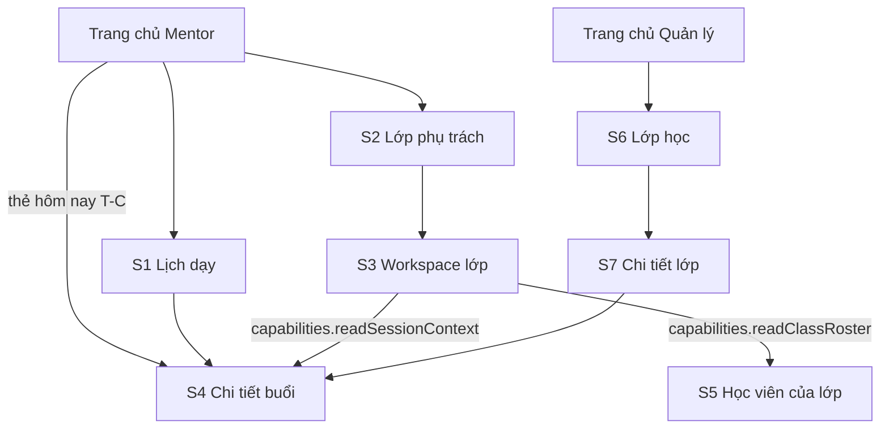

# P1 — Mentor xem lịch/lớp → Manager theo dõi lớp · Design cấp phase

Ngày: 31/10/2026 (Asia/Bangkok). Người thiết kế: Claude. Trạng thái: **design hoàn tất, chờ người dùng duyệt cùng UI toàn phase** (ADR-009).

File này chứa phần dùng chung của cả phase: luồng điều hướng, Trang chủ, token bổ sung, thành phần, định dạng, nhãn trạng thái và hành vi dữ liệu. Màn hình, trạng thái, nội dung chữ và test case của từng slice nằm ở:

| Slice | Design |
| --- | --- |
| P1-S1 — mentor-schedule | [mentor-schedule/design.md](mentor-schedule/design.md) |
| P1-S2 — mentor-classes | [mentor-classes/design.md](mentor-classes/design.md) |
| P1-S3 — mentor-class-detail | [mentor-class-detail/design.md](mentor-class-detail/design.md) |
| P1-S4 — session-context | [session-context/design.md](session-context/design.md) |
| P1-S5 — mentor-students | [mentor-students/design.md](mentor-students/design.md) |
| P1-S6 — manager-classes | [manager-classes/design.md](manager-classes/design.md) |
| P1-S7 — manager-class-detail | [manager-class-detail/design.md](manager-class-detail/design.md) |

Căn cứ:

- Mẫu `docs/design/Mentor Mobile UI.html` [M] và `Manager Mobile UI.html` [H] (thay `Thiết kế Home UI.html` từ 31/10/2026), giải nén và đọc ngày 31/10/2026. **Cả hai bản hiện tại đều là prototype Quản lý.** Không còn trang lịch Mentor; lịch tuần chỉ còn lại ở token `.mdy-week` trong [global.css.md](../global.css.md). Bố cục S1–S5 vì vậy được ghép từ token và thành phần có sẵn, không sao từ mẫu. Khi duyệt UI cần xem kỹ các màn này. **Cập nhật 31/10/2026:** `Mentor Mobile UI.html` đã được người dùng thay bằng prototype Mentor thật. Mục 3 (Trang chủ Mentor) đã theo bản mới; S1–S5 chưa được đối chiếu lại.
- Trang lớp của mẫu [H] là cơ sở cho S6/S7, đối chiếu từng phần ở S6 mục 2.1 và S7 mục 2.1. Trang chi tiết buổi của [H], bản người dùng cập nhật ngày 01/11/2026, là cơ sở cho bố cục Quản lý của S4, đối chiếu ở S4 mục 2.2. Thẻ lớp S2 vẫn theo mẫu [M]. Các dòng số học viên, tiến độ unit, lịch tuần và phòng trên thẻ bị bỏ vì DTO danh sách không có.
- BR-TEACH-01/02, BR-TIME-01, BR-CLASS-02/03, BR-AUTH-04, BR-SCOPE-02/03, BR-ENR-02, BR-MAT-06, BR-DATA-02; UC-M-02, UC-M-03, UC-MG-02.
- Source backend `../Mindy-BE/src/modules` đọc ngày 31/10/2026: `classes`, `payments`, `manager-operations`, `attendance`. Đây là căn cứ trường dữ liệu cho design, chưa phải contract; Codex vẫn đối chiếu lại ở bước API-00.

## 1. Ranh giới slice (trả lời Q-DESIGN-01 cho P1)

Giữ nguyên 7 slice của kế hoạch. Loading/empty/lỗi/offline/không quyền là trạng thái của màn tương ứng, không phải màn mới. Bổ sung **Trang chủ** (mục 3), cùng cách làm với khung workspace P0: không phải slice riêng, chỉ là cửa vào các màn P1.

| Quyết định | Lý do |
| --- | --- |
| S4 dùng chung route cho Mentor và Quản lý, mỗi role một bố cục | Cùng endpoint context. Từ 01/11/2026 Quản lý theo trang "Chi tiết buổi học" của mẫu [H], đối chiếu ở S4 mục 2.2 |
| S7 gộp Tổng quan, Buổi học và Học viên trong một màn bằng tab | Kế hoạch ghi S7 là một UI "đọc lịch và học viên lớp"; ba tab theo mẫu [H] |
| S4 có thêm mục đọc học viên của buổi | UC-M-03 yêu cầu người dạy thay xem roster buổi, và S5 không được mở cho họ. Xem S4 mục 4 |

## 2. Câu hỏi đầu vào

Người dùng trả lời ngày 31/10/2026:

| ID | Câu trả lời | Áp dụng trong design |
| --- | --- | --- |
| Q-CLASS-01 | Đúng: giới hạn ONLINE/OFFLINE, hoãn HYBRID | Chỉ hiển thị hai giá trị đúng enum backend |
| Q-CLASS-02 — meeting URL | Mobile P0 chỉ cần hiển thị link Meet để mentor vào dạy, chưa cần sửa meeting URL theo từng buổi. Backend đã hỗ trợ nên có thể bổ sung sau | S4 hiển thị và mở link, không có action sửa |
| Q-CLASS-02 — phân công | Mobile P0 chỉ cần hỗ trợ dạy thay từng buổi, chưa cần đổi mentor chính của cả lớp. Mentor dạy thay lấy link Meet qua context của buổi được phân công | P1 không có action phân công. Mentor thay mở S4 từ S1 hoặc S3 và lấy link tại đó. P5 chỉ làm dạy thay theo buổi, không làm đổi mentor chính |
| Hành vi buổi hủy trước khi bắt đầu (G-09) | Giữ hành vi hiện tại của backend | Mentor không thấy buổi này ở S1; Mentor chính thấy ở S3 nhưng không mở được chi tiết |
| Hình thức Trang chủ | "Home P1 giữ theo prototype, nhưng nút nào chưa có thì chưa cần hiển thị trên UI" | Mục 3 dùng ngôn ngữ hình ảnh của [H]; ẩn mọi phần chưa có đích |
| Thẻ hôm nay của Mentor | Ảnh mẫu Mentor kèm yêu cầu: khi không có lịch buổi học hôm nay, hoặc chưa có lịch, hiển thị card như mẫu | Mục 3.4; ảnh lưu tại [assets/home-mentor-no-session.png](assets/home-mentor-no-session.png) |
| Thẻ của Quản lý | Quản lý cũng có thẻ: "đổi dòng sub-title vẫn giữ nguyên title: Bạn được nghỉ ngơi" | Mục 3.5; thẻ tĩnh, không gọi API lịch |
| Nút trên Trang chủ Mentor | "Đẩy hết các button như class thành tiện ích" | Mục 3: bỏ nhóm "Giảng dạy", Lịch dạy và Lớp phụ trách nằm trong "Tiện ích yêu thích" |
| Thẻ hôm nay khi có lịch | Ảnh mẫu kèm yêu cầu: chưa có lớp hôm nay thì hiện thông báo, có lịch dạy thì hiện như [ảnh có lịch](assets/home-mentor-today-session.png) | Mục 3.4: T-B giữ thông báo, T-C theo bố cục mới và có nút vào Meet |

## 3. Trang chủ (thay khung workspace P0 mục 6)

Thay phần thân của khung workspace P0, theo mẫu [H] đã lược bỏ những gì chưa có đích ở P1. Giữ `workspace-mentor-root`, `workspace-manager-root`, `workspace-account-button`, `workspace-settings-button` để hồi quy E2E P0.

Mentor: thẻ kính là thẻ hôm nay (mục 3.4), tiện ích nằm trên nền màn, không bọc trong thẻ.

```
┌──────────────────────────────┐
│▓▓ header gradient (workspace)▓│
│ (TL)  Trần Thị Linh      (⚙) │
│       Mentor · linh.tran@…   │
│▓▓  🐸 linh vật ▓▓▓▓▓▓▓▓▓▓▓▓▓▓▓│
│  ┌─👇─────────────────────┐  │  GlassCard, overlap −50px
│  │            Xem lịch  › │  │
│  │   Bạn được nghỉ ngơi   │  │  T-B: không có buổi hôm nay
│  │ Không có buổi học nào… │  │
│  └────────────────────────┘  │
│  Tiện ích yêu thích          │  Tiêu đề 17/600
│    (■)       (○)             │  Hàng tiện ích trên nền; mục đầu nổi bật
│ Lớp phụ trách  Lịch dạy      │
└──────────────────────────────┘
```

Mentor có buổi hôm nay, phần thẻ đổi thành T-C (mục 3.4):

```
│  ┌─👇─────────────────────┐  │
│  │              Xem lịch  › │  │
│  │ 18:30 │ [⇄ Hôm nay]      │  │  Cột giờ, đường chia, cột nội dung
│  │ đến   │ IELTS 6.5 … K08  │  │
│  │ 20:00 │ ⚲ Phòng 301      │  │
│  │ ( ▶  Vào Google Meet   ) │  │  Chỉ hiện khi có link hợp lệ
│  └──────────────────────────┘  │
```

Quản lý: cùng bố cục, thẻ tĩnh giữ tiêu đề và đổi dòng phụ (mục 3.5).

```
│  ┌─👇─────────────────────┐  │  GlassCard, overlap −50px
│  │   Bạn được nghỉ ngơi   │  │  Không có "Xem lịch"
│  │ Hiện chưa có việc cần… │  │
│  └────────────────────────┘  │
│  Điều phối giảng dạy         │  Tiêu đề nhóm 17/600
│    (🎓)                      │  HomeTile trên nền, lưới 4 cột
│  Lớp học                     │
```

**Quy tắc hiển thị:** một phần tử chỉ xuất hiện khi đích của nó đã đăng ký cho role đó trong bản build. Không có nút disabled, "sắp có", ô giữ chỗ hay số giả. Phase sau thêm tile khi route của phase đó có design và được đăng ký.

Thứ tự tiện ích Mentor lấy từ prototype: Lớp phụ trách trước, Lịch dạy sau.

| Role | Nhóm vi / en | Tile vi / en | Icon | Đích | testID |
| --- | --- | --- | --- | --- | --- |
| Mentor | Tiện ích yêu thích / Favorite utilities | Lớp phụ trách / My classes | `co_present` | S2 | `workspace-open-classes` |
| Mentor | Tiện ích yêu thích / Favorite utilities | Lịch dạy / Schedule | `calendar_month` | S1 | `workspace-open-schedule` |
| Quản lý | Điều phối giảng dạy / Teaching coordination | Lớp học / Classes | `school` | S6 | `workspace-open-manager-classes` |

Trang chủ Mentor theo [M] và hai ảnh mẫu [không có lịch](assets/home-mentor-no-session.png), [có lịch](assets/home-mentor-today-session.png). Trang chủ Quản lý theo [H]; "Lớp học" ở đó vốn đã là tiện ích trong nhóm "Điều phối giảng dạy" nên không đổi. Dòng phụ "Xem buổi dạy theo tuần", "Lớp được giao cho bạn", "Theo dõi lớp và lịch học" bị bỏ vì tile không có dòng phụ.

### 3.1 Đối chiếu mẫu [M] (Mentor)

| Phần của [M] | P1 | Lý do |
| --- | --- | --- |
| Thẻ hôm nay có linh vật, "Xem lịch", hai trạng thái có lịch và không có lịch | Giữ | Mục 3.4 |
| Tiêu đề "Tiện ích yêu thích", hàng tiện ích, mục đầu nổi bật | Giữ | Chỉ với tiện ích có đích |
| Tiện ích Tài liệu | Ẩn | Tài liệu ngoài phạm vi P1 (mục 10), dù [M] xếp vào 3 tiện ích chính |
| "Sửa", ô "+", đếm "n/6" | Ẩn | Cả 2 tiện ích có đích đều là tiện ích chính không bỏ được, nên "Sửa" chưa làm được gì; chưa có chính sách lưu lựa chọn |
| Nhóm "Tính năng gần đây" | Ẩn | Chỉ lặp lại 2 tiện ích đã có ở hàng trên; các mục còn lại chưa có đích |
| Nhóm "Tính năng mới", "Xem tất cả", nhãn "MỚI", badge số | Ẩn | Chưa có đích hoặc nguồn số liệu |
| Chuông, bảng thông báo | Ẩn | Như [H], thuộc P8-S3 |
| Ẩn Lớp phụ trách với mentor chỉ dạy thay (`primaryOnly`) | Không áp dụng | App không có cờ "chỉ dạy thay"; S2 vẫn liệt kê lớp dạy thay với chip "Dạy thay · Theo buổi" |

Phase sau thêm "Sửa" khi có ít nhất một tiện ích có đích bỏ được, và thêm nhóm khi có đủ tiện ích mới.

### 3.1b Đối chiếu mẫu [H] (Quản lý)

| Phần của [H] | P1 | Lý do |
| --- | --- | --- |
| Header gradient, avatar, tên, vai trò · email | Giữ | |
| Linh vật ở mép trên thẻ kính | Giữ | Ảnh trang trí, không phải nút |
| Tiêu đề nhóm, tile tròn 56, lưới 4 cột | Giữ | Chỉ với tile có đích |
| Chuông, badge chưa đọc, bảng thông báo | Ẩn | Thông báo thuộc P8-S3, chưa có đích. Thứ tự khi có chuông: xem mục 3.2 |
| Thẻ ưu tiên và "Xử lý đơn nghỉ" | Ẩn | Đơn nghỉ thuộc phase sau |
| "Tiện ích yêu thích", "Sửa", ô thêm | Ẩn | Cả 3 tiện ích chính đều chưa có; chưa có chính sách lưu lựa chọn |
| "Xem tất cả" | Ẩn | Chưa có màn Tất cả tiện ích |
| Badge số trên tile | Ẩn | Chưa có nguồn số liệu |
| Tile khác của "Điều phối giảng dạy"; nhóm "Phê duyệt & thanh toán", "Danh mục" | Ẩn | Chưa có đích |

**Khác [H] có chủ đích:** ở [H], thẻ kính chứa thẻ ưu tiên. Ở P1, thẻ này được thay bằng thẻ mục 3.4 (Mentor) và 3.5 (Quản lý); nhóm tile vẫn nằm trên nền màn như [H].

### 3.2 Thông số

- **Header:** padding 20/16/120, gap 12. Avatar 52, chữ 18/600. Tên 17/600 và phụ đề 13 `--mdy-on-brand-muted` cách nhau 2. Tên dài xuống dòng; phụ đề cắt 1 dòng.
- **Nút Cài đặt:** 44, tròn, nền `--mdy-gradient-glass-on-brand`, viền 1px rgba(255,255,255,.35), `--mdy-shadow-glass-on-brand`, icon `settings` 24 màu `--mdy-on-brand`, pressed nền rgba(255,255,255,.24). Hai theme như nhau.
- **Thứ tự nút góc phải:** từ trái sang phải là Cài đặt, rồi Chuông, cách nhau 8. Người dùng chốt ngày 31/10/2026. Khi chưa có chuông, Cài đặt nằm sát phải. Chuông chỉ hiện khi màn thông báo P8-S3 được đăng ký cho role đó, cùng kiểu nút với Cài đặt. Backend hiện chỉ mở `/notifications` cho MENTOR và STUDENT, nên Quản lý chưa có chuông cho đến khi Q-P1-01 được chốt (GAP-MANAGER-COMMS).
- **Thẻ:** `GlassCard` lề ngang 16, overlap −50; padding theo mục 3.4 và 3.5.
- **Linh vật:** [assets/mascot-home.png](assets/mascot-home.png), trích nguyên từ [H], nền trong suốt. Hiển thị 125×88, đặt cách mép trái thẻ −17 và mép trên thẻ −57, nổi trên thẻ. Phải nằm ngoài vùng `overflow-hidden` của thẻ để không bị cắt. Không đổi giữa hai theme. Ảnh trang trí: ẩn khỏi trình đọc màn hình, không nhận thao tác. Được giảm kích thước file nếu giữ nguyên hình và độ nét.
- **Nhóm tile trên nền (Quản lý):** padding 24/16/0, gap 14.
- **Hàng tiện ích (Mentor):** tiêu đề padding 24/16/0; hàng padding 14/16/4, gap 16, mỗi tiện ích rộng 60, cuộn ngang khi vượt màn. Nhãn 12, dòng 1.3, căn giữa. Mục đầu là biến thể nổi bật của `HomeTile` (mục 6).
- **Tiêu đề nhóm:** 17/600 `--mdy-ink`, `accessibilityRole="header"`.
- **`HomeTile`:** xem mục 6.

### 3.3 Trạng thái và test case

Trang chủ Quản lý không gọi API. Trang chủ Mentor chỉ gọi API cho thẻ hôm nay (mục 3.4); thẻ này lỗi hoặc offline thì header và tile vẫn dùng được. Loading, empty và lỗi của danh sách vẫn thuộc màn đích. Khoảng trống dưới cùng để nguyên, không thêm nội dung lấp chỗ. Build chưa đăng ký route P1 giữ thẻ khung P0, không hiện thẻ hôm nay hay tile.

| ID | Tình huống | Kỳ vọng |
| --- | --- | --- |
| H-A | Mentor đăng nhập hoặc khôi phục phiên | "Tiện ích yêu thích" với đúng 2 tiện ích theo thứ tự Lớp phụ trách, Lịch dạy; mục đầu nổi bật; không có nhóm "Giảng dạy" và `workspace-open-manager-classes` |
| H-B | Quản lý đăng nhập hoặc khôi phục phiên | Nhóm "Điều phối giảng dạy" với đúng 1 tile; không có `workspace-open-schedule`, `workspace-open-classes` |
| H-C | Bấm từng tile, rồi back | Mở đúng S1/S2/S6; back về đúng một Trang chủ |
| H-D | Tìm chuông, thẻ ưu tiên, "Sửa", ô "+", Tài liệu, "Tính năng gần đây", "Tính năng mới", "Xem tất cả", nhãn "MỚI", badge số | Không có phần nào |
| H-E | Vi/en × sáng/tối | Đúng chữ; "Favorite utilities" và "Teaching coordination" không bị cắt; icon mục nổi bật đủ tương phản ở cả hai theme |
| H-F | Tên dài, email dài, tên lớp dài, màn 360, font scale 1.3 | Tên không bị avatar hoặc nút Cài đặt che; linh vật không đè giờ hay chữ; "Xem lịch" không đè chip; tên lớp tối đa 2 dòng; nhãn tile xuống dòng, các tile thẳng hàng theo đỉnh |
| H-G | Mất mạng trên Trang chủ | Mentor: thẻ hôm nay hiện lỗi; Quản lý: không có request. Tile, avatar, Cài đặt vẫn bấm được |
| H-H | Trình đọc màn hình | Đọc tiêu đề nhóm rồi từng tile với vai trò nút; bỏ qua linh vật |
| H-I | Bật giảm chuyển động | Tile không co giãn khi bấm, vẫn có phản hồi đổi độ mờ |
| H-J | Mentor có buổi ở ngày khác nhưng hôm nay không có | Thẻ "Bạn được nghỉ ngơi" như ảnh mẫu |
| H-K | Mentor chưa có lịch nào | Cùng thẻ với H-J |
| H-L | Bấm "Xem lịch" ở mọi trạng thái của thẻ | Mở S1 đang chọn hôm nay; back về đúng một Trang chủ |
| H-M | Tải thất bại lần đầu, offline hoặc 5xx | Hiện lỗi và "Thử lại", **không** hiện "Bạn được nghỉ ngơi" |
| H-N | Đang tải lần đầu | Hiện skeleton, **không** hiện "Bạn được nghỉ ngơi" |
| H-O | Hôm nay có buổi SCHEDULED, đủ dữ liệu | Hiện giờ bắt đầu, "đến" giờ kết thúc, chip "Hôm nay", tên lớp, phòng, nút "Vào Google Meet"; bấm vùng thông tin mở S4; không có nút "Tiếp tục buổi dạy" |
| H-P | Có cả buổi IN_PROGRESS và buổi SCHEDULED sắp tới | Thẻ hiện buổi IN_PROGRESS |
| H-Q | Máy khác múi giờ +07:00, buổi 23:30 giờ Việt Nam | Xếp đúng ngày theo giờ Việt Nam |
| H-R | Quản lý mở Trang chủ, kể cả khi offline | Thẻ "Bạn được nghỉ ngơi" với dòng phụ của Quản lý, không có "Xem lịch"; không có request; không có skeleton hay lỗi |
| H-S | App để qua ngày rồi quay về foreground | Không giữ buổi của hôm qua; thẻ tải lại theo ngày mới |
| H-T | Buổi `assignmentType` SUBSTITUTE, SCHEDULED | Chip "Hôm nay" tone warning có icon `swap_horiz`; trình đọc màn hình đọc "Hôm nay, dạy thay" |
| H-U | Buổi `assignmentType` PRIMARY, SCHEDULED | Chip "Hôm nay" tone success, không có icon |
| H-V | Bấm "Vào Google Meet" với `meetingUrl` https của `meet.google.com` | Gọi mở URL đúng một lần; không mở S4; URL không vào log |
| H-W | `meetingUrl` https của tên miền khác | Nút ghi "Mở link học", vẫn mở đúng URL |
| H-X | `meetingUrl` null | Không có nút, không có dòng báo thiếu link; không đoán online/offline; thẻ vẫn bấm được mở S4 |
| H-Y | `meetingUrl` `javascript:alert(1)` | Không có nút; có dòng "Link không hợp lệ"; không gọi mở URL |
| H-Z | `roomName` null | Ẩn dòng phòng |
| H-AA | Context đang tải | Giờ, chip, tên lớp hiện ngay; dòng phòng và nút là skeleton, không nhảy bố cục khi có dữ liệu |
| H-AB | Context lỗi mạng hoặc 5xx | Giữ giờ, chip, tên lớp; không có nút Meet; có dòng "Chưa tải được link học." và "Thử lại" |
| H-AC | Context 403 hoặc 404 | Xóa dữ liệu context; không có nút, phòng hay dòng lỗi; thẻ vẫn hiện từ lịch và bấm được mở S4 |
| H-AD | Tra tên lớp lỗi hoặc không thấy `classId` | Hiện `title` của buổi thay tên lớp, không hiện id, không làm thẻ lỗi |
| H-AE | Hôm nay chỉ còn buổi COMPLETED | Hiện buổi muộn nhất, chip "Đã hoàn tất", không có nút Meet và không gọi lại để lấy link |
| H-AF | Buổi IN_PROGRESS | Chip "Đang diễn ra", có nút Meet nếu có link |

### 3.4 Thẻ hôm nay (Mentor)

Thẻ cố định ở vị trí thẻ kính có linh vật. Bản dùng: [không có lịch](assets/home-mentor-no-session.png), [có lịch](assets/home-mentor-today-session.png); cỡ và khoảng cách lấy từ [M]. `GlassCard` padding 24/16/16, gap 16, testID `workspace-today-card`.

Cập nhật theo phản hồi ảnh của người dùng 31/10/2026: nút không chiếm hàng riêng; đặt ở góc phải, gần ngang chip Hôm nay/Đang diễn ra, cách đỉnh 16 và phải 10, giữ vùng chạm tối thiểu 44. Bỏ phần padding/hàng trống trước nội dung của buổi.

Góc trên phải luôn có nút "Xem lịch" 12/600 `--mdy-link` kèm `chevron_right` 18, đặt tuyệt đối cách đỉnh 16 và phải 10, cao 28, vùng chạm 44 bằng hitSlop, mở S1, testID `workspace-today-schedule`.

| # | Trạng thái | Điều kiện | Hiển thị |
| --- | --- | --- | --- |
| T-A | Đang tải | Lần đầu, chưa có dữ liệu | Hai khối `SkeletonList` căn giữa, `accessibilityLabel` "Đang tải" |
| T-B | Không có buổi | Không có buổi nào hôm nay, gồm cả mentor chưa có lịch; hoặc mọi buổi hôm nay đều CANCELLED | Vùng chữ padding 20/8/8, gap 4. Tiêu đề 15/600 `--mdy-ink` căn giữa, dòng phụ 13 `--mdy-text-secondary` căn giữa |
| T-C | Có buổi | Còn buổi hôm nay chưa bị hủy | Bố cục ở bảng T-C bên dưới. Vùng giờ và thông tin bấm được, mở S4, testID `workspace-today-session` |
| T-D | Lỗi, chưa có dữ liệu | Offline, timeout, 5xx, sai định dạng | Dòng lỗi 13 căn giữa + nút text "Thử lại", testID `workspace-today-retry` |
| T-E | Lỗi, đã có dữ liệu của hôm nay | Như T-D | Giữ nội dung, thêm dòng 12 `--mdy-text-secondary` "Chưa cập nhật được." |
| T-F | 401 | | Về Login theo P0 |
| T-G | 403 | | Xóa dữ liệu; dòng "Chưa xem được lịch hôm nay."; không có "Thử lại" |

**Chọn buổi cho T-C:** ưu tiên IN_PROGRESS, tiếp đến SCHEDULED sớm nhất, cuối cùng là COMPLETED muộn nhất. Không suy diễn trạng thái ở client (mục 8). Nút "Tiếp tục buổi dạy" thuộc P2-S1, chưa hiển thị ở P1.

**Bố cục T-C:** hàng ngang gap 16 gồm cột giờ và cột nội dung, dưới hàng là nút Meet.

| Phần | Nguồn | Hiển thị |
| --- | --- | --- |
| Cột giờ | `startsAt`, `endsAt` theo Asia/Ho_Chi_Minh | Giờ bắt đầu 26/700, dòng 1, màu `--mdy-link`; dưới cách 6 là "đến 20:00" 13 `--mdy-text-secondary`. Căn giữa dọc, padding phải 16, viền phải 1px `--mdy-divider` |
| Chip | `status`, `assignmentType` | Bảng chip bên dưới, căn trái |
| Tên lớp | `name` của lớp có `id` = `classId` trong `GET /mentor/classes`, cùng cách tra với S1 | 15/600, dòng 1.3, `--mdy-ink`, tối đa 2 dòng. Không tra được thì dùng `title` của buổi |
| Phòng | `roomName` trong `GET /class-sessions/:id/context` | Icon `location_on` 16 + chữ 13 `--mdy-text-secondary`. Null thì ẩn dòng |
| Nút Meet | `meetingUrl` trong context | `Button` primary cao 44, bo tròn 22, icon `videocam` 20, chữ 14/600, testID `workspace-today-meet` |

Cột nội dung gap 6, padding phải 24 để không chạm "Xem lịch".

| `status` | `assignmentType` | Chip | Tone | Icon |
| --- | --- | --- | --- | --- |
| SCHEDULED | PRIMARY | Hôm nay | success | Không |
| SCHEDULED | SUBSTITUTE | Hôm nay | warning | `swap_horiz` 14 |
| IN_PROGRESS | PRIMARY | Đang diễn ra | success | Không |
| IN_PROGRESS | SUBSTITUTE | Đang diễn ra | success | `swap_horiz` 14 |
| COMPLETED | Bất kỳ | Đã hoàn tất | neutral | Không |

[M] chỉ có chip hàng SCHEDULED + SUBSTITUTE; các hàng còn lại do design đề xuất. Chip có icon đọc thêm "dạy thay" cho trình đọc màn hình, vì icon không phải cách duy nhất để hiểu nghĩa. Buổi SCHEDULED đã quá giờ vẫn là "Hôm nay", không suy diễn.

**Quy tắc nút Meet:** chỉ xét buổi SCHEDULED và IN_PROGRESS; buổi COMPLETED không có link (S4) nên không gọi context.

| `meetingUrl` | Hiển thị |
| --- | --- |
| https/http, host `meet.google.com` | Nút "Vào Google Meet" |
| https/http, host khác | Nút "Mở link học", để chữ không sai với link thật |
| Null | Không có nút, không báo gì: lớp tại phòng vốn không có link, và không đoán online/offline |
| Scheme khác | Không có nút; dòng 12 `--mdy-text-secondary` "Link không hợp lệ" |

Mở link theo S4 mục 3: qua hệ điều hành, thất bại thì toast "Không mở được link học.", không ghi URL vào log. Nút Meet nằm ngoài vùng bấm mở S4.

**Trạng thái của context** độc lập với lịch, không làm thẻ chuyển sang T-D:

| Tình huống | Hiển thị |
| --- | --- |
| Đang tải | Skeleton ở dòng phòng và khối cao 44 ở vị trí nút |
| Mất mạng, timeout, 5xx, sai định dạng | Không có phòng và nút; dòng 12 "Chưa tải được link học." + nút text "Thử lại", testID `workspace-today-context-retry` |
| 403, 404 | Xóa dữ liệu context; không có phòng, nút hay dòng lỗi. Thẻ vẫn bấm được mở S4, nơi hiện lỗi đúng quyền |
| 401 | Về Login theo P0 |

**Dữ liệu:** `GET /mentor/schedule` của S1 với `from` là 00:00 hôm nay và `to` là 00:00 ngày mai giờ Việt Nam, `pageSize` 100, tải đủ `total`. Chỉ giữ buổi có `startsAt` thuộc hôm nay theo giờ Việt Nam (BR-TIME-01). Khi ở T-C, gọi thêm tra tên lớp và context của đúng một buổi đang hiện (G-01, G-11); T-B không gọi thêm gì. Không phải slice mới và không có endpoint mới. Làm mới và lưu trữ theo mục 9.1; dữ liệu gắn với ngày và tài khoản, đổi một trong hai thì bỏ.

| Key gợi ý | vi | en |
| --- | --- | --- |
| `teaching.home.viewSchedule` | Xem lịch | View schedule |
| `teaching.home.restTitle` | Bạn được nghỉ ngơi | Time to rest |
| `teaching.home.restBody` | Không có buổi học nào trong hôm nay | No classes today |
| `teaching.home.todayFailed` | Chưa tải được lịch hôm nay. | Couldn't load today's schedule. |
| `teaching.home.todayStale` | Chưa cập nhật được. | Couldn't refresh. |
| `teaching.home.todayDenied` | Chưa xem được lịch hôm nay. | Today's schedule isn't available. |
| `teaching.home.utilities` | Tiện ích yêu thích | Favorite utilities |
| `teaching.home.today` | Hôm nay | Today |
| `teaching.home.until` | đến {time} | until {time} |
| `teaching.home.joinMeet` | Vào Google Meet | Join Google Meet |
| `teaching.home.openLink` | Mở link học | Open class link |
| `teaching.home.contextFailed` | Chưa tải được link học. | Couldn't load the class link. |
| `teaching.home.todayChipSubstitute` (a11y) | {status}, dạy thay | {status}, substitute |

### 3.5 Thẻ của Quản lý

Thẻ tĩnh, không có dữ liệu và không có trạng thái tải hay lỗi. `GlassCard` padding 24/16/24, testID `workspace-today-card`. Tiêu đề và dòng phụ cùng cỡ với T-B. Không có "Xem lịch" vì Quản lý không có route S1; không bấm được.

| Key gợi ý | vi | en |
| --- | --- | --- |
| `teaching.home.restTitle` | Bạn được nghỉ ngơi | Time to rest |
| `teaching.home.managerRestBody` | Hiện chưa có việc cần xử lý | Nothing needs your attention yet |

Câu này chỉ đúng khi app chưa có hàng việc nào cho Quản lý. **Khi P2-S3 có danh sách buổi cần xử lý, thẻ phải chuyển sang dùng dữ liệu thật** trước khi phát hành phần đó.

**Điều chỉnh design P0:** P0-S4 mục 2 ghi "Từ P1, tiện ích Tài khoản trong Tất cả tiện ích cũng mở Hồ sơ". Màn "Tất cả tiện ích" chưa có ở P1 vì mới có 1–2 tiện ích; dòng đó lùi đến phase có đủ tiện ích. Avatar → Hồ sơ không đổi. Chữ thẻ "Không gian Mentor/Quản lý" bị bỏ.

## 4. Luồng điều hướng



| Route | Vai trò | Params | Ghi chú |
| --- | --- | --- | --- |
| `TeachingSchedule` | MENTOR | — | S1 |
| `MentorClasses` | MENTOR | — | S2 |
| `MentorClassDetail` | MENTOR | `classId` | S3 |
| `MentorStudents` | MENTOR | `classId` | S5 |
| `SessionContext` | MENTOR, MANAGER | `sessionId`, `classTitle?` | S4 |
| `ManagerClasses` | MANAGER | — | S6 |
| `ManagerClassDetail` | MANAGER | `classId` | S7 |

- Mọi màn là trang con push từ phải (`--mdy-dur-slide` 0.32s, `--mdy-ease-standard`), giữ Native Stack và lazy loading theo ADR-013/ADR-018. Back và back Android về màn trước.
- Mỗi role chỉ đăng ký route của mình. Role lấy từ phiên hiện tại theo BR-AUTH-04.
- Params chỉ để định danh tài nguyên và hiển thị. `classTitle` chỉ là chữ phụ đề, **không phải căn cứ quyền**. Không truyền capabilities hay scope qua params; luôn đọc từ response hiện tại.
- Từ màn bị chặn quyền, "Quay lại" về màn trước và màn đó refetch.

## 5. Token bổ sung

Bảng sáng lấy từ [global.css.md](../global.css.md). Bảng tối của P0 chưa có các cặp dưới đây nên design bổ sung. Token và giá trị khác giữ theo [design P0 mục 3.1](../foundation-auth/design.md).

| Token | Sáng | Tối | Vai trò |
| --- | --- | --- | --- |
| `--mdy-success-fg` / `--mdy-success-bg` | #1d6b3a / #e3f0e6 | #9bd8b0 / #1c3a29 | chip thành công |
| `--mdy-warning-fg` / `--mdy-warning-bg` | #8a4b06 / #fbecd3 | #f2c27a / #3d2e12 | chip cảnh báo |
| `--mdy-brand-border-soft` | #d6e3e1 | #2f4a47 | viền chip lọc |
| nền chip lọc chưa chọn | rgba(255,255,255,.8) | #1a2121 | |
| chữ chip lọc chưa chọn | #1f4f55 | #7cc4bf | |
| `--mdy-dur-skeleton` | 1.2s | 1.2s | chu kỳ nhấp nháy skeleton |

Độ tương phản (WCAG, tính ngày 31/10/2026, sáng / tối): chip success 5.6 / 7.6; warning 5.8 / 8.0; danger 6.0 / 6.5; info 7.0 / 7.9; brand 6.2 / 6.3; neutral 4.7 / 5.9; chip lọc chưa chọn 8.3 / 8.2; chip lọc đã chọn 9.1 / 5.3.

`--mdy-on-brand-muted` chỉ đạt 4.3:1 ở cuối gradient header. **Chữ thứ trong lịch tuần phải dùng `--mdy-on-brand`** (6.2 / 8.9), không dùng muted.

Xung đột #2 trong global.css đã chốt ở P0: chấm lịch tuần dùng #9fe3d6, chấm của ô đang chọn dùng `--mdy-brand-800`. Màu chấm là thành phần phi chữ, đạt yêu cầu tối thiểu 3:1 (ô thường 4.2, ô đang chọn 9.1).

## 6. Thành phần dùng ở P1

Tái sử dụng primitives P0 (`Screen`, `BrandHeader`, `GlassCard`, `Button`, `InlineAlert`, `StatusBlock`, `Toast`, `Avatar`, `ListRow`, `Chip`). Cỡ chạm tối thiểu 44×44 như P0.

| Thành phần | Mô tả | Dùng ở |
| --- | --- | --- |
| `HomeTile` | Nút cột: vòng tròn 56, icon 26 màu `--mdy-link` (6.2 / 6.3), cách nhãn 8; nhãn 12, dòng 1.35, căn giữa, màu `--mdy-ink`, tự xuống dòng. Lưới 4 cột, khoảng cách cột 4, hàng 18, tile căn theo đỉnh. Pressed scale .94; giảm chuyển động thì opacity .8. Toàn bộ cột là vùng chạm, `accessibilityRole="button"`, label là nhãn tile. Không dùng `--mdy-brand-800` cho icon: ở tối chỉ đạt 2.4:1 trên `--mdy-brand-tint-2`. Nền vòng tròn: trong thẻ kính dùng `--mdy-brand-tint-2`; trên nền màn dùng `--mdy-gradient-glass`, viền thẻ kính 1px, `--mdy-shadow-glass-tile`. Biến thể nổi bật (mục đầu của hàng tiện ích): nền `--mdy-gradient-brand-diag`, icon `--mdy-on-brand` ở cả hai theme | Trang chủ |
| `Chip` — mở rộng tone | Thêm `success`, `warning`, `danger`, `info` vào `brand`, `neutral`. Cao 22, pill, 11/600 | Tất cả |
| `FilterChipBar` | Hàng chip cuộn ngang, cao 36, vùng chạm 44 bằng hitSlop, pill, viền 1px. Chọn: nền `--mdy-brand-800`, chữ `--mdy-on-brand`. Chọn một mục, có `radiogroup` | S2, S5, S6 |
| `SessionRow` | Ô ngày trái 52px (thứ 12/600, ngày 18/600, tháng 11) + tiêu đề 14/500 tối đa 2 dòng + giờ 13 + chip. Khi bấm được có `chevron_right`, pressed nền `--mdy-surface-muted`. S7 dùng biến thể riêng, xem S7 mục 4 | S3, S7 |
| `ClassCard` | `GlassCard pressable` padding 16, gap 12, pressed scale .99. Tên 15/600 tối đa 2 dòng; mã 12 `--mdy-text-secondary`; chip trạng thái bên phải; các dòng icon 16 + chữ 13 | S2, S6 |
| `StudentRow` | Avatar chữ cái 40px + tên 14/500 + chip + dòng phụ 12. Không bấm được. S7 dùng biến thể riêng, xem S7 mục 5 | S4, S5, S7 |
| `SkeletonList` | Khối `--mdy-surface-muted`, nhấp nháy opacity 1 → .55 chu kỳ `--mdy-dur-skeleton`. Tắt chuyển động của máy → đứng yên. `accessibilityLabel` "Đang tải" | Tất cả |
| `ListFooter` | Đang tải (spinner 18 + "Đang tải thêm…"); lỗi (chữ + nút text "Thử lại"); hết dữ liệu thì không hiện gì | Danh sách phân trang |
| Tab trong header | Ba tab dính vào panel, xem S7 mục 2. Thay `SegmentedTabs` | S7 |
| `WeekStrip` | S1 mục 2 | S1 |

Icon dòng thông tin trong thẻ lớp và thẻ tóm tắt: `person` cho mentor, `event_repeat` cho khoảng ngày, `menu_book` cho khóa học. Các ký hiệu trong sơ đồ ASCII của slice chỉ để minh họa vị trí icon; tên icon thật theo bảng này và phase mục 8.

Mô tả trạng thái mức màn dùng `StatusBlock` (mục 9). Dòng phụ dùng `--mdy-text-secondary`, không dùng tertiary, cùng quy tắc P0 mục 3.1.

**Icon cần thêm vào `src/components/ui/symbols.json`** vì bộ hiện tại chưa có, lấy từ Material Symbols Rounded, weight 300: `calendar_month`, `groups`, `chevron_left`, `expand_more`, `event_busy`, `person`, `meeting_room`, `videocam`, `open_in_new`, `search`, `close`, `schedule`, `event_repeat`, `menu_book`, `co_present`, `swap_horiz`, `location_on`. Không tự đổi hình khác.

## 7. Định dạng thời gian và dữ liệu

Theo BR-TIME-01 và ADR-008.

- Instant (`startsAt`, `endsAt`, `actualStartedAt`, `actualEndedAt`, `paidAt`, `expiresAt`): luôn hiển thị theo `Asia/Ho_Chi_Minh`, **không theo múi giờ máy**.
- Calendar date (`startDate`, `endDate`): cắt chuỗi `YYYY-MM-DD` thành `DD/MM/YYYY`, không qua `Date`, tránh lệch ngày.

| Loại | vi | en |
| --- | --- | --- |
| Khoảng giờ | 18:30–20:00 | 18:30–20:00 |
| Ngày đầy đủ | Thứ Hai, 02/11/2026 | Mon, 02/11/2026 |
| Khoảng ngày lớp | 02/11/2026 – 30/01/2027 | 02/11/2026 – 30/01/2027 |
| Ô ngày | T2 · 02 · Th11 | Mon · 02 · Nov |
| Thứ trong tuần (T2 → CN) | T2 T3 T4 T5 T6 T7 CN | Mon Tue Wed Thu Fri Sat Sun |

Tuần bắt đầu từ thứ Hai, khớp mặc định của `GET /mentor/schedule`.

Khi múi giờ máy khác +07:00, S1 và S4 hiện một dòng 12 `--mdy-text-secondary`: "Giờ hiển thị theo giờ Việt Nam (GMT+7)." / "Times are shown in Vietnam time (GMT+7)."

## 8. Nhãn trạng thái

Nhãn luôn lấy từ giá trị server. **Không suy diễn trạng thái ở client:** buổi SCHEDULED đã quá giờ vẫn là "Theo lịch"; đơn PENDING đã quá `expiresAt` vẫn là "Chờ thanh toán".

| Loại | Giá trị | vi | en | Tone |
| --- | --- | --- | --- | --- |
| Lớp | DRAFT | Nháp | Draft | neutral |
| Lớp | OPEN | Đang mở | Open | brand |
| Lớp | IN_PROGRESS | Đang học | In progress | success |
| Lớp | COMPLETED | Đã kết thúc | Completed | neutral |
| Lớp | CANCELLED | Đã hủy | Cancelled | danger |
| Buổi | SCHEDULED | Theo lịch | Scheduled | brand |
| Buổi | IN_PROGRESS | Đang diễn ra | In progress | success |
| Buổi | COMPLETED | Đã hoàn tất | Completed | neutral |
| Buổi | CANCELLED | Đã hủy | Cancelled | danger |
| Dạy buổi (`assignmentType`) | PRIMARY | Dạy chính | Primary | brand |
| Dạy buổi (`assignmentType`) | SUBSTITUTE | Dạy thay | Substitute | info |
| Dạy lớp (`assignmentType` + `accessScope`) | PRIMARY/BOTH + CLASS | Mentor chính · Toàn lớp | Primary mentor · Whole class | brand |
| Dạy lớp (`assignmentType` + `accessScope`) | SUBSTITUTE + SESSION | Dạy thay · Theo buổi | Substitute · By session | info |
| Hình thức | ONLINE | Trực tuyến (icon `videocam`) | Online | dòng chữ |
| Hình thức | OFFLINE | Tại lớp (icon `meeting_room`) | In person | dòng chữ |
| Ghi danh | ACTIVE | Đang học | Active | success |
| Ghi danh | PENDING_PAYMENT | Đang giữ chỗ | Seat held | warning |
| Ghi danh | COMPLETED | Đã hoàn thành | Completed | neutral |
| Đơn | PAID | Đã thanh toán | Paid | success |
| Đơn | PENDING | Chờ thanh toán | Awaiting payment | warning |
| Đơn | EXPIRED | Quá hạn thanh toán | Payment expired | danger |
| Đơn | CANCELLED | Đơn đã hủy | Order cancelled | neutral |
| Hình thức thanh toán | CASH / PAYOS | Tiền mặt / PayOS | Cash / PayOS | dòng chữ |
| Vào học | REGULAR / MAKEUP | không hiện / Học bù | none / Make-up | chip info cho MAKEUP |

"Đang giữ chỗ" và "Chờ thanh toán" phải khác nhau rõ với "Đang học": chờ thanh toán không có nghĩa đủ quyền học (BR-ENR-02).

Giá trị enum lạ: schema coi là phản hồi sai định dạng và hiện lỗi tương ứng, không có nhãn dự phòng.

**Tên có thể null:** `displayName` trong mentor là nullable. Khi null hiện "Chưa có tên" / "Name unavailable" màu secondary, không ẩn hàng và không thay bằng id.

**Người dạy null:** `effectiveMentor` null có hai nghĩa khác nhau, vì sau SCHEDULED server chỉ lấy `teachingMentorId`:

| `status` | Nghĩa | Hiển thị |
| --- | --- | --- |
| IN_PROGRESS, COMPLETED | Dữ liệu legacy thiếu người dạy | "Chưa có dữ liệu người dạy" |
| CANCELLED | Buổi hủy trước khi có người dạy thực tế | Không hiện dòng người dạy |

Cả hai trường hợp đều không lấy `primaryMentor` thay thế (BR-TEACH-01, BR-TEACH-02).

## 9. Hành vi dữ liệu và trạng thái dùng chung

### 9.1 Làm mới

- Refetch khi màn được focus lại và khi app quay về foreground. Không polling.
- Mọi danh sách có kéo xuống để làm mới, spinner màu `--mdy-brand-800`.
- Dữ liệu chỉ ở bộ nhớ. Không persist roster hay response P1 xuống thiết bị (BR-DATA-02). Đăng xuất hoặc đổi tài khoản xóa sạch cache trước khi điều hướng, như P0-S4.
- Response cũ về sau khi người dùng đã đổi tuần, bộ lọc hoặc tài khoản thì bị bỏ qua, không được hiện lên.

### 9.2 Phân trang

Mặc định `pageSize` 20. Danh sách tải tiếp khi cuộn gần cuối, hiện `ListFooter`. Nguồn tổng là `total` của server. Không dùng số phần tử đã tải làm tổng và không trùng hoặc mất item khi nối trang. Đổi bộ lọc thì về trang 1.

### 9.3 Ma trận lỗi mức màn

Mã lỗi cụ thể đối chiếu lại ở bước contract. Chữ lỗi mạng và lỗi chung lấy nguyên từ [design P0 mục 8](../foundation-auth/design.md).

| Tình huống | Chưa có dữ liệu | Đã có dữ liệu (đang làm mới) |
| --- | --- | --- |
| Đang tải lần đầu | `SkeletonList` | Giữ dữ liệu, spinner kéo làm mới |
| Mất mạng (`cloud_off`), timeout, 5xx (`dns`), sai định dạng | `StatusBlock` + "Thử lại" | **Giữ** dữ liệu trong bộ nhớ, `InlineAlert` warning trên đầu danh sách: "Chưa cập nhật được. Đang hiện dữ liệu đã tải trước đó." kèm "Thử lại". 5xx có `requestId` thì thêm "Mã hỗ trợ: {requestId}" |
| 401 / refresh thất bại | Về Login theo luồng P0 | Xóa dữ liệu rồi về Login theo luồng P0 |
| 403 | `StatusBlock` không quyền | **Xóa ngay** dữ liệu trên màn rồi hiện `StatusBlock` không quyền |
| 404 | `StatusBlock` không tìm thấy | **Xóa ngay** dữ liệu rồi hiện `StatusBlock` không tìm thấy |

Phân biệt quan trọng: lỗi mạng cho phép giữ dữ liệu đã tải, còn 403/404 thì không, vì cache không phải bằng chứng quyền hiện hành (BR-AUTH-04).

`StatusBlock` không quyền: icon `lock_person` nền `--mdy-warning-bg`; không tìm thấy: icon `event_busy` nền `--mdy-surface-muted`. Cả hai có nút `primary` "Quay lại". Chữ riêng ghi trong từng slice.

Không có fallback sang mock khi API lỗi. Mock chỉ tồn tại ở giai đoạn UI.

## 10. Không làm trong P1

Không có nút nào của phase sau, kể cả dạng disabled hoặc "sắp có": điểm danh, ghi chú, tài liệu, xin nghỉ, dạy thay, đổi lịch, thu tiền, báo cáo, tiến độ. Backend có trả `authorMaterials`, `readClassReports`, `writeTeachingNotes`, `canConfirmCash`, `editableUntil`, số tiền đơn hàng: **P1 không dùng để hiển thị**. Phase sau bổ sung khi có design của phase đó.

Không tạo/sửa/hủy lớp, không mở khóa chương, không chọn chi nhánh, không chọn role, không có bộ lọc theo chi nhánh.

## 11. Khoảng lệch với backend

Đọc từ source ngày 31/10/2026. Design đã có cách xử lý cho từng mục, không cần đổi backend để làm UI mock. Mục G-01 nên được chủ backend xem xét.

| ID | Phát hiện | Cách design xử lý |
| --- | --- | --- |
| G-01 | `TeachingSessionDto` của `GET /mentor/schedule` chỉ có `classId`, **không có tên hay mã lớp** | S1: tra tên lớp theo `classId` từ `GET /mentor/classes`; không tra được thì ẩn dòng tên lớp. Thẻ vẫn đủ nghĩa nhờ tiêu đề buổi. Nếu backend thêm `class { code, name }` vào DTO thì bỏ bước tra |
| G-02 | Mapping tại `docs/api-contract/README.md` thiếu các route design dùng: `GET /mentor/classes/:classId/units` (S3); `GET /class-sessions/:id/attendance-candidates` và `/attendance` (S4); `GET /manager/classes/:classId/students` (S7) | Codex bổ sung vào contract ở API-00 |
| G-03 | `GET /mentor/classes/:classId/units` trả 403 `MATERIAL_ACCESS_DENIED` với lớp CANCELLED, trong khi `/sessions` vẫn đọc được | S3: lớp đã hủy không gọi units, hiện danh sách buổi phẳng |
| G-04 | Hai DTO chương vẫn trả `status` LOCKED/OPEN/COMPLETED và `unlockAt`, trong khi BR-MAT-06 đã bỏ khóa chương | Không hiển thị hai trường này ở S3/S7 |
| G-05 | `GET /management/classes/:classId` chỉ phân trang từ buổi đầu lớp, không có `from`/`to` | S7: danh sách từ buổi đầu tiên, không có "nhảy tới hôm nay" |
| G-06 | `ManagerClassDetailDto.roomName` luôn null; `assignmentType`/`accessScope` trong DTO lớp của Manager là giá trị mặc định | Không hiển thị các trường này ở S6/S7 |
| G-07 | `MentorWorkspaceDto` không có `deliveryMode`/ngày lớp; context buổi không có tên lớp hay `deliveryMode` | S3/S4 không hiện hình thức học; S4 lấy tên lớp từ param `classTitle` |
| G-08 | `GET .../attendance` kèm trạng thái điểm danh, thuộc P2 | S4 chỉ dùng tên học viên và loại vào học, không hiện trạng thái điểm danh hay tổng số |
| G-09 | Với Mentor, buổi CANCELLED trước khi bắt đầu có effective mentor null: không có trong `GET /mentor/schedule`, `GET .../context` trả 403, và `readSessionContext` = false | Mentor chính thấy buổi đó ở S3 nhưng không mở được chi tiết. Mentor không biết buổi đã hủy qua S1. Người dùng xác nhận giữ hành vi này ngày 31/10/2026 |
| G-10 | Mẫu [H] hiển thị lịch tuần, số phòng, số học viên và tiến độ unit trên thẻ lớp, nhưng `GET /manager/classes` không trả các trường này. Chi tiết lớp có `enrollmentCounts`, không có lịch tuần hay tiến độ | S6/S7 thay bằng trường có thật. Muốn hiện đúng như mẫu thì backend phải bổ sung trường; không gọi lịch từng lớp để tự tính |
| G-11 | `TeachingSessionDto` của `GET /mentor/schedule` không có `roomName` và `meetingUrl`; hai trường này chỉ có ở `GET /class-sessions/:id/context` | Thẻ hôm nay T-C gọi context cho đúng một buổi đang hiện, không gọi cho mọi buổi trong ngày. Nếu backend thêm hai trường vào DTO lịch thì bỏ bước gọi này |

## 12. i18n và testID

Namespace gợi ý `teaching.*`; Codex được đổi tên key nếu giữ nguyên chữ. Mỗi slice có bảng chữ vi/en. Không hiển thị message tiếng Anh thô từ backend. testID theo mẫu `<slice>-<phần tử>`, liệt kê trong từng slice, dùng cho Jest/RNTL và Maestro.

## 13. Dữ liệu thử cần có cho E2E

Môi trường: E2E tích hợp P1 chạy trên server deploy `https://api.quanh123.id.vn/api/v1`; người dùng xác nhận ngày 31/10/2026 là được phép chạy và tạo/sửa dữ liệu test trên server này. Dùng tài khoản và lớp riêng cho test, không đụng vào dữ liệu không do bộ test tạo.

Tổng hợp từ ứng viên Maestro của từng slice, để Codex chuẩn bị dataset theo kế hoạch tổng:

- Mentor A: mentor chính của một lớp IN_PROGRESS, có buổi hôm nay và một buổi đã giao cho Mentor B.
- Mentor B: chỉ dạy thay một buổi của lớp trên.
- Mentor C: không có lớp nào.
- Quản lý: một tài khoản MANAGER.
- Lớp đủ các trạng thái, trong đó có CANCELLED; roster có đủ đơn PAID và PENDING; có một buổi legacy thiếu người dạy; một buổi có `meetingUrl`.
- Khả năng thu hồi assignment của Mentor B trong lúc chạy flow.
